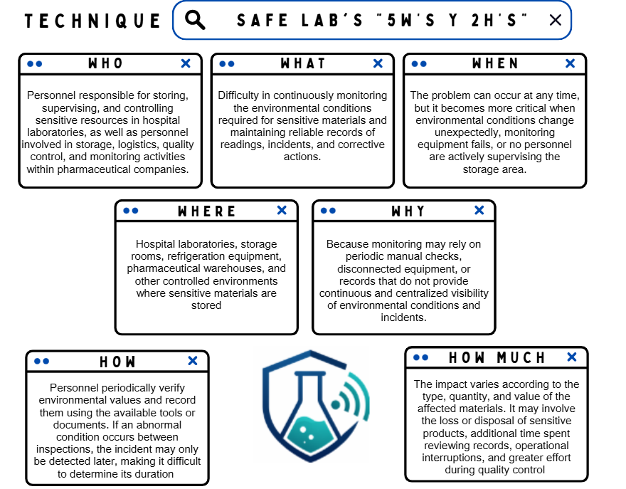
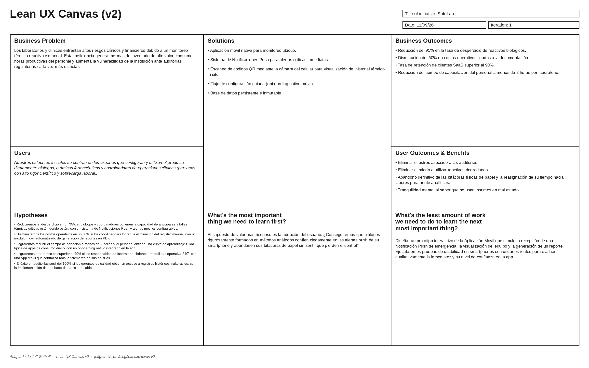

# **Chapter I: Introduction**

## **1.1. Startup Profile**

### **1.1.1. Startup Description**

  SafeLab es una startup tecnológica enfocada en la supervisión de condiciones ambientales para la conservación de muestras clínicas, reactivos, vacunas y otros productos sensibles a variaciones de temperatura o humedad. Su propuesta responde a una dificultad frecuente en laboratorios hospitalarios y organizaciones farmacéuticas: disponer de lecturas verificables, detectar desviaciones oportunamente y reconstruir los hechos cuando se presenta un incidente de almacenamiento.

  La solución reúne una aplicación web, una aplicación nativa para Android y servicios REST que permiten consultar activos, sensores, lecturas, reglas de alerta, incidentes, mantenimiento y registros de seguimiento. La información operativa se consolida mediante un backend y una base de datos relacional, con acceso diferenciado según las funciones del personal. La organización del software aplica Domain-Driven Design (DDD) y delimita doce <i>Bounded Contexts</i> para separar responsabilidades de negocio y facilitar su evolución.

El modelo comercial se dirige a organizaciones bajo un esquema B2B (<i>Business-to-Business</i>) y de suscripción SaaS (<i>Software as a Service</i>). El plan SafeLab Business contempla una cuota base de <strong>S/ 118 mensuales</strong>, que incluye diez cuentas de empleados y una cuenta de gerente general que no consume esos cupos. Cada empleado adicional representa <strong>S/ 17 mensuales</strong>. Esta estructura vincula el costo del servicio con la cantidad de personal autorizado, sin ofrecer planes ficticios o condiciones comerciales ajenas a la propuesta vigente.

SafeLab busca facilitar el seguimiento de materiales sensibles, disminuir la dependencia de registros dispersos y aportar información útil para la respuesta a incidentes y la revisión de antecedentes. Su propósito es apoyar las decisiones del personal responsable; la plataforma no sustituye los procedimientos clínicos, el mantenimiento de los equipos físicos ni la verificación de las condiciones de conservación exigidas por cada fabricante. La disponibilidad del servicio y la continuidad de las lecturas dependen también de la conectividad, de la infraestructura desplegada y de la fuente de datos utilizada.

### **1.1.2. Team Member Profiles**

<table style="width: 96%; margin: 0 auto; border-collapse: collapse;">
  <!-- MEMBER 1 -->
  <tr style="page-break-inside: avoid; break-inside: avoid;">
    <td style="text-align: center; width: 31%; vertical-align: middle; padding: 12px 10px; border-bottom: 1px solid #d9d9d9;">
      
    </td>
    <td style="text-align: justify; width: 69%; vertical-align: top; padding: 12px 12px; border-bottom: 1px solid #d9d9d9;">
      <h3 style="text-align: justify; margin: 0 0 10px 0;">Carlos Lavado, Ever Giusephi</h3>
      
<b>Código de estudiante:</b> U202224867

      
<b>Edad:</b> 21

      
<b>Carrera:</b> Ingeniería de Software

      
<b>Acerca de mí:</b> Estudio Ingeniería de Software en la Universidad Peruana de Ciencias Aplicadas (UPC). He desarrollado competencias en HTML, CSS, JavaScript, Vue, Vite, C#, ASP.NET Core, Git y GitHub, así como en consumo de servicios REST, control de versiones y documentación con Markdown. Me interesa diseñar soluciones mantenibles, analizar problemas técnicos y colaborar en equipos de desarrollo; SafeLab me permite fortalecer esas capacidades al trabajar en una solución que integra experiencias web y móviles.

    </td>
  </tr>

  <!-- MEMBER 2 -->
  <tr style="page-break-inside: avoid; break-inside: avoid;">
    <td style="text-align: center; width: 31%; vertical-align: middle; padding: 12px 10px; border-bottom: 1px solid #d9d9d9;">
      
    </td>
    <td style="text-align: justify; width: 69%; vertical-align: top; padding: 12px 12px; border-bottom: 1px solid #d9d9d9;">
      <h3 style="text-align: justify; margin: 0 0 10px 0;">Espino Rossi, Víctor Manuel</h3>
      
<b>Código de estudiante:</b> U202411567

      
<b>Edad:</b> 19

      
<b>Carrera:</b> Ingeniería de Software

      
<b>Acerca de mí:</b> Soy estudiante de Ingeniería de Software en la UPC, con interés en ciberseguridad y protección de sistemas. Valoro la iniciativa, el análisis de riesgos y la aplicación de prácticas de desarrollo que contribuyan a construir aplicaciones confiables.

    </td>
  </tr>

  <!-- MEMBER 3 -->
  <tr style="page-break-inside: avoid; break-inside: avoid;">
    <td style="text-align: center; width: 31%; vertical-align: middle; padding: 12px 10px; border-bottom: 1px solid #d9d9d9;">
      
    </td>
    <td style="text-align: justify; width: 69%; vertical-align: top; padding: 12px 12px; border-bottom: 1px solid #d9d9d9;">
      <h3 style="text-align: justify; margin: 0 0 10px 0;">García Cerpa, Braden Raid</h3>
      
<b>Código de estudiante:</b> U202415618

      
<b>Edad:</b> 21

      
<b>Carrera:</b> Ingeniería de Software

      
<b>Acerca de mí:</b> Soy estudiante de Ingeniería de Software interesado en el desarrollo de soluciones tecnológicas y en la aplicación de buenas prácticas de programación. Priorizo el trabajo colaborativo, la organización del código y la mejora progresiva de las funcionalidades para responder a necesidades reales.

    </td>
  </tr>

  <!-- MEMBER 4 -->
  <tr style="page-break-inside: avoid; break-inside: avoid;">
    <td style="text-align: center; width: 31%; vertical-align: middle; padding: 12px 10px; border-bottom: 1px solid #d9d9d9;">
      
    </td>
    <td style="text-align: justify; width: 69%; vertical-align: top; padding: 12px 12px; border-bottom: 1px solid #d9d9d9;">
      <h3 style="text-align: justify; margin: 0 0 10px 0;">Rojas Gómez, Valeria Alexandra</h3>
      
<b>Código de estudiante:</b> U202411373

      
<b>Edad:</b> 19

      
<b>Carrera:</b> Ingeniería de Software

      
<b>Acerca de mí:</b> Poseo conocimientos en desarrollo frontend y backend con Angular, Java, Spring Boot y servicios REST, además de bases de datos SQL y NoSQL. En cuanto a mis habilidades, me esfuerzo por mantenerme organizado, escuchar las opiniones de los demás y contribuir al trabajo en equipo, cumpliendo al mismo tiempo con los plazos acordados por el grupo.

    </td>
  </tr>

  <!-- MEMBER 5 -->
  <tr style="page-break-inside: avoid; break-inside: avoid;">
    <td style="text-align: center; width: 31%; vertical-align: middle; padding: 12px 10px; border-bottom: 1px solid #d9d9d9;">
      
    </td>
    <td style="text-align: justify; width: 69%; vertical-align: top; padding: 12px 12px; border-bottom: 1px solid #d9d9d9;">
      <h3 style="text-align: justify; margin: 0 0 10px 0;">Vara Velásquez, Óscar Fernando</h3>
      
<b>Código de estudiante:</b> U202411622

      
<b>Edad:</b> 21

      
<b>Carrera:</b> Ingeniería de Software

      
<b>Acerca de mí:</b> Soy estudiante de Ingeniería de Software, orientado a crear soluciones ajustadas a las necesidades de los usuarios. Me interesa adquirir conocimientos técnicos, participar en equipos de desarrollo y contribuir a la calidad de los productos mediante el aprendizaje y la colaboración.

    </td>
  </tr>
</table>

## **1.2. Solution Profile**

### **1.2.1. Background and Problem Statement**

Los laboratorios hospitalarios y las empresas farmacéuticas administran recursos cuyo desempeño o estabilidad dependen de condiciones de almacenamiento específicas. En estos entornos se conservan muestras, reactivos, medicamentos, vacunas y otros insumos; por ello, las lecturas de temperatura y humedad, los límites permitidos y el estado de los equipos deben controlarse de acuerdo con las características de cada producto. No existe un único rango térmico aplicable a todos los materiales sensibles.

Cuando la supervisión se apoya en controles manuales, planillas o registradores independientes, pueden existir intervalos sin información fácilmente consultable. Esta discontinuidad dificulta identificar una desviación fuera del horario de atención, determinar su duración y reconocer qué materiales estuvieron expuestos. La demora en comunicar una anomalía también puede incrementar el esfuerzo necesario para evaluar los efectos y registrar las medidas correctivas.

La fragmentación de registros constituye una dificultad adicional: las lecturas ambientales, las incidencias, las asignaciones de responsables y las intervenciones de mantenimiento pueden encontrarse en sistemas o documentos distintos. Para el personal de laboratorio, los responsables de calidad y los operadores farmacéuticos, esta situación complica reconstruir la secuencia de un evento y disponer de evidencia organizada para una revisión interna o una auditoría.

SafeLab responde a estas necesidades mediante la centralización de datos operativos, la consulta de activos y sensores, la definición de umbrales, la gestión de alertas e incidentes y el acceso a registros históricos. El personal autorizado puede operar desde la aplicación web y consultar funciones relevantes desde Android, mientras que los servicios REST comparten información con PostgreSQL. El alcance de la solución es el apoyo informático al monitoreo y la trazabilidad: no implica, por sí solo, que se hayan instalado sensores físicos en los establecimientos o que exista una garantía de vigilancia ininterrumpida.

Para delimitar el problema se aplicó la técnica <strong>5W y 2H</strong>, considerando quiénes realizan el seguimiento, qué dificultades afrontan, cuándo y dónde se manifiestan, por qué se producen, cómo se ejecuta la supervisión y cuáles podrían ser sus consecuencias operativas y económicas. La Figura 1 sintetiza este análisis.

<figure style="margin: 14px auto 16px auto; text-align: center; page-break-inside: avoid; break-inside: avoid;">
  
  <figcaption style="font-size: 0.9em; line-height: 1.4; margin-top: 6px; text-align: center;"><em>Figura 1. Análisis 5W y 2H de SafeLab.</em></figcaption>
</figure>

### **1.2.2. Lean UX Process**

La definición del producto parte de las dificultades de ambos segmentos objetivo y organiza las decisiones mediante un único enunciado del problema, supuestos de negocio y de usuario, hipótesis contrastables y un Lean UX Canvas. Los supuestos e hipótesis representan planteamientos sujetos a validación; no constituyen resultados observados ni garantías del servicio.

#### **1.2.2.1. Lean UX Problem Statements**

El estado actual de la supervisión ambiental de materiales sensibles en laboratorios hospitalarios y empresas farmacéuticas se ha centrado principalmente en controles periódicos, registros manuales, dispositivos aislados y revisión posterior de incidentes. Estos procedimientos pueden dificultar el acceso oportuno a las lecturas y la coordinación entre responsables.

Lo que las soluciones y procedimientos existentes no siempre resuelven es la <strong>integración de lecturas, activos, alertas, incidentes y antecedentes operativos</strong> en un entorno accesible para el personal autorizado, tanto desde una aplicación web como desde un dispositivo móvil.

SafeLab aborda esta brecha mediante una plataforma de monitoreo y gestión que utiliza servicios REST y persistencia centralizada. La solución permite visualizar equipos y sensores, gestionar umbrales y alertas, registrar incidentes, consultar datos históricos y aplicar permisos según las responsabilidades de cada usuario.

El enfoque inicial considera dos segmentos: <strong>personal de laboratorios hospitalarios</strong> que supervisa muestras y reactivos, y <strong>personal operativo o responsable de empresas farmacéuticas</strong> que controla las condiciones de almacenamiento de productos sensibles.

Se considerará que la propuesta genera valor cuando las pruebas con representantes de ambos segmentos evidencien que pueden localizar un activo, interpretar sus lecturas, identificar una alerta, registrar o consultar una incidencia y recuperar antecedentes de forma comprensible y con menor esfuerzo que en su procedimiento previo. Los tiempos, errores de ejecución y apreciaciones de los participantes se documentarán en las actividades de validación correspondientes.

#### **1.2.2.2. Lean UX Assumptions**

<strong>Business Assumptions</strong>

<ul style="text-align: justify; line-height: 1.5; margin: 4px 0 14px 0; padding-left: 25px;">
  <li style="margin-bottom: 6px;"><strong>BA-01.</strong> Creemos que las organizaciones que conservan materiales sensibles consideran relevante contar con registros ambientales centralizados y accesibles.</li>
  <li style="margin-bottom: 6px;"><strong>BA-02.</strong> Creemos que una suscripción corporativa con cupos de empleados y administración por gerente facilita evaluar el costo del servicio.</li>
  <li style="margin-bottom: 6px;"><strong>BA-03.</strong> Creemos que la posibilidad de consultar activos, alertas e incidentes desde web y Android es un elemento diferenciador para organizaciones con personal distribuido entre sedes.</li>
  <li style="margin-bottom: 6px;"><strong>BA-04.</strong> Creemos que la confianza en el manejo de permisos y en la trazabilidad de acciones influye en la disposición a adoptar SafeLab.</li>
</ul>

<strong>Business Outcome Assumptions</strong>

<ul style="text-align: justify; line-height: 1.5; margin: 4px 0 14px 0; padding-left: 25px;">
  <li style="margin-bottom: 6px;"><strong>BO-01.</strong> Creemos que una demostración comprensible de monitoreo y gestión de incidentes aumentará la proporción de instituciones interesadas en evaluar el servicio.</li>
  <li style="margin-bottom: 6px;"><strong>BO-02.</strong> Creemos que un modelo de suscripción con precio y capacidad explícitos reducirá las dudas sobre la contratación por parte de los responsables administrativos.</li>
  <li style="margin-bottom: 6px;"><strong>BO-03.</strong> Creemos que el uso recurrente de consultas de sensores y registros históricos favorecerá la continuidad de utilización del producto.</li>
  <li style="margin-bottom: 6px;"><strong>BO-04.</strong> Creemos que reducir el esfuerzo de consolidación de información ambiental fortalecerá la percepción de utilidad del servicio.</li>
</ul>

<strong>User Assumptions</strong>

<ul style="text-align: justify; line-height: 1.5; margin: 4px 0 14px 0; padding-left: 25px;">
  <li style="margin-bottom: 6px;"><strong>UA-01.</strong> Creemos que el personal técnico de laboratorios hospitalarios necesita consultar las condiciones de conservación durante sus actividades de supervisión.</li>
  <li style="margin-bottom: 6px;"><strong>UA-02.</strong> Creemos que quienes administran almacenes o equipos farmacéuticos requieren identificar desviaciones y coordinar acciones con otros responsables.</li>
  <li style="margin-bottom: 6px;"><strong>UA-03.</strong> Creemos que gerentes y responsables de calidad necesitan una vista consolidada de recursos, permisos, incidentes y antecedentes.</li>
  <li style="margin-bottom: 6px;"><strong>UA-04.</strong> Creemos que los usuarios presentan distintos niveles de familiaridad digital y que la claridad de las pantallas influirá en la facilidad de uso.</li>
</ul>

<strong>User Outcome and Benefit Assumptions</strong>

<ul style="text-align: justify; line-height: 1.5; margin: 4px 0 14px 0; padding-left: 25px;">
  <li style="margin-bottom: 6px;"><strong>UOB-01.</strong> Creemos que consultar activos y lecturas desde un mismo entorno reducirá las búsquedas en diferentes registros.</li>
  <li style="margin-bottom: 6px;"><strong>UOB-02.</strong> Creemos que las alertas asociadas a umbrales ayudarán a reconocer desviaciones que requieren revisión.</li>
  <li style="margin-bottom: 6px;"><strong>UOB-03.</strong> Creemos que el seguimiento de incidencias y responsables permitirá documentar con mayor claridad las acciones realizadas.</li>
  <li style="margin-bottom: 6px;"><strong>UOB-04.</strong> Creemos que disponer de registros históricos y reportes facilitará la preparación de revisiones internas y auditorías.</li>
  <li style="margin-bottom: 6px;"><strong>UOB-05.</strong> Creemos que los permisos según el rol reducirán la confusión sobre qué funciones puede ejecutar cada integrante.</li>
</ul>

<strong>Feature Assumptions</strong>

<ul style="text-align: justify; line-height: 1.5; margin: 4px 0 14px 0; padding-left: 25px;">
  <li style="margin-bottom: 6px;"><strong>FA-01.</strong> Creemos que un panel de consulta de activos, sensores y lecturas en la web y Android permitirá comprender el estado de los recursos supervisados.</li>
  <li style="margin-bottom: 6px;"><strong>FA-02.</strong> Creemos que la configuración de umbrales y la visualización de alertas ayudarán a priorizar la revisión de condiciones anómalas.</li>
  <li style="margin-bottom: 6px;"><strong>FA-03.</strong> Creemos que un registro de incidentes con estados y acciones de seguimiento facilitará la coordinación entre responsables.</li>
  <li style="margin-bottom: 6px;"><strong>FA-04.</strong> Creemos que la consulta de históricos y la generación de reportes reducirá la reconstrucción manual de antecedentes.</li>
  <li style="margin-bottom: 6px;"><strong>FA-05.</strong> Creemos que el control de acceso por roles, organizaciones y recursos permitirá trabajar con información pertinente para cada usuario.</li>
  <li style="margin-bottom: 6px;"><strong>FA-06.</strong> Creemos que la actualización de perfiles y la sincronización de datos entre la aplicación web y Android disminuirán los registros administrativos contradictorios.</li>
</ul>

#### **1.2.2.3. Lean UX Hypothesis Statements**

Cada hipótesis corresponde a uno de los seis supuestos de funcionalidades anteriores. Su evaluación requiere observar tareas y registrar resultados con participantes de los segmentos objetivo, sin anticipar porcentajes de mejora no medidos.

<ol style="text-align: justify; line-height: 1.5; margin: 4px 0 14px 0; padding-left: 25px;">
  <li style="margin-bottom: 10px;"><strong>H-01 / FA-01.</strong> Creemos que aumentará la utilización de la plataforma para revisar el estado de almacenamiento <strong>si</strong> el personal de laboratorio y de empresas farmacéuticas <strong>obtiene</strong> una consulta clara de activos y lecturas <strong>con</strong> un panel de monitoreo disponible en web y Android.</li>
  <li style="margin-bottom: 10px;"><strong>H-02 / FA-02.</strong> Creemos que disminuirá el tiempo necesario para identificar una condición fuera del umbral <strong>si</strong> los responsables de supervisión <strong>obtienen</strong> una señal comprensible de la anomalía <strong>con</strong> reglas configurables y una vista de alertas.</li>
  <li style="margin-bottom: 10px;"><strong>H-03 / FA-03.</strong> Creemos que mejorará la documentación de medidas ante eventos ambientales <strong>si</strong> el personal autorizado <strong>obtiene</strong> un seguimiento organizado de los hechos y sus estados <strong>con</strong> el módulo de gestión de incidentes.</li>
  <li style="margin-bottom: 10px;"><strong>H-04 / FA-04.</strong> Creemos que se reducirá el esfuerzo dedicado a reconstruir antecedentes <strong>si</strong> el personal técnico y los responsables de calidad <strong>obtienen</strong> acceso ordenado a lecturas e información histórica <strong>con</strong> las funciones de consulta y generación de reportes.</li>
  <li style="margin-bottom: 10px;"><strong>H-05 / FA-05.</strong> Creemos que disminuirán las consultas y operaciones realizadas fuera del alcance asignado <strong>si</strong> gerentes y empleados <strong>obtienen</strong> acceso coherente con sus responsabilidades <strong>con</strong> permisos definidos por rol, organización y recursos.</li>
  <li style="margin-bottom: 10px;"><strong>H-06 / FA-06.</strong> Creemos que se reducirá la duplicación de cambios administrativos <strong>si</strong> los usuarios con acceso a web y Android <strong>obtienen</strong> un perfil compartido y persistente <strong>con</strong> actualizaciones gestionadas mediante el mismo servicio REST.</li>
</ol>

#### **1.2.2.4. Lean UX Canvas**

El Lean UX Canvas integra el problema del negocio, los segmentos de usuarios, los resultados esperados, las hipótesis y las alternativas de solución consideradas durante la definición del producto. La Figura 2 conserva el artefacto visual elaborado por el equipo, que sirve como referencia de las decisiones iniciales de diseño y experimentación.

<figure style="margin: 14px auto 16px auto; text-align: center; page-break-inside: avoid; break-inside: avoid;">
  
  <figcaption style="font-size: 0.9em; line-height: 1.4; margin-top: 6px; text-align: center;"><em>Figura 2. Lean UX Canvas de SafeLab.</em></figcaption>
</figure>

## **1.3. Target Segments**

SafeLab contempla dos segmentos objetivo vinculados con la conservación de materiales que requieren supervisión ambiental: el personal de laboratorios hospitalarios y el personal de empresas farmacéuticas. La segmentación identifica a quienes ejecutan o supervisan las tareas y diferencia a estos usuarios de las organizaciones que contratan y administran el servicio.

### **Segment 1: Hospital Laboratories**

El primer segmento comprende al personal técnico, profesionales de laboratorio, coordinadores y responsables de calidad de laboratorios hospitalarios. Entre sus actividades se encuentran la revisión de condiciones de almacenamiento, la identificación de cambios relevantes en temperatura o humedad, el seguimiento del estado de equipos y la consulta de antecedentes cuando se detecta una desviación.

Se consideran usuarios adultos con experiencia y responsabilidades distintas, desde tareas operativas de supervisión hasta funciones de coordinación. Para estudiar sus necesidades es relevante registrar el cargo, el tipo de establecimiento, la frecuencia de supervisión, el uso de dispositivos móviles y las dificultades encontradas en el procedimiento vigente. Los rangos de edad empleados para planificar entrevistas no deben interpretarse como una distribución estadística de toda la población del segmento.

Como referencia del contexto institucional, el Instituto Nacional de Estadística e Informática registró <strong>23 217 establecimientos de salud en el Perú durante 2024</strong>, de los cuales <strong>637 eran hospitales</strong> (INEI, 2025). Estas cifras describen la infraestructura sanitaria nacional y no equivalen al número de laboratorios hospitalarios ni al mercado potencial contratado por SafeLab. Fuente: <a href="https://www.inei.gob.pe/media/MenuRecursivo/publicaciones_digitales/Est/CompDptal2025/Moquegua2025.pdf">Compendio Estadístico Moquegua 2025, cuadro 6.1</a>.

### **Segment 2: Pharmaceutical Companies**

El segundo segmento comprende al personal de operaciones, almacén, logística, supervisión y calidad de organizaciones farmacéuticas que conservan o distribuyen productos sensibles. Sus necesidades incluyen revisar condiciones ambientales, relacionar lecturas con equipos y ubicaciones, identificar incidentes y disponer de registros consultables durante controles de calidad o revisiones de cumplimiento.

La caracterización de los usuarios considera el cargo desempeñado, el tipo de organización, la frecuencia de seguimiento ambiental, la experiencia con herramientas digitales y la responsabilidad sobre materiales o equipos. La contratación se plantea a escala organizacional: un gerente general administra la suscripción y las cuentas de empleados autorizados, mientras las operaciones deben limitarse según los permisos asignados.

Según la Dirección General de Medicamentos, Insumos y Drogas, al <strong>30 de junio de 2025</strong> se registraban <strong>35 726 establecimientos farmacéuticos privados, autorizados y activos</strong> en el Perú, de los cuales <strong>5 166 eran droguerías</strong> (14,5 %) y <strong>191 laboratorios</strong> (0,5 %). Las dos últimas categorías suman <strong>5 357 establecimientos</strong> y ofrecen una referencia sectorial pertinente; no implican que todos requieran el servicio o pertenezcan al mercado accesible de SafeLab (DIGEMID, 2025). Fuente: <a href="https://api-repositorio-digemid.minsa.gob.pe/server/api/core/bitstreams/cb5f2246-1d9b-4f7b-a68d-0816457a2e7a/content">Boletín de establecimientos farmacéuticos, junio de 2025, p. 3</a>.

Ambos segmentos comparten la necesidad de consultar información ambiental confiable; sin embargo, difieren en el tipo de materiales conservados, los procedimientos operativos y las responsabilidades asociadas a cada puesto. Esta distinción orienta la elaboración de perfiles de usuario, historias de usuario, flujos de interacción y pruebas de validación.

