# **Chapter III: Solution UI/UX Design**

## **3.1. Product design**

<p style="text-align: justify;">
  En este capítulo se presentan las decisiones de diseño que guían la experiencia de usuario de SafeLab en sus dos puntos de contacto: la Landing Page, orientada a presentar el producto a laboratorios hospitalarios y empresas farmacéuticas, y las aplicaciones móviles para Android e iOS, utilizadas por el personal para supervisar sus equipos, atender alertas y obtener reportes. Las decisiones se basan en los hallazgos del capítulo II —User Personas, User Journey Maps y Empathy Maps—, en el Ubiquitous Language del dominio y en las épicas del Product Backlog, de modo que la interfaz utilice el mismo lenguaje y priorice las mismas tareas que el personal identificó como críticas.
</p>

### **3.1.1. Style Guidelines**

<p style="text-align: justify;">  
  Las guías de estilo establecen los lineamientos visuales y verbales que deben aplicarse de manera consistente en la Landing Page y en las aplicaciones móviles. Su objetivo es que el usuario reconozca SafeLab en cualquier plataforma y que la interfaz comunique con claridad el estado de los equipos monitoreados, aspecto central del producto. La guía se resume en la siguiente figura y se detalla en los apartados posteriores.
</p>

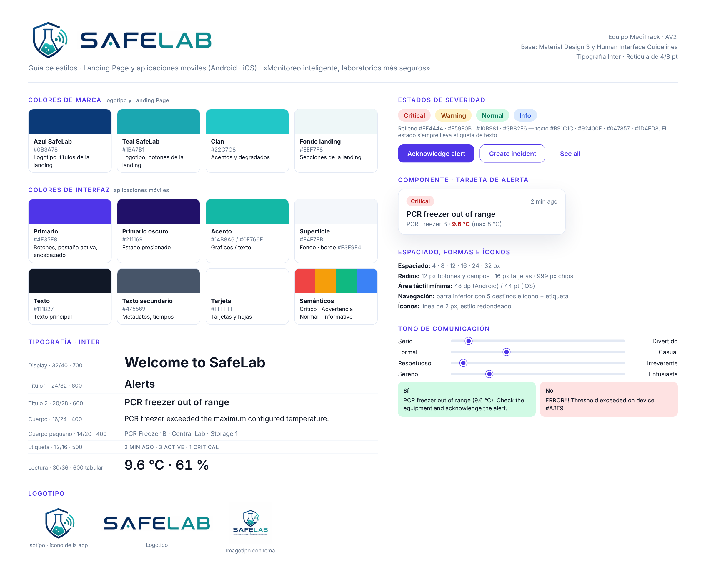

#### **3.1.1.1. General Style Guidelines**

##### **Design System de referencia y principios**

<p style="text-align: justify;">
  La guía de estilos de SafeLab toma como referencia Material Design 3 (Google, s. f.) para la aplicación Android y las Human Interface Guidelines (Apple, s. f.) para iOS, y adapta sus componentes a la identidad de la marca. Las decisiones se sustentan en cuatro principios de diseño: <b>jerarquía visual</b>, para que lo urgente —una alerta crítica o un equipo fuera de rango— sea lo primero que se percibe; <b>consistencia</b>, para que los mismos colores, etiquetas y componentes signifiquen lo mismo en la Landing Page y en las aplicaciones; <b>contraste y accesibilidad</b>, para que la información sea legible en cualquier condición de luz del laboratorio; y <b>simplicidad</b>, para que el personal resuelva cada tarea con el menor número de pasos.
</p>

##### **Branding**

<p style="text-align: justify;">
  SafeLab se presenta como un aliado confiable y preciso para el personal que protege recursos sensibles, resumido en su lema «Monitoreo inteligente, laboratorios más seguros». El logotipo cuenta con tres versiones: el isotipo, un escudo que contiene un matraz de laboratorio y ondas de señal inalámbrica, que representan la protección de los recursos y el monitoreo remoto; el logotipo, con «SAFE» en azul y «LAB» en teal; y el imagotipo, que combina ambos con el lema. El isotipo se utiliza como ícono de las aplicaciones y el logotipo e imagotipo en la Landing Page y en la pantalla de inicio de sesión. El logotipo se coloca sobre fondos claros, con un área libre mínima equivalente a la altura de la letra «S», y no se deforma, rota ni recolorea.
</p>

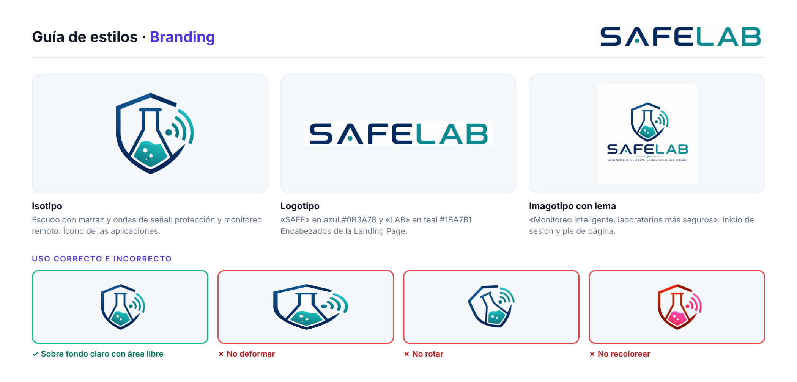

##### **Typography**

<p style="text-align: justify;">
  Se utiliza <b>Inter</b> como familia tipográfica única en la Landing Page y en las aplicaciones móviles. Es una fuente sans serif de código abierto (Andersson, s. f.), diseñada para pantallas, con alta legibilidad en tamaños pequeños y cifras tabulares que alinean las lecturas de temperatura y humedad para compararlas con rapidez. En Android se empaqueta en los recursos de la aplicación (<code>res/font</code>) y se asigna a la escala tipográfica del tema de Material 3, de modo que todos los componentes la heredan sin definir la fuente en cada pantalla; en iOS se empaqueta con la aplicación.
</p>
<table border="1" style="width: 100%; border-collapse: collapse;">
  <thead>
    <tr>
      <th style="text-align: center; vertical-align: middle; padding: 6px;">Estilo</th>
      <th style="text-align: center; vertical-align: middle; padding: 6px;">Tamaño / interlineado</th>
      <th style="text-align: center; vertical-align: middle; padding: 6px;">Peso</th>
      <th style="text-align: center; vertical-align: middle; padding: 6px;">Uso</th>
    </tr>
  </thead>
  <tbody>
    <tr>
      <td style="text-align: justify; vertical-align: top; padding: 6px;">Display</td>
      <td style="text-align: justify; vertical-align: top; padding: 6px;">32 / 40 px</td>
      <td style="text-align: justify; vertical-align: top; padding: 6px;">Bold (700)</td>
      <td style="text-align: justify; vertical-align: top; padding: 6px;">Títulos principales de la Landing Page y bienvenida</td>
    </tr>
    <tr>
      <td style="text-align: justify; vertical-align: top; padding: 6px;">Título 1</td>
      <td style="text-align: justify; vertical-align: top; padding: 6px;">24 / 32 px</td>
      <td style="text-align: justify; vertical-align: top; padding: 6px;">Semibold (600)</td>
      <td style="text-align: justify; vertical-align: top; padding: 6px;">Título de cada pantalla de la aplicación</td>
    </tr>
    <tr>
      <td style="text-align: justify; vertical-align: top; padding: 6px;">Título 2</td>
      <td style="text-align: justify; vertical-align: top; padding: 6px;">20 / 28 px</td>
      <td style="text-align: justify; vertical-align: top; padding: 6px;">Semibold (600)</td>
      <td style="text-align: justify; vertical-align: top; padding: 6px;">Título de alertas, equipos y tarjetas</td>
    </tr>
    <tr>
      <td style="text-align: justify; vertical-align: top; padding: 6px;">Cuerpo</td>
      <td style="text-align: justify; vertical-align: top; padding: 6px;">16 / 24 px</td>
      <td style="text-align: justify; vertical-align: top; padding: 6px;">Regular (400)</td>
      <td style="text-align: justify; vertical-align: top; padding: 6px;">Descripciones y mensajes</td>
    </tr>
    <tr>
      <td style="text-align: justify; vertical-align: top; padding: 6px;">Cuerpo pequeño</td>
      <td style="text-align: justify; vertical-align: top; padding: 6px;">14 / 20 px</td>
      <td style="text-align: justify; vertical-align: top; padding: 6px;">Regular (400)</td>
      <td style="text-align: justify; vertical-align: top; padding: 6px;">Equipo, sitio y área asociados</td>
    </tr>
    <tr>
      <td style="text-align: justify; vertical-align: top; padding: 6px;">Etiqueta</td>
      <td style="text-align: justify; vertical-align: top; padding: 6px;">12 / 16 px</td>
      <td style="text-align: justify; vertical-align: top; padding: 6px;">Medium (500)</td>
      <td style="text-align: justify; vertical-align: top; padding: 6px;">Marcas de tiempo, contadores y chips</td>
    </tr>
    <tr>
      <td style="text-align: justify; vertical-align: top; padding: 6px;">Lectura</td>
      <td style="text-align: justify; vertical-align: top; padding: 6px;">30 / 36 px</td>
      <td style="text-align: justify; vertical-align: top; padding: 6px;">Semibold (600), cifras tabulares</td>
      <td style="text-align: justify; vertical-align: top; padding: 6px;">Valores de temperatura y humedad</td>
    </tr>
  </tbody>
</table>

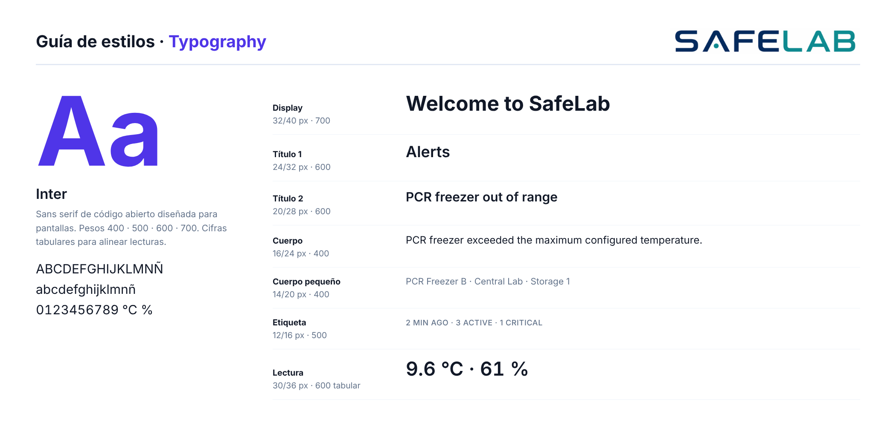

##### **Colors**

<p style="text-align: justify;">
  La paleta se organiza en tres niveles. Los <b>colores de marca</b> provienen del logotipo y se aplican en la Landing Page, donde el objetivo es comunicar la identidad de SafeLab. Los <b>colores de interfaz</b> se aplican en las aplicaciones móviles, donde el objetivo es guiar la acción del usuario: el primario índigo identifica los elementos interactivos y el acento teal mantiene el vínculo con la marca. Los <b>colores semánticos</b> se reservan para los estados de severidad y siempre se acompañan de una etiqueta de texto, de modo que el estado no dependa solo del color.
</p>

<p style="text-align: justify;">
  Para asegurar la legibilidad, el contraste se valida por <b>combinación real de texto y fondo</b>, y no solo frente al blanco, conforme a las WCAG 2.1 (World Wide Web Consortium [W3C], 2018): 4,5:1 como mínimo para texto normal (criterio 1.4.3, nivel AA) y 3:1 para texto grande —24 px regular o 18,66 px en negrita— y para componentes gráficos (criterio 1.4.11). Por ello, cada color semántico se define con tres tokens: <b>relleno</b>, para íconos, barras e indicadores; <b>fondo tenue</b>, el relleno al 14 % sobre la superficie, para el fondo de los chips; y <b>texto</b>, una variante oscura que es la única que se utiliza para escribir sobre fondos claros. El color de relleno nunca se usa como color de texto.
</p>

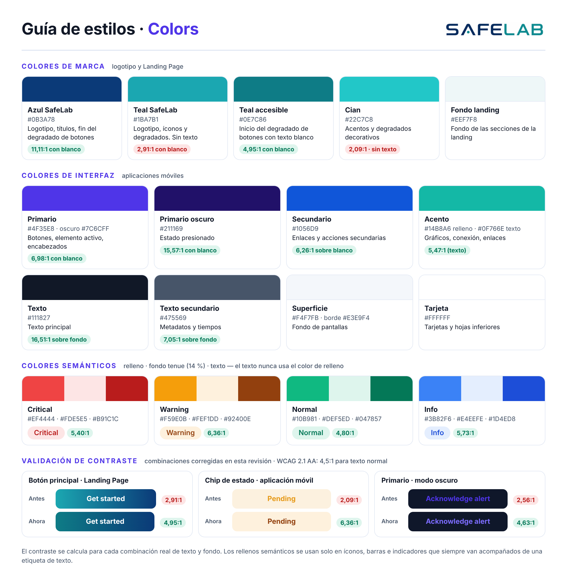

<table border="1" style="width: 100%; border-collapse: collapse;">
  <thead>
  <tr><th style="text-align: center; vertical-align: middle; padding: 6px;">Nivel</th><th style="text-align: center; vertical-align: middle; padding: 6px;">Color</th><th style="text-align: center; vertical-align: middle; padding: 6px;">Código</th><th style="text-align: center; vertical-align: middle; padding: 6px;">Contraste sobre blanco</th><th style="text-align: center; vertical-align: middle; padding: 6px;">Uso</th></tr>
  </thead>
  <tbody>
  <tr><td style="text-align: justify; vertical-align: top; padding: 6px;">Marca</td><td style="text-align: justify; vertical-align: top; padding: 6px;">Azul SafeLab</td><td style="text-align: justify; vertical-align: top; padding: 6px;">#0B3A78</td><td style="text-align: justify; vertical-align: top; padding: 6px;">11,11:1</td><td style="text-align: justify; vertical-align: top; padding: 6px;">Logotipo, títulos de la Landing Page y final del degradado de los botones principales</td></tr>
  <tr><td style="text-align: justify; vertical-align: top; padding: 6px;">Marca</td><td style="text-align: justify; vertical-align: top; padding: 6px;">Teal SafeLab</td><td style="text-align: justify; vertical-align: top; padding: 6px;">#1BA7B1</td><td style="text-align: justify; vertical-align: top; padding: 6px;">2,91:1</td><td style="text-align: justify; vertical-align: top; padding: 6px;">Logotipo, íconos y degradados decorativos. No se utiliza para texto ni como fondo de texto blanco</td></tr>
  <tr><td style="text-align: justify; vertical-align: top; padding: 6px;">Marca</td><td style="text-align: justify; vertical-align: top; padding: 6px;">Teal accesible</td><td style="text-align: justify; vertical-align: top; padding: 6px;">#0E7C86</td><td style="text-align: justify; vertical-align: top; padding: 6px;">4,95:1</td><td style="text-align: justify; vertical-align: top; padding: 6px;">Inicio del degradado de los botones principales de la Landing Page, con texto blanco</td></tr>
  <tr><td style="text-align: justify; vertical-align: top; padding: 6px;">Marca</td><td style="text-align: justify; vertical-align: top; padding: 6px;">Cian</td><td style="text-align: justify; vertical-align: top; padding: 6px;">#22C7C8</td><td style="text-align: justify; vertical-align: top; padding: 6px;">2,09:1</td><td style="text-align: justify; vertical-align: top; padding: 6px;">Acentos y degradados decorativos, sin texto</td></tr>
  <tr><td style="text-align: justify; vertical-align: top; padding: 6px;">Marca</td><td style="text-align: justify; vertical-align: top; padding: 6px;">Fondo landing</td><td style="text-align: justify; vertical-align: top; padding: 6px;">#EEF7F8</td><td style="text-align: justify; vertical-align: top; padding: 6px;">—</td><td style="text-align: justify; vertical-align: top; padding: 6px;">Fondo de las secciones de la Landing Page</td></tr>
  <tr><td style="text-align: justify; vertical-align: top; padding: 6px;">Interfaz</td><td style="text-align: justify; vertical-align: top; padding: 6px;">Primario</td><td style="text-align: justify; vertical-align: top; padding: 6px;">#4F35E8</td><td style="text-align: justify; vertical-align: top; padding: 6px;">6,98:1</td><td style="text-align: justify; vertical-align: top; padding: 6px;">Botones principales, pestaña activa y encabezados</td></tr>
  <tr><td style="text-align: justify; vertical-align: top; padding: 6px;">Interfaz</td><td style="text-align: justify; vertical-align: top; padding: 6px;">Primario oscuro</td><td style="text-align: justify; vertical-align: top; padding: 6px;">#211169</td><td style="text-align: justify; vertical-align: top; padding: 6px;">15,57:1</td><td style="text-align: justify; vertical-align: top; padding: 6px;">Estado presionado de los botones</td></tr>
  <tr><td style="text-align: justify; vertical-align: top; padding: 6px;">Interfaz</td><td style="text-align: justify; vertical-align: top; padding: 6px;">Secundario</td><td style="text-align: justify; vertical-align: top; padding: 6px;">#1056D9</td><td style="text-align: justify; vertical-align: top; padding: 6px;">6,26:1</td><td style="text-align: justify; vertical-align: top; padding: 6px;">Enlaces y acciones secundarias</td></tr>
  <tr><td style="text-align: justify; vertical-align: top; padding: 6px;">Interfaz</td><td style="text-align: justify; vertical-align: top; padding: 6px;">Acento</td><td style="text-align: justify; vertical-align: top; padding: 6px;">#14B8A6 (relleno) / #0F766E (texto)</td><td style="text-align: justify; vertical-align: top; padding: 6px;">5,47:1 (texto)</td><td style="text-align: justify; vertical-align: top; padding: 6px;">Gráficos, indicadores de conexión y enlaces secundarios</td></tr>
  <tr><td style="text-align: justify; vertical-align: top; padding: 6px;">Interfaz</td><td style="text-align: justify; vertical-align: top; padding: 6px;">Superficie</td><td style="text-align: justify; vertical-align: top; padding: 6px;">#F4F7FB / #FFFFFF</td><td style="text-align: justify; vertical-align: top; padding: 6px;">—</td><td style="text-align: justify; vertical-align: top; padding: 6px;">Fondo de pantallas / tarjetas y hojas inferiores</td></tr>
  <tr><td style="text-align: justify; vertical-align: top; padding: 6px;">Interfaz</td><td style="text-align: justify; vertical-align: top; padding: 6px;">Texto</td><td style="text-align: justify; vertical-align: top; padding: 6px;">#111827</td><td style="text-align: justify; vertical-align: top; padding: 6px;">17,74:1</td><td style="text-align: justify; vertical-align: top; padding: 6px;">Texto principal</td></tr>
  <tr><td style="text-align: justify; vertical-align: top; padding: 6px;">Interfaz</td><td style="text-align: justify; vertical-align: top; padding: 6px;">Texto secundario</td><td style="text-align: justify; vertical-align: top; padding: 6px;">#475569</td><td style="text-align: justify; vertical-align: top; padding: 6px;">7,58:1</td><td style="text-align: justify; vertical-align: top; padding: 6px;">Metadatos y marcas de tiempo, sobre tarjetas y sobre el fondo de pantalla</td></tr>
  <tr><td style="text-align: justify; vertical-align: top; padding: 6px;">Semántico</td><td style="text-align: justify; vertical-align: top; padding: 6px;">Critical</td><td style="text-align: justify; vertical-align: top; padding: 6px;">#EF4444 (relleno) / #FDE5E5 (fondo tenue) / #B91C1C (texto)</td><td style="text-align: justify; vertical-align: top; padding: 6px;">6,47:1 (texto)</td><td style="text-align: justify; vertical-align: top; padding: 6px;">Lectura fuera de rango que requiere atención inmediata</td></tr>
  <tr><td style="text-align: justify; vertical-align: top; padding: 6px;">Semántico</td><td style="text-align: justify; vertical-align: top; padding: 6px;">Warning</td><td style="text-align: justify; vertical-align: top; padding: 6px;">#F59E0B (relleno) / #FEF1DD (fondo tenue) / #92400E (texto)</td><td style="text-align: justify; vertical-align: top; padding: 6px;">7,09:1 (texto)</td><td style="text-align: justify; vertical-align: top; padding: 6px;">Lectura cercana al límite o anomalía del equipo</td></tr>
  <tr><td style="text-align: justify; vertical-align: top; padding: 6px;">Semántico</td><td style="text-align: justify; vertical-align: top; padding: 6px;">Normal</td><td style="text-align: justify; vertical-align: top; padding: 6px;">#10B981 (relleno) / #DEF5ED (fondo tenue) / #047857 (texto)</td><td style="text-align: justify; vertical-align: top; padding: 6px;">5,48:1 (texto)</td><td style="text-align: justify; vertical-align: top; padding: 6px;">Equipo con lecturas dentro del rango</td></tr>
  <tr><td style="text-align: justify; vertical-align: top; padding: 6px;">Semántico</td><td style="text-align: justify; vertical-align: top; padding: 6px;">Info</td><td style="text-align: justify; vertical-align: top; padding: 6px;">#3B82F6 (relleno) / #E4EEFE (fondo tenue) / #1D4ED8 (texto)</td><td style="text-align: justify; vertical-align: top; padding: 6px;">6,70:1 (texto)</td><td style="text-align: justify; vertical-align: top; padding: 6px;">Eventos informativos, como la pérdida de conexión de un sensor</td></tr>
  </tbody>
</table>

<p style="text-align: justify;">
  La siguiente tabla resume la validación de contraste de las combinaciones que se utilizan en la Landing Page y en la aplicación móvil. Se incluyen las combinaciones que no cumplían el nivel AA antes de esta revisión y el ajuste aplicado en cada caso.
</p>

<table border="1" style="width: 100%; border-collapse: collapse;">
  <thead>
  <tr><th style="text-align: center; vertical-align: middle; padding: 6px;">Producto</th><th style="text-align: center; vertical-align: middle; padding: 6px;">Combinación (texto / fondo)</th><th style="text-align: center; vertical-align: middle; padding: 6px;">Antes del ajuste</th><th style="text-align: center; vertical-align: middle; padding: 6px;">Después del ajuste</th><th style="text-align: center; vertical-align: middle; padding: 6px;">Resultado</th></tr>
  </thead>
  <tbody>
  <tr><td style="text-align: left; vertical-align: top; padding: 6px;">Landing Page</td><td style="text-align: left; vertical-align: top; padding: 6px;">Texto blanco del botón principal / degradado teal → azul</td><td style="text-align: justify; vertical-align: top; padding: 6px;">#FFFFFF / #1BA7B1 → #0B3A78: 2,91:1 en el extremo teal</td><td style="text-align: justify; vertical-align: top; padding: 6px;">#FFFFFF / #0E7C86 → #0B3A78: 4,95:1 a 11,11:1</td><td style="text-align: justify; vertical-align: top; padding: 6px;">✔ Cumple</td></tr>
  <tr><td style="text-align: left; vertical-align: top; padding: 6px;">Landing Page</td><td style="text-align: left; vertical-align: top; padding: 6px;">Texto / fondo de sección</td><td style="text-align: justify; vertical-align: top; padding: 6px;">#0B2F6B / #EEF7F8: 11,81:1</td><td style="text-align: justify; vertical-align: top; padding: 6px;">Sin cambios</td><td style="text-align: justify; vertical-align: top; padding: 6px;">✔ Cumple</td></tr>
  <tr><td style="text-align: left; vertical-align: top; padding: 6px;">Landing Page</td><td style="text-align: left; vertical-align: top; padding: 6px;">Texto secundario / fondo de sección</td><td style="text-align: justify; vertical-align: top; padding: 6px;">#3F6A8C / #EEF7F8: 5,28:1</td><td style="text-align: justify; vertical-align: top; padding: 6px;">Sin cambios</td><td style="text-align: justify; vertical-align: top; padding: 6px;">✔ Cumple</td></tr>
  <tr><td style="text-align: left; vertical-align: top; padding: 6px;">Aplicación móvil</td><td style="text-align: left; vertical-align: top; padding: 6px;">Texto del botón principal / primario</td><td style="text-align: justify; vertical-align: top; padding: 6px;">#FFFFFF / #4F35E8: 6,98:1</td><td style="text-align: justify; vertical-align: top; padding: 6px;">Sin cambios</td><td style="text-align: justify; vertical-align: top; padding: 6px;">✔ Cumple</td></tr>
  <tr><td style="text-align: left; vertical-align: top; padding: 6px;">Aplicación móvil</td><td style="text-align: left; vertical-align: top; padding: 6px;">Chip de estado de advertencia (texto / fondo tenue)</td><td style="text-align: justify; vertical-align: top; padding: 6px;">#E69A19 / #FCF1DF: 2,09:1</td><td style="text-align: justify; vertical-align: top; padding: 6px;">#92400E / #FEF1DD: 6,36:1</td><td style="text-align: justify; vertical-align: top; padding: 6px;">✔ Cumple</td></tr>
  <tr><td style="text-align: left; vertical-align: top; padding: 6px;">Aplicación móvil</td><td style="text-align: left; vertical-align: top; padding: 6px;">Chip de estado normal (texto / fondo tenue)</td><td style="text-align: justify; vertical-align: top; padding: 6px;">#0D9B72 / #DDF1EB: 3,00:1</td><td style="text-align: justify; vertical-align: top; padding: 6px;">#047857 / #DEF5ED: 4,80:1</td><td style="text-align: justify; vertical-align: top; padding: 6px;">✔ Cumple</td></tr>
  <tr><td style="text-align: left; vertical-align: top; padding: 6px;">Aplicación móvil</td><td style="text-align: left; vertical-align: top; padding: 6px;">Chip de estado crítico (texto / fondo tenue)</td><td style="text-align: justify; vertical-align: top; padding: 6px;">#E44848 / #FBE5E5: 3,28:1</td><td style="text-align: justify; vertical-align: top; padding: 6px;">#B91C1C / #FDE5E5: 5,40:1</td><td style="text-align: justify; vertical-align: top; padding: 6px;">✔ Cumple</td></tr>
  <tr><td style="text-align: left; vertical-align: top; padding: 6px;">Aplicación móvil</td><td style="text-align: left; vertical-align: top; padding: 6px;">Chip de estado neutro (texto / fondo tenue)</td><td style="text-align: justify; vertical-align: top; padding: 6px;">#64748B / #E9ECEF: 4,01:1</td><td style="text-align: justify; vertical-align: top; padding: 6px;">#475569 / #E9ECEF: 6,39:1</td><td style="text-align: justify; vertical-align: top; padding: 6px;">✔ Cumple</td></tr>
  <tr><td style="text-align: left; vertical-align: top; padding: 6px;">Aplicación móvil</td><td style="text-align: left; vertical-align: top; padding: 6px;">Texto secundario / fondo de pantalla</td><td style="text-align: justify; vertical-align: top; padding: 6px;">#64748B / #F4F7FB: 4,43:1</td><td style="text-align: justify; vertical-align: top; padding: 6px;">#475569 / #F4F7FB: 7,05:1</td><td style="text-align: justify; vertical-align: top; padding: 6px;">✔ Cumple</td></tr>
  <tr><td style="text-align: left; vertical-align: top; padding: 6px;">Aplicación móvil (modo oscuro)</td><td style="text-align: left; vertical-align: top; padding: 6px;">Primario / superficie oscura</td><td style="text-align: justify; vertical-align: top; padding: 6px;">#4F35E8 / #0F172A: 2,56:1</td><td style="text-align: justify; vertical-align: top; padding: 6px;">#7C6CFF / #0F172A: 4,63:1</td><td style="text-align: justify; vertical-align: top; padding: 6px;">✔ Cumple</td></tr>
  <tr><td style="text-align: left; vertical-align: top; padding: 6px;">Aplicación móvil (modo oscuro)</td><td style="text-align: left; vertical-align: top; padding: 6px;">Texto del botón principal / primario</td><td style="text-align: justify; vertical-align: top; padding: 6px;">#E5EDF9 / #4F35E8: 5,91:1</td><td style="text-align: justify; vertical-align: top; padding: 6px;">#0F172A / #7C6CFF: 4,63:1</td><td style="text-align: justify; vertical-align: top; padding: 6px;">✔ Cumple</td></tr>
  <tr><td style="text-align: left; vertical-align: top; padding: 6px;">Aplicación móvil (modo oscuro)</td><td style="text-align: left; vertical-align: top; padding: 6px;">Chip de estado crítico / fondo tenue oscuro</td><td style="text-align: justify; vertical-align: top; padding: 6px;">#E44848 / tinte sobre #111C31: 3,80:1</td><td style="text-align: justify; vertical-align: top; padding: 6px;">#FB7185 / #302234: 5,56:1</td><td style="text-align: justify; vertical-align: top; padding: 6px;">✔ Cumple</td></tr>
  <tr><td style="text-align: left; vertical-align: top; padding: 6px;">Aplicación móvil (modo oscuro)</td><td style="text-align: left; vertical-align: top; padding: 6px;">Chip de estado neutro / fondo tenue oscuro</td><td style="text-align: justify; vertical-align: top; padding: 6px;">#64748B / tinte sobre #111C31: 3,10:1</td><td style="text-align: justify; vertical-align: top; padding: 6px;">#9CAEC8 / #1D283E: 6,53:1</td><td style="text-align: justify; vertical-align: top; padding: 6px;">✔ Cumple</td></tr>
  </tbody>
</table>

<p style="text-align: justify;">
  Las aplicaciones incluyen un <b>modo oscuro</b>, que el usuario activa desde el botón de tema de la barra superior y que mantiene los mismos roles de color con valores ajustados para conservar el contraste sobre fondos oscuros. En este modo, el texto de los botones sobre el primario #7C6CFF se escribe en #0F172A, porque el blanco solo alcanza 3,86:1.
</p>
<table border="1" style="width: 100%; border-collapse: collapse;">
  <thead>
  <tr><th style="text-align: center; vertical-align: middle; padding: 6px;">Rol</th><th style="text-align: center; vertical-align: middle; padding: 6px;">Modo claro</th><th style="text-align: center; vertical-align: middle; padding: 6px;">Modo oscuro</th></tr>
  </thead>
  <tbody>
  <tr><td style="text-align: justify; vertical-align: top; padding: 6px;">Primario</td><td style="text-align: justify; vertical-align: top; padding: 6px;">#4F35E8</td><td style="text-align: justify; vertical-align: top; padding: 6px;">#7C6CFF</td></tr>
  <tr><td style="text-align: justify; vertical-align: top; padding: 6px;">Texto sobre el primario</td><td style="text-align: justify; vertical-align: top; padding: 6px;">#FFFFFF</td><td style="text-align: justify; vertical-align: top; padding: 6px;">#0F172A</td></tr>
  <tr><td style="text-align: justify; vertical-align: top; padding: 6px;">Acento</td><td style="text-align: justify; vertical-align: top; padding: 6px;">#14B8A6</td><td style="text-align: justify; vertical-align: top; padding: 6px;">#2DD4BF</td></tr>
  <tr><td style="text-align: justify; vertical-align: top; padding: 6px;">Superficie</td><td style="text-align: justify; vertical-align: top; padding: 6px;">#F4F7FB</td><td style="text-align: justify; vertical-align: top; padding: 6px;">#0F172A</td></tr>
  <tr><td style="text-align: justify; vertical-align: top; padding: 6px;">Tarjeta</td><td style="text-align: justify; vertical-align: top; padding: 6px;">#FFFFFF</td><td style="text-align: justify; vertical-align: top; padding: 6px;">#111C31</td></tr>
  <tr><td style="text-align: justify; vertical-align: top; padding: 6px;">Texto</td><td style="text-align: justify; vertical-align: top; padding: 6px;">#111827</td><td style="text-align: justify; vertical-align: top; padding: 6px;">#E5EDF9</td></tr>
  <tr><td style="text-align: justify; vertical-align: top; padding: 6px;">Texto secundario</td><td style="text-align: justify; vertical-align: top; padding: 6px;">#475569</td><td style="text-align: justify; vertical-align: top; padding: 6px;">#9CAEC8</td></tr>
  <tr><td style="text-align: justify; vertical-align: top; padding: 6px;">Borde</td><td style="text-align: justify; vertical-align: top; padding: 6px;">#E3E9F4</td><td style="text-align: justify; vertical-align: top; padding: 6px;">#24324A</td></tr>
  <tr><td style="text-align: justify; vertical-align: top; padding: 6px;">Texto de Critical / Warning / Normal / Info</td><td style="text-align: justify; vertical-align: top; padding: 6px;">#B91C1C / #92400E / #047857 / #1D4ED8</td><td style="text-align: justify; vertical-align: top; padding: 6px;">#FB7185 / #FBBF24 / #34D399 / #60A5FA</td></tr>
  </tbody>
</table>

##### **Spacing**

<p style="text-align: justify;">
  La interfaz se construye sobre una retícula de 4 y 8 pt, con valores de espaciado de 4, 8, 12, 16, 24 y 32 px. Los botones y campos de texto tienen un radio de 12 px, las tarjetas de 16 px y los chips de estado son completamente redondeados. El área táctil mínima es de 48 × 48 dp en Android y de 44 × 44 pt en iOS. La navegación principal se resuelve con una barra inferior de cinco destinos, cada uno con ícono y etiqueta, y los íconos son de línea de 2 px en estilo redondeado.
</p>

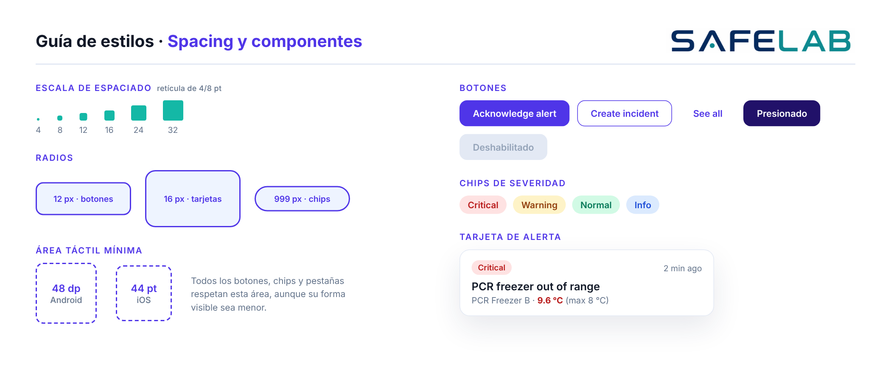

##### **Tono de comunicación**

<p style="text-align: justify;">
  El tono de SafeLab se define en cuatro dimensiones, considerando que los mensajes acompañan decisiones críticas sobre la conservación de recursos sensibles:
</p>
<table border="1" style="width: 100%; border-collapse: collapse;">
  <thead>
    <tr>
      <th style="text-align: center; vertical-align: middle; padding: 6px;">Dimensión</th>
      <th style="text-align: center; vertical-align: middle; padding: 6px;">Posición de SafeLab</th>
      <th style="text-align: center; vertical-align: middle; padding: 6px;">Justificación</th>
    </tr>
  </thead>
  <tbody>
    <tr>
      <td style="text-align: justify; vertical-align: top; padding: 6px;">Divertido / Serio</td>
      <td style="text-align: justify; vertical-align: top; padding: 6px;">Serio</td>
      <td style="text-align: justify; vertical-align: top; padding: 6px;">Las alertas comunican riesgos para muestras, reactivos y medicamentos, por lo que no se usa humor.</td>
    </tr>
    <tr>
      <td style="text-align: justify; vertical-align: top; padding: 6px;">Formal / Casual</td>
      <td style="text-align: justify; vertical-align: top; padding: 6px;">Mayormente formal</td>
      <td style="text-align: justify; vertical-align: top; padding: 6px;">Se emplea un lenguaje profesional y cercano, sin tecnicismos del sistema, adecuado para el personal de laboratorio y de calidad.</td>
    </tr>
    <tr>
      <td style="text-align: justify; vertical-align: top; padding: 6px;">Respetuoso / Irreverente</td>
      <td style="text-align: justify; vertical-align: top; padding: 6px;">Respetuoso</td>
      <td style="text-align: justify; vertical-align: top; padding: 6px;">Los mensajes no culpan al usuario y se enfocan en la acción que debe realizar.</td>
    </tr>
    <tr>
      <td style="text-align: justify; vertical-align: top; padding: 6px;">Entusiasta / Sereno</td>
      <td style="text-align: justify; vertical-align: top; padding: 6px;">Sereno</td>
      <td style="text-align: justify; vertical-align: top; padding: 6px;">Ante un incidente, el tono transmite calma y control: se evitan las mayúsculas sostenidas y los signos de exclamación repetidos.</td>
    </tr>
  </tbody>
</table>

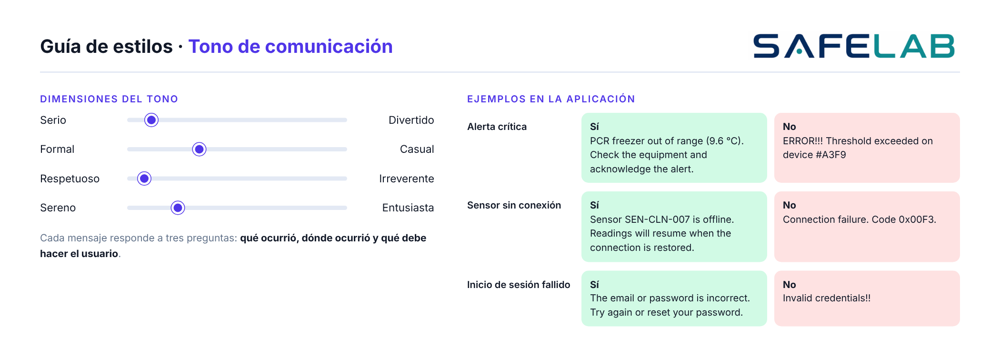

<p style="text-align: justify;">
  Cada mensaje responde a tres preguntas: qué ocurrió, dónde ocurrió y qué debe hacer el usuario. Por ejemplo, la aplicación muestra «PCR freezer out of range (9.6 °C). Check the equipment and acknowledge the alert.» en lugar de «ERROR!!! Threshold exceeded on device #A3F9». Los textos de las aplicaciones están en inglés, idioma por defecto, y la Landing Page se presenta en inglés y español.
</p>

### **3.1.2. Information Architecture**

<p style="text-align: justify;">
  La arquitectura de información define cómo se organiza, rotula y encuentra el contenido de SafeLab en la Landing Page y en las aplicaciones móviles. Se diseñó a partir de las tareas más frecuentes e importantes de la User Task Matrix —revisar el estado de los equipos, atender alertas, registrar incidentes y consultar lecturas históricas— y se refleja en las pantallas definidas en la sección 3.1.4, de modo que cada tarea crítica sea accesible en el menor número de pasos desde cualquier pantalla.
</p>
#### **3.1.2.1. Organization Systems**

<p style="text-align: justify;">
  SafeLab utiliza esquemas de organización distintos según el tipo de contenido y el producto. La Landing Page se organiza de forma <b>secuencial</b>, como una sola página cuyas secciones conducen al visitante desde la propuesta de valor hasta la acción final: registrarse o solicitar una demostración. Su estructura sigue el orden de los wireframes y mock-ups de la sección 3.1.3.
</p>

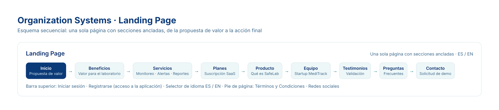

<p style="text-align: justify;">
  La aplicación móvil se organiza de forma <b>jerárquica</b> en dos niveles. El primer nivel es la barra de navegación inferior, que reúne las cuatro tareas más frecuentes del personal —Inicio, Sensores, Alertas y Equipos— y una quinta pestaña, <b>Más</b>, que agrupa los módulos de consulta menos frecuente y la cuenta del usuario. El contenido se muestra según el rol y los permisos de cada usuario: una pestaña o un módulo solo aparece si el usuario tiene permiso para verlo, y el gerente de la empresa ve además la gestión de usuarios y la suscripción. Dentro de cada pestaña, los registros relacionados se agrupan en vistas que el usuario alterna con botones (por ejemplo, Alertas e Incidentes), y cada registro abre su detalle y sus acciones disponibles.
</p>

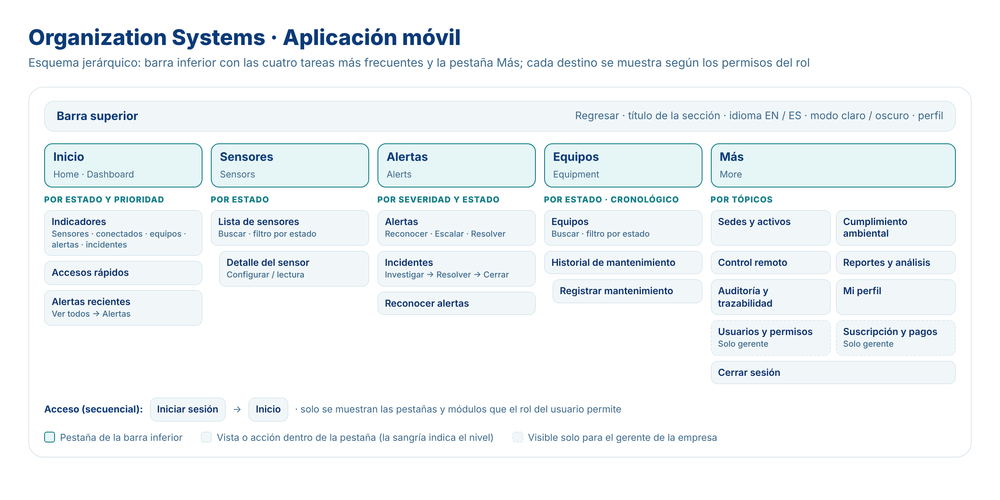

<table border="1" style="width: 100%; border-collapse: collapse;">
  <thead>
  <tr><th style="text-align: center; vertical-align: middle; padding: 6px;">Grupo de información</th><th style="text-align: center; vertical-align: middle; padding: 6px;">Organización visual</th><th style="text-align: center; vertical-align: middle; padding: 6px;">Esquema de categorización</th><th style="text-align: center; vertical-align: middle; padding: 6px;">Justificación</th></tr>
  </thead>
  <tbody>
  <tr><td style="text-align: justify; vertical-align: top; padding: 6px;">Landing Page</td><td style="text-align: justify; vertical-align: top; padding: 6px;">Secuencial</td><td style="text-align: justify; vertical-align: top; padding: 6px;">Por tópicos</td><td style="text-align: justify; vertical-align: top; padding: 6px;">Las secciones Home, Benefits, Services, Plans, About Product, About Team, Testimonials, FAQ y Contact llevan al visitante del problema a la acción.</td></tr>
  <tr><td style="text-align: justify; vertical-align: top; padding: 6px;">Inicio (Home)</td><td style="text-align: justify; vertical-align: top; padding: 6px;">Jerárquica</td><td style="text-align: justify; vertical-align: top; padding: 6px;">Por estado y prioridad</td><td style="text-align: justify; vertical-align: top; padding: 6px;">El panel principal muestra primero los indicadores que requieren atención —sensores conectados, alertas activas e investigaciones abiertas—, luego los accesos rápidos y las alertas más recientes.</td></tr>
  <tr><td style="text-align: justify; vertical-align: top; padding: 6px;">Sensores (Sensors)</td><td style="text-align: justify; vertical-align: top; padding: 6px;">Jerárquica</td><td style="text-align: justify; vertical-align: top; padding: 6px;">Por estado</td><td style="text-align: justify; vertical-align: top; padding: 6px;">La lista de sensores se puede buscar y filtrar por estado (normal, fuera de rango, desconectado); cada sensor abre su detalle con la lectura actual y su rango.</td></tr>
  <tr><td style="text-align: justify; vertical-align: top; padding: 6px;">Alertas (Alerts)</td><td style="text-align: justify; vertical-align: top; padding: 6px;">Jerárquica</td><td style="text-align: justify; vertical-align: top; padding: 6px;">Por severidad y estado</td><td style="text-align: justify; vertical-align: top; padding: 6px;">La pestaña alterna entre Alertas e Incidentes. Las alertas activas se listan con su severidad y estado, y el panel «Reconocer alertas» reúne las que aún no se han atendido.</td></tr>
  <tr><td style="text-align: justify; vertical-align: top; padding: 6px;">Equipos (Equipment)</td><td style="text-align: justify; vertical-align: top; padding: 6px;">Jerárquica</td><td style="text-align: justify; vertical-align: top; padding: 6px;">Por estado y cronológico</td><td style="text-align: justify; vertical-align: top; padding: 6px;">La pestaña alterna entre la lista de equipos y su historial de mantenimiento, que se presenta del registro más reciente al más antiguo.</td></tr>
  <tr><td style="text-align: justify; vertical-align: top; padding: 6px;">Más (More)</td><td style="text-align: justify; vertical-align: top; padding: 6px;">Jerárquica</td><td style="text-align: justify; vertical-align: top; padding: 6px;">Por tópicos</td><td style="text-align: justify; vertical-align: top; padding: 6px;">Agrupa Sedes y activos, Cumplimiento ambiental, Control remoto, Reportes y análisis, y Auditoría y trazabilidad; para el gerente, también Usuarios y permisos, y Suscripción y pagos. Al final se ubican Mi perfil y Cerrar sesión.</td></tr>
  <tr><td style="text-align: justify; vertical-align: top; padding: 6px;">Acceso (Identity &amp; Access Management)</td><td style="text-align: justify; vertical-align: top; padding: 6px;">Secuencial</td><td style="text-align: justify; vertical-align: top; padding: 6px;">—</td><td style="text-align: justify; vertical-align: top; padding: 6px;">Inicio de sesión → panel principal. Después de autenticarse, el usuario ve solo las pestañas y módulos que su rol le permite.</td></tr>
  <tr><td style="text-align: justify; vertical-align: top; padding: 6px;">Flujos de varios pasos</td><td style="text-align: justify; vertical-align: top; padding: 6px;">Secuencial</td><td style="text-align: justify; vertical-align: top; padding: 6px;">—</td><td style="text-align: justify; vertical-align: top; padding: 6px;">Alerta → Acciones → Reconocer o Escalar (abre un incidente); Incidente → Investigar → Resolver → Cerrar; Equipos → Registrar mantenimiento; Reportes → Generar reporte.</td></tr>
  </tbody>
</table>
#### **3.1.2.2. Labeling Systems**

<p style="text-align: justify;">
  El sistema de rotulación traduce los términos del Ubiquitous Language a etiquetas breves, de una a tres palabras, que se usan igual en todas las pantallas. Tanto la Landing Page como la aplicación móvil están disponibles en inglés y en español: en la aplicación, el usuario cambia de idioma desde el botón de la barra superior y todas las etiquetas se actualizan sin salir de la pantalla en la que se encuentra. Cada destino de navegación se acompaña de un ícono y cada estado se acompaña de un color semántico con su etiqueta de texto, sin depender únicamente del color.
</p>

##### **Etiquetas de navegación**

<table border="1" style="width: 100%; border-collapse: collapse;">
  <thead>
  <tr><th style="text-align: center; vertical-align: middle; padding: 6px;">Etiqueta (inglés)</th><th style="text-align: center; vertical-align: middle; padding: 6px;">Etiqueta (español)</th><th style="text-align: center; vertical-align: middle; padding: 6px;">Ubicación</th><th style="text-align: center; vertical-align: middle; padding: 6px;">Contenido que agrupa</th></tr>
  </thead>
  <tbody>
  <tr><td style="text-align: justify; vertical-align: top; padding: 6px;">Home</td><td style="text-align: justify; vertical-align: top; padding: 6px;">Inicio</td><td style="text-align: justify; vertical-align: top; padding: 6px;">Barra inferior</td><td style="text-align: justify; vertical-align: top; padding: 6px;">Panel principal con indicadores, accesos rápidos y alertas recientes.</td></tr>
  <tr><td style="text-align: justify; vertical-align: top; padding: 6px;">Sensors</td><td style="text-align: justify; vertical-align: top; padding: 6px;">Sensores</td><td style="text-align: justify; vertical-align: top; padding: 6px;">Barra inferior</td><td style="text-align: justify; vertical-align: top; padding: 6px;">Sensores asignados, lecturas actuales y estado de conexión.</td></tr>
  <tr><td style="text-align: justify; vertical-align: top; padding: 6px;">Alerts</td><td style="text-align: justify; vertical-align: top; padding: 6px;">Alertas</td><td style="text-align: justify; vertical-align: top; padding: 6px;">Barra inferior</td><td style="text-align: justify; vertical-align: top; padding: 6px;">Alertas e incidentes, con la opción de reconocer alertas.</td></tr>
  <tr><td style="text-align: justify; vertical-align: top; padding: 6px;">Equipment</td><td style="text-align: justify; vertical-align: top; padding: 6px;">Equipos</td><td style="text-align: justify; vertical-align: top; padding: 6px;">Barra inferior</td><td style="text-align: justify; vertical-align: top; padding: 6px;">Equipos registrados e historial de mantenimiento.</td></tr>
  <tr><td style="text-align: justify; vertical-align: top; padding: 6px;">More</td><td style="text-align: justify; vertical-align: top; padding: 6px;">Más</td><td style="text-align: justify; vertical-align: top; padding: 6px;">Barra inferior</td><td style="text-align: justify; vertical-align: top; padding: 6px;">Módulos de consulta menos frecuente y opciones de la cuenta.</td></tr>
  <tr><td style="text-align: justify; vertical-align: top; padding: 6px;">Facilities &amp; assets</td><td style="text-align: justify; vertical-align: top; padding: 6px;">Sedes y activos</td><td style="text-align: justify; vertical-align: top; padding: 6px;">Más</td><td style="text-align: justify; vertical-align: top; padding: 6px;">Sedes de la empresa y sus activos.</td></tr>
  <tr><td style="text-align: justify; vertical-align: top; padding: 6px;">Environmental compliance</td><td style="text-align: justify; vertical-align: top; padding: 6px;">Cumplimiento ambiental</td><td style="text-align: justify; vertical-align: top; padding: 6px;">Más</td><td style="text-align: justify; vertical-align: top; padding: 6px;">Reglas ambientales, evaluaciones e incumplimientos.</td></tr>
  <tr><td style="text-align: justify; vertical-align: top; padding: 6px;">Remote control</td><td style="text-align: justify; vertical-align: top; padding: 6px;">Control remoto</td><td style="text-align: justify; vertical-align: top; padding: 6px;">Más</td><td style="text-align: justify; vertical-align: top; padding: 6px;">Dispositivos remotos e historial de comandos.</td></tr>
  <tr><td style="text-align: justify; vertical-align: top; padding: 6px;">Reports &amp; analytics</td><td style="text-align: justify; vertical-align: top; padding: 6px;">Reportes y análisis</td><td style="text-align: justify; vertical-align: top; padding: 6px;">Más</td><td style="text-align: justify; vertical-align: top; padding: 6px;">Reportes generados y su generación.</td></tr>
  <tr><td style="text-align: justify; vertical-align: top; padding: 6px;">Audit &amp; traceability</td><td style="text-align: justify; vertical-align: top; padding: 6px;">Auditoría y trazabilidad</td><td style="text-align: justify; vertical-align: top; padding: 6px;">Más</td><td style="text-align: justify; vertical-align: top; padding: 6px;">Registro de acciones de los usuarios.</td></tr>
  <tr><td style="text-align: justify; vertical-align: top; padding: 6px;">Users &amp; permissions</td><td style="text-align: justify; vertical-align: top; padding: 6px;">Usuarios y permisos</td><td style="text-align: justify; vertical-align: top; padding: 6px;">Más (solo gerente)</td><td style="text-align: justify; vertical-align: top; padding: 6px;">Empleados, invitaciones y accesos.</td></tr>
  <tr><td style="text-align: justify; vertical-align: top; padding: 6px;">Subscription &amp; billing</td><td style="text-align: justify; vertical-align: top; padding: 6px;">Suscripción y pagos</td><td style="text-align: justify; vertical-align: top; padding: 6px;">Más (solo gerente)</td><td style="text-align: justify; vertical-align: top; padding: 6px;">Plan, cupos y recibos.</td></tr>
  <tr><td style="text-align: justify; vertical-align: top; padding: 6px;">My profile / Sign out</td><td style="text-align: justify; vertical-align: top; padding: 6px;">Mi perfil / Cerrar sesión</td><td style="text-align: justify; vertical-align: top; padding: 6px;">Más y barra superior</td><td style="text-align: justify; vertical-align: top; padding: 6px;">Datos del usuario y cierre de sesión.</td></tr>
  </tbody>
</table>

##### **Etiquetas del dominio**

<table border="1" style="width: 100%; border-collapse: collapse;">
  <thead>
  <tr><th style="text-align: center; vertical-align: middle; padding: 6px;">Término del dominio</th><th style="text-align: center; vertical-align: middle; padding: 6px;">Etiqueta (inglés / español)</th><th style="text-align: center; vertical-align: middle; padding: 6px;">Ejemplo en las pantallas</th></tr>
  </thead>
  <tbody>
  <tr><td style="text-align: justify; vertical-align: top; padding: 6px;">Facility</td><td style="text-align: justify; vertical-align: top; padding: 6px;">Facility / Sede</td><td style="text-align: justify; vertical-align: top; padding: 6px;">Andinos Central Laboratory</td></tr>
  <tr><td style="text-align: justify; vertical-align: top; padding: 6px;">Monitored Equipment</td><td style="text-align: justify; vertical-align: top; padding: 6px;">Equipment / Equipo</td><td style="text-align: justify; vertical-align: top; padding: 6px;">Reagent Freezer A</td></tr>
  <tr><td style="text-align: justify; vertical-align: top; padding: 6px;">Environmental Sensor</td><td style="text-align: justify; vertical-align: top; padding: 6px;">Sensor / Sensor</td><td style="text-align: justify; vertical-align: top; padding: 6px;">Reagent Freezer Temperature · SEN-CLN-001</td></tr>
  <tr><td style="text-align: justify; vertical-align: top; padding: 6px;">Environmental Reading</td><td style="text-align: justify; vertical-align: top; padding: 6px;">Reading / Lectura</td><td style="text-align: justify; vertical-align: top; padding: 6px;">3.8 °C</td></tr>
  <tr><td style="text-align: justify; vertical-align: top; padding: 6px;">Environmental Threshold</td><td style="text-align: justify; vertical-align: top; padding: 6px;">Range / Rango</td><td style="text-align: justify; vertical-align: top; padding: 6px;">2–8 °C</td></tr>
  <tr><td style="text-align: justify; vertical-align: top; padding: 6px;">Alert</td><td style="text-align: justify; vertical-align: top; padding: 6px;">Alert / Alerta</td><td style="text-align: justify; vertical-align: top; padding: 6px;">PCR freezer out of range</td></tr>
  <tr><td style="text-align: justify; vertical-align: top; padding: 6px;">Incident</td><td style="text-align: justify; vertical-align: top; padding: 6px;">Incident / Incidente</td><td style="text-align: justify; vertical-align: top; padding: 6px;">INC-001 · PCR freezer deviation</td></tr>
  <tr><td style="text-align: justify; vertical-align: top; padding: 6px;">Maintenance Record</td><td style="text-align: justify; vertical-align: top; padding: 6px;">Maintenance history / Historial de mantenimiento</td><td style="text-align: justify; vertical-align: top; padding: 6px;">Door gasket replaced and alarm tested.</td></tr>
  <tr><td style="text-align: justify; vertical-align: top; padding: 6px;">Compliance Report</td><td style="text-align: justify; vertical-align: top; padding: 6px;">Report / Reporte</td><td style="text-align: justify; vertical-align: top; padding: 6px;">Cold Chain Executive Summary</td></tr>
  </tbody>
</table>

##### **Etiquetas de acciones**

<table border="1" style="width: 100%; border-collapse: collapse;">
  <thead>
  <tr><th style="text-align: center; vertical-align: middle; padding: 6px;">Contexto</th><th style="text-align: center; vertical-align: middle; padding: 6px;">Etiqueta (inglés / español)</th><th style="text-align: center; vertical-align: middle; padding: 6px;">Resultado</th></tr>
  </thead>
  <tbody>
  <tr><td style="text-align: justify; vertical-align: top; padding: 6px;">Listas</td><td style="text-align: justify; vertical-align: top; padding: 6px;">Search records / Buscar registros</td><td style="text-align: justify; vertical-align: top; padding: 6px;">Filtra la lista con el texto ingresado.</td></tr>
  <tr><td style="text-align: justify; vertical-align: top; padding: 6px;">Listas</td><td style="text-align: justify; vertical-align: top; padding: 6px;">Status / Estado</td><td style="text-align: justify; vertical-align: top; padding: 6px;">Filtra la lista por el estado del registro.</td></tr>
  <tr><td style="text-align: justify; vertical-align: top; padding: 6px;">Listas</td><td style="text-align: justify; vertical-align: top; padding: 6px;">Refresh data / Actualizar datos</td><td style="text-align: justify; vertical-align: top; padding: 6px;">Sincroniza la información con SafeLab Platform API.</td></tr>
  <tr><td style="text-align: justify; vertical-align: top; padding: 6px;">Inicio</td><td style="text-align: justify; vertical-align: top; padding: 6px;">View all / Ver todos</td><td style="text-align: justify; vertical-align: top; padding: 6px;">Abre la lista completa de alertas.</td></tr>
  <tr><td style="text-align: justify; vertical-align: top; padding: 6px;">Alertas</td><td style="text-align: justify; vertical-align: top; padding: 6px;">Acknowledge / Reconocer</td><td style="text-align: justify; vertical-align: top; padding: 6px;">Confirma que el personal atendió la alerta.</td></tr>
  <tr><td style="text-align: justify; vertical-align: top; padding: 6px;">Alertas</td><td style="text-align: justify; vertical-align: top; padding: 6px;">Escalate / Escalar</td><td style="text-align: justify; vertical-align: top; padding: 6px;">Escala la alerta y abre un incidente vinculado.</td></tr>
  <tr><td style="text-align: justify; vertical-align: top; padding: 6px;">Alertas</td><td style="text-align: justify; vertical-align: top; padding: 6px;">Resolve alert / Resolver alerta</td><td style="text-align: justify; vertical-align: top; padding: 6px;">Marca la alerta como resuelta.</td></tr>
  <tr><td style="text-align: justify; vertical-align: top; padding: 6px;">Incidentes</td><td style="text-align: justify; vertical-align: top; padding: 6px;">Investigate / Investigar · Resolve incident / Resolver incidente · Close incident / Cerrar incidente</td><td style="text-align: justify; vertical-align: top; padding: 6px;">Avanza el incidente en su ciclo de atención.</td></tr>
  <tr><td style="text-align: justify; vertical-align: top; padding: 6px;">Sensores</td><td style="text-align: justify; vertical-align: top; padding: 6px;">Configure / reading / Configurar / lectura</td><td style="text-align: justify; vertical-align: top; padding: 6px;">Configura los límites del sensor o registra una lectura.</td></tr>
  <tr><td style="text-align: justify; vertical-align: top; padding: 6px;">Alertas</td><td style="text-align: justify; vertical-align: top; padding: 6px;">Create incident / Registrar incidente</td><td style="text-align: justify; vertical-align: top; padding: 6px;">Registra un incidente vinculado a una sede.</td></tr>
  <tr><td style="text-align: justify; vertical-align: top; padding: 6px;">Equipos</td><td style="text-align: justify; vertical-align: top; padding: 6px;">Add equipment / Agregar equipo</td><td style="text-align: justify; vertical-align: top; padding: 6px;">Registra un nuevo equipo (según permisos).</td></tr>
  <tr><td style="text-align: justify; vertical-align: top; padding: 6px;">Equipos</td><td style="text-align: justify; vertical-align: top; padding: 6px;">Record maintenance / Registrar mantenimiento</td><td style="text-align: justify; vertical-align: top; padding: 6px;">Registra un trabajo de mantenimiento.</td></tr>
  <tr><td style="text-align: justify; vertical-align: top; padding: 6px;">Sensores</td><td style="text-align: justify; vertical-align: top; padding: 6px;">Add sensor / Agregar sensor</td><td style="text-align: justify; vertical-align: top; padding: 6px;">Registra un nuevo sensor (según permisos).</td></tr>
  <tr><td style="text-align: justify; vertical-align: top; padding: 6px;">Reportes</td><td style="text-align: justify; vertical-align: top; padding: 6px;">Generate report / Generar reporte</td><td style="text-align: justify; vertical-align: top; padding: 6px;">Genera el registro de un reporte.</td></tr>
  <tr><td style="text-align: justify; vertical-align: top; padding: 6px;">Registros</td><td style="text-align: justify; vertical-align: top; padding: 6px;">Actions / Acciones</td><td style="text-align: justify; vertical-align: top; padding: 6px;">Menú con las acciones que el rol del usuario permite sobre el registro seleccionado.</td></tr>
  <tr><td style="text-align: justify; vertical-align: top; padding: 6px;">Cuenta</td><td style="text-align: justify; vertical-align: top; padding: 6px;">Sign out / Cerrar sesión</td><td style="text-align: justify; vertical-align: top; padding: 6px;">Cierra la sesión.</td></tr>
  </tbody>
</table>

##### **Etiquetas de estado**

<table border="1" style="width: 100%; border-collapse: collapse;">
  <thead>
  <tr><th style="text-align: center; vertical-align: middle; padding: 6px;">Grupo</th><th style="text-align: center; vertical-align: middle; padding: 6px;">Etiquetas (inglés / español)</th><th style="text-align: center; vertical-align: middle; padding: 6px;">Color semántico</th></tr>
  </thead>
  <tbody>
  <tr><td style="text-align: justify; vertical-align: top; padding: 6px;">Normales</td><td style="text-align: justify; vertical-align: top; padding: 6px;">Normal / Normal · Online / Conectado · Compliant / Conforme · Resolved / Resuelto · Reviewed / Revisado</td><td style="text-align: justify; vertical-align: top; padding: 6px;">Normal</td></tr>
  <tr><td style="text-align: justify; vertical-align: top; padding: 6px;">De atención</td><td style="text-align: justify; vertical-align: top; padding: 6px;">Pending / Pendiente · Acknowledged / Reconocido · In progress / En progreso · Maintenance / Mantenimiento · Offline / Desconectado</td><td style="text-align: justify; vertical-align: top; padding: 6px;">Warning</td></tr>
  <tr><td style="text-align: justify; vertical-align: top; padding: 6px;">Críticos</td><td style="text-align: justify; vertical-align: top; padding: 6px;">Critical / Crítico · Open / Abierto · Violation / Incumplimiento · Blocked / Bloqueado · Active (alertas e incidentes) / Activo</td><td style="text-align: justify; vertical-align: top; padding: 6px;">Critical</td></tr>
  <tr><td style="text-align: justify; vertical-align: top; padding: 6px;">Otros</td><td style="text-align: justify; vertical-align: top; padding: 6px;">Cancelled / Cancelado y estados sin categoría</td><td style="text-align: justify; vertical-align: top; padding: 6px;">Neutro (texto secundario)</td></tr>
  </tbody>
</table>
<p style="text-align: justify;">
  Las lecturas se muestran con su unidad, por ejemplo, 3.8 °C para temperatura o 46 % para humedad.
</p>

#### **3.1.2.3. SEO Tags and Meta Tags**

<p style="text-align: justify;">
  Los SEO Tags y Meta Tags permiten que los motores de búsqueda indexen correctamente la Landing Page y que las tiendas de aplicaciones muestren SafeLab ante las búsquedas de su público objetivo. Las palabras clave se seleccionaron a partir de los términos que utilizaron los entrevistados para describir su problema, como temperatura, cadena de frío, alertas y auditorías de la DIGEMID.
</p>

##### **Landing Page**

<p style="text-align: justify;">
  La siguiente tabla presenta las etiquetas de la cabecera de la Landing Page publicada. El título y la descripción se traducen con el selector de idioma (atributos <code>data-i18n</code>), por lo que el buscador y la pestaña del navegador muestran el texto en el idioma elegido.
</p>

<table border="1" style="width: 100%; border-collapse: collapse;">
  <thead>
  <tr><th style="text-align: center; vertical-align: middle; padding: 6px;">Etiqueta</th><th style="text-align: center; vertical-align: middle; padding: 6px;">Valor</th><th style="text-align: center; vertical-align: middle; padding: 6px;">Criterio</th></tr>
  </thead>
  <tbody>
  <tr><td style="text-align: left; vertical-align: top; padding: 6px;"><code>&lt;html lang&gt;</code></td><td style="text-align: justify; vertical-align: top; padding: 6px;">en</td><td style="text-align: justify; vertical-align: top; padding: 6px;">Declara el idioma principal de la página.</td></tr>
  <tr><td style="text-align: left; vertical-align: top; padding: 6px;">Title</td><td style="text-align: justify; vertical-align: top; padding: 6px;">SafeLab | Real-Time Cold Chain Monitoring</td><td style="text-align: justify; vertical-align: top; padding: 6px;">41 caracteres; incluye la marca y la palabra clave principal por debajo del límite recomendado de 60 caracteres.</td></tr>
  <tr><td style="text-align: left; vertical-align: top; padding: 6px;">Meta description</td><td style="text-align: justify; vertical-align: top; padding: 6px;">SafeLab helps clinical laboratories, hospitals and pharmacy networks monitor cold-chain conditions, detect risks early and maintain audit-ready traceability.</td><td style="text-align: justify; vertical-align: top; padding: 6px;">Resume el público objetivo y los tres beneficios principales (monitoreo, detección temprana y trazabilidad).</td></tr>
  <tr><td style="text-align: left; vertical-align: top; padding: 6px;">Meta author</td><td style="text-align: justify; vertical-align: top; padding: 6px;">SafeLab</td><td style="text-align: justify; vertical-align: top; padding: 6px;">Identifica al responsable del sitio.</td></tr>
  <tr><td style="text-align: left; vertical-align: top; padding: 6px;">Meta robots</td><td style="text-align: justify; vertical-align: top; padding: 6px;">index, follow</td><td style="text-align: justify; vertical-align: top; padding: 6px;">Permite indexar la página y seguir sus enlaces.</td></tr>
  <tr><td style="text-align: left; vertical-align: top; padding: 6px;">Meta theme-color</td><td style="text-align: justify; vertical-align: top; padding: 6px;">#0b3a78</td><td style="text-align: justify; vertical-align: top; padding: 6px;">Colorea la barra del navegador móvil con el Azul SafeLab.</td></tr>
  <tr><td style="text-align: left; vertical-align: top; padding: 6px;">Viewport</td><td style="text-align: justify; vertical-align: top; padding: 6px;">width=device-width, initial-scale=1.0, viewport-fit=cover</td><td style="text-align: justify; vertical-align: top; padding: 6px;">Adapta la página al ancho de los dispositivos móviles.</td></tr>
  <tr><td style="text-align: left; vertical-align: top; padding: 6px;">Favicon / apple-touch-icon</td><td style="text-align: justify; vertical-align: top; padding: 6px;">assets/images/logos/favicon.png</td><td style="text-align: justify; vertical-align: top; padding: 6px;">Identifica la marca en la pestaña, los marcadores y la pantalla de inicio de iOS.</td></tr>
  <tr><td style="text-align: left; vertical-align: top; padding: 6px;">Open Graph</td><td style="text-align: justify; vertical-align: top; padding: 6px;">og:type, og:title, og:description</td><td style="text-align: justify; vertical-align: top; padding: 6px;">Vista previa al compartir el enlace en redes sociales y aplicaciones de mensajería.</td></tr>
  </tbody>
</table>

<p style="text-align: justify;">
  Para completar la vista previa al compartir el enlace y evitar contenido duplicado en el buscador, se incorporan las siguientes etiquetas:
</p>

<table border="1" style="width: 100%; border-collapse: collapse;">
  <thead>
  <tr><th style="text-align: center; vertical-align: middle; padding: 6px;">Etiqueta</th><th style="text-align: center; vertical-align: middle; padding: 6px;">Valor</th><th style="text-align: center; vertical-align: middle; padding: 6px;">Criterio</th></tr>
  </thead>
  <tbody>
  <tr><td style="text-align: left; vertical-align: top; padding: 6px;">Canonical</td><td style="text-align: justify; vertical-align: top; padding: 6px;">https://meditrack-mobile-app-1acc0238-2620-4949.github.io/safelab-business-website/</td><td style="text-align: justify; vertical-align: top; padding: 6px;">Indica al buscador la URL principal de la página.</td></tr>
  <tr><td style="text-align: left; vertical-align: top; padding: 6px;">og:url / og:image / og:locale</td><td style="text-align: justify; vertical-align: top; padding: 6px;">URL pública, imagen del isotipo, en_US con alternativa es_PE</td><td style="text-align: justify; vertical-align: top; padding: 6px;">Completan la tarjeta de vista previa con la dirección, la imagen y el idioma.</td></tr>
  <tr><td style="text-align: left; vertical-align: top; padding: 6px;">Meta keywords</td><td style="text-align: justify; vertical-align: top; padding: 6px;">cold chain monitoring, temperature monitoring, humidity monitoring, clinical laboratory, pharmaceutical storage, real-time alerts, audit reports, DIGEMID</td><td style="text-align: justify; vertical-align: top; padding: 6px;">Términos del vocabulario de los segmentos objetivo y de la propuesta de valor.</td></tr>
  </tbody>
</table>

```html
<link
  rel="canonical"
  href="https://meditrack-mobile-app-1acc0238-2620-4949.github.io/safelab-business-website/"
/>
<meta
  name="keywords"
  content="cold chain monitoring, temperature monitoring, humidity monitoring, clinical laboratory, pharmaceutical storage, real-time alerts, audit reports, DIGEMID"
/>
<meta
  property="og:url"
  content="https://meditrack-mobile-app-1acc0238-2620-4949.github.io/safelab-business-website/"
/>
<meta
  property="og:image"
  content="https://meditrack-mobile-app-1acc0238-2620-4949.github.io/safelab-business-website/assets/images/logos/safelab-shield.png"
/>
<meta property="og:locale" content="en_US" />
<meta property="og:locale:alternate" content="es_PE" />
```

##### **Aplicaciones móviles (App Store Optimization)**

<p style="text-align: justify;">
  En las aplicaciones móviles, el equivalente a las meta tags son los metadatos de las fichas en Google Play y App Store, que determinan cómo se encuentra y presenta la aplicación en cada tienda. Como la aplicación está disponible en inglés y en español, se publica una ficha en cada idioma: la ficha en inglés como principal y la ficha en español para el mercado peruano.
</p>

<table border="1" style="width: 100%; border-collapse: collapse;">
  <thead>
  <tr><th style="text-align: center; vertical-align: middle; padding: 6px;">Tienda</th><th style="text-align: center; vertical-align: middle; padding: 6px;">Campo</th><th style="text-align: center; vertical-align: middle; padding: 6px;">Valor (inglés)</th><th style="text-align: center; vertical-align: middle; padding: 6px;">Valor (español)</th></tr>
  </thead>
  <tbody>
  <tr><td style="text-align: left; vertical-align: top; padding: 6px;">Google Play</td><td style="text-align: left; vertical-align: top; padding: 6px;">Título (máx. 30)</td><td style="text-align: justify; vertical-align: top; padding: 6px;">SafeLab: Cold Chain Monitor</td><td style="text-align: justify; vertical-align: top; padding: 6px;">SafeLab: Monitoreo de frío</td></tr>
  <tr><td style="text-align: left; vertical-align: top; padding: 6px;">Google Play</td><td style="text-align: left; vertical-align: top; padding: 6px;">Descripción breve (máx. 80)</td><td style="text-align: justify; vertical-align: top; padding: 6px;">Monitor lab temperature and humidity and get real-time alerts.</td><td style="text-align: justify; vertical-align: top; padding: 6px;">Monitorea temperatura y humedad del laboratorio con alertas al instante.</td></tr>
  <tr><td style="text-align: left; vertical-align: top; padding: 6px;">Google Play</td><td style="text-align: left; vertical-align: top; padding: 6px;">Categoría</td><td style="text-align: justify; vertical-align: top; padding: 6px;">Medical</td><td style="text-align: justify; vertical-align: top; padding: 6px;">Medicina</td></tr>
  <tr><td style="text-align: left; vertical-align: top; padding: 6px;">App Store</td><td style="text-align: left; vertical-align: top; padding: 6px;">Nombre (máx. 30)</td><td style="text-align: justify; vertical-align: top; padding: 6px;">SafeLab</td><td style="text-align: justify; vertical-align: top; padding: 6px;">SafeLab</td></tr>
  <tr><td style="text-align: left; vertical-align: top; padding: 6px;">App Store</td><td style="text-align: left; vertical-align: top; padding: 6px;">Subtítulo (máx. 30)</td><td style="text-align: justify; vertical-align: top; padding: 6px;">Lab cold chain monitoring</td><td style="text-align: justify; vertical-align: top; padding: 6px;">Monitoreo de cadena de frío</td></tr>
  <tr><td style="text-align: left; vertical-align: top; padding: 6px;">App Store</td><td style="text-align: left; vertical-align: top; padding: 6px;">Palabras clave (máx. 100)</td><td style="text-align: justify; vertical-align: top; padding: 6px;">temperature,humidity,cold chain,laboratory,pharmacy,alerts,DIGEMID,sensors,reports</td><td style="text-align: justify; vertical-align: top; padding: 6px;">temperatura,humedad,cadena de frío,laboratorio,farmacia,alertas,DIGEMID,sensores</td></tr>
  <tr><td style="text-align: left; vertical-align: top; padding: 6px;">App Store</td><td style="text-align: left; vertical-align: top; padding: 6px;">Categoría</td><td style="text-align: justify; vertical-align: top; padding: 6px;">Medical (secondary: Productivity)</td><td style="text-align: justify; vertical-align: top; padding: 6px;">Medicina (secundaria: Productividad)</td></tr>
  <tr><td style="text-align: left; vertical-align: top; padding: 6px;">Ambas</td><td style="text-align: left; vertical-align: top; padding: 6px;">Descripción completa</td><td style="text-align: justify; vertical-align: top; padding: 6px;">SafeLab monitors the temperature and humidity of refrigerators, freezers and storage areas in clinical laboratories and pharmaceutical companies in real time. Get alerts when equipment goes out of range, record corrective actions and generate audit-ready reports.</td><td style="text-align: justify; vertical-align: top; padding: 6px;">SafeLab monitorea en tiempo real la temperatura y la humedad de refrigeradoras, congeladoras y almacenes de laboratorios y empresas farmacéuticas. Recibe alertas cuando un equipo sale de rango, registra las acciones correctivas y genera reportes para auditorías.</td></tr>
  </tbody>
</table>

#### **3.1.2.4. Searching Systems**

<p style="text-align: justify;">
  Los sistemas de búsqueda de SafeLab buscan que el personal de laboratorios hospitalarios y de empresas farmacéuticas encuentre rápidamente un equipo, una alerta o un registro histórico, aun cuando la cantidad de sitios, áreas, equipos y lecturas aumente con el uso del sistema. Las decisiones se basan en las User Stories de la sección 2.4.1 y en lo señalado en las entrevistas de la sección 2.2: los usuarios necesitan identificar qué equipo presenta un problema sin recorrer físicamente las instalaciones y revisar lo ocurrido en fechas anteriores sin buscar en distintos archivos.
</p>

<p style="text-align: justify;">
  La Landing Page no incorpora un buscador interno, ya que es una página informativa con contenido breve; el visitante accede a cada sección mediante la navegación descrita en la sección 3.1.2.5. En la aplicación móvil, cada lista de registros incluye el mismo mecanismo de búsqueda: un campo <b>Search records / Buscar registros</b> y un filtro <b>Status / Estado</b> con los estados presentes en la lista. La siguiente tabla especifica cómo se aplica en cada sección.
</p>

<table border="1" style="width: 100%; border-collapse: collapse;">
  <thead>
  <tr><th style="text-align: center; vertical-align: middle; padding: 6px;">Sección</th><th style="text-align: center; vertical-align: middle; padding: 6px;">Opción de búsqueda</th><th style="text-align: center; vertical-align: middle; padding: 6px;">Filtros disponibles</th><th style="text-align: center; vertical-align: middle; padding: 6px;">Presentación de los resultados</th><th style="text-align: center; vertical-align: middle; padding: 6px;">User Stories</th></tr>
  </thead>
  <tbody>
  <tr><td style="text-align: justify; vertical-align: top; padding: 6px;">Equipos</td><td style="text-align: justify; vertical-align: top; padding: 6px;">Búsqueda por texto sobre los datos del equipo, como su nombre, sede o área de almacenamiento.</td><td style="text-align: justify; vertical-align: top; padding: 6px;">Estado del equipo.</td><td style="text-align: justify; vertical-align: top; padding: 6px;">Tarjetas con el nombre del equipo, una descripción y su chip de estado; cada tarjeta abre el detalle del equipo.</td><td style="text-align: center; vertical-align: middle; padding: 6px;">US06, US08, US12, US14</td></tr>
  <tr><td style="text-align: justify; vertical-align: top; padding: 6px;">Alertas</td><td style="text-align: justify; vertical-align: top; padding: 6px;">Búsqueda por texto sobre el título, el equipo o la sede de la alerta.</td><td style="text-align: justify; vertical-align: top; padding: 6px;">Estado (activa, reconocida, escalada, resuelta).</td><td style="text-align: justify; vertical-align: top; padding: 6px;">Tarjetas con el título, la severidad y el estado; el panel «Reconocer alertas» reúne las alertas activas.</td><td style="text-align: center; vertical-align: middle; padding: 6px;">US20, US22, US23, US44</td></tr>
  <tr><td style="text-align: justify; vertical-align: top; padding: 6px;">Incidentes</td><td style="text-align: justify; vertical-align: top; padding: 6px;">Búsqueda por texto sobre el código, el título o el responsable.</td><td style="text-align: justify; vertical-align: top; padding: 6px;">Estado (abierto, en investigación, resuelto, cerrado).</td><td style="text-align: justify; vertical-align: top; padding: 6px;">Tarjetas con el código, el título y el estado del incidente.</td><td style="text-align: center; vertical-align: middle; padding: 6px;">US62</td></tr>
  <tr><td style="text-align: justify; vertical-align: top; padding: 6px;">Sensores</td><td style="text-align: justify; vertical-align: top; padding: 6px;">Búsqueda por texto sobre el nombre, el código o el tipo de sensor.</td><td style="text-align: justify; vertical-align: top; padding: 6px;">Estado de la lectura o de la conexión.</td><td style="text-align: justify; vertical-align: top; padding: 6px;">Tarjetas con el nombre del sensor, su lectura actual y su estado.</td><td style="text-align: center; vertical-align: middle; padding: 6px;">US09, US10, US11</td></tr>
  <tr><td style="text-align: justify; vertical-align: top; padding: 6px;">Sedes y activos</td><td style="text-align: justify; vertical-align: top; padding: 6px;">Búsqueda por texto sobre el nombre o la ciudad de la sede.</td><td style="text-align: justify; vertical-align: top; padding: 6px;">—</td><td style="text-align: justify; vertical-align: top; padding: 6px;">Tarjetas con la sede y sus indicadores.</td><td style="text-align: center; vertical-align: middle; padding: 6px;">US02, US04</td></tr>
  </tbody>
</table>

<p style="text-align: justify;">
  Además, todas las búsquedas de la aplicación siguen los siguientes criterios:
</p>

- **Búsqueda tolerante:** las coincidencias no distinguen mayúsculas ni minúsculas, y se consideran coincidencias parciales.
- **Resultados visibles:** sobre la lista se muestra la cantidad de registros que cumplen la búsqueda y el filtro aplicado.
- **Contexto conservado:** el texto de búsqueda y el filtro se mantienen mientras el usuario permanece en la sección.
- **Información autorizada:** la búsqueda se realiza solo sobre los registros de las sedes y equipos que el usuario tiene asignados según su rol.
- **Accesibilidad:** el campo de búsqueda y el filtro tienen etiquetas descriptivas, y el estado de cada registro se comunica con texto además del color.

#### **3.1.2.5. Navigation Systems**

<p style="text-align: justify;">
  Los sistemas de navegación de SafeLab definen cómo los visitantes y usuarios recorren el Landing Page y las aplicaciones móviles para cumplir sus objetivos. Se consideró que el personal de laboratorios hospitalarios utiliza principalmente el celular durante sus rondas y que el personal de empresas farmacéuticas necesita pasar rápidamente de una vista general a la zona o equipo que presenta un problema.
</p>

##### **Landing Page**

- **Navegación global:** barra superior fija con el logotipo de SafeLab, que regresa al inicio de la página, y enlaces que desplazan al visitante hacia cada sección. En navegadores móviles, estos enlaces se agrupan en un menú desplegable.
- **Cambio de idioma:** selector ubicado en la barra superior que permite cambiar entre inglés y español sin perder la sección en la que se encuentra el visitante (US57).
- **Navegación secuencial:** el contenido se organiza en un recorrido vertical que lleva al visitante desde el problema que resuelve SafeLab hasta su propuesta de valor y la forma de comenzar a utilizarlo.
- **Llamadas a la acción:** botones ubicados en las secciones principales que guían al visitante hacia el siguiente paso, como conocer las aplicaciones o contactar al equipo.
- **Pie de página:** enlaces a los Términos y Condiciones del servicio (US58), a la información de contacto y a las redes sociales.

##### **Aplicaciones móviles**

<p style="text-align: justify;">
  La navegación global de la aplicación se resuelve mediante una <b>barra de navegación inferior</b> con cinco destinos, cada uno con su ícono y su etiqueta, de acuerdo con los wireframes y mock-ups de la sección 3.1.4. Los destinos se muestran según los permisos del usuario. La <b>barra superior</b> muestra el logotipo y el título de la sección activa, y contiene los botones para regresar, cambiar de idioma (inglés o español), cambiar entre el modo claro y el modo oscuro, y abrir el perfil del usuario.
</p>

<table border="1" style="width: 100%; border-collapse: collapse;">
  <thead>
  <tr><th style="text-align: center; vertical-align: middle; padding: 6px;">Destino</th><th style="text-align: center; vertical-align: middle; padding: 6px;">Contenido</th><th style="text-align: center; vertical-align: middle; padding: 6px;">Bounded Context</th></tr>
  </thead>
  <tbody>
  <tr><td style="text-align: center; vertical-align: middle; padding: 6px;">Home / Inicio</td><td style="text-align: justify; vertical-align: top; padding: 6px;">Indicadores de sensores, equipos, alertas e incidentes; accesos rápidos y alertas recientes.</td><td style="text-align: justify; vertical-align: top; padding: 6px;">Dashboard &amp; Insights</td></tr>
  <tr><td style="text-align: center; vertical-align: middle; padding: 6px;">Sensors / Sensores</td><td style="text-align: justify; vertical-align: top; padding: 6px;">Sensores asignados con su lectura actual y estado de conexión.</td><td style="text-align: justify; vertical-align: top; padding: 6px;">Sensor Monitoring</td></tr>
  <tr><td style="text-align: center; vertical-align: middle; padding: 6px;">Alerts / Alertas</td><td style="text-align: justify; vertical-align: top; padding: 6px;">Alertas e incidentes, y reconocimiento de alertas.</td><td style="text-align: justify; vertical-align: top; padding: 6px;">Alerts &amp; Incident Management</td></tr>
  <tr><td style="text-align: center; vertical-align: middle; padding: 6px;">Equipment / Equipos</td><td style="text-align: justify; vertical-align: top; padding: 6px;">Equipos registrados e historial de mantenimiento.</td><td style="text-align: justify; vertical-align: top; padding: 6px;">Equipment Condition &amp; Maintenance</td></tr>
  <tr><td style="text-align: center; vertical-align: middle; padding: 6px;">More / Más</td><td style="text-align: justify; vertical-align: top; padding: 6px;">Sedes y activos, cumplimiento ambiental, control remoto, reportes, auditoría, usuarios y suscripción (gerente), perfil y cierre de sesión.</td><td style="text-align: justify; vertical-align: top; padding: 6px;">Facility &amp; Asset Management, Environmental Compliance, Remote Control &amp; Actuation, Reporting &amp; Analytics, Audit &amp; Traceability, Identity &amp; Access Management, Subscription &amp; Billing y User Profiles</td></tr>
  </tbody>
</table>

<p style="text-align: justify;">
  Adicionalmente, la aplicación aplica las siguientes técnicas de navegación:
</p>

- **Navegación jerárquica:** el usuario avanza de la pestaña a la lista de registros y de la lista al detalle de cada registro.
- **Retroceso:** el botón de regreso de la barra superior y el botón de retroceso del sistema operativo regresan al nivel anterior; desde cualquier pestaña distinta de Inicio, el retroceso regresa a Inicio.
- **Navegación contextual:** los accesos rápidos del panel principal llevan directamente a Sensores o a Alertas, y la lista compacta de alertas recientes incluye la opción «Ver todos».
- **Vistas alternas:** dentro de una pestaña, los botones superiores alternan entre registros relacionados, como Alertas e Incidentes, o Equipos e Historial de mantenimiento.
- **Inicio y cierre de sesión:** después de autenticarse, el usuario llega al panel principal (US52); el cierre de sesión se encuentra al final de la pestaña Más (US54).

### **3.1.3. Landing Page UI Design**

<p style="text-align: justify;">
  La Landing Page de SafeLab fue diseñada para presentar de manera ordenada la propuesta de valor del producto y facilitar que los visitantes conozcan sus principales características. La página mantiene un recorrido vertical desde la presentación inicial de SafeLab hasta las secciones informativas y de contacto, considerando versiones desktop y mobile para adaptar correctamente la distribución del contenido según el tamaño de pantalla.
</p>

#### **3.1.3.1. Landing Page Wireframe**

<p style="text-align: justify;">
  Los wireframes representan la estructura de la Landing Page antes de aplicar el diseño visual definitivo. En ellos se definieron la jerarquía de la información, la distribución de las tarjetas, la ubicación de los botones y el orden de las diferentes secciones. La estructura comienza con el Navbar y el Hero, continúa con Benefits, Services y Plans, y posteriormente presenta About Product, About Team, Testimonials, FAQ, Contact y Footer.
</p>

<p style="text-align: justify;">
  En la versión desktop, los elementos aprovechan el espacio horizontal mediante columnas y grupos de tarjetas. En la versión mobile, las mismas secciones mantienen su orden, pero sus componentes se reorganizan verticalmente para facilitar la lectura y navegación desde pantallas pequeñas.
</p>

<p align="center">
  <b>Landing Page Wireframe - Desktop</b>
</p>

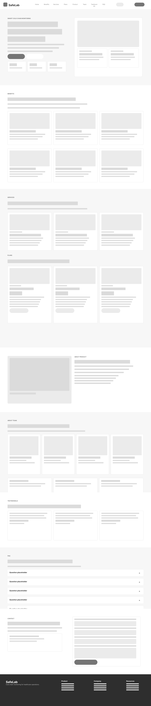

<p align="center">
  <b>Landing Page Wireframe - Mobile</b>
</p>

<p align="center">
  
</p>

#### **3.1.3.2. Landing Page Mockup**

<p style="text-align: justify;">
  Los mockups muestran la versión de alta fidelidad de la Landing Page, incorporando la identidad visual de SafeLab sobre la estructura definida previamente en los wireframes. Se aplicaron los colores, tipografía, imágenes, tarjetas, botones y demás elementos visuales utilizados en la interfaz final.
</p>

<p style="text-align: justify;">
  En Benefits se presentan las principales ventajas de SafeLab mediante tarjetas acompañadas de recursos visuales. Services muestra las soluciones orientadas a laboratorios clínicos, hospitales y farmacias clínicas, además de la plataforma de monitoreo. Plans presenta las alternativas Starter Lab, Professional y Enterprise. Las secciones posteriores complementan la presentación del producto mediante información sobre SafeLab, el equipo, testimonios, preguntas frecuentes y opciones de contacto.
</p>

<p style="text-align: justify;">
  La versión mobile conserva el mismo contenido y jerarquía de la versión desktop, reorganizando las tarjetas y componentes en una sola columna para mantener la legibilidad y facilitar la interacción desde dispositivos móviles.
</p>

<p align="center">
  <b>Landing Page Mockup - Desktop</b>
</p>

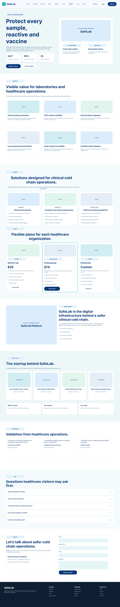

<p align="center">
  <b>Landing Page Mockup - Mobile</b>
</p>

<p align="center">
  
</p>

#### **3.1.4.2. Mobile Applications Wireflow Diagrams**

<p style="text-align: justify;">
  Los wireflows muestran cómo cambian las pantallas a partir de las interacciones del usuario. Se elaboró un wireflow por cada user goal; en cada flecha se indica la acción que realiza el usuario para pasar a la siguiente pantalla.
</p>

<p style="text-align: justify;">
  <b>User goal 1:</b> Como técnico de laboratorio, quiero iniciar sesión de forma rápida y segura para acceder al monitoreo del laboratorio. El usuario ingresa sus credenciales o utiliza su huella digital y, al autenticarse, llega directamente al dashboard.
</p>

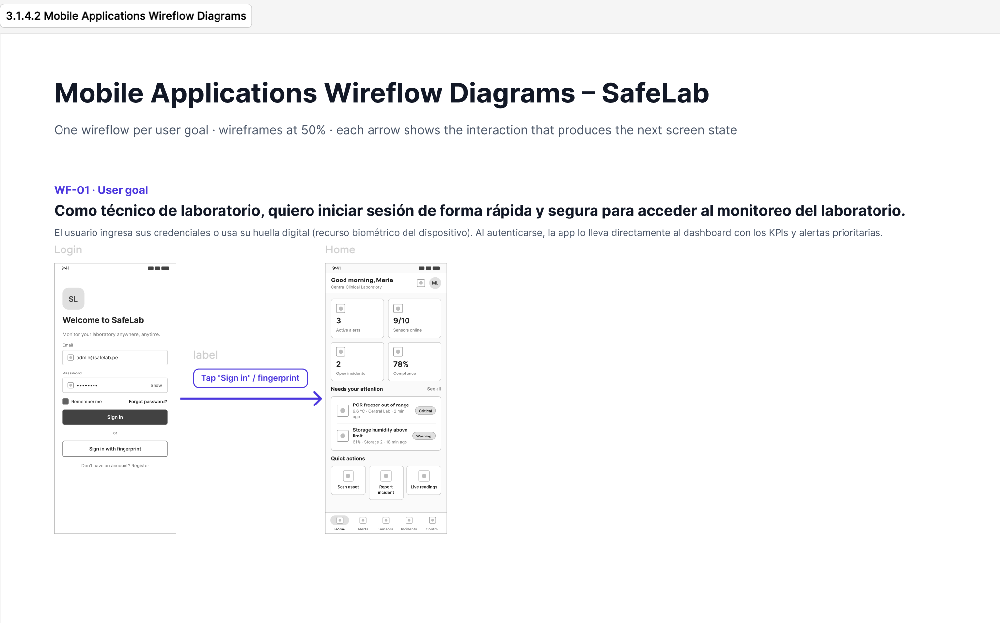

<p style="text-align: justify;">
  <b>User goal 2:</b> Como técnico de laboratorio, quiero atender una alerta crítica y actuar sobre el equipo afectado para proteger las muestras. Desde la lista de alertas abre el detalle, compara el valor registrado con el rango permitido y pasa al control remoto, donde confirma el comando mediante un bottom sheet que muestra el resultado de la validación de seguridad.
</p>

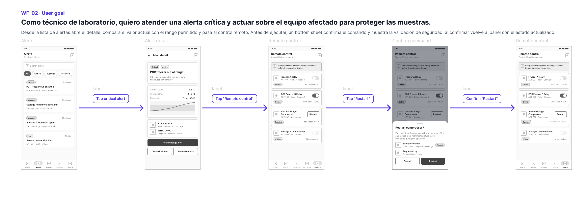

<p style="text-align: justify;">
  <b>User goal 3:</b> Como técnico de laboratorio, quiero reportar un incidente con evidencia fotográfica para dejar trazabilidad de la desviación. Desde el detalle de la alerta crea el incidente, adjunta fotografías con la cámara y lo envía; el nuevo incidente aparece en la lista de incidentes abiertos.
</p>

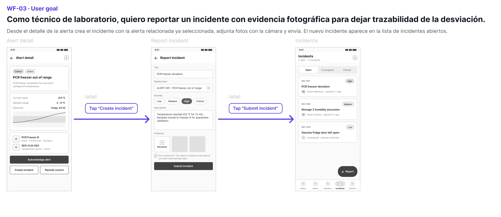

<p style="text-align: justify;">
  <b>User goal 4:</b> Como técnico de laboratorio, quiero identificar un equipo escaneando su código QR para ver su estado sin buscarlo manualmente. Desde los accesos rápidos abre la cámara, el código se reconoce automáticamente y se muestra la ficha del equipo, desde donde accede a las lecturas de su sensor.
</p>

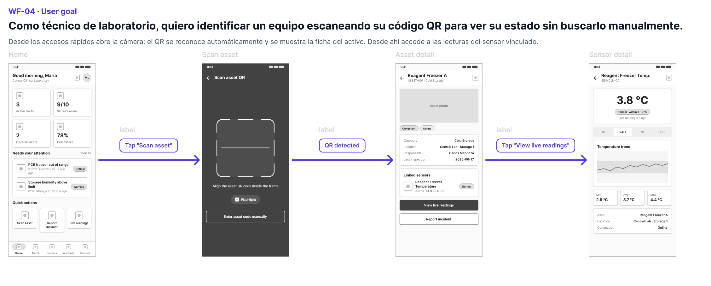

<p style="text-align: justify;">
  <b>User goal 5:</b> Como jefa de laboratorio, quiero revisar las lecturas en tiempo real de un sensor para verificar que se mantiene dentro del rango permitido. Desde el dashboard abre las lecturas en vivo, filtra por tipo de sensor y entra al detalle, donde revisa la tendencia y las estadísticas del periodo.
</p>

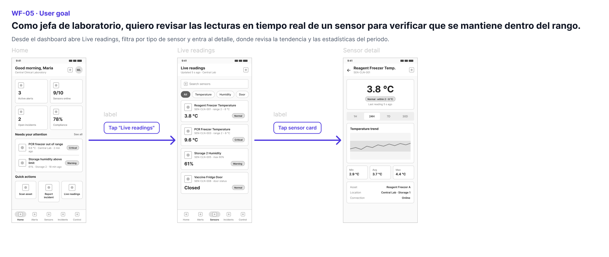

#### **3.1.4.3. Mobile Applications Mock-ups**

<p style="text-align: justify;">
  Los mock-ups presentan el diseño en alta fidelidad de las pantallas, aplicando la guía de estilos de SafeLab: color primario #4F35E8, color de acento #14B8A6, fondos #F4F7FB y la tipografía Inter. Los estados de severidad (crítico, advertencia, normal e informativo) usan colores semánticos y siempre se acompañan de una etiqueta de texto, para no depender únicamente del color. Los textos de la interfaz están en inglés, idioma por defecto de la aplicación.
</p>

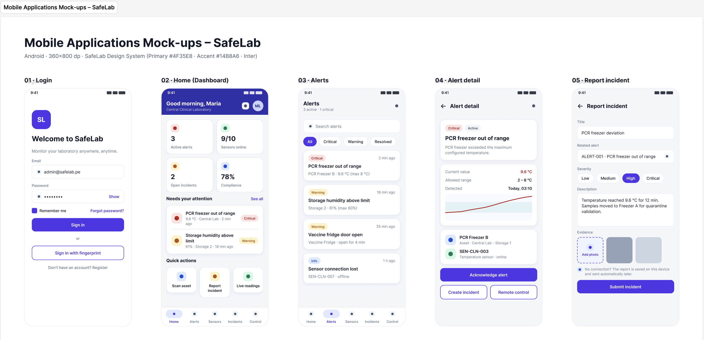

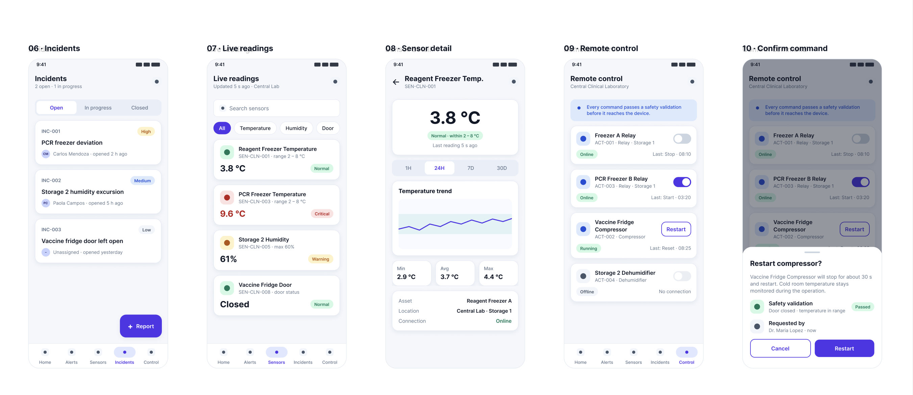

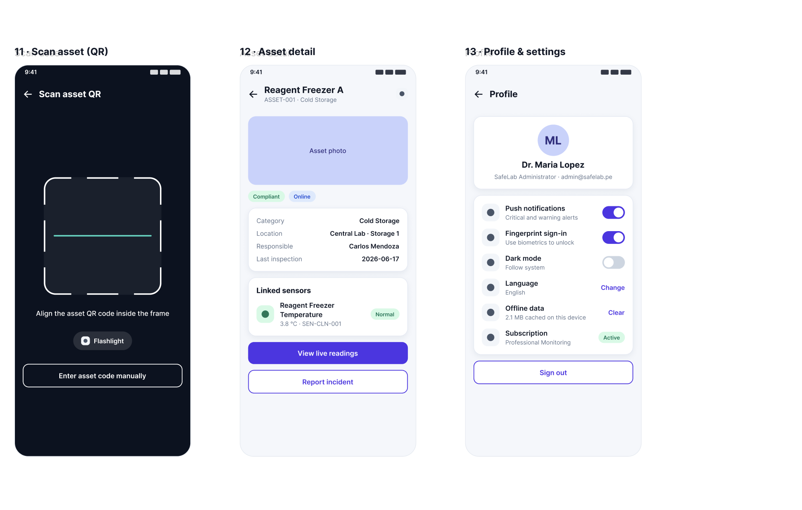

#### **3.1.4.4. Mobile Applications User Flow Diagrams**

<p style="text-align: justify;">
  Los user flows representan el recorrido completo que sigue el usuario para cumplir cada user goal en la interfaz real de SafeLab (versión 2.5.0). Parten del user goal, pasan por el task flow y el wireflow, y llegan al nivel de interacción: cada diagrama indica qué acción dispara el cambio de pantalla, qué decisión interviene y cómo responde la aplicación cuando algo falla. Se elaboraron con la herramienta LucidChart y usan capturas de la aplicación en ejecución, de modo que son coherentes con el prototipo y con los mock-ups.
</p>
<p style="text-align: justify;">
  En cada diagrama se distingue el happy path (línea verde continua), en el que el usuario completa su objetivo sin inconvenientes, de los unhappy paths (línea roja discontinua), que muestran la respuesta de la aplicación ante errores, falta de permisos o situaciones alternativas. Los rombos amarillos representan los puntos de decisión, el óvalo negro el punto de inicio, el óvalo morado el objetivo cumplido y el óvalo rojo claro el estado final de cada unhappy path. Los diagramas están disponibles en LucidChart: <a href="https://lucid.app/lucidchart/bc6db41e-c842-4668-9278-6e60496b90fc/view">SafeLab – Mobile Applications User Flow Diagrams (AV2)</a>.
</p>
<p style="text-align: justify;">
  <b>User flow 1 – Iniciar sesión.</b> Como usuario de laboratorio, quiero iniciar sesión de forma segura para acceder al monitoreo de mi laboratorio. El usuario abre la aplicación, escribe su correo y su contraseña y pulsa Sign in. En el happy path, el servidor responde, las credenciales son válidas y el usuario llega al dashboard con los indicadores de su laboratorio. Se contemplan dos unhappy paths: si el servidor no está disponible, la aplicación muestra un mensaje de error de conexión y el usuario debe reintentar cuando haya red; si las credenciales son inválidas, se muestra un mensaje de error junto al formulario, se conserva el correo ingresado y el usuario corrige los datos y vuelve a intentarlo.
</p>
<p align="center">
  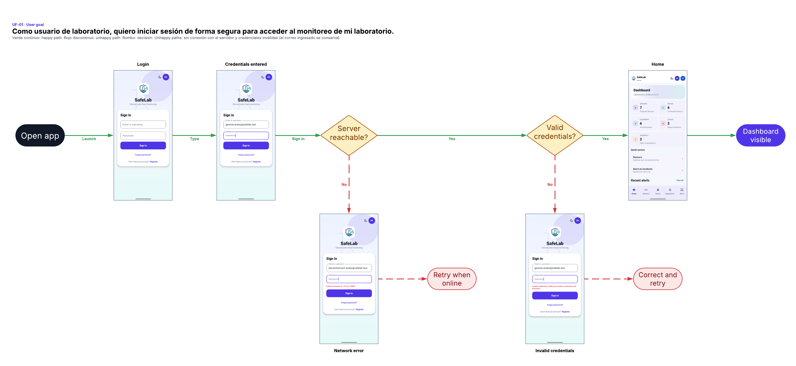
</p>
<p style="text-align: justify;">
  <b>User flow 2 – Atender una alerta.</b> Como jefe de laboratorio, quiero confirmar la atención de una alerta activa para dejar constancia de que fue atendida. Desde la lista de alertas, el usuario filtra por las activas, abre el detalle y despliega el menú de acciones. En el happy path, su rol le permite reconocer la alerta: al hacerlo, el estado cambia a atendida y el cambio queda reflejado en la lista. En el unhappy path, el usuario es técnico y su rol no incluye reconocer alertas; el menú solo le ofrece escalarla, por lo que la alerta pasa a quien tiene la autoridad para atenderla.
</p>
<p align="center">
  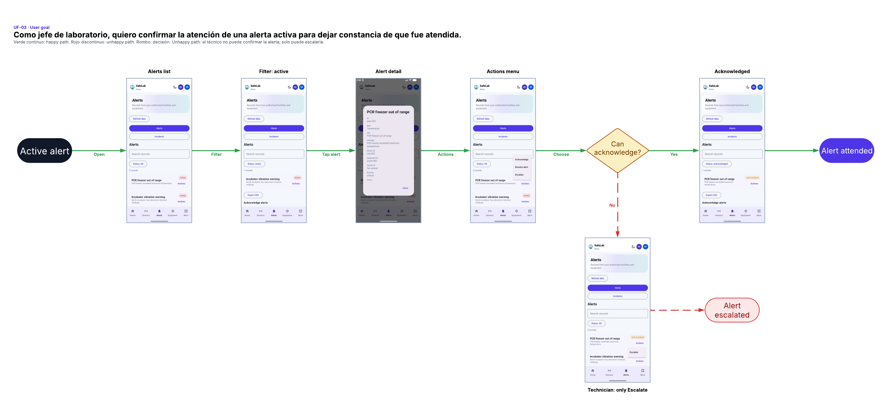
</p>
<p style="text-align: justify;">
  <b>User flow 3 – Gestionar un incidente.</b> Como jefe de laboratorio, quiero gestionar un incidente abierto para dar seguimiento a su resolución. El usuario abre la lista de incidentes, selecciona uno y consulta su detalle; desde el menú de acciones marca el incidente como en investigación. En el happy path, el rol tiene permiso para gestionar incidentes y el estado se actualiza a Investigating. En el unhappy path, el usuario es técnico y solo puede consultar el incidente: el menú de acciones no aparece y el estado permanece sin cambios.
</p>
<p align="center">
  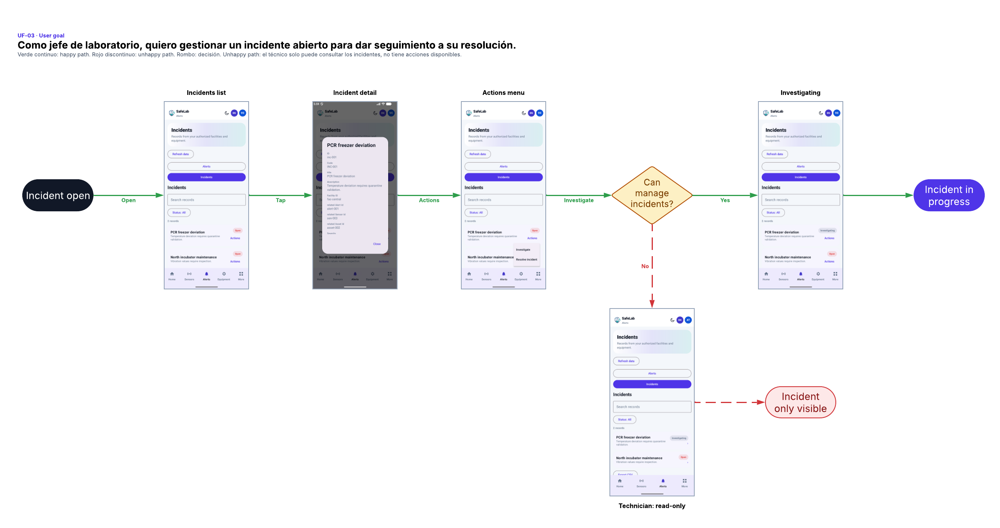
</p>
<p style="text-align: justify;">
  <b>User flow 4 – Configurar los límites de un sensor.</b> Como coordinador de laboratorio, quiero configurar los límites de un sensor para recibir alertas cuando una lectura salga de rango. Esta acción requiere el permiso <code>sensors.configure</code>, que no se asigna por defecto. El usuario abre la lista de sensores, elige Actions en el sensor y edita el valor mínimo y el máximo. En el happy path, el permiso está concedido, el mínimo es menor que el máximo y los nuevos límites se guardan y se muestran en la lista. Se contemplan dos unhappy paths: si el usuario es técnico, el menú de acciones no aparece y debe solicitar el permiso a un responsable; si el mínimo es mayor o igual que el máximo, la aplicación muestra un mensaje de validación y el usuario corrige el rango antes de guardar.
</p>
<p align="center">
  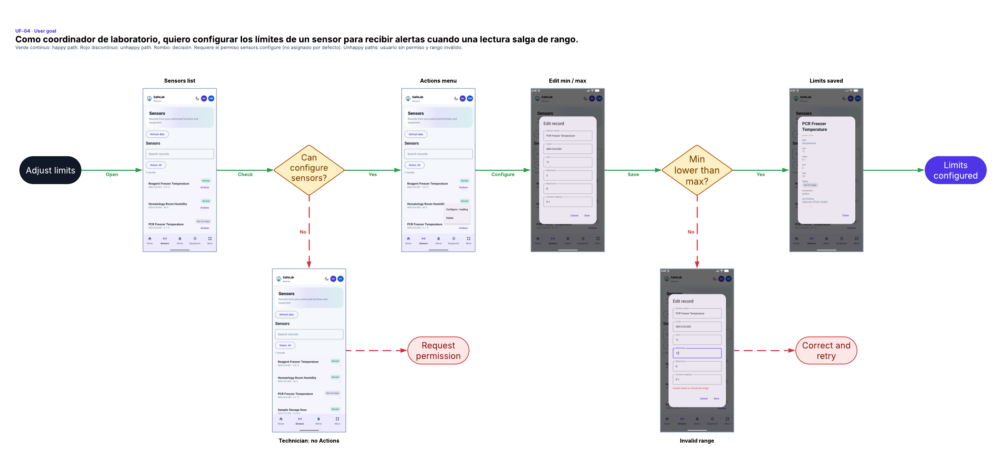
</p>
<p style="text-align: justify;">
  <b>User flow 5 – Monitorear sensores.</b> Como jefe de laboratorio, quiero revisar el estado de los sensores para verificar que se mantienen dentro del rango permitido. El usuario abre la sección Sensors, actualiza los datos y entra al detalle de un sensor. En el happy path, la actualización tiene éxito, el sensor está conectado y la lectura está dentro del rango, por lo que el estado es Normal. Se contemplan tres unhappy paths: si la actualización falla por un error de red, la aplicación conserva los datos ya cargados y permite reintentar; si el sensor figura como desconectado, el usuario debe revisar el dispositivo; si la lectura está fuera de rango, el estado se marca como Out-of-range y el flujo continúa en el user flow 2 para atender la alerta.
</p>
<p align="center">
  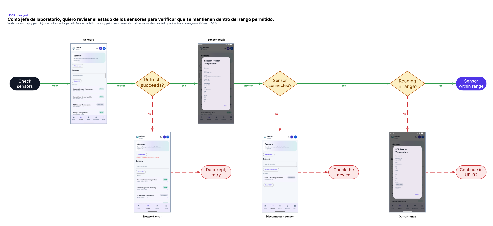
</p>
<p style="text-align: justify;">
  <b>User flow 6 – Buscar un equipo.</b> Como usuario de laboratorio, quiero buscar un equipo por su nombre para consultar su información sin recorrer toda la lista. El usuario abre la lista de equipos y escribe un término en el buscador. En el happy path, existen coincidencias, la lista se filtra y el usuario abre el detalle del equipo. En el unhappy path, no hay coincidencias: la aplicación muestra que no hay registros y el usuario modifica el término de búsqueda.
</p>
<p align="center">
  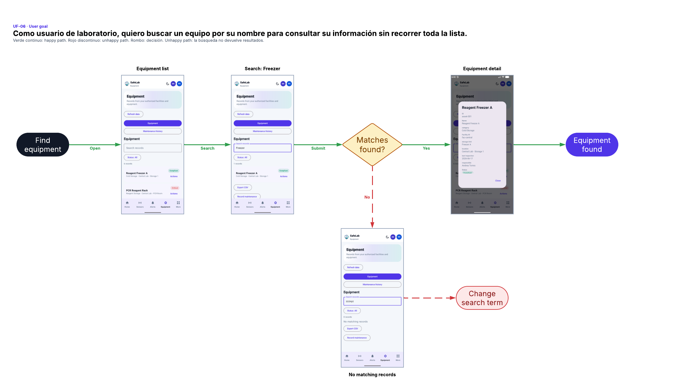
</p>
<p style="text-align: justify;">
  <b>User flow 7 – Registrar un equipo.</b> Como gerente de laboratorio, quiero registrar un equipo nuevo para incluirlo en el monitoreo de mi organización. El usuario abre la sección de equipos, pulsa Add equipment, completa el nombre, la descripción y el responsable, y guarda. En el happy path, el rol permite registrar equipos, los campos obligatorios están completos y el nuevo equipo aparece en la lista con el mensaje Record saved. Se contemplan dos unhappy paths: si el usuario es técnico, el botón de registro no se muestra y debe pedir a un gerente que lo registre; si faltan campos obligatorios, la aplicación muestra un mensaje de validación y el usuario completa el formulario antes de guardar de nuevo.
</p>
<p align="center">
  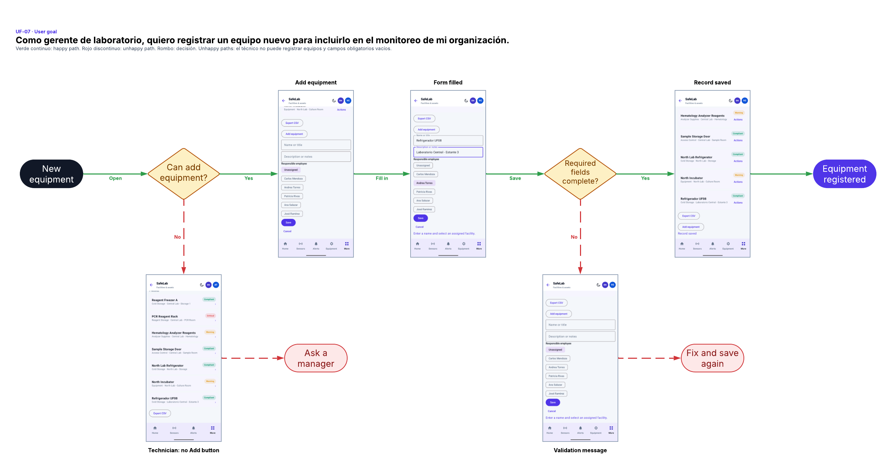
</p>

#### **3.1.4.5. Mobile Applications Prototyping**

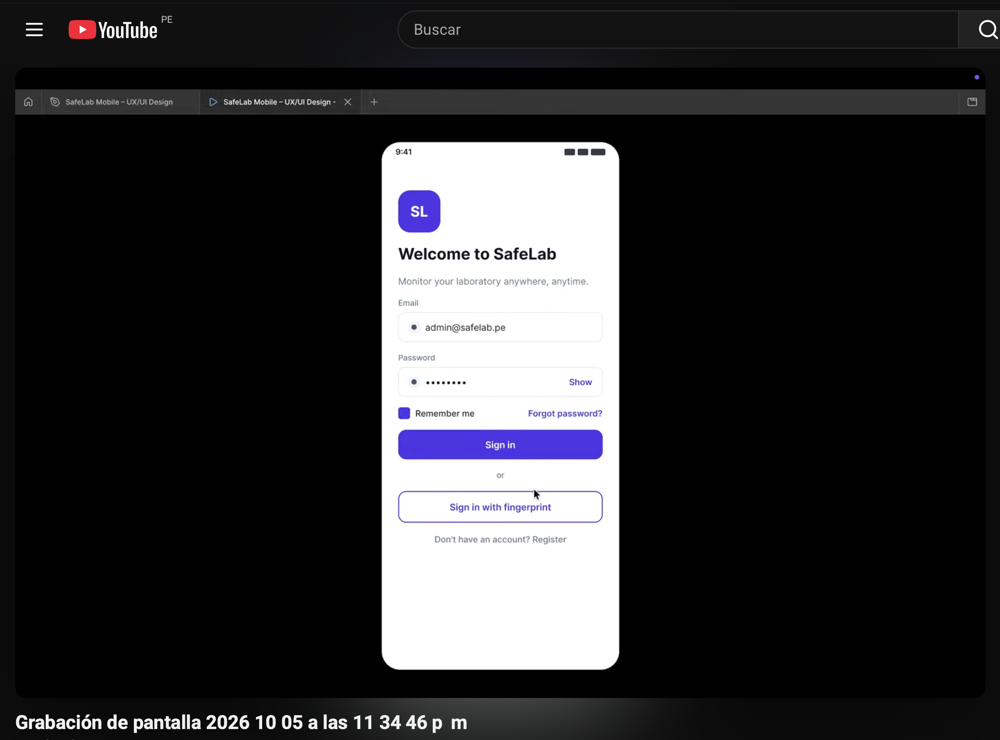
Link: https://youtu.be/3eaxNpcLX8k
