# **Chapter IV: Product Implementation & Validation**

<p
  style="text-align: justify;
         text-indent: 0.5in;
         line-height: 1.5;
         margin: 0 0 12px 0;
         orphans: 2;
         widows: 2;">
  SafeLab evolucionó desde el prototipo Android con datos locales presentado en TB1 hasta un ecosistema
  conectado durante AV2. El incremento comprende la Landing Page bilingüe publicada en GitHub Pages, la
  aplicación web Vue desplegada en Render, los servicios RESTful de Spring Boot y la aplicación Android
  desarrollada con Kotlin y Jetpack Compose. Ambos clientes consumen la API centralizada; PostgreSQL,
  alojado en Neon para el entorno desplegado, conserva la información de las organizaciones y sus recursos
  autorizados.
</p>

<p
  style="text-align: justify;
         text-indent: 0.5in;
         line-height: 1.5;
         margin: 0 0 12px 0;
         orphans: 2;
         widows: 2;">
  Los repositorios <code>safelab-report</code>, <code>safelab-business-website</code>,
  <code>safelab-frontend</code>, <code>safelab-platform-api</code> y <code>safelab-mobile-app</code>
  conservan historiales independientes. La entrega AV2 integra autenticación, permisos por organización,
  consulta y modificación de recursos habilitados, sincronización de datos y publicación de la APK. El
  mantenimiento de los doce Bounded Contexts facilita la separación de responsabilidades, pero no implica
  que todas las operaciones de cada contexto estén completas.
</p>

<p
  style="text-align: justify;
         text-indent: 0.5in;
         line-height: 1.5;
         margin: 0 0 12px 0;
         orphans: 2;
         widows: 2;">
  Las evidencias de TB1 se conservan como antecedente del Sprint 1. Para el Sprint 2 se presentan las
  decisiones de configuración, historias seleccionadas, actividades, pruebas, documentación, ejecución y
  despliegue. Los incrementos correspondientes al Trabajo Final se distinguen de las funciones ya
  publicadas, evitando interpretar una pantalla, un estado en Jira o un commit como prueba suficiente de
  funcionamiento integral.
</p>

## **4.1. Software Configuration Management**

<p
  style="text-align: justify;
         text-indent: 0.5in;
         line-height: 1.5;
         margin: 0 0 12px 0;
         orphans: 2;
         widows: 2;">
  La gestión de configuración de SafeLab se estableció con el objetivo de mantener trazabilidad entre los
  artefactos académicos, el código fuente, los entornos de desarrollo y las versiones liberadas. El equipo
  utilizó Git y GitHub como mecanismos centrales de control de versiones, aplicando una estrategia basada
  en <code>main</code>, <code>develop</code> y ramas <code>feature/*</code>. De esta manera, cada
  integrante pudo trabajar de forma aislada sobre su responsabilidad y posteriormente integrar sus cambios
  de manera controlada.
</p>

### **4.1.1. Software Development Environment Configuration**

<p
  style="text-align: justify;
         text-indent: 0.5in;
         line-height: 1.5;
         margin: 0 0 12px 0;
         orphans: 2;
         widows: 2;">
  Para el desarrollo de SafeLab se utilizan herramientas distintas según el ciclo de vida del producto:
  planificación y gestión de requisitos, diseño de experiencia, programación, pruebas, despliegue y
  documentación. El Sprint 1 utilizó principalmente entornos locales; el Sprint 2 incorporó servicios
  públicos, repositorios vinculados y una base de datos remota. La tabla siguiente conserva el registro de
  herramientas del primer incremento.
</p>

<table border="1" style="width: 100%; border-collapse: collapse; table-layout: fixed;">
<thead>
<tr>
<th style="text-align: center; vertical-align: middle; padding: 6px;">Producto / Artefacto</th>
<th style="text-align: center; vertical-align: middle; padding: 6px;">Entorno principal</th>
<th style="text-align: center; vertical-align: middle; padding: 6px;">Tecnologías y herramientas</th>
<th style="text-align: center; vertical-align: middle; padding: 6px;">Uso durante TB1</th>
</tr>
</thead>
<tbody>
<tr>
<td style="text-align: left; vertical-align: top; padding: 6px;"><code>safelab-mobile-app</code></td>
<td style="text-align: left; vertical-align: top; padding: 6px;">Android Studio</td>
<td style="text-align: left; vertical-align: top; padding: 6px;">Kotlin, Jetpack Compose, Material 3, Gradle y Android Emulator</td>
<td style="text-align: justify; vertical-align: top; padding: 6px;">Implementación de la navegación compartida, sidebar, topbar y pantallas de los Bounded Contexts con datos mock/locales.</td>
</tr>

<tr>
<td style="text-align: left; vertical-align: top; padding: 6px;"><code>safelab-business-website</code></td>
<td style="text-align: left; vertical-align: top; padding: 6px;">Visual Studio Code</td>
<td style="text-align: left; vertical-align: top; padding: 6px;">HTML5, CSS3, JavaScript, JSON e internacionalización EN/ES</td>
<td style="text-align: justify; vertical-align: top; padding: 6px;">Desarrollo de la Landing Page responsive, navegación, secciones informativas, internacionalización, modo claro/oscuro y mejoras de accesibilidad.</td>
</tr>

<tr>
<td style="text-align: left; vertical-align: top; padding: 6px;"><code>safelab-platform-api</code></td>
<td style="text-align: left; vertical-align: top; padding: 6px;">Entorno Java compatible con Maven</td>
<td style="text-align: left; vertical-align: top; padding: 6px;">Java 21, Spring Boot 3.4, Maven, JPA, H2/PostgreSQL y Swagger/OpenAPI</td>
<td style="text-align: justify; vertical-align: top; padding: 6px;">Adaptación y validación de servicios RESTful que serán consumidos por la aplicación móvil en una etapa posterior.</td>
</tr>

<tr>
<td style="text-align: left; vertical-align: top; padding: 6px;"><code>safelab-report</code></td>
<td style="text-align: left; vertical-align: top; padding: 6px;">Visual Studio Code</td>
<td style="text-align: left; vertical-align: top; padding: 6px;">Markdown, HTML embebido, Git y extensión Markdown PDF</td>
<td style="text-align: justify; vertical-align: top; padding: 6px;">Documentación de artefactos, evidencias, resultados del Sprint y preparación de la versión exportable a PDF.</td>
</tr>
</tbody>
</table>

<p
  style="text-align: justify;
         text-indent: 0.5in;
         line-height: 1.5;
         margin: 0 0 12px 0;
         orphans: 2;
         widows: 2;">
  Para la aplicación móvil se verificó la ejecución desde Android Studio utilizando un emulador Android. La
  estructura del proyecto se organizó por Bounded Context y, dentro de cada uno, por las capas
  <code>data</code>, <code>domain</code> y <code>presentation</code>. Esta organización facilita que cada
  módulo pueda evolucionar de forma independiente y que, posteriormente, los repositorios locales de datos
  sean sustituidos por implementaciones que consuman la API.
</p>

<p align="center">
  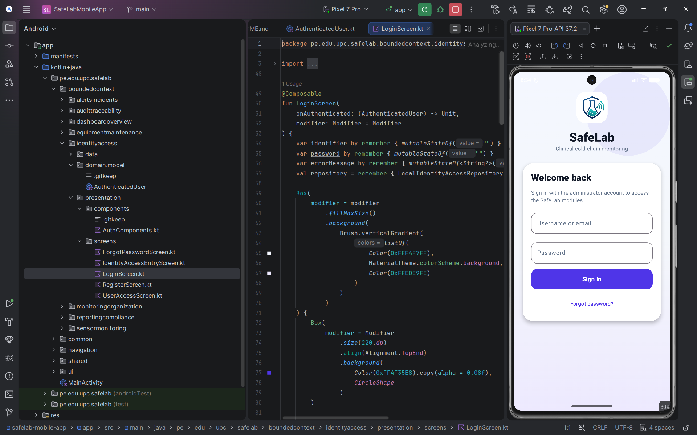
</p>

<p align="center"><i>Figura: Entorno de desarrollo de SafeLab Mobile App en Android Studio.</i></p>

<p
  style="text-align: justify;
         text-indent: 0.5in;
         line-height: 1.5;
         margin: 0 0 12px 0;
         orphans: 2;
         widows: 2;">
  Para la Landing Page se utilizó Visual Studio Code junto con un servidor local de desarrollo para
  verificar estilos, navegación, internacionalización y responsive design antes de integrar los cambios en
  <code>develop</code>. En el caso del backend, la validación local se realiza ejecutando Spring Boot
  mediante Maven, exponiendo la API en el puerto 8080 y verificando sus contratos mediante Swagger UI y las
  pruebas automatizadas.
</p>

<p align="center">
  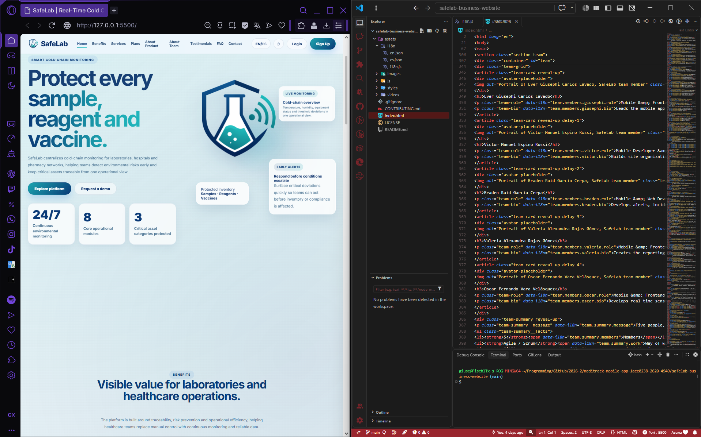
</p>

<p align="center"><i>Figura: Entorno de desarrollo de la Landing Page de SafeLab.</i></p>

<p
  style="text-align: justify;
         text-indent: 0.5in;
         line-height: 1.5;
         margin: 0 0 12px 0;
         orphans: 2;
         widows: 2;">
  Para mantener la gestión de configuración actualizada, revisamos los componentes que evolucionaron
  después de TB1. En el repositorio <code>safelab-platform-api</code> conservamos Java 21, Spring Boot,
  Maven y los contratos RESTful; la candidata <code>v2.5.0 RC3</code> incorpora persistencia local en
  PostgreSQL 18, migraciones Flyway V1–V4 y un endpoint autenticado de sincronización <code>GET
  /api/v1/integration/bootstrap</code>. En <code>safelab-mobile-app</code> mantenemos Kotlin, Jetpack
  Compose y Gradle, y utilizamos el emulador Android para la integración con el servicio local. La Landing
  Page conserva su implementación independiente y el reporte continúa organizado en Markdown e imágenes con
  rutas relativas.
</p>

<p
  style="text-align: justify;
         text-indent: 0.5in;
         line-height: 1.5;
         margin: 0 0 12px 0;
         orphans: 2;
         widows: 2;">
  Organizamos la validación técnica por entorno. Primero verificamos los contratos y permisos de la API;
  después comprobamos las operaciones de lectura y escritura que sí están implementadas y, finalmente,
  contrastamos la información presentada en Android con los registros autorizados de PostgreSQL. No
  equiparamos la presencia de una pantalla o de un endpoint con una operación aprobada de extremo a
  extremo. El código RC3 requería validación local antes de etiquetarse; posteriormente se publicaron
  los commits de despliegue y una Release Android de prueba. Esa publicación no sustituye las
  comprobaciones de roles, CRUD y datos persistidos durante la exposición.
</p>

##### **Development Toolchain & Reference URLs**

<p
  style="text-align: justify;
         text-indent: 0.5in;
         line-height: 1.5;
         margin: 0 0 12px 0;
         orphans: 2;
         widows: 2;">
  La selección de herramientas cubre los productos del Sprint 2 y permite reproducir sus actividades sin
  incorporar contraseñas ni archivos de configuración privada al reporte.
</p>

<table border="1" style="width: 100%; border-collapse: collapse; page-break-inside: auto;">
<thead>
<tr>
<th style="text-align: center; vertical-align: middle; padding: 6px;">Actividad</th>
<th style="text-align: center; vertical-align: middle; padding: 6px;">Herramienta</th>
<th style="text-align: center; vertical-align: middle; padding: 6px;">Propósito en SafeLab</th>
<th style="text-align: center; vertical-align: middle; padding: 6px;">Referencia</th>
</tr>
</thead>
<tbody>
<tr style="page-break-inside: avoid;">
<td style="text-align: left; vertical-align: top; padding: 6px;">Gestión de Sprints y requisitos</td>
<td style="text-align: left; vertical-align: top; padding: 6px;">Jira</td>
<td style="text-align: left; vertical-align: top; padding: 6px;">Product Backlog, Sprint Backlog, responsables, estados y tareas de ingeniería</td>
<td style="text-align: left; vertical-align: top; padding: 6px;"><a href="https://ipoundzy.atlassian.net/jira/software/projects/SL/boards/2/backlog">Tablero SafeLab</a></td>
</tr>

<tr style="page-break-inside: avoid;">
<td style="text-align: left; vertical-align: top; padding: 6px;">Diseño UX/UI</td>
<td style="text-align: left; vertical-align: top; padding: 6px;">Figma y Lucidchart</td>
<td style="text-align: left; vertical-align: top; padding: 6px;">Maquetas, diagramas de navegación, wireflows y user flows</td>
<td style="text-align: left; vertical-align: top; padding: 6px;"><a href="https://www.figma.com/">Figma</a> / <a href="https://lucid.app/">Lucidchart</a></td>
</tr>

<tr style="page-break-inside: avoid;">
<td style="text-align: left; vertical-align: top; padding: 6px;">Control de versiones</td>
<td style="text-align: left; vertical-align: top; padding: 6px;">Git y GitHub</td>
<td style="text-align: left; vertical-align: top; padding: 6px;">Ramas, revisiones, commits, tags y publicaciones</td>
<td style="text-align: left; vertical-align: top; padding: 6px;"><a href="https://github.com/meditrack-mobile-app-1acc0238-2620-4949">Organización MediTrack</a></td>
</tr>

<tr style="page-break-inside: avoid;">
<td style="text-align: left; vertical-align: top; padding: 6px;">Aplicación Android</td>
<td style="text-align: left; vertical-align: top; padding: 6px;">Android Studio, Kotlin, Jetpack Compose y Gradle</td>
<td style="text-align: left; vertical-align: top; padding: 6px;">Compilación, depuración, emulación y generación de APK</td>
<td style="text-align: left; vertical-align: top; padding: 6px;"><a href="https://developer.android.com/studio">Android Studio</a></td>
</tr>

<tr style="page-break-inside: avoid;">
<td style="text-align: left; vertical-align: top; padding: 6px;">Aplicación web</td>
<td style="text-align: left; vertical-align: top; padding: 6px;">Visual Studio Code, Vue 3, Vite y Node.js</td>
<td style="text-align: left; vertical-align: top; padding: 6px;">Interfaz web con módulos y conexión autenticada con la API</td>
<td style="text-align: left; vertical-align: top; padding: 6px;"><a href="https://vite.dev/">Vite</a></td>
</tr>

<tr style="page-break-inside: avoid;">
<td style="text-align: left; vertical-align: top; padding: 6px;">Servicios REST</td>
<td style="text-align: left; vertical-align: top; padding: 6px;">JDK 21, Spring Boot, Maven y Swagger UI</td>
<td style="text-align: left; vertical-align: top; padding: 6px;">Reglas de negocio, endpoints HTTP, autenticación y documentación OpenAPI</td>
<td style="text-align: left; vertical-align: top; padding: 6px;"><a href="https://spring.io/projects/spring-boot">Spring Boot</a></td>
</tr>

<tr style="page-break-inside: avoid;">
<td style="text-align: left; vertical-align: top; padding: 6px;">Pruebas automatizadas</td>
<td style="text-align: left; vertical-align: top; padding: 6px;">JUnit, Mockito, Spring Boot Test y Cucumber</td>
<td style="text-align: left; vertical-align: top; padding: 6px;">Pruebas unitarias, de integración y de aceptación BDD</td>
<td style="text-align: left; vertical-align: top; padding: 6px;"><a href="https://junit.org/junit5/">JUnit</a> / <a href="https://cucumber.io/">Cucumber</a></td>
</tr>

<tr style="page-break-inside: avoid;">
<td style="text-align: left; vertical-align: top; padding: 6px;">Persistencia</td>
<td style="text-align: left; vertical-align: top; padding: 6px;">PostgreSQL, Flyway y Neon</td>
<td style="text-align: left; vertical-align: top; padding: 6px;">Migraciones, aislamiento de organizaciones y datos persistidos</td>
<td style="text-align: left; vertical-align: top; padding: 6px;"><a href="https://neon.tech/">Neon</a></td>
</tr>

<tr style="page-break-inside: avoid;">
<td style="text-align: left; vertical-align: top; padding: 6px;">Despliegue y distribución</td>
<td style="text-align: left; vertical-align: top; padding: 6px;">GitHub Pages, Render y GitHub Releases</td>
<td style="text-align: left; vertical-align: top; padding: 6px;">Landing pública, servicios HTTPS, aplicación web y APK de Android</td>
<td style="text-align: left; vertical-align: top; padding: 6px;"><a href="https://render.com/">Render</a> / <a href="https://pages.github.com/">GitHub Pages</a></td>
</tr>

<tr style="page-break-inside: avoid;">
<td style="text-align: left; vertical-align: top; padding: 6px;">Documentación</td>
<td style="text-align: left; vertical-align: top; padding: 6px;">Markdown, HTML y Visual Studio Code</td>
<td style="text-align: left; vertical-align: top; padding: 6px;">Informe versionado con figuras y tablas exportables a PDF</td>
<td style="text-align: left; vertical-align: top; padding: 6px;"><a href="https://code.visualstudio.com/">Visual Studio Code</a></td>
</tr>
</tbody>
</table>

### **4.1.2. Source Code Management**

<p
  style="text-align: justify;
         text-indent: 0.5in;
         line-height: 1.5;
         margin: 0 0 12px 0;
         orphans: 2;
         widows: 2;">
  El código fuente del proyecto se administró mediante GitHub dentro de la organización del equipo. Cada
  producto se mantuvo en un repositorio independiente con el fin de separar responsabilidades, facilitar el
  versionado y conservar un historial claro de cambios. La rama <code>main</code> representa la versión
  estable, mientras que <code>develop</code> funciona como rama de integración. Las funcionalidades se
  desarrollan en ramas <code>feature/*</code> creadas a partir de <code>develop</code> y se integran
  nuevamente mediante merge commits.
</p>

<table border="1" style="width: 100%; border-collapse: collapse; table-layout: fixed;">
<thead>
<tr>
<th style="text-align: center; vertical-align: middle; padding: 6px;">Repositorio</th>
<th style="text-align: center; vertical-align: middle; padding: 6px;">Propósito</th>
<th style="text-align: center; vertical-align: middle; padding: 6px;">Ramas principales</th>
<th style="text-align: center; vertical-align: middle; padding: 6px;">Estrategia de integración</th>
</tr>
</thead>
<tbody>
<tr>
<td style="text-align: left; vertical-align: top; padding: 6px;"><code>safelab-report</code></td>
<td style="text-align: justify; vertical-align: top; padding: 6px;">Documentación académica del proyecto y evidencias de los entregables.</td>
<td style="text-align: left; vertical-align: top; padding: 6px;"><code>main</code>, <code>develop</code> y ramas de documentación.</td>
<td style="text-align: justify; vertical-align: top; padding: 6px;">Integración por capítulos y artefactos, seguida de revisión del documento consolidado.</td>
</tr>

<tr>
<td style="text-align: left; vertical-align: top; padding: 6px;"><code>safelab-business-website</code></td>
<td style="text-align: justify; vertical-align: top; padding: 6px;">Landing Page pública de SafeLab.</td>
<td style="text-align: left; vertical-align: top; padding: 6px;"><code>main</code>, <code>develop</code>, <code>feature/tb1-front-section</code>, <code>feature/tb1-core-content</code>, <code>feature/tb1-product-team</code>, <code>feature/tb1-engagement-section</code>, <code>feature/tb1-i18n</code> y <code>feature/tb1-site-quality</code>.</td>
<td style="text-align: justify; vertical-align: top; padding: 6px;">Integración progresiva en <code>develop</code>; resolución de conflictos sobre archivos compartidos y consolidación final antes de pasar a <code>main</code>.</td>
</tr>

<tr>
<td style="text-align: left; vertical-align: top; padding: 6px;"><code>safelab-mobile-app</code></td>
<td style="text-align: justify; vertical-align: top; padding: 6px;">Aplicación móvil nativa para Android.</td>
<td style="text-align: left; vertical-align: top; padding: 6px;"><code>main</code>, <code>develop</code> y una rama <code>feature/tb1-bc-*</code> por Bounded Context.</td>
<td style="text-align: justify; vertical-align: top; padding: 6px;">Cada Bounded Context se implementó de forma aislada; los cambios compartidos de navegación se validaron al integrarse en <code>develop</code>.</td>
</tr>

<tr>
<td style="text-align: left; vertical-align: top; padding: 6px;"><code>safelab-platform-api</code></td>
<td style="text-align: justify; vertical-align: top; padding: 6px;">Backend RESTful y persistencia de la plataforma.</td>
<td style="text-align: left; vertical-align: top; padding: 6px;"><code>main</code>, ramas de desarrollo y pruebas.</td>
<td style="text-align: justify; vertical-align: top; padding: 6px;">Adaptación de endpoints existentes y validación mediante pruebas automatizadas antes de su futura integración con Android.</td>
</tr>
</tbody>
</table>

<p
  style="text-align: justify;
         text-indent: 0.5in;
         line-height: 1.5;
         margin: 0 0 12px 0;
         orphans: 2;
         widows: 2;">
  En la aplicación móvil se utilizaron las ramas <code>feature/tb1-bc-identity-access</code>,
  <code>feature/tb1-bc-dashboard-overview</code>, <code>feature/tb1-bc-monitoring-organization</code>,
  <code>feature/tb1-bc-sensor-monitoring</code>, <code>feature/tb1-bc-alerts-incidents</code>,
  <code>feature/tb1-bc-equipment-maintenance</code>, <code>feature/tb1-bc-reporting-compliance</code> y
  <code>feature/tb1-bc-audit-traceability</code>. Este esquema redujo el acoplamiento entre integrantes, ya
  que la mayoría de los cambios permanecieron dentro de la carpeta correspondiente a cada Bounded Context.
</p>

<p
  style="text-align: justify;
         text-indent: 0.5in;
         line-height: 1.5;
         margin: 0 0 12px 0;
         orphans: 2;
         widows: 2;">
  Para conservar la trazabilidad de las integraciones se utilizaron merge commits explícitos mediante
  <code>git merge --no-ff</code>. Cuando aparecieron conflictos, principalmente en archivos compartidos de
  la Landing Page como <code>index.html</code>, <code>styles.css</code> y <code>script.js</code>, estos se
  resolvieron desde el Merge Editor de Visual Studio Code y se validó posteriormente la versión consolidada
  en <code>develop</code>. Una vez estable, el incremento se integró a <code>main</code> y se identificó
  mediante un tag de versión TB1.
</p>

<p align="center">
  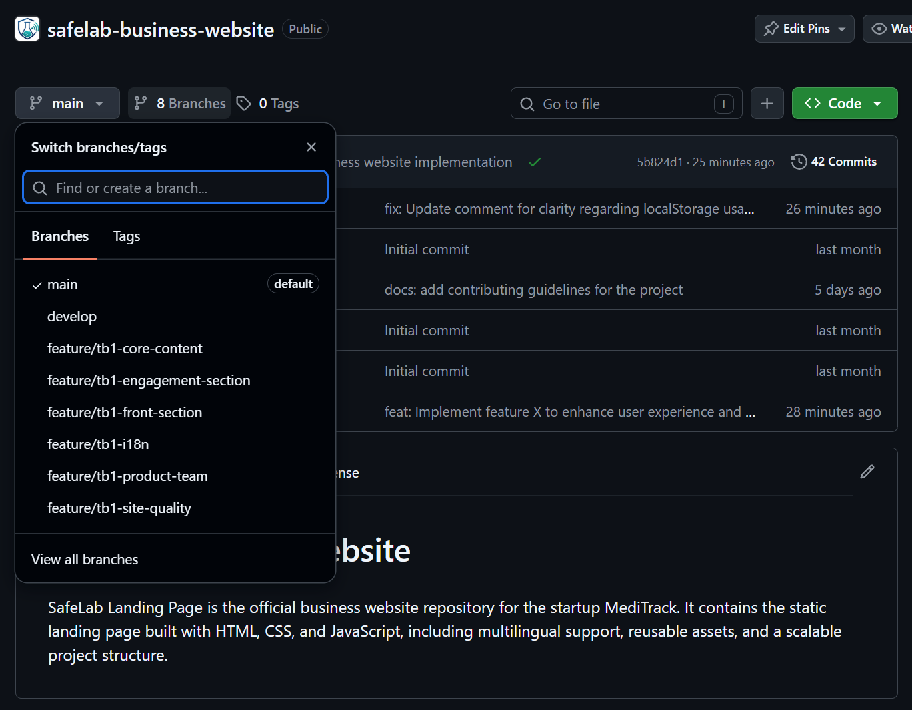
</p>

<p align="center"><i>Figura: Estrategia de ramas utilizada para la implementación de TB1.</i></p>

<p align="center">
  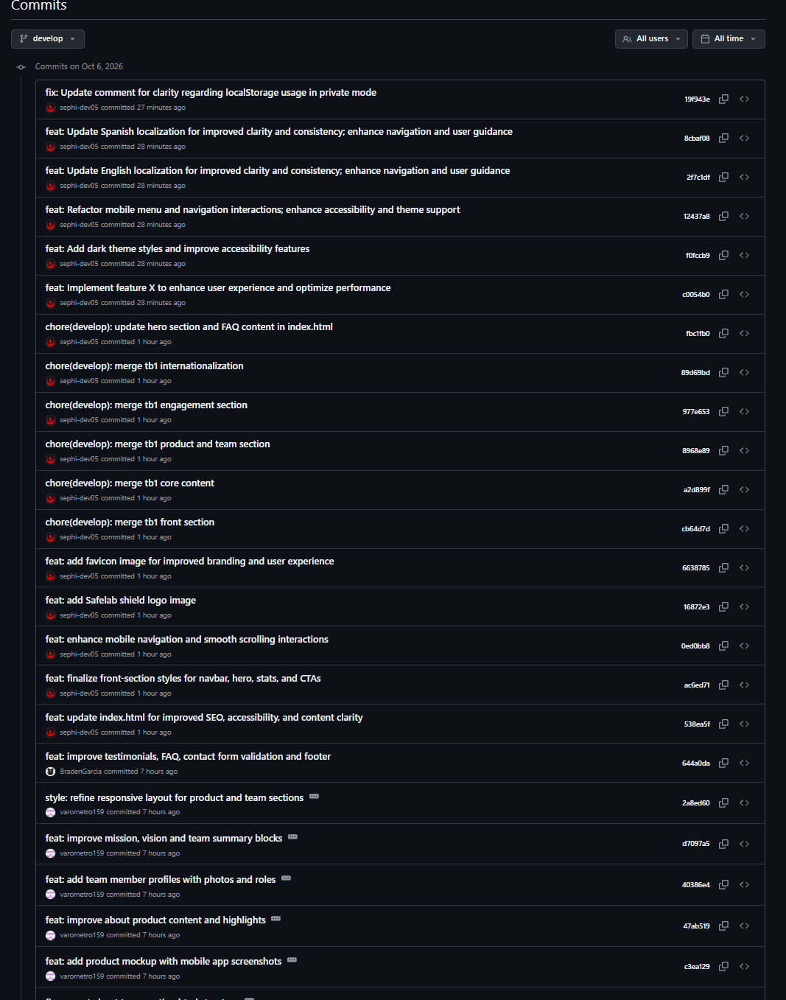
</p>

<p align="center"><i>Figura: Evidencia de integración y trazabilidad del código fuente.</i></p>

<p
  style="text-align: justify;
         text-indent: 0.5in;
         line-height: 1.5;
         margin: 0 0 12px 0;
         orphans: 2;
         widows: 2;">
  Para la documentación del AV2 creamos en <code>safelab-report</code> las ramas
  <code>feature/av2-front-matter</code>, <code>feature/av2-chapter-1</code>,
  <code>feature/av2-chapter-2</code>, <code>feature/av2-chapter-3</code>,
  <code>feature/av2-chapter-4</code> y <code>feature/av2-back-matter</code>, además de mantener
  <code>main</code> y <code>develop</code>. Concentramos la revisión de Software Configuration Management,
  las evidencias técnicas y el despliegue del Sprint 2 en <code>feature/av2-chapter-4</code>, mientras que
  el registro de versiones se administra en <code>feature/av2-front-matter</code>. Con esta distribución
  conservamos la correspondencia entre los archivos editados, el responsable de cada modificación y la rama
  que luego se integrará al informe.
</p>

<p
  style="text-align: justify;
         text-indent: 0.5in;
         line-height: 1.5;
         margin: 0 0 12px 0;
         orphans: 2;
         widows: 2;">
  También diferenciamos el estado de las ramas del estado de los productos. El historial del repositorio
  del reporte acredita los cambios documentales, pero no demuestra por sí mismo que una versión del backend
  haya sido publicada. Para las funcionalidades verificamos el código y los contratos en sus repositorios
  y, para el despliegue, utilizamos el registro de ejecución del entorno y las comprobaciones de
  disponibilidad. Esta distinción evita confundir una integración en Git con una liberación operativa.
</p>

##### **Repository URLs, GitFlow and Versioning**

<table border="1" style="width: 100%; border-collapse: collapse; page-break-inside: auto;">
<thead>
<tr>
<th style="text-align: center; vertical-align: middle; padding: 6px;">Repositorio público</th>
<th style="text-align: center; vertical-align: middle; padding: 6px;">Función</th>
<th style="text-align: center; vertical-align: middle; padding: 6px;">Entrega AV2</th>
</tr>
</thead>
<tbody>
<tr style="page-break-inside: avoid;">
<td style="text-align: left; vertical-align: top; padding: 6px;"><a href="https://github.com/meditrack-mobile-app-1acc0238-2620-4949/safelab-report"><code>safelab-report</code></a></td>
<td style="text-align: left; vertical-align: top; padding: 6px;">Informe, evidencias y artefactos académicos</td>
<td style="text-align: left; vertical-align: top; padding: 6px;">Actualización por capítulos y revisión de las evidencias del Sprint 2</td>
</tr>

<tr style="page-break-inside: avoid;">
<td style="text-align: left; vertical-align: top; padding: 6px;"><a href="https://github.com/meditrack-mobile-app-1acc0238-2620-4949/safelab-business-website"><code>safelab-business-website</code></a></td>
<td style="text-align: left; vertical-align: top; padding: 6px;">Landing Page bilingüe</td>
<td style="text-align: left; vertical-align: top; padding: 6px;">GitHub Pages; videos, autenticación web y enlace de descarga Android</td>
</tr>

<tr style="page-break-inside: avoid;">
<td style="text-align: left; vertical-align: top; padding: 6px;"><a href="https://github.com/meditrack-mobile-app-1acc0238-2620-4949/safelab-frontend"><code>safelab-frontend</code></a></td>
<td style="text-align: left; vertical-align: top; padding: 6px;">Aplicación web operativa</td>
<td style="text-align: left; vertical-align: top; padding: 6px;">Vue 3 + Vite; consumo de la API, autenticación y navegación por permisos</td>
</tr>

<tr style="page-break-inside: avoid;">
<td style="text-align: left; vertical-align: top; padding: 6px;"><a href="https://github.com/meditrack-mobile-app-1acc0238-2620-4949/safelab-platform-api"><code>safelab-platform-api</code></a></td>
<td style="text-align: left; vertical-align: top; padding: 6px;">Backend RESTful y proyecto de pruebas</td>
<td style="text-align: left; vertical-align: top; padding: 6px;">Spring Boot, OpenAPI, configuración Render y persistencia Neon/PostgreSQL</td>
</tr>

<tr style="page-break-inside: avoid;">
<td style="text-align: left; vertical-align: top; padding: 6px;"><a href="https://github.com/meditrack-mobile-app-1acc0238-2620-4949/safelab-mobile-app"><code>safelab-mobile-app</code></a></td>
<td style="text-align: left; vertical-align: top; padding: 6px;">Aplicación Android</td>
<td style="text-align: left; vertical-align: top; padding: 6px;">Kotlin/Compose; tag <code>av2-v2.5.3</code> y APK en GitHub Releases</td>
</tr>
</tbody>
</table>

<p
  style="text-align: justify;
         text-indent: 0.5in;
         line-height: 1.5;
         margin: 0 0 12px 0;
         orphans: 2;
         widows: 2;">
  Cada repositorio adopta <code>main</code> para los incrementos integrados y <code>develop</code> como
  rama de integración. Las ramas <code>feature/&lt;entrega&gt;-&lt;alcance&gt;</code> se utilizan para
  funcionalidades y documentación; <code>release/&lt;versión&gt;</code>, para preparar entregables; y
  <code>hotfix/&lt;alcance&gt;</code>, para resolver incidencias detectadas después de integrar en
  <code>main</code>. El historial conserva merges explícitos y mensajes Conventional Commits; los tags son
  referencias inmutables a un commit específico, no copias dinámicas de la rama.
</p>

<p
  style="text-align: justify;
         text-indent: 0.5in;
         line-height: 1.5;
         margin: 0 0 12px 0;
         orphans: 2;
         widows: 2;">
  Para diferenciar entregas académicas se emplean identificadores como <code>av2-v2.5.2</code> y
  <code>av2-v2.5.3</code>, conservando los números MAJOR.MINOR.PATCH de Semantic Versioning. La GitHub
  Release de Android se publica con el tag <code>av2-v2.5.3</code> y el archivo <code>SafeLab.apk</code>.
  Las versiones posteriores requieren un nuevo commit, un nuevo tag y un APK compilado; publicar otro
  commit en <code>main</code> no modifica automáticamente una Release anterior.
</p>

### **4.1.3. Source Code Style Guide & Conventions**

<p
  style="text-align: justify;
         text-indent: 0.5in;
         line-height: 1.5;
         margin: 0 0 12px 0;
         orphans: 2;
         widows: 2;">
  El equipo adoptó convenciones comunes para reducir inconsistencias entre repositorios y facilitar la
  revisión de código. Las reglas se aplicaron a nombres de ramas, mensajes de commit, estructura de
  archivos, nomenclatura de clases y componentes, así como a la documentación en Markdown.
</p>

<table border="1" style="width: 100%; border-collapse: collapse; table-layout: fixed;">
<thead>
<tr>
<th style="text-align: center; vertical-align: middle; padding: 6px;">Ámbito</th>
<th style="text-align: center; vertical-align: middle; padding: 6px;">Convención aplicada</th>
<th style="text-align: center; vertical-align: middle; padding: 6px;">Ejemplo</th>
</tr>
</thead>
<tbody>
<tr>
<td style="text-align: left; vertical-align: top; padding: 6px;">Ramas Git</td>
<td style="text-align: justify; vertical-align: top; padding: 6px;">Nombres en minúsculas, separados por guiones y asociados al entregable o Bounded Context.</td>
<td style="text-align: left; vertical-align: top; padding: 6px;"><code>feature/tb1-bc-dashboard-overview</code></td>
</tr>

<tr>
<td style="text-align: left; vertical-align: top; padding: 6px;">Conventional Commits</td>
<td style="text-align: justify; vertical-align: top; padding: 6px;">Uso de <code>feat</code>, <code>fix</code>, <code>docs</code>, <code>refactor</code>, <code>chore</code>, <code>style</code> y <code>test</code>, incluyendo scope cuando aporta contexto.</td>
<td style="text-align: left; vertical-align: top; padding: 6px;"><code>feat(dashboard): implement operational dashboard screen</code></td>
</tr>

<tr>
<td style="text-align: left; vertical-align: top; padding: 6px;">Kotlin / Compose</td>
<td style="text-align: justify; vertical-align: top; padding: 6px;">Clases y Composables en PascalCase; funciones y variables en camelCase; paquetes en minúsculas; separación por <code>data</code>, <code>domain</code> y <code>presentation</code>.</td>
<td style="text-align: left; vertical-align: top; padding: 6px;"><code>DashboardScreen.kt</code>, <code>MonitoringTrendsScreen.kt</code></td>
</tr>

<tr>
<td style="text-align: left; vertical-align: top; padding: 6px;">HTML / CSS / JavaScript</td>
<td style="text-align: justify; vertical-align: top; padding: 6px;">HTML semántico; clases CSS en kebab-case; variables y funciones JavaScript en camelCase; recursos organizados dentro de <code>assets/</code>.</td>
<td style="text-align: left; vertical-align: top; padding: 6px;"><code>hero-stat</code>, <code>mobileMenu</code>, <code>assets/styles/styles.css</code></td>
</tr>

<tr>
<td style="text-align: left; vertical-align: top; padding: 6px;">Java / Spring Boot</td>
<td style="text-align: justify; vertical-align: top; padding: 6px;">Paquetes en minúsculas; clases en PascalCase; separación de responsabilidades entre controladores, servicios, persistencia y pruebas.</td>
<td style="text-align: left; vertical-align: top; padding: 6px;"><code>SensorMonitoringController</code>, <code>BusinessEventService</code></td>
</tr>

<tr>
<td style="text-align: left; vertical-align: top; padding: 6px;">Markdown del reporte</td>
<td style="text-align: justify; vertical-align: top; padding: 6px;">Jerarquía consistente de encabezados, párrafos justificados mediante HTML, tablas con estilos embebidos y rutas relativas para imágenes.</td>
<td style="text-align: left; vertical-align: top; padding: 6px;"><code>../assets/09-chapter-4/...</code></td>
</tr>
</tbody>
</table>

<p
  style="text-align: justify;
         text-indent: 0.5in;
         line-height: 1.5;
         margin: 0 0 12px 0;
         orphans: 2;
         widows: 2;">
  Para las evidencias gráficas del reporte se definió además que todas las imágenes deben incorporar un
  texto alternativo descriptivo mediante el atributo <code>alt</code>. El texto alternativo identifica el
  contenido visible de la captura y evita utilizar nombres genéricos como “imagen” o “captura”. Esta
  convención mantiene la documentación más clara y mejora la accesibilidad del contenido exportado.
</p>

<p
  style="text-align: justify;
         text-indent: 0.5in;
         line-height: 1.5;
         margin: 0 0 12px 0;
         orphans: 2;
         widows: 2;">
  Los merges entre ramas se registran como cambios de integración utilizando el tipo <code>chore</code>,
  mientras que las funcionalidades nuevas utilizan <code>feat</code> y las correcciones posteriores a una
  integración utilizan <code>fix</code>. Esta diferenciación permite interpretar el historial de cada
  repositorio sin necesidad de revisar individualmente todos los archivos modificados.
</p>

<p
  style="text-align: justify;
         text-indent: 0.5in;
         line-height: 1.5;
         margin: 0 0 12px 0;
         orphans: 2;
         widows: 2;">
  Extendimos estas convenciones al control de cambios del Sprint 2. Utilizamos nombres descriptivos en las
  ramas y mensajes con estructura Conventional Commits para distinguir las nuevas funcionalidades, las
  correcciones, la documentación y las integraciones. En el código conservamos los términos de los Bounded
  Contexts —<i>Alerts &amp; Incidents</i>, <i>Facility &amp; Asset Management</i> e <i>Identity &amp;
  Access Management</i>— para relacionar los archivos Java y Kotlin con las historias de usuario y los
  diagramas DDD y C4. No incorporamos credenciales ni cadenas privadas de conexión al informe; documentamos
  los nombres de los parámetros y su finalidad sin publicar sus valores sensibles.
</p>

<p
  style="text-align: justify;
         text-indent: 0.5in;
         line-height: 1.5;
         margin: 0 0 12px 0;
         orphans: 2;
         widows: 2;">
  Las pruebas BDD utilizan archivos <code>.feature</code> con nombres en inglés y escenarios Gherkin
  estructurados con <code>Feature</code>, <code>Scenario</code>, <code>Given</code>, <code>When</code> y
  <code>Then</code>. Los pasos se vinculan con clases Java de prueba; se evita mezclar descripciones de
  negocio con detalles internos de implementación. Los mensajes de error de los clientes se redactan de
  forma comprensible, distinguiendo credenciales inválidas de fallos de red o agotamiento del tiempo de
  espera.
</p>

### **4.1.4. Software Deployment Configuration**

<p
  style="text-align: justify;
         text-indent: 0.5in;
         line-height: 1.5;
         margin: 0 0 12px 0;
         orphans: 2;
         widows: 2;">
  La configuración de despliegue se definió de forma independiente para cada producto. La Landing Page se
  publica como un sitio web estático; el backend puede ejecutarse localmente o desplegarse como un servicio
  web; y la aplicación móvil se ejecuta durante TB1 desde Android Studio en emuladores o dispositivos de
  prueba. En este incremento la aplicación móvil utiliza datos estáticos/mock y no mantiene todavía una
  conexión runtime con SafeLab Platform API.
</p>

<table border="1" style="width: 100%; border-collapse: collapse; table-layout: fixed;">
<thead>
<tr>
<th style="text-align: center; vertical-align: middle; padding: 6px;">Producto</th>
<th style="text-align: center; vertical-align: middle; padding: 6px;">Entorno / Plataforma</th>
<th style="text-align: center; vertical-align: middle; padding: 6px;">Configuración TB1</th>
<th style="text-align: center; vertical-align: middle; padding: 6px;">Estado de integración</th>
</tr>
</thead>
<tbody>
<tr>
<td style="text-align: left; vertical-align: top; padding: 6px;">Landing Page</td>
<td style="text-align: left; vertical-align: top; padding: 6px;">GitHub Pages</td>
<td style="text-align: justify; vertical-align: top; padding: 6px;">Publicación desde la rama <code>main</code> y carpeta raíz del repositorio <code>safelab-business-website</code>.</td>
<td style="text-align: justify; vertical-align: top; padding: 6px;">Versión integrada y preparada para acceso público.</td>
</tr>

<tr>
<td style="text-align: left; vertical-align: top; padding: 6px;">SafeLab Mobile App</td>
<td style="text-align: left; vertical-align: top; padding: 6px;">Android Studio / Android Emulator</td>
<td style="text-align: justify; vertical-align: top; padding: 6px;">Compilación Gradle y ejecución local del APK de desarrollo sobre emulador o dispositivo Android.</td>
<td style="text-align: justify; vertical-align: top; padding: 6px;">Frontend funcional con navegación y datos mock; sin consumo real del backend durante TB1.</td>
</tr>

<tr>
<td style="text-align: left; vertical-align: top; padding: 6px;">SafeLab Platform API</td>
<td style="text-align: left; vertical-align: top; padding: 6px;">Local / Render</td>
<td style="text-align: justify; vertical-align: top; padding: 6px;">Ejecución local mediante Maven en <code>localhost:8080</code> y configuración de despliegue con Docker, PostgreSQL y variables de entorno.</td>
<td style="text-align: justify; vertical-align: top; padding: 6px;">Backend validado como entregable independiente y preparado para futura integración con el cliente Android.</td>
</tr>
</tbody>
</table>

<p
  style="text-align: justify;
         text-indent: 0.5in;
         line-height: 1.5;
         margin: 0 0 12px 0;
         orphans: 2;
         widows: 2;">
  Para el desarrollo local del backend se utiliza la ruta base <code>http://localhost:8080/api/v1</code>.
  Cuando la aplicación móvil se conecte al servicio en una etapa posterior, el cliente Android deberá
  utilizar una URL accesible desde el dispositivo o emulador; por ejemplo, el emulador estándar de Android
  puede acceder al host de desarrollo mediante <code>10.0.2.2</code>. En producción, la aplicación
  utilizará la URL HTTPS pública del backend. La URL del servicio deberá mantenerse centralizada en la
  configuración del cliente para evitar cambios distribuidos en las pantallas o repositorios.
</p>

<p
  style="text-align: justify;
         text-indent: 0.5in;
         line-height: 1.5;
         margin: 0 0 12px 0;
         orphans: 2;
         widows: 2;">
  En el backend, la configuración de producción se desacopla del código fuente mediante variables de
  entorno, entre ellas el perfil activo de Spring, la URL de la base de datos, los orígenes permitidos y la
  configuración de los datos semilla. Esto permite conservar el mismo código entre desarrollo local y
  despliegue, modificando únicamente los parámetros del entorno.
</p>

<p align="center">
  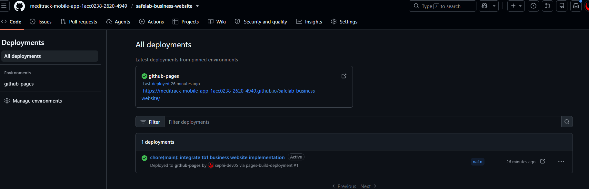
</p>

<p align="center"><i>Figura: Configuración de despliegue de los productos digitales de SafeLab.</i></p>

##### **Sprint 2 Deployment & Integration Configuration**

<p
  style="text-align: justify;
         text-indent: 0.5in;
         line-height: 1.5;
         margin: 0 0 12px 0;
         orphans: 2;
         widows: 2;">
  El despliegue de AV2 separa cinco componentes: Landing Page estática en GitHub Pages, frontend web Vue en
  Render, backend Spring Boot publicado como Web Service en Render, PostgreSQL administrado por Neon y
  cliente Android distribuido mediante GitHub Releases. La Landing Page enlaza los formularios públicos de
  autenticación y permite obtener la APK, pero no se conecta directamente a la base de datos.
</p>

<table border="1" style="width: 100%; border-collapse: collapse; page-break-inside: auto;">
<thead>
<tr>
<th style="text-align: center; vertical-align: middle; padding: 6px;">Componente</th>
<th style="text-align: center; vertical-align: middle; padding: 6px;">Plataforma y referencia</th>
<th style="text-align: center; vertical-align: middle; padding: 6px;">Configuración / flujo</th>
<th style="text-align: center; vertical-align: middle; padding: 6px;">Validación de AV2</th>
</tr>
</thead>
<tbody>
<tr style="page-break-inside: avoid;">
<td style="text-align: left; vertical-align: top; padding: 6px;">Landing Page</td>
<td style="text-align: left; vertical-align: top; padding: 6px;"><a href="https://meditrack-mobile-app-1acc0238-2620-4949.github.io/safelab-business-website/">GitHub Pages</a></td>
<td style="text-align: left; vertical-align: top; padding: 6px;">HTML, CSS y JavaScript publicados desde <code>main</code></td>
<td style="text-align: left; vertical-align: top; padding: 6px;">Página pública EN/ES con acceso a la web y descarga Android</td>
</tr>

<tr style="page-break-inside: avoid;">
<td style="text-align: left; vertical-align: top; padding: 6px;">Aplicación web</td>
<td style="text-align: left; vertical-align: top; padding: 6px;"><a href="https://safelab-frontend.onrender.com/">Render Static Site</a></td>
<td style="text-align: left; vertical-align: top; padding: 6px;">Vue y Vite; solicitudes HTTPS autenticadas a Spring Boot; reescritura <code>/* → /index.html</code> para rutas internas</td>
<td style="text-align: left; vertical-align: top; padding: 6px;">Pantallas de usuario, activos, permisos y sincronización</td>
</tr>

<tr style="page-break-inside: avoid;">
<td style="text-align: left; vertical-align: top; padding: 6px;">SafeLab Platform API</td>
<td style="text-align: left; vertical-align: top; padding: 6px;"><a href="https://safelab-platform-api.onrender.com/">Render Web Service</a></td>
<td style="text-align: left; vertical-align: top; padding: 6px;">Spring Boot + Docker; variables de entorno y documentación Swagger/OpenAPI</td>
<td style="text-align: left; vertical-align: top; padding: 6px;">Commits de configuración en <code>main</code> y endpoint de salud; pruebas funcionales por demostrar en la exposición</td>
</tr>

<tr style="page-break-inside: avoid;">
<td style="text-align: left; vertical-align: top; padding: 6px;">Base de datos</td>
<td style="text-align: left; vertical-align: top; padding: 6px;">Neon PostgreSQL</td>
<td style="text-align: left; vertical-align: top; padding: 6px;">Conexión privada entre API y PostgreSQL mediante variables de entorno; migraciones Flyway</td>
<td style="text-align: left; vertical-align: top; padding: 6px;">Persistencia entre clientes con separación por organización</td>
</tr>

<tr style="page-break-inside: avoid;">
<td style="text-align: left; vertical-align: top; padding: 6px;">Android</td>
<td style="text-align: left; vertical-align: top; padding: 6px;"><a href="https://github.com/meditrack-mobile-app-1acc0238-2620-4949/safelab-mobile-app/releases/tag/av2-v2.5.3">GitHub Release av2-v2.5.3</a></td>
<td style="text-align: left; vertical-align: top; padding: 6px;">APK de depuración para pruebas; consumo HTTPS desde dispositivo/emulador</td>
<td style="text-align: left; vertical-align: top; padding: 6px;">Archivo <code>SafeLab.apk</code> asociado a un tag y a un commit</td>
</tr>
</tbody>
</table>

<p
  style="text-align: justify;
         text-indent: 0.5in;
         line-height: 1.5;
         margin: 0 0 12px 0;
         orphans: 2;
         widows: 2;">
  Para reproducir el despliegue desde los repositorios, se integra el código aprobado en <code>main</code>,
  se construye el backend con Maven/Docker y se configura en Render el perfil PostgreSQL, la URL JDBC de
  Neon, las credenciales de aplicación y migración, y los orígenes CORS del frontend. La base se migra con
  Flyway sin reinicializar datos. El frontend se construye con Vite y utiliza la URL HTTPS de la API;
  GitHub Pages publica los cambios de la Landing Page. Para Android se ejecuta la compilación Gradle, se
  verifica el certificado de firma, se comprueba el APK en el dispositivo y se adjunta
  <code>SafeLab.apk</code> a la Release correspondiente.
</p>

<p
  style="text-align: justify;
         text-indent: 0.5in;
         line-height: 1.5;
         margin: 0 0 12px 0;
         orphans: 2;
         widows: 2;">
  En el emulador el host local de Spring Boot se representa mediante
  <code>http://10.0.2.2:8080/api/v1</code>; esa dirección no debe incluirse en la APK distribuida. En el
  entorno publicado, la aplicación consume la API HTTPS de Render. Los errores de resolución DNS y de
  tiempo de espera se manejan con recuperación controlada y mensajes diferenciados, sin presentar una falla
  de red como contraseña incorrecta. La sincronización funciona al retomar el primer plano, volver a
  consultar una sección o solicitar una actualización; no se ofrecen WebSockets ni actualización simultánea
  instantánea entre web y Android.
</p>

<p
  style="text-align: justify;
         text-indent: 0.5in;
         line-height: 1.5;
         margin: 0 0 12px 0;
         orphans: 2;
         widows: 2;">
  El diagrama de despliegue C4, solicitado para esta sección, debe representar los cinco componentes
  publicados y los enlaces HTTPS/JDBC entre ellos. Se mantiene la figura histórica de TB1 como antecedente,
  sin etiquetarla como el diagrama final de AV2. La figura de despliegue vigente se incorporará cuando se
  disponga de la evidencia visual del equipo.
</p>

## **4.2. Landing Page & Mobile Application Implementation**

<p
  style="text-align: justify;
         text-indent: 0.5in;
         line-height: 1.5;
         margin: 0 0 12px 0;
         orphans: 2;
         widows: 2;">
  La implementación del Sprint 1 se desarrolló en paralelo sobre la Landing Page y la aplicación móvil. La
  Landing Page tiene como propósito presentar públicamente la propuesta de valor de SafeLab, comunicar sus
  beneficios, servicios y plan comercial, mostrar información del producto y del equipo, y proporcionar
  mecanismos de interacción como testimonios, preguntas frecuentes, contacto e internacionalización EN/ES.
  Para organizar el trabajo se utilizaron ramas <code>feature/tb1-*</code> independientes y una etapa final
  de revisión transversal de calidad.
</p>

<p
  style="text-align: justify;
         text-indent: 0.5in;
         line-height: 1.5;
         margin: 0 0 12px 0;
         orphans: 2;
         widows: 2;">
  La aplicación móvil se implementó con Kotlin y Jetpack Compose siguiendo la separación por Bounded
  Contexts definida en la arquitectura del proyecto. En <code>develop</code> se prepararon los elementos
  compartidos, entre ellos la navegación general, la sidebar, la topbar y el tema visual. Posteriormente,
  cada Bounded Context se desarrolló en su propia rama y se integró en <code>develop</code>. Identity &amp;
  Access Management se utiliza como flujo de entrada mediante un usuario administrador local para la
  demostración de TB1 y no se expone como opción dentro de la sidebar.
</p>

<p
  style="text-align: justify;
         text-indent: 0.5in;
         line-height: 1.5;
         margin: 0 0 12px 0;
         orphans: 2;
         widows: 2;">
  Durante esta etapa, la aplicación móvil utiliza datos locales y repositorios en memoria con el fin de
  validar pantallas, flujos y consistencia visual sin depender todavía del backend. SafeLab Platform API se
  trabaja como un entregable técnico separado: sus endpoints y pruebas se preparan para que, en una etapa
  posterior, los datos mock del cliente Android puedan ser reemplazados por consumo de servicios RESTful
  sin rediseñar la interfaz ni la estructura de los Bounded Contexts.
</p>

### **4.2.1. Sprint 1**

#### **4.2.1.1. Sprint Planning 1**

<p
  style="text-align: justify;
         text-indent: 0.5in;
         line-height: 1.5;
         margin: 0 0 12px 0;
         orphans: 2;
         widows: 2;">
  Se presentan los principales aspectos definidos durante el Sprint Planning Meeting del Sprint 1 de
  SafeLab. La planificación establece el objetivo del Sprint, la capacidad del equipo y el alcance
  funcional seleccionado, priorizando las funcionalidades principales de organización y monitoreo
  ambiental, junto con la primera versión de la Landing Page.
</p>

<table border="1" style="width: 100%; border-collapse: collapse;">
<tr>
<th style="text-align: left; vertical-align: middle; padding: 6px; width: 35%;">Sprint #</th>
<td style="text-align: left; vertical-align: middle; padding: 6px;">1</td>
</tr>

<tr>
<th colspan="2" style="text-align: center; vertical-align: middle; padding: 6px;">Sprint Planning Background</th>
</tr>

<tr>
<td style="text-align: left; vertical-align: middle; padding: 6px;"><b>Date</b></td>
<td style="text-align: left; vertical-align: middle; padding: 6px;">2026-09-25</td>
</tr>

<tr>
<td style="text-align: left; vertical-align: middle; padding: 6px;"><b>Time</b></td>
<td style="text-align: left; vertical-align: middle; padding: 6px;">10:00 AM</td>
</tr>

<tr>
<td style="text-align: left; vertical-align: middle; padding: 6px;"><b>Location</b></td>
<td style="text-align: left; vertical-align: middle; padding: 6px;">UPC San Isidro</td>
</tr>

<tr>
<td style="text-align: left; vertical-align: middle; padding: 6px;"><b>Prepared By</b></td>
<td style="text-align: left; vertical-align: middle; padding: 6px;">Valeria Rojas</td>
</tr>

<tr>
<td style="text-align: left; vertical-align: top; padding: 6px;"><b>Attendees (to planning meeting)</b></td>
<td style="text-align: left; vertical-align: top; padding: 6px;">Braden Garcia / Victor Espino / Giusephi Carlos / Oscar Vara / Valeria Rojas</td>
</tr>

<tr>
<td style="text-align: left; vertical-align: top; padding: 6px;"><b>Sprint 1 Review Summary</b></td>
<td style="text-align: justify; vertical-align: top; padding: 6px;">The Sprint focused on organizing the SafeLab project, refining the requirements and Product Backlog, and preparing the Landing Page and the initial monitoring features required for the first product increment.</td>
</tr>

<tr>
<td style="text-align: left; vertical-align: top; padding: 6px;"><b>Sprint 1 Retrospective Summary</b></td>
<td style="text-align: justify; vertical-align: top; padding: 6px;">The team identified progress in the organization of requirements and project documentation, as well as opportunities to improve task coordination, distribution of responsibilities and consistency between the Product Backlog, Sprint Planning and implementation activities.</td>
</tr>

<tr>
<th colspan="2" style="text-align: center; vertical-align: middle; padding: 6px;">Sprint Goal & User Stories</th>
</tr>

<tr>
<td style="text-align: left; vertical-align: top; padding: 6px;"><b>Sprint 1 Goal</b></td>
<td style="text-align: justify; vertical-align: top; padding: 6px;">Our focus is on enabling the initial monitoring flow of SafeLab by organizing monitoring sites, storage areas and equipment, collecting and consulting essential environmental information, and making the product information available through the Landing Page.<br><br>
      We believe it delivers greater visibility and initial control of monitored environments to hospital laboratory and pharmaceutical company personnel, while allowing potential users to understand the SafeLab solution.<br><br>
      This will be confirmed when users can register a monitoring site, create a storage area, register and assign equipment, automatically collect monitoring data, consult temperature, humidity and equipment operational status, identify equipment without recent data, and visitors can access the SafeLab Landing Page, its supported languages and Terms and Conditions.</td>
</tr>

<tr>
<td style="text-align: left; vertical-align: middle; padding: 6px;"><b>Sprint 1 Velocity</b></td>
<td style="text-align: left; vertical-align: middle; padding: 6px;">60 Story Points</td>
</tr>

<tr>
<td style="text-align: left; vertical-align: middle; padding: 6px;"><b>Sum of Story Points</b></td>
<td style="text-align: left; vertical-align: middle; padding: 6px;">57 Story Points</td>
</tr>
</table>

#### **4.2.1.2. Aspect Leaders and Collaborators**

<p
  style="text-align: justify;
         text-indent: 0.5in;
         line-height: 1.5;
         margin: 0 0 12px 0;
         orphans: 2;
         widows: 2;">
  En el Sprint 1 se definieron tres aspectos de trabajo, que corresponden al alcance funcional del Sprint
  Backlog 1. El aspecto <b>Organización del monitoreo</b> agrupa el registro de sitios de monitoreo, áreas
  de almacenamiento y equipos, así como sus servicios RESTful (US01, US03, US05, US07 y US60). El aspecto
  <b>Monitoreo ambiental</b> agrupa la recolección automática de datos, la consulta de temperatura, humedad
  y estado operativo, y sus servicios (US09, US10, US11, US13, US15, US16 y US61). El aspecto <b>Landing
  Page</b> agrupa la presentación pública de SafeLab, el cambio de idioma y el acceso a los Términos y
  Condiciones (US56, US57 y US58).
</p>

<p
  style="text-align: justify;
         text-indent: 0.5in;
         line-height: 1.5;
         margin: 0 0 12px 0;
         orphans: 2;
         widows: 2;">
  Para cada aspecto se designó como líder (L) al integrante con mayor carga de horas asignadas en el Sprint
  Backlog 1, quien coordina el avance, define los criterios de terminado y verifica la integración del
  aspecto; los demás integrantes con tareas en el aspecto participan como colaboradores (C). La siguiente
  Leadership-and-Collaboration Matrix (LACX) resume esta distribución.
</p>

<table border="1" style="width: 100%; border-collapse: collapse;">
<thead>
<tr>
<th style="text-align: center; vertical-align: middle; padding: 6px;">Team Member (Last Name, First Name)</th>
<th style="text-align: center; vertical-align: middle; padding: 6px;">GitHub Username</th>
<th style="text-align: center; vertical-align: middle; padding: 6px;">Organización del monitoreo</th>
<th style="text-align: center; vertical-align: middle; padding: 6px;">Monitoreo ambiental</th>
<th style="text-align: center; vertical-align: middle; padding: 6px;">Landing Page</th>
</tr>
</thead>
<tbody>
<tr>
<td style="text-align: left; vertical-align: top; padding: 6px;">Carlos Lavado, Ever Giusephi</td>
<td style="text-align: center; vertical-align: middle; padding: 6px;">sephi-dev05</td>
<td style="text-align: center; vertical-align: middle; padding: 6px;">L</td>
<td style="text-align: center; vertical-align: middle; padding: 6px;">C</td>
<td style="text-align: center; vertical-align: middle; padding: 6px;">—</td>
</tr>

<tr>
<td style="text-align: left; vertical-align: top; padding: 6px;">Espino Rossi, Victor Manuel</td>
<td style="text-align: center; vertical-align: middle; padding: 6px;">Vmer140</td>
<td style="text-align: center; vertical-align: middle; padding: 6px;">C</td>
<td style="text-align: center; vertical-align: middle; padding: 6px;">C</td>
<td style="text-align: center; vertical-align: middle; padding: 6px;">—</td>
</tr>

<tr>
<td style="text-align: left; vertical-align: top; padding: 6px;">Garcia Cerpa, Braden Raid</td>
<td style="text-align: center; vertical-align: middle; padding: 6px;">BradenGarcia</td>
<td style="text-align: center; vertical-align: middle; padding: 6px;">—</td>
<td style="text-align: center; vertical-align: middle; padding: 6px;">L</td>
<td style="text-align: center; vertical-align: middle; padding: 6px;">—</td>
</tr>

<tr>
<td style="text-align: left; vertical-align: top; padding: 6px;">Rojas Gomez, Valeria Alexandra</td>
<td style="text-align: center; vertical-align: middle; padding: 6px;">ValeriaAler</td>
<td style="text-align: center; vertical-align: middle; padding: 6px;">—</td>
<td style="text-align: center; vertical-align: middle; padding: 6px;">C</td>
<td style="text-align: center; vertical-align: middle; padding: 6px;">L</td>
</tr>

<tr>
<td style="text-align: left; vertical-align: top; padding: 6px;">Vara Velásquez, Oscar Fernando</td>
<td style="text-align: center; vertical-align: middle; padding: 6px;">varometro159</td>
<td style="text-align: center; vertical-align: middle; padding: 6px;">C</td>
<td style="text-align: center; vertical-align: middle; padding: 6px;">C</td>
<td style="text-align: center; vertical-align: middle; padding: 6px;">C</td>
</tr>
</tbody>
</table>

#### **4.2.1.3. Sprint Backlog 1**

<p
  style="text-align: justify;
         text-indent: 0.5in;
         line-height: 1.5;
         margin: 0 0 12px 0;
         orphans: 2;
         widows: 2;">
  El Sprint Backlog 1 reúne las User Stories y Work-items definidos para alcanzar el objetivo del primer
  Sprint de SafeLab. El trabajo se enfoca en establecer la organización inicial del entorno de monitoreo,
  permitir la recolección y consulta de información ambiental y desarrollar las funcionalidades
  correspondientes a la Landing Page. Las actividades se distribuyen entre los integrantes del equipo
  Meditrack y se estiman en horas para facilitar el seguimiento de su avance durante el Sprint.
</p>

<table border="1" style="width: 100%; border-collapse: collapse;">
<thead>
<tr>
<th colspan="8" style="text-align: left; vertical-align: middle; padding: 6px;">Sprint # &nbsp;&nbsp; Sprint 1</th>
</tr>

<tr>
<th style="text-align: center; vertical-align: middle; padding: 6px;">User Story Id</th>
<th style="text-align: center; vertical-align: middle; padding: 6px;">Title</th>
<th style="text-align: center; vertical-align: middle; padding: 6px;">Work-Item / Task Id</th>
<th style="text-align: center; vertical-align: middle; padding: 6px;">Title</th>
<th style="text-align: center; vertical-align: middle; padding: 6px;">Description</th>
<th style="text-align: center; vertical-align: middle; padding: 6px;">Estimation (Hours)</th>
<th style="text-align: center; vertical-align: middle; padding: 6px;">Assigned To</th>
<th style="text-align: center; vertical-align: middle; padding: 6px;">Status</th>
</tr>
</thead>
<tbody>
<tr>
<td style="text-align:center; padding:6px;">US01</td>
<td style="padding:6px;">Registrar sitio de monitoreo</td>
<td style="text-align:center; padding:6px;">UT01</td>
<td style="padding:6px;">Implementar registro de sitio</td>
<td style="padding:6px;">Implementar el registro de un sitio de monitoreo con nombre y ubicación.</td>
<td style="text-align:center; padding:6px;">3</td>
<td style="padding:6px;">Victor Espino</td>
<td style="text-align:center; padding:6px;">To-Do</td>
</tr>

<tr>
<td style="text-align:center; padding:6px;">US01</td>
<td style="padding:6px;">Registrar sitio de monitoreo</td>
<td style="text-align:center; padding:6px;">UT02</td>
<td style="padding:6px;">Validar datos del sitio</td>
<td style="padding:6px;">Validar que el registro requiera nombre y ubicación antes de almacenar el sitio.</td>
<td style="text-align:center; padding:6px;">3</td>
<td style="padding:6px;">Victor Espino</td>
<td style="text-align:center; padding:6px;">To-Do</td>
</tr>

<tr>
<td style="text-align:center; padding:6px;">US03</td>
<td style="padding:6px;">Crear área de almacenamiento</td>
<td style="text-align:center; padding:6px;">UT03</td>
<td style="padding:6px;">Implementar creación de área</td>
<td style="padding:6px;">Implementar la creación de áreas de almacenamiento con nombre y tipo.</td>
<td style="text-align:center; padding:6px;">3</td>
<td style="padding:6px;">Giusephi Carlos</td>
<td style="text-align:center; padding:6px;">To-Do</td>
</tr>

<tr>
<td style="text-align:center; padding:6px;">US03</td>
<td style="padding:6px;">Crear área de almacenamiento</td>
<td style="text-align:center; padding:6px;">UT04</td>
<td style="padding:6px;">Validar datos del área</td>
<td style="padding:6px;">Validar que el área cuente con nombre y tipo antes de registrarse.</td>
<td style="text-align:center; padding:6px;">3</td>
<td style="padding:6px;">Giusephi Carlos</td>
<td style="text-align:center; padding:6px;">To-Do</td>
</tr>

<tr>
<td style="text-align:center; padding:6px;">US05</td>
<td style="padding:6px;">Registrar equipo</td>
<td style="text-align:center; padding:6px;">UT05</td>
<td style="padding:6px;">Implementar registro de equipo</td>
<td style="padding:6px;">Implementar el registro de equipos con nombre, tipo e identificador.</td>
<td style="text-align:center; padding:6px;">4</td>
<td style="padding:6px;">Oscar Vara</td>
<td style="text-align:center; padding:6px;">To-Do</td>
</tr>

<tr>
<td style="text-align:center; padding:6px;">US05</td>
<td style="padding:6px;">Registrar equipo</td>
<td style="text-align:center; padding:6px;">UT06</td>
<td style="padding:6px;">Validar información del equipo</td>
<td style="padding:6px;">Validar los datos requeridos del equipo antes de completar su registro.</td>
<td style="text-align:center; padding:6px;">4</td>
<td style="padding:6px;">Oscar Vara</td>
<td style="text-align:center; padding:6px;">To-Do</td>
</tr>

<tr>
<td style="text-align:center; padding:6px;">US07</td>
<td style="padding:6px;">Asignar equipo a un área</td>
<td style="text-align:center; padding:6px;">UT07</td>
<td style="padding:6px;">Implementar asignación de equipo</td>
<td style="padding:6px;">Implementar la asociación de un equipo registrado con un área de almacenamiento registrada.</td>
<td style="text-align:center; padding:6px;">3</td>
<td style="padding:6px;">Victor Espino</td>
<td style="text-align:center; padding:6px;">To-Do</td>
</tr>

<tr>
<td style="text-align:center; padding:6px;">US07</td>
<td style="padding:6px;">Asignar equipo a un área</td>
<td style="text-align:center; padding:6px;">UT08</td>
<td style="padding:6px;">Validar asociación equipo-área</td>
<td style="padding:6px;">Verificar que la asignación conserve correctamente la relación entre el equipo y el área seleccionada.</td>
<td style="text-align:center; padding:6px;">3</td>
<td style="padding:6px;">Victor Espino</td>
<td style="text-align:center; padding:6px;">To-Do</td>
</tr>

<tr>
<td style="text-align:center; padding:6px;">US60</td>
<td style="padding:6px;">Proporcionar servicios de organización del monitoreo</td>
<td style="text-align:center; padding:6px;">UT09</td>
<td style="padding:6px;">Implementar servicios de organización</td>
<td style="padding:6px;">Implementar las operaciones RESTful requeridas para sitios, áreas de almacenamiento y equipos.</td>
<td style="text-align:center; padding:6px;">5</td>
<td style="padding:6px;">Giusephi Carlos</td>
<td style="text-align:center; padding:6px;">To-Do</td>
</tr>

<tr>
<td style="text-align:center; padding:6px;">US60</td>
<td style="padding:6px;">Proporcionar servicios de organización del monitoreo</td>
<td style="text-align:center; padding:6px;">UT10</td>
<td style="padding:6px;">Validar respuestas de organización</td>
<td style="padding:6px;">Validar las respuestas de las operaciones de organización y el manejo de recursos no disponibles.</td>
<td style="text-align:center; padding:6px;">5</td>
<td style="padding:6px;">Giusephi Carlos</td>
<td style="text-align:center; padding:6px;">To-Do</td>
</tr>

<tr>
<td style="text-align:center; padding:6px;">US16</td>
<td style="padding:6px;">Recolección automática de datos</td>
<td style="text-align:center; padding:6px;">UT11</td>
<td style="padding:6px;">Implementar recolección automática</td>
<td style="padding:6px;">Implementar el registro automático de nuevas lecturas de monitoreo recibidas por SafeLab.</td>
<td style="text-align:center; padding:6px;">5</td>
<td style="padding:6px;">Valeria Rojas</td>
<td style="text-align:center; padding:6px;">To-Do</td>
</tr>

<tr>
<td style="text-align:center; padding:6px;">US16</td>
<td style="padding:6px;">Recolección automática de datos</td>
<td style="text-align:center; padding:6px;">UT12</td>
<td style="padding:6px;">Asociar lecturas con equipos</td>
<td style="padding:6px;">Verificar que cada lectura recolectada quede asociada al equipo de monitoreo correspondiente.</td>
<td style="text-align:center; padding:6px;">5</td>
<td style="padding:6px;">Valeria Rojas</td>
<td style="text-align:center; padding:6px;">To-Do</td>
</tr>

<tr>
<td style="text-align:center; padding:6px;">US61</td>
<td style="padding:6px;">Proporcionar servicios de monitoreo ambiental</td>
<td style="text-align:center; padding:6px;">UT13</td>
<td style="padding:6px;">Exponer datos ambientales</td>
<td style="padding:6px;">Implementar servicios RESTful para proporcionar temperatura, humedad y estado de los equipos.</td>
<td style="text-align:center; padding:6px;">4</td>
<td style="padding:6px;">Braden Garcia</td>
<td style="text-align:center; padding:6px;">To-Do</td>
</tr>

<tr>
<td style="text-align:center; padding:6px;">US61</td>
<td style="padding:6px;">Proporcionar servicios de monitoreo ambiental</td>
<td style="text-align:center; padding:6px;">UT14</td>
<td style="padding:6px;">Validar consultas de monitoreo</td>
<td style="padding:6px;">Validar las consultas de monitoreo cuando los datos o el equipo solicitado no se encuentran disponibles.</td>
<td style="text-align:center; padding:6px;">4</td>
<td style="padding:6px;">Braden Garcia</td>
<td style="text-align:center; padding:6px;">To-Do</td>
</tr>

<tr>
<td style="text-align:center; padding:6px;">US09</td>
<td style="padding:6px;">Visualizar valores de temperatura</td>
<td style="text-align:center; padding:6px;">UT15</td>
<td style="padding:6px;">Mostrar temperatura del equipo</td>
<td style="padding:6px;">Implementar la consulta y visualización del valor de temperatura disponible para un equipo.</td>
<td style="text-align:center; padding:6px;">3</td>
<td style="padding:6px;">Braden Garcia</td>
<td style="text-align:center; padding:6px;">To-Do</td>
</tr>

<tr>
<td style="text-align:center; padding:6px;">US09</td>
<td style="padding:6px;">Visualizar valores de temperatura</td>
<td style="text-align:center; padding:6px;">UT16</td>
<td style="padding:6px;">Gestionar temperatura no disponible</td>
<td style="padding:6px;">Identificar correctamente cuando un equipo no dispone de una lectura de temperatura.</td>
<td style="text-align:center; padding:6px;">3</td>
<td style="padding:6px;">Braden Garcia</td>
<td style="text-align:center; padding:6px;">To-Do</td>
</tr>

<tr>
<td style="text-align:center; padding:6px;">US10</td>
<td style="padding:6px;">Visualizar valores de humedad</td>
<td style="text-align:center; padding:6px;">UT17</td>
<td style="padding:6px;">Mostrar humedad del equipo</td>
<td style="padding:6px;">Implementar la consulta y visualización del valor de humedad disponible para un equipo.</td>
<td style="text-align:center; padding:6px;">3</td>
<td style="padding:6px;">Braden Garcia</td>
<td style="text-align:center; padding:6px;">To-Do</td>
</tr>

<tr>
<td style="text-align:center; padding:6px;">US10</td>
<td style="padding:6px;">Visualizar valores de humedad</td>
<td style="text-align:center; padding:6px;">UT18</td>
<td style="padding:6px;">Gestionar humedad no disponible</td>
<td style="padding:6px;">Identificar correctamente cuando un equipo no dispone de una lectura de humedad.</td>
<td style="text-align:center; padding:6px;">3</td>
<td style="padding:6px;">Braden Garcia</td>
<td style="text-align:center; padding:6px;">To-Do</td>
</tr>

<tr>
<td style="text-align:center; padding:6px;">US11</td>
<td style="padding:6px;">Visualizar estado operativo del equipo</td>
<td style="text-align:center; padding:6px;">UT19</td>
<td style="padding:6px;">Determinar estado operativo</td>
<td style="padding:6px;">Implementar la consulta del estado operativo de un equipo a partir de la información de monitoreo disponible.</td>
<td style="text-align:center; padding:6px;">3</td>
<td style="padding:6px;">Oscar Vara</td>
<td style="text-align:center; padding:6px;">To-Do</td>
</tr>

<tr>
<td style="text-align:center; padding:6px;">US11</td>
<td style="padding:6px;">Visualizar estado operativo del equipo</td>
<td style="text-align:center; padding:6px;">UT20</td>
<td style="padding:6px;">Validar interrupción de monitoreo</td>
<td style="padding:6px;">Verificar el comportamiento cuando un equipo deja de proporcionar datos de monitoreo.</td>
<td style="text-align:center; padding:6px;">3</td>
<td style="padding:6px;">Oscar Vara</td>
<td style="text-align:center; padding:6px;">To-Do</td>
</tr>

<tr>
<td style="text-align:center; padding:6px;">US13</td>
<td style="padding:6px;">Visualizar lista de equipos con datos en tiempo real</td>
<td style="text-align:center; padding:6px;">UT21</td>
<td style="padding:6px;">Mostrar equipos con valores actuales</td>
<td style="padding:6px;">Implementar la lista de equipos junto con sus valores actuales de monitoreo.</td>
<td style="text-align:center; padding:6px;">3</td>
<td style="padding:6px;">Giusephi Carlos</td>
<td style="text-align:center; padding:6px;">To-Do</td>
</tr>

<tr>
<td style="text-align:center; padding:6px;">US13</td>
<td style="padding:6px;">Visualizar lista de equipos con datos en tiempo real</td>
<td style="text-align:center; padding:6px;">UT22</td>
<td style="padding:6px;">Identificar valores actuales faltantes</td>
<td style="padding:6px;">Verificar que la lista permita identificar equipos que no disponen de datos actuales.</td>
<td style="text-align:center; padding:6px;">3</td>
<td style="padding:6px;">Giusephi Carlos</td>
<td style="text-align:center; padding:6px;">To-Do</td>
</tr>

<tr>
<td style="text-align:center; padding:6px;">US15</td>
<td style="padding:6px;">Identificar equipos sin datos recientes</td>
<td style="text-align:center; padding:6px;">UT23</td>
<td style="padding:6px;">Detectar equipos sin datos recientes</td>
<td style="padding:6px;">Implementar la identificación de equipos que no disponen de datos recientes de monitoreo.</td>
<td style="text-align:center; padding:6px;">3</td>
<td style="padding:6px;">Victor Espino</td>
<td style="text-align:center; padding:6px;">To-Do</td>
</tr>

<tr>
<td style="text-align:center; padding:6px;">US15</td>
<td style="padding:6px;">Identificar equipos sin datos recientes</td>
<td style="text-align:center; padding:6px;">UT24</td>
<td style="padding:6px;">Validar identificación de equipos</td>
<td style="padding:6px;">Verificar que únicamente los equipos sin datos recientes sean identificados por esta funcionalidad.</td>
<td style="text-align:center; padding:6px;">3</td>
<td style="padding:6px;">Victor Espino</td>
<td style="text-align:center; padding:6px;">To-Do</td>
</tr>

<tr>
<td style="text-align:center; padding:6px;">US56</td>
<td style="padding:6px;">Visualizar la Landing Page de SafeLab</td>
<td style="text-align:center; padding:6px;">UT25</td>
<td style="padding:6px;">Implementar contenido principal de Landing Page</td>
<td style="padding:6px;">Implementar el contenido principal necesario para presentar SafeLab públicamente.</td>
<td style="text-align:center; padding:6px;">3</td>
<td style="padding:6px;">Valeria Rojas</td>
<td style="text-align:center; padding:6px;">To-Do</td>
</tr>

<tr>
<td style="text-align:center; padding:6px;">US56</td>
<td style="padding:6px;">Visualizar la Landing Page de SafeLab</td>
<td style="text-align:center; padding:6px;">UT26</td>
<td style="padding:6px;">Validar acceso público a Landing Page</td>
<td style="padding:6px;">Verificar que la Landing Page y su información principal puedan consultarse públicamente.</td>
<td style="text-align:center; padding:6px;">2</td>
<td style="padding:6px;">Valeria Rojas</td>
<td style="text-align:center; padding:6px;">To-Do</td>
</tr>

<tr>
<td style="text-align:center; padding:6px;">US57</td>
<td style="padding:6px;">Cambiar el idioma de la Landing Page</td>
<td style="text-align:center; padding:6px;">UT27</td>
<td style="padding:6px;">Implementar contenido en inglés</td>
<td style="padding:6px;">Implementar el contenido en inglés (en_US) como idioma predeterminado de la Landing Page.</td>
<td style="text-align:center; padding:6px;">3</td>
<td style="padding:6px;">Valeria Rojas</td>
<td style="text-align:center; padding:6px;">To-Do</td>
</tr>

<tr>
<td style="text-align:center; padding:6px;">US57</td>
<td style="padding:6px;">Cambiar el idioma de la Landing Page</td>
<td style="text-align:center; padding:6px;">UT28</td>
<td style="padding:6px;">Implementar cambio a español</td>
<td style="padding:6px;">Implementar el cambio de contenido a español latinoamericano (es_419).</td>
<td style="text-align:center; padding:6px;">3</td>
<td style="padding:6px;">Valeria Rojas</td>
<td style="text-align:center; padding:6px;">To-Do</td>
</tr>

<tr>
<td style="text-align:center; padding:6px;">US58</td>
<td style="padding:6px;">Acceder a los Términos y Condiciones</td>
<td style="text-align:center; padding:6px;">UT29</td>
<td style="padding:6px;">Implementar acceso a Términos y Condiciones</td>
<td style="padding:6px;">Implementar el acceso a los Términos y Condiciones desde la Landing Page.</td>
<td style="text-align:center; padding:6px;">3</td>
<td style="padding:6px;">Oscar Vara</td>
<td style="text-align:center; padding:6px;">To-Do</td>
</tr>

<tr>
<td style="text-align:center; padding:6px;">US58</td>
<td style="padding:6px;">Acceder a los Términos y Condiciones</td>
<td style="text-align:center; padding:6px;">UT30</td>
<td style="padding:6px;">Validar contenido de Términos y Condiciones</td>
<td style="padding:6px;">Verificar que el contenido correspondiente a los Términos y Condiciones pueda consultarse desde SafeLab.</td>
<td style="text-align:center; padding:6px;">2</td>
<td style="padding:6px;">Oscar Vara</td>
<td style="text-align:center; padding:6px;">To-Do</td>
</tr>
</tbody>
</table>

<p
  style="text-align: justify;
         text-indent: 0.5in;
         line-height: 1.5;
         margin: 0 0 12px 0;
         orphans: 2;
         widows: 2;">
  El Sprint Backlog 1 de SafeLab se gestiona mediante Jira, donde se encuentran organizadas las User
  Stories seleccionadas para el Sprint, sus estimaciones en Story Points, responsables y Work-items
  asociados. El tablero permite al equipo Meditrack realizar el seguimiento de las actividades y su estado
  durante el desarrollo del Sprint.
</p>

<p align="center">
  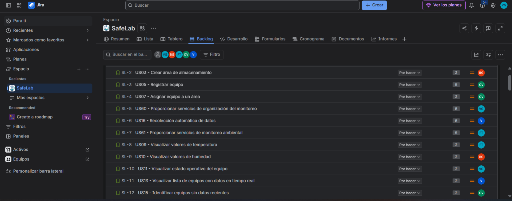
</p>

<p align="center"><i>Figura: Sprint Backlog 1 de SafeLab en Jira.</i></p>

**Board URL:** [SafeLab - Sprint 1](https://ipoundzy.atlassian.net/jira/software/projects/SL/boards/2/backlog)

#### **4.2.1.4. Development Evidence for Sprint Review**

<p
  style="text-align: justify;
         text-indent: 0.5in;
         line-height: 1.5;
         margin: 0 0 12px 0;
         orphans: 2;
         widows: 2;">
  Durante el Sprint 1 el equipo concentró el trabajo de implementación en la aplicación móvil de SafeLab,
  desarrollada de forma nativa para Android con Kotlin y Jetpack Compose (Material 3). El repositorio
  <code>safelab-mobile-app</code> se organizó siguiendo el flujo de trabajo GitFlow: la rama
  <code>main</code> contiene la versión estable, la rama <code>develop</code> concentra la integración y
  cada bounded context se desarrolla en su propia rama
  <code>feature/tb1-bc-&lt;bounded-context&gt;</code>, de modo que cada integrante trabajó de manera
  independiente sobre el módulo que tenía asignado.
</p>

<p
  style="text-align: justify;
         text-indent: 0.5in;
         line-height: 1.5;
         margin: 0 0 12px 0;
         orphans: 2;
         widows: 2;">
  En primer lugar se construyó en <code>develop</code> la estructura base del proyecto: el shell de la
  aplicación con el menú lateral (sidebar) y la barra superior, el tema visual con la paleta de colores
  de SafeLab, la navegación entre módulos y la estructura de carpetas por bounded context organizada en
  capas (<code>domain</code>, <code>data</code> y <code>presentation</code>). Sobre esa base, cada
  bounded context se implementó con un patrón común: modelos de dominio en Kotlin, datos de prueba (mock
  data) cargados en un repositorio en memoria, componentes de interfaz reutilizables propios del módulo y
  pantallas con navegación interna. En este sprint la aplicación funciona con datos locales; la
  integración con los Web Services se realizará en el siguiente sprint.
</p>

Los principales avances por bounded context fueron los siguientes:

- **Dashboard Overview:** dashboard operativo con los indicadores generales y pantalla de tendencias de monitoreo.
- **Monitoring Organization:** gestión de sedes de monitoreo, áreas de almacenamiento y registro de equipos.
- **Equipment Maintenance:** condición de los equipos, registro de mantenimientos, historial de mantenimiento y confiabilidad de los equipos.
- **Reporting & Compliance:** reportes, datos históricos, generación y exportación de reportes, y monitoreo de cumplimiento normativo.
- **Sensor Monitoring:** monitoreo en vivo de sensores con búsqueda y filtros, detalle del sensor con umbrales y calibraciones, historial de lecturas con gráfica y sensores fuera de línea.
- **Alerts & Incidents:** listado y detalle de alertas, reglas de alerta, y listado y detalle de incidentes.
- **Audit & Traceability:** registro de auditoría (audit trail) y línea de trazabilidad.
  En total se implementaron 25 pantallas funcionales distribuidas en 7 bounded contexts. La siguiente tabla presenta los commits del repositorio de la aplicación móvil relacionados con la implementación durante el Sprint 1.

| Repository                                                 | Branch                                 | Commit Id | Commit Message                                                                  | Commit Message Body | Committed on (Date) |
| ---------------------------------------------------------- | -------------------------------------- | --------- | ------------------------------------------------------------------------------- | ------------------- | ------------------- |
| meditrack-mobile-app-1acc0238-2620-4949/safelab-mobile-app | main                                   | 8999796   | Initial commit                                                                  | —                   | 02/10/2026          |
| meditrack-mobile-app-1acc0238-2620-4949/safelab-mobile-app | develop                                | a00e60d   | feat: add initial structure for mobile-app                                      | —                   | 03/10/2026          |
| meditrack-mobile-app-1acc0238-2620-4949/safelab-mobile-app | develop                                | 9d6c0e9   | feat: add new proyect base form for mobile-app                                  | —                   | 03/10/2026          |
| meditrack-mobile-app-1acc0238-2620-4949/safelab-mobile-app | feature/tb1-bc-dashboard-overview      | d199a71   | feat(dashboard): add dashboard domain models                                    | —                   | 03/10/2026          |
| meditrack-mobile-app-1acc0238-2620-4949/safelab-mobile-app | feature/tb1-bc-dashboard-overview      | 5d0cace   | feat(dashboard): add mock data for dashboard overview                           | —                   | 03/10/2026          |
| meditrack-mobile-app-1acc0238-2620-4949/safelab-mobile-app | feature/tb1-bc-dashboard-overview      | b1611ee   | feat(dashboard): add reusable dashboard UI components                           | —                   | 03/10/2026          |
| meditrack-mobile-app-1acc0238-2620-4949/safelab-mobile-app | feature/tb1-bc-dashboard-overview      | 3d6437b   | feat(dashboard): implement operational dashboard screen                         | —                   | 03/10/2026          |
| meditrack-mobile-app-1acc0238-2620-4949/safelab-mobile-app | feature/tb1-bc-dashboard-overview      | 298087b   | feat(dashboard): implement monitoring trends screen                             | —                   | 03/10/2026          |
| meditrack-mobile-app-1acc0238-2620-4949/safelab-mobile-app | feature/tb1-bc-dashboard-overview      | 460b5de   | feat(dashboard): connect dashboard overview entry screen                        | —                   | 03/10/2026          |
| meditrack-mobile-app-1acc0238-2620-4949/safelab-mobile-app | feature/tb1-bc-dashboard-overview      | c4a745b   | fix(navigation): remove identity access from sidebar                            | —                   | 03/10/2026          |
| meditrack-mobile-app-1acc0238-2620-4949/safelab-mobile-app | feature/tb1-bc-monitoring-organization | 6b63b5a   | feat(monitoring-organization): add domain models for sites, areas and equipment | —                   | 05/10/2026          |
| meditrack-mobile-app-1acc0238-2620-4949/safelab-mobile-app | feature/tb1-bc-monitoring-organization | dcf8800   | feat(monitoring-organization): add mock data and in-memory repository           | —                   | 05/10/2026          |
| meditrack-mobile-app-1acc0238-2620-4949/safelab-mobile-app | feature/tb1-bc-monitoring-organization | d7228ad   | feat(monitoring-organization): add reusable UI components                       | —                   | 05/10/2026          |
| meditrack-mobile-app-1acc0238-2620-4949/safelab-mobile-app | feature/tb1-bc-monitoring-organization | 7c321b4   | feat(monitoring-organization): implement monitoring sites screen                | —                   | 05/10/2026          |
| meditrack-mobile-app-1acc0238-2620-4949/safelab-mobile-app | feature/tb1-bc-monitoring-organization | 5f28e88   | feat(monitoring-organization): implement storage areas screen                   | —                   | 05/10/2026          |
| meditrack-mobile-app-1acc0238-2620-4949/safelab-mobile-app | feature/tb1-bc-monitoring-organization | 9f43d09   | feat(monitoring-organization): implement equipment registry screen              | —                   | 05/10/2026          |
| meditrack-mobile-app-1acc0238-2620-4949/safelab-mobile-app | feature/tb1-bc-monitoring-organization | 2eff849   | feat(monitoring-organization): connect module entry navigation                  | —                   | 05/10/2026          |
| meditrack-mobile-app-1acc0238-2620-4949/safelab-mobile-app | feature/tb1-bc-equipment-maintenance   | 9f35e19   | feat(equipment-maintenance): add condition, maintenance and reliability models  | —                   | 05/10/2026          |
| meditrack-mobile-app-1acc0238-2620-4949/safelab-mobile-app | feature/tb1-bc-equipment-maintenance   | 7901a54   | feat(equipment-maintenance): add mock data and in-memory repository             | —                   | 05/10/2026          |
| meditrack-mobile-app-1acc0238-2620-4949/safelab-mobile-app | feature/tb1-bc-equipment-maintenance   | d78224a   | feat(equipment-maintenance): add reusable UI components                         | —                   | 05/10/2026          |
| meditrack-mobile-app-1acc0238-2620-4949/safelab-mobile-app | feature/tb1-bc-equipment-maintenance   | cff54bc   | feat(equipment-maintenance): implement equipment condition screen               | —                   | 05/10/2026          |
| meditrack-mobile-app-1acc0238-2620-4949/safelab-mobile-app | feature/tb1-bc-equipment-maintenance   | 51d754f   | feat(equipment-maintenance): implement maintenance history screen               | —                   | 05/10/2026          |
| meditrack-mobile-app-1acc0238-2620-4949/safelab-mobile-app | feature/tb1-bc-equipment-maintenance   | 84cb4af   | feat(equipment-maintenance): implement maintenance record screen                | —                   | 05/10/2026          |
| meditrack-mobile-app-1acc0238-2620-4949/safelab-mobile-app | feature/tb1-bc-equipment-maintenance   | 8d1296e   | feat(equipment-maintenance): implement equipment reliability screen             | —                   | 05/10/2026          |
| meditrack-mobile-app-1acc0238-2620-4949/safelab-mobile-app | feature/tb1-bc-equipment-maintenance   | 692fba3   | feat(equipment-maintenance): connect module entry navigation                    | —                   | 05/10/2026          |
| meditrack-mobile-app-1acc0238-2620-4949/safelab-mobile-app | feature/tb1-bc-reporting-compliance    | cd5babc   | feat(reporting): implement reports and historical data screens                  | —                   | 05/10/2026          |
| meditrack-mobile-app-1acc0238-2620-4949/safelab-mobile-app | feature/tb1-bc-reporting-compliance    | 2ca92ba   | feat(reporting): add report generation and export screens                       | —                   | 05/10/2026          |
| meditrack-mobile-app-1acc0238-2620-4949/safelab-mobile-app | feature/tb1-bc-reporting-compliance    | b1e3683   | feat(compliance): implement compliance monitoring screen                        | —                   | 05/10/2026          |
| meditrack-mobile-app-1acc0238-2620-4949/safelab-mobile-app | feature/tb1-bc-reporting-compliance    | 23fc082   | feat(reporting): connect reporting compliance navigation                        | —                   | 05/10/2026          |
| meditrack-mobile-app-1acc0238-2620-4949/safelab-mobile-app | feature/tb1-bc-sensor-monitoring       | f9587cc   | feat(sensor-monitoring): add sensor, reading, threshold and calibration models  | —                   | 05/10/2026          |
| meditrack-mobile-app-1acc0238-2620-4949/safelab-mobile-app | feature/tb1-bc-sensor-monitoring       | fbc2c6a   | feat(sensor-monitoring): add mock data and in-memory repository                 | —                   | 05/10/2026          |
| meditrack-mobile-app-1acc0238-2620-4949/safelab-mobile-app | feature/tb1-bc-sensor-monitoring       | 4558685   | feat(sensor-monitoring): add reusable UI components                             | —                   | 05/10/2026          |
| meditrack-mobile-app-1acc0238-2620-4949/safelab-mobile-app | feature/tb1-bc-sensor-monitoring       | d2596ff   | feat(sensor-monitoring): implement live monitoring screen                       | —                   | 05/10/2026          |
| meditrack-mobile-app-1acc0238-2620-4949/safelab-mobile-app | feature/tb1-bc-sensor-monitoring       | dacc8e1   | feat(sensor-monitoring): implement sensor detail screen                         | —                   | 05/10/2026          |
| meditrack-mobile-app-1acc0238-2620-4949/safelab-mobile-app | feature/tb1-bc-sensor-monitoring       | 3d0f08d   | feat(sensor-monitoring): implement historical readings screen                   | —                   | 05/10/2026          |
| meditrack-mobile-app-1acc0238-2620-4949/safelab-mobile-app | feature/tb1-bc-sensor-monitoring       | a544a07   | feat(sensor-monitoring): implement offline sensors screen                       | —                   | 05/10/2026          |
| meditrack-mobile-app-1acc0238-2620-4949/safelab-mobile-app | feature/tb1-bc-sensor-monitoring       | 73ad49b   | feat(sensor-monitoring): connect module entry navigation                        | —                   | 05/10/2026          |
| meditrack-mobile-app-1acc0238-2620-4949/safelab-mobile-app | feature/tb1-bc-alerts-incidents        | 6bf3113   | feat: add alerts and incidents bounded context                                  | —                   | 05/10/2026          |
| meditrack-mobile-app-1acc0238-2620-4949/safelab-mobile-app | feature/tb1-bc-audit-traceability      | c4f8e1a   | feat: add audit and traceability bounded context                                | —                   | 05/10/2026          |
| meditrack-mobile-app-1acc0238-2620-4949/safelab-mobile-app | feature/tb1-bc-audit-traceability      | c0e347f   | fix: move audit traceability files to bounded context root                      | —                   | 05/10/2026          |

#### **4.2.1.5. Testing Suite Evidence for Sprint Review**

<p
  style="text-align: justify;
         text-indent: 0.5in;
         line-height: 1.5;
         margin: 0 0 12px 0;
         orphans: 2;
         widows: 2;">
  Se presenta el conjunto de pruebas automatizadas elaborado para los Web Services de la <i>SafeLab
  Platform API</i> relacionados con las User Stories del Sprint 1: <b>US60 - Proporcionar servicios de
  organización del monitoreo</b>, <b>US61 - Proporcionar servicios de monitoreo ambiental</b> y <b>US16 -
  Recolección automática de datos</b>. El conjunto incluye Unit Tests, Integration Tests y Acceptance Tests
  bajo el enfoque BDD, desarrollados con JUnit 5, Mockito, AssertJ, Spring Boot Test (MockMvc) y Cucumber
  7.20.1. Las pruebas de integración y aceptación se ejecutan sobre una base de datos H2 en memoria con el
  perfil <code>test</code>, y cada caso inicia desde los datos semilla de la API para garantizar resultados
  reproducibles.
</p>

<p
  style="text-align: justify;
         text-indent: 0.5in;
         line-height: 1.5;
         margin: 0 0 12px 0;
         orphans: 2;
         widows: 2;">
  Los proyectos de testing se encuentran en el repositorio del backend <b>safelab-platform-api</b>, en las
  rutas <code>src/test/java/com/safelab/platform</code> (clases de prueba y Steps) y
  <code>src/test/resources/features</code> (archivos <code>.feature</code>).
</p>

<p align="center">
  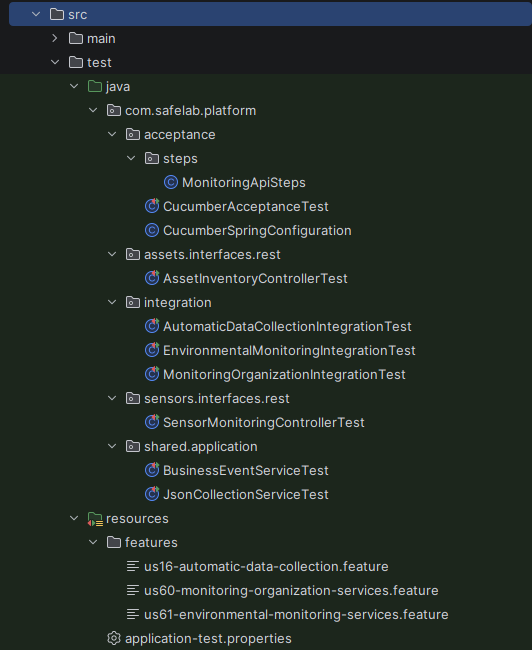
</p>

<p align="center"><i>Figura: Estructura del proyecto de testing de la SafeLab Platform API.</i></p>

##### **Unit Tests**

<p
  style="text-align: justify;
         text-indent: 0.5in;
         line-height: 1.5;
         margin: 0 0 12px 0;
         orphans: 2;
         widows: 2;">
  Los Unit Tests verifican de forma aislada el comportamiento de las clases que soportan los servicios del
  Sprint 1. Las dependencias de cada clase se reemplazan con <i>mocks</i> de Mockito, por lo que estas
  pruebas no levantan el servidor ni acceden a la base de datos. La siguiente tabla relaciona cada clase de
  prueba con la clase evaluada, los comportamientos verificados y las User Stories asociadas.
</p>

<table border="1" style="width: 100%; border-collapse: collapse;">
<thead>
<tr>
<th style="text-align: center; vertical-align: middle; padding: 6px;">Test Class</th>
<th style="text-align: center; vertical-align: middle; padding: 6px;">Clase evaluada</th>
<th style="text-align: center; vertical-align: middle; padding: 6px;">Tests y comportamientos verificados</th>
<th style="text-align: center; vertical-align: middle; padding: 6px;">User Story</th>
</tr>
</thead>
<tbody>
<tr>
<td style="text-align:center; vertical-align: top; padding:6px;">JsonCollectionServiceTest</td>
<td style="text-align: justify; vertical-align: top; padding:6px;"><code>JsonCollectionService</code></td>
<td style="text-align: justify; vertical-align: top; padding:6px;"><code>findByIdReturnsTheEquipmentWhenItExists</code>: retorna el equipo solicitado.<br><code>findByIdThrowsNotFoundWhenTheItemDoesNotExist</code>: responde 404 si el recurso no existe.<br><code>getThrowsNotFoundWhenTheCollectionDoesNotExist</code>: responde 404 si la colección no existe.<br><code>createGeneratesAPrefixedIdAndCreationDate</code>: genera el id con prefijo y la fecha de creación.<br><code>createKeepsTheIdSentByTheClient</code>: conserva el id enviado.<br><code>patchUpdatesOnlyTheSentFields</code>: actualiza solo los campos enviados.<br><code>deleteThrowsNotFoundWhenTheItemDoesNotExist</code>: no elimina ni guarda si el recurso no existe.<br><code>numberReturnsFallbackWhenTheValueIsNotNumeric</code>: interpreta lecturas numéricas y no numéricas.</td>
<td style="text-align:center; vertical-align: top; padding:6px;">US60, US61</td>
</tr>

<tr>
<td style="text-align:center; vertical-align: top; padding:6px;">BusinessEventServiceTest</td>
<td style="text-align: justify; vertical-align: top; padding:6px;"><code>BusinessEventService</code></td>
<td style="text-align: justify; vertical-align: top; padding:6px;"><code>createAlertRegistersAnActiveAlert</code>: registra la alerta activa con severidad normalizada, notificación y entrada de auditoría.<br><code>createAlertUsesDefaultsWhenDataIsMissing</code>: aplica severidad <i>warning</i> y responsable por defecto.<br><code>auditUsesSystemAsActorWhenTheActorIsBlank</code>: registra la auditoría con actor <i>System</i>.<br><code>createIncidentFromAlertOpensALinkedIncident</code>: abre un incidente vinculado a la alerta, sensor y equipo.</td>
<td style="text-align:center; vertical-align: top; padding:6px;">US16</td>
</tr>

<tr>
<td style="text-align:center; vertical-align: top; padding:6px;">SensorMonitoringControllerTest</td>
<td style="text-align: justify; vertical-align: top; padding:6px;"><code>SensorMonitoringController</code></td>
<td style="text-align: justify; vertical-align: top; padding:6px;"><code>recordReadingKeepsNormalStatusInsideTheRange</code>: registra la lectura sin generar alerta.<br><code>recordReadingCreatesACriticalAlertAboveTheMaximumTemperature</code>: genera alerta crítica por temperatura.<br><code>recordReadingDetectsValuesBelowTheMinimum</code>: detecta valores bajo el mínimo.<br><code>recordReadingCreatesAWarningAlertForHumidity</code>: genera alerta de advertencia por humedad.<br><code>disconnectMarksTheSensorOffline</code>: detecta la ausencia de datos y genera alerta de conectividad.<br><code>registerAppliesDefaultConnectionAndStatus</code>: registra el sensor en línea y en estado normal.</td>
<td style="text-align:center; vertical-align: top; padding:6px;">US16, US61</td>
</tr>

<tr>
<td style="text-align:center; vertical-align: top; padding:6px;">AssetInventoryControllerTest</td>
<td style="text-align: justify; vertical-align: top; padding:6px;"><code>AssetInventoryController</code></td>
<td style="text-align: justify; vertical-align: top; padding:6px;"><code>createAssignsCompliantStatusByDefault</code>: registra el equipo con estado <i>compliant</i> y lo audita.<br><code>createKeepsTheStatusSentByTheClient</code>: conserva el estado enviado.<br><code>updateAuditsTheChangedEquipment</code>: actualiza el equipo y registra la auditoría.<br><code>deleteRemovesTheEquipmentAndNotifiesAWarning</code>: elimina el equipo y notifica el cambio.</td>
<td style="text-align:center; vertical-align: top; padding:6px;">US60</td>
</tr>
</tbody>
</table>

<p align="center">
  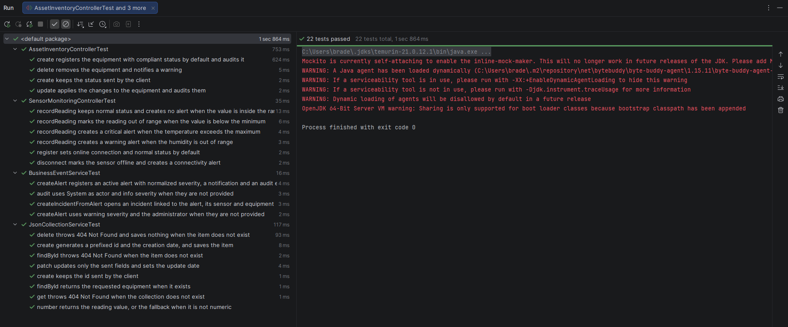
</p>

<p align="center"><i>Figura: Ejecución de los Unit Tests (22 tests aprobados).</i></p>

##### **Integration Tests**

<p
  style="text-align: justify;
         text-indent: 0.5in;
         line-height: 1.5;
         margin: 0 0 12px 0;
         orphans: 2;
         widows: 2;">
  Los Integration Tests levantan el contexto completo de Spring Boot y consumen los endpoints de la RESTful
  API mediante MockMvc, verificando la interacción entre controladores, servicios y persistencia. Cada
  clase agrupa los escenarios de una User Story.
</p>

<table border="1" style="width: 100%; border-collapse: collapse;">
<thead>
<tr>
<th style="text-align: center; vertical-align: middle; padding: 6px;">Test Class</th>
<th style="text-align: center; vertical-align: middle; padding: 6px;">Endpoints evaluados</th>
<th style="text-align: center; vertical-align: middle; padding: 6px;">Comportamientos verificados</th>
<th style="text-align: center; vertical-align: middle; padding: 6px;">User Story</th>
</tr>
</thead>
<tbody>
<tr>
<td style="text-align:center; vertical-align: top; padding:6px;">MonitoringOrganizationIntegrationTest</td>
<td style="text-align: justify; vertical-align: top; padding:6px;"><code>GET /api/v1/facilities</code><br><code>GET /api/v1/asset-inventory/assets</code><br><code>GET /api/v1/assets/{id}</code><br><code>POST /api/v1/asset-inventory/assets</code></td>
<td style="text-align: justify; vertical-align: top; padding:6px;">Lista los sitios de monitoreo registrados; lista todos los equipos; retorna un equipo por id; registra un nuevo equipo; responde 404 para un equipo inexistente y para un recurso no expuesto.</td>
<td style="text-align:center; vertical-align: top; padding:6px;">US60</td>
</tr>

<tr>
<td style="text-align:center; vertical-align: top; padding:6px;">EnvironmentalMonitoringIntegrationTest</td>
<td style="text-align: justify; vertical-align: top; padding:6px;"><code>GET /api/v1/sensors/{id}</code><br><code>GET /api/v1/sensor-monitoring/sensors</code></td>
<td style="text-align: justify; vertical-align: top; padding:6px;">Retorna la temperatura y la humedad del equipo; retorna el estado operativo de cada equipo (conexión y estado de lectura); responde 404 si el equipo de monitoreo no está registrado.</td>
<td style="text-align:center; vertical-align: top; padding:6px;">US61</td>
</tr>

<tr>
<td style="text-align:center; vertical-align: top; padding:6px;">AutomaticDataCollectionIntegrationTest</td>
<td style="text-align: justify; vertical-align: top; padding:6px;"><code>PATCH /api/v1/sensor-monitoring/sensors/{id}/reading</code><br><code>POST /api/v1/sensor-monitoring/sensors/{id}/disconnect</code><br><code>GET /api/v1/alerts</code></td>
<td style="text-align: justify; vertical-align: top; padding:6px;">Registra automáticamente una nueva lectura asociada a su equipo; asocia lecturas de distintos equipos a cada uno; genera una alerta crítica ante una lectura fuera de rango; detecta que el equipo dejó de enviar datos; responde 404 si el sensor no existe.</td>
<td style="text-align:center; vertical-align: top; padding:6px;">US16</td>
</tr>
</tbody>
</table>

<p align="center">
  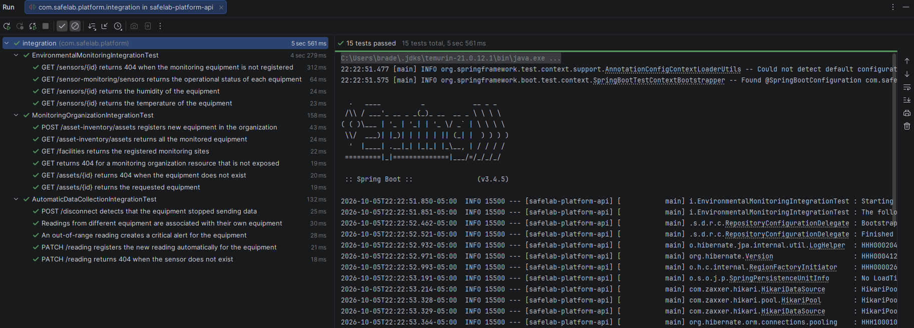
</p>

<p align="center"><i>Figura: Ejecución de los Integration Tests (15 tests aprobados).</i></p>

##### **Acceptance Tests (BDD)**

<p
  style="text-align: justify;
         text-indent: 0.5in;
         line-height: 1.5;
         margin: 0 0 12px 0;
         orphans: 2;
         widows: 2;">
  Los Acceptance Tests se elaboraron bajo el enfoque BDD con Cucumber. Cada archivo <code>.feature</code>
  está escrito en lenguaje Gherkin a partir de los criterios de aceptación de la User Story
  correspondiente, y sus pasos se implementan en la clase de Steps <code>MonitoringApiSteps</code>, que
  ejecuta las solicitudes contra la RESTful API. La clase <code>CucumberAcceptanceTest</code> ejecuta los
  escenarios y <code>CucumberSpringConfiguration</code> inicia el contexto de Spring Boot para las pruebas.
</p>

<p
  style="text-align: justify;
         text-indent: 0.5in;
         line-height: 1.5;
         margin: 0 0 12px 0;
         orphans: 2;
         widows: 2;">
  <b>US60 - Proporcionar servicios de organización del monitoreo.</b> Verifica que la API proporcione las
  operaciones de sitios de monitoreo y de equipos, y que responda que el recurso no fue encontrado cuando
  este no existe. Archivo: <code>us60-monitoring-organization-services.feature</code>.
</p>

```gherkin
@US60
Feature: US60 - Provide monitoring organization services
  As a Developer
  I want the RESTful API to provide operations for monitoring sites, storage areas and equipment
  So that the SafeLab applications can use the monitoring organization information

  Scenario: Provide monitoring site operations
    Given the RESTful API has registered monitoring sites
    When a client requests the monitoring sites
    Then the service responds with status 200
    And the response contains the monitoring site "fac-central"

  Scenario: Provide equipment operations
    Given the equipment "asset-002" is registered
    When a client requests the equipment "asset-002"
    Then the service responds with status 200
    And the response field "name" is "PCR Reagent Rack"
    And the response field "facilityId" is "fac-central"

  Scenario: Non-existent monitoring organization resource
    Given the equipment "asset-999" is not registered
    When a client requests the equipment "asset-999"
    Then the service responds with status 404
```

<p
  style="text-align: justify;
         text-indent: 0.5in;
         line-height: 1.5;
         margin: 0 0 12px 0;
         orphans: 2;
         widows: 2;">
  <b>US61 - Proporcionar servicios de monitoreo ambiental.</b> Verifica que la API proporcione la
  temperatura, la humedad y el estado del equipo solicitado, y que responda que el equipo no fue encontrado
  cuando no está registrado. Archivo: <code>us61-environmental-monitoring-services.feature</code>.
</p>

```gherkin
@US61
Feature: US61 - Provide environmental monitoring services
  As a Developer
  I want the RESTful API to provide environmental monitoring data
  So that the SafeLab applications can consume temperature, humidity and equipment status information

  Scenario Outline: Provide temperature and humidity
    Given the sensor "<sensor>" is registered
    When a client requests the monitoring data of sensor "<sensor>"
    Then the service responds with status 200
    And the response field "type" is "<type>"
    And the response field "value" is "<value>"
    And the response field "assetId" is "<equipment>"

    Examples:
      | sensor  | type        | value | equipment |
      | sen-001 | temperature | 3.8   | asset-001 |
      | sen-002 | humidity    | 46    | asset-003 |

  Scenario: Provide equipment status
    Given the sensor "sen-009" is registered
    When a client requests the monitoring data of sensor "sen-009"
    Then the service responds with status 200
    And the response field "connection" is "offline"
    And the response field "status" is "invalid"

  Scenario: Non-existent monitoring equipment
    Given the sensor "sen-999" is not registered
    When a client requests the monitoring data of sensor "sen-999"
    Then the service responds with status 404
```

<p
  style="text-align: justify;
         text-indent: 0.5in;
         line-height: 1.5;
         margin: 0 0 12px 0;
         orphans: 2;
         widows: 2;">
  <b>US16 - Recolección automática de datos.</b> Verifica que una nueva lectura se registre
  automáticamente, que las lecturas de distintos equipos queden asociadas a su equipo correspondiente y que
  el sistema identifique cuando un equipo deja de proporcionar datos. Archivo:
  <code>us16-automatic-data-collection.feature</code>.
</p>

```gherkin
@US16
Feature: US16 - Automatic data collection
  As a hospital laboratory or pharmaceutical company staff member
  I want monitoring data to be collected automatically
  So that I do not have to register it manually

  Scenario: Automatically register a new reading
    Given the sensor "sen-001" is providing data
    When the system receives a reading of 5.2 for sensor "sen-001"
    Then the service responds with status 200
    And the response field "value" is "5.2"
    And the response field "status" is "normal"
    And the response field "assetId" is "asset-001"

  Scenario Outline: Register readings from different equipment
    Given the sensor "<sensor>" is providing data
    When the system receives a reading of <value> for sensor "<sensor>"
    Then the service responds with status 200
    And the response field "assetId" is "<equipment>"

    Examples:
      | sensor  | value | equipment |
      | sen-002 | 50.0  | asset-003 |
      | sen-005 | 4.5   | asset-005 |

  Scenario: Detect the absence of a new reading
    Given the sensor "sen-001" is providing data
    When the sensor "sen-001" stops providing data
    Then the service responds with status 200
    And the response field "connection" is "offline"
    And an alert of type "Connectivity" is registered for sensor "sen-001"
```

<p align="center">
  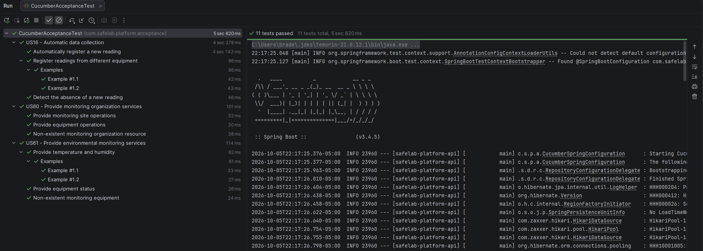
</p>

<p align="center"><i>Figura: Ejecución de los Acceptance Tests BDD (11 escenarios aprobados).</i></p>

<p align="center">
  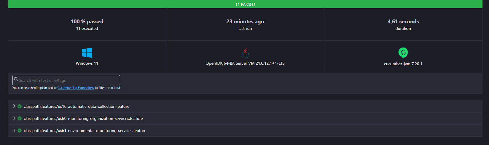
</p>

<p align="center"><i>Figura: Reporte de Cucumber con los escenarios de US16, US60 y US61.</i></p>

##### **Test Results**

<p
  style="text-align: justify;
         text-indent: 0.5in;
         line-height: 1.5;
         margin: 0 0 12px 0;
         orphans: 2;
         widows: 2;">
  La ejecución de la suite mediante <code>mvn test</code> finalizó con éxito: los 22 Unit Tests y los 15
  Integration Tests se aprobaron sin fallos ni errores, y los 11 escenarios BDD de Cucumber se ejecutaron
  satisfactoriamente, según se muestra en el reporte de Cucumber. Con ello se valida el comportamiento de
  los Web Services asociados a las User Stories US16, US60 y US61 del Sprint 1.
</p>

<p align="center">
  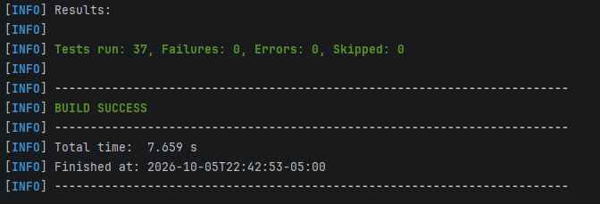
</p>

<p align="center"><i>Figura: Resumen de la ejecución de la suite con Maven.</i></p>

#### **4.2.1.6. Execution Evidence for Sprint Review**

<p
  style="text-align: justify;
         text-indent: 0.5in;
         line-height: 1.5;
         margin: 0 0 12px 0;
         orphans: 2;
         widows: 2;">
  Al finalizar el Sprint 1, la aplicación móvil de SafeLab cuenta con su estructura de navegación
  completa y con las pantallas core de siete bounded contexts funcionando con datos de prueba. Al iniciar
  la aplicación, el usuario accede a un shell común compuesto por una barra superior y un menú lateral
  desde el cual navega entre los módulos de la plataforma. Cada módulo tiene su propia navegación
  interna: desde una vista principal el usuario puede acceder al detalle de un elemento y a sus vistas
  relacionadas, y regresar con el botón atrás del dispositivo. Todas las vistas comparten el mismo
  lenguaje visual basado en Material Design 3 y en la paleta de SafeLab, en la que los colores verde,
  ámbar y rojo comunican de forma consistente el estado normal, de advertencia y crítico de sensores,
  equipos y alertas. Además, son compatibles con el modo claro y el modo oscuro.
</p>

A continuación se presentan las principales vistas implementadas, agrupadas por bounded context.

##### Dashboard Overview

La aplicación presenta un menú lateral con acceso a los módulos de SafeLab y una barra superior que identifica el módulo activo. El dashboard operativo es la vista de inicio y resume el estado general de la operación mediante indicadores clave.

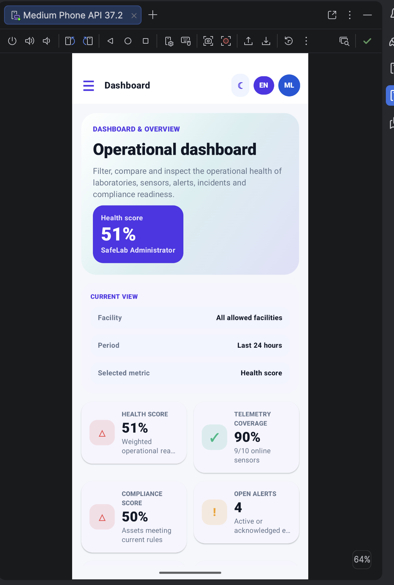

##### Monitoring Organization

Permite consultar las sedes de monitoreo con sus áreas de almacenamiento y el registro de equipos asociados a cada sede.

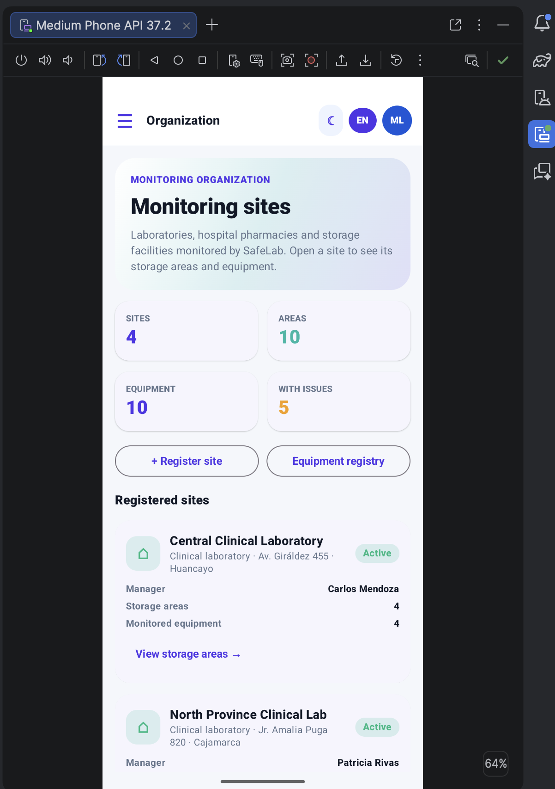

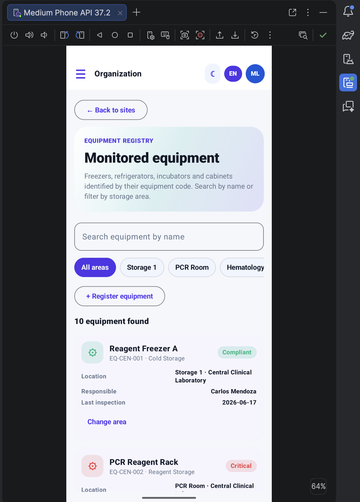

##### Equipment Maintenance

Permite revisar la condición de los equipos a partir de sus indicadores y consultar el historial de mantenimientos realizados.

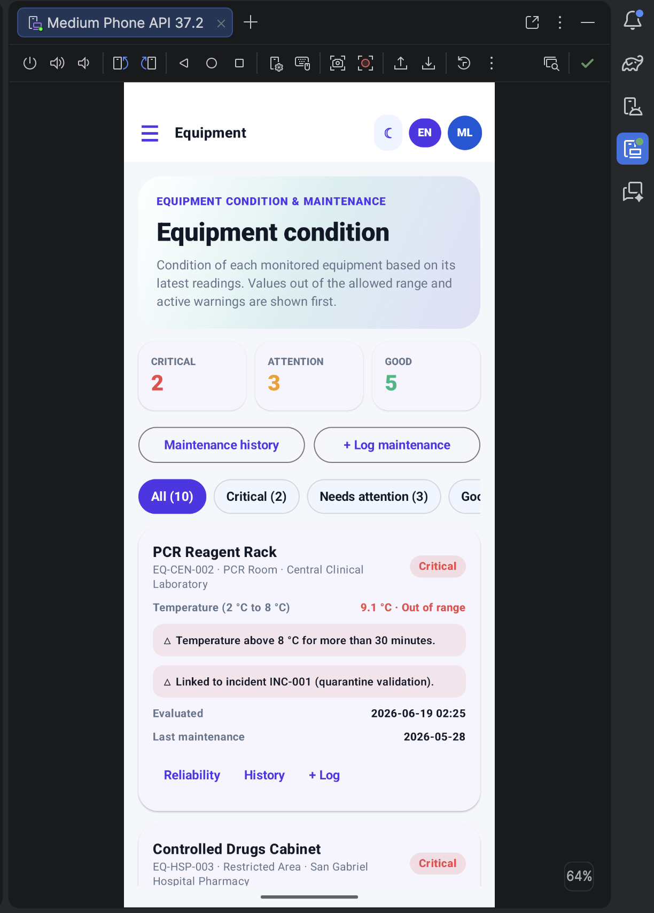

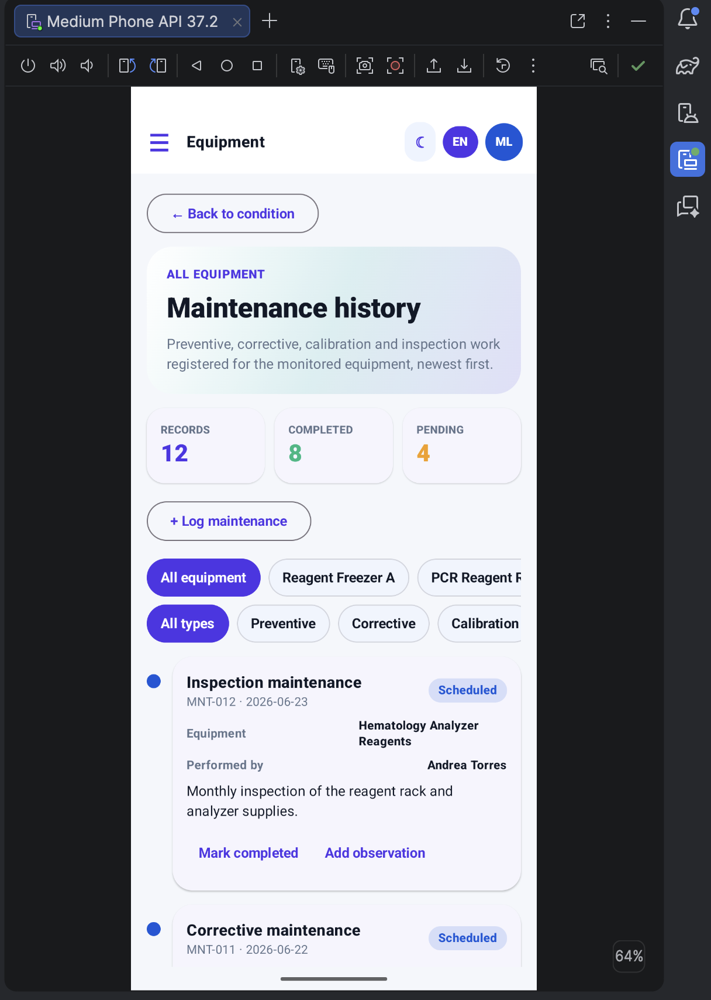

##### Reporting & Compliance

Permite consultar, generar y exportar reportes de la operación, y monitorear el cumplimiento de las normas aplicables.

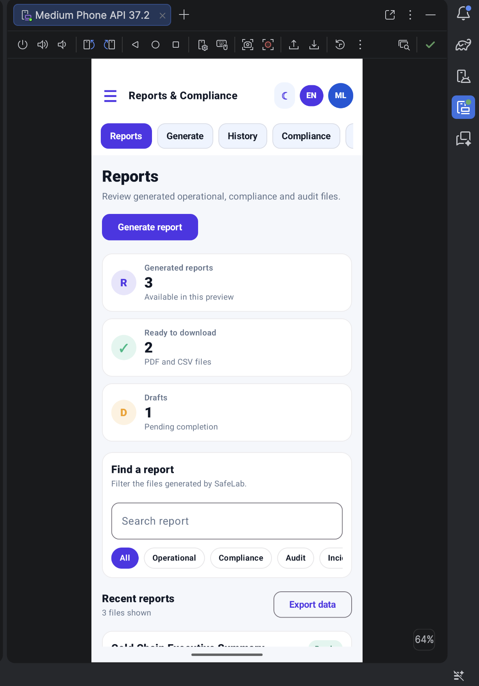

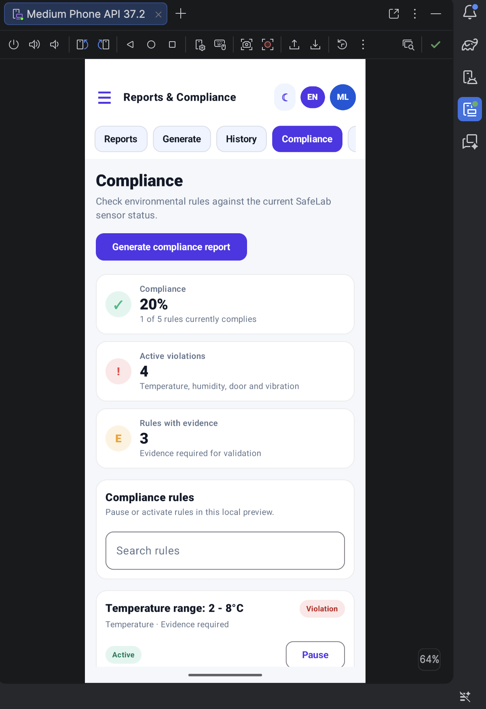

##### Sensor Monitoring

<p
  style="text-align: justify;
         text-indent: 0.5in;
         line-height: 1.5;
         margin: 0 0 12px 0;
         orphans: 2;
         widows: 2;">
  La vista de monitoreo en vivo muestra un resumen del estado de los sensores (total, normales, fuera de
  rango y fuera de línea) y una tarjeta por sensor con su lectura actual, rango objetivo, conexión y
  responsable. Además, permite buscar y filtrar por tipo y estado. Desde cada tarjeta el usuario accede
  al detalle del sensor, donde visualiza la lectura frente al umbral configurado, las calibraciones y los
  lotes de telemetría, y desde donde puede registrar lecturas y calibraciones o consultar el historial de
  lecturas.
</p>

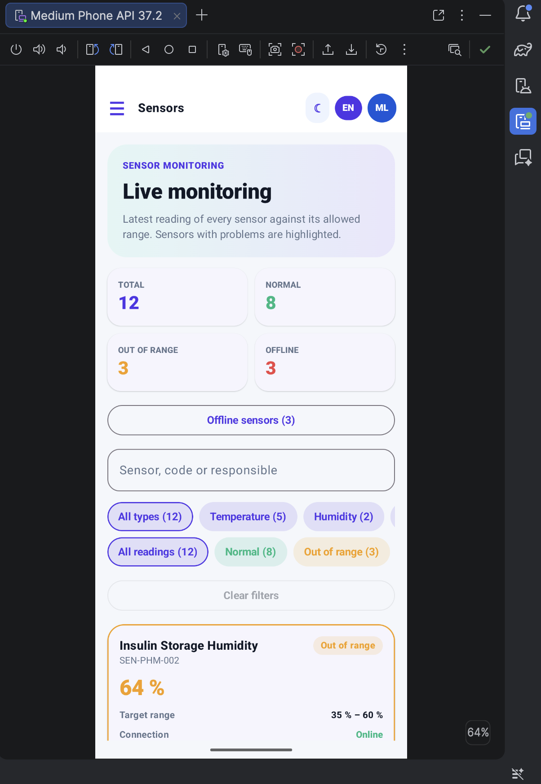

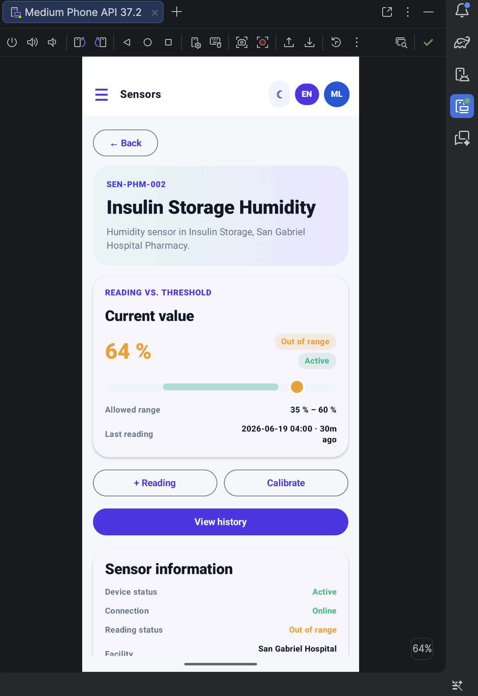

##### Alerts & Incidents

Muestra las alertas generadas con su severidad y estado, y el seguimiento de los incidentes asociados.

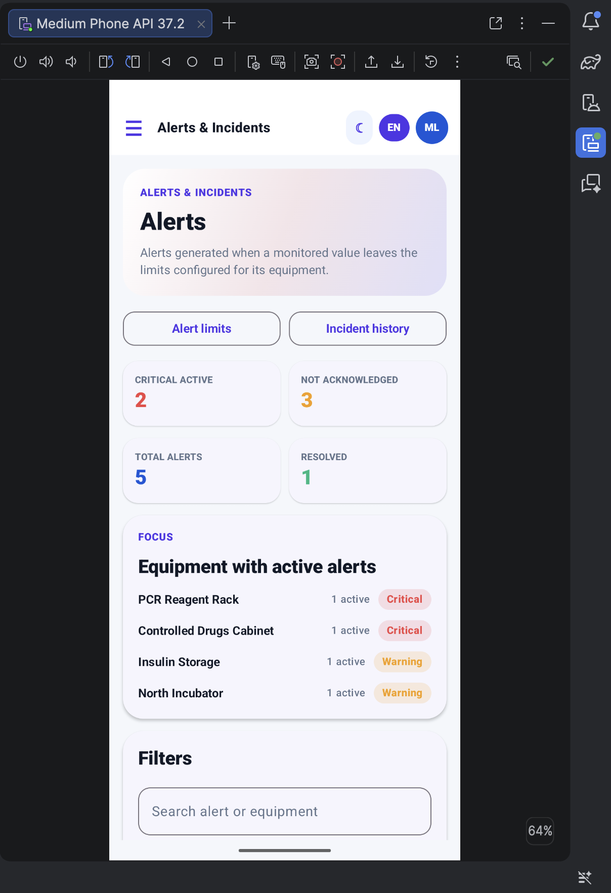

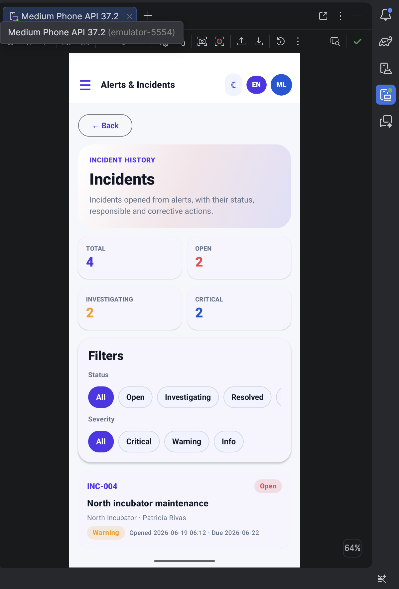

##### Audit & Traceability

Presenta el registro de auditoría con las acciones realizadas en la plataforma y la línea de trazabilidad de los eventos.

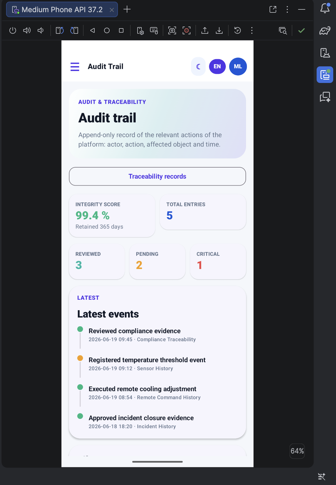

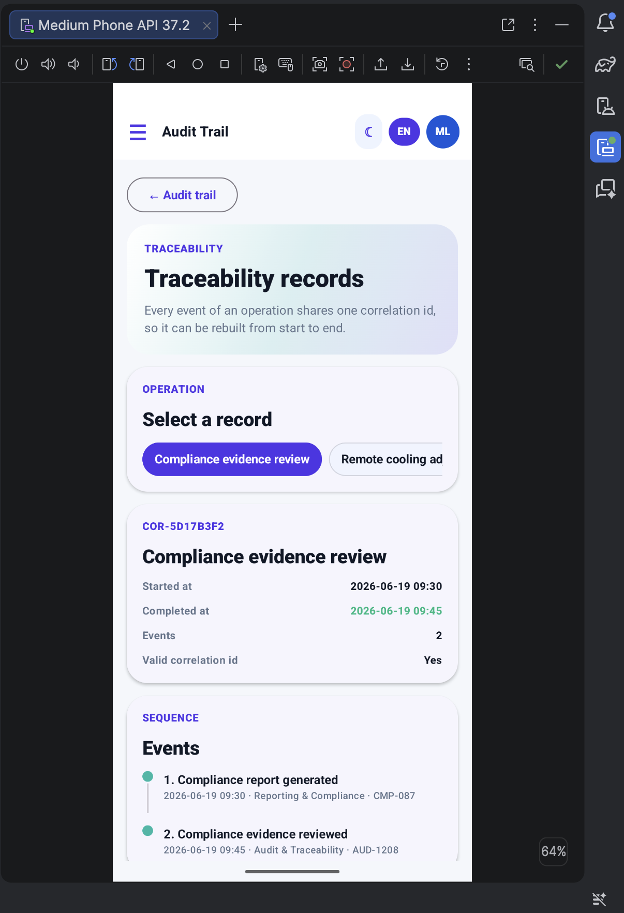

#### **4.2.1.7. Services Documentation Evidence for Sprint Review**

<p
  style="text-align: justify;
         text-indent: 0.5in;
         line-height: 1.5;
         margin: 0 0 12px 0;
         orphans: 2;
         widows: 2;">
  En el Sprint 1 se habilitaron los servicios web que soportan la organización y el monitoreo ambiental de
  SafeLab (US60 y US61). Para ello se reutilizó y adaptó <b>SafeLab Platform API</b>, un backend
  desarrollado con Java 21 y Spring Boot 3.4 que expone servicios RESTful bajo la ruta base
  <code>/api/v1</code>, persiste la información en PostgreSQL y documenta sus endpoints con la
  especificación OpenAPI mediante springdoc, publicada en Swagger UI. La siguiente tabla resume los
  endpoints relacionados con el alcance del Sprint, con su verbo HTTP, la sintaxis de llamada, sus
  parámetros y un ejemplo de respuesta obtenido con los datos de muestra del servicio.
</p>

<table border="1" style="width: 100%; border-collapse: collapse; table-layout: fixed; overflow-wrap: anywhere;">
<colgroup>
<col style="width: 13%;">
    <col style="width: 21%;">
    <col style="width: 8%;">
    <col style="width: 15%;">
    <col style="width: 16%;">
    <col style="width: 27%;">
</colgroup>
<thead>
<tr>
<th style="text-align: center; vertical-align: middle; padding: 6px;">Bounded Context</th>
<th style="text-align: center; vertical-align: middle; padding: 6px;">Endpoint</th>
<th style="text-align: center; vertical-align: middle; padding: 6px;">Verbo HTTP</th>
<th style="text-align: center; vertical-align: middle; padding: 6px;">Acción</th>
<th style="text-align: center; vertical-align: middle; padding: 6px;">Parámetros</th>
<th style="text-align: center; vertical-align: middle; padding: 6px;">Ejemplo y explicación del response</th>
</tr>
</thead>
<tbody>
<tr>
<td style="text-align: left; vertical-align: top; padding: 6px;">Identity &amp; Access Management</td>
<td style="text-align: left; vertical-align: top; padding: 6px;"><code>/api/v1/auth/sign-in</code></td>
<td style="text-align: center; vertical-align: middle; padding: 6px;">POST</td>
<td style="text-align: left; vertical-align: top; padding: 6px;">Iniciar sesión</td>
<td style="text-align: left; vertical-align: top; padding: 6px;">Body: <code>email</code> (o <code>username</code>), <code>password</code></td>
<td style="text-align: left; vertical-align: top; padding: 6px;"><code>200 OK</code>: <code>{"accessToken": "demo-…", "tokenType": "Bearer", "user": {"id": "usr-admin-001", "fullName": "Dr. Maria Lopez", "role": "safeLabAdministrator"}}</code>. Devuelve el token de sesión y el usuario autenticado. Con credenciales inválidas responde <code>401 Unauthorized</code>.</td>
</tr>

<tr>
<td style="text-align: left; vertical-align: top; padding: 6px;">Identity &amp; Access Management</td>
<td style="text-align: left; vertical-align: top; padding: 6px;"><code>/api/v1/auth/me</code></td>
<td style="text-align: center; vertical-align: middle; padding: 6px;">GET</td>
<td style="text-align: left; vertical-align: top; padding: 6px;">Consultar usuario autenticado</td>
<td style="text-align: left; vertical-align: top; padding: 6px;">—</td>
<td style="text-align: left; vertical-align: top; padding: 6px;"><code>200 OK</code>: datos del usuario de la sesión actual (nombre, rol, sitio y contextos permitidos).</td>
</tr>

<tr>
<td style="text-align: left; vertical-align: top; padding: 6px;">Monitoring Organization</td>
<td style="text-align: left; vertical-align: top; padding: 6px;"><code>/api/v1/facilities</code></td>
<td style="text-align: center; vertical-align: middle; padding: 6px;">GET</td>
<td style="text-align: left; vertical-align: top; padding: 6px;">Listar sitios de monitoreo</td>
<td style="text-align: left; vertical-align: top; padding: 6px;">—</td>
<td style="text-align: left; vertical-align: top; padding: 6px;"><code>200 OK</code>: <code>[{"id": "fac-central", "name": "Central Clinical Laboratory", "type": "Clinical laboratory", "city": "Huancayo", "manager": "Carlos Mendoza"}, …]</code></td>
</tr>

<tr>
<td style="text-align: left; vertical-align: top; padding: 6px;">Monitoring Organization</td>
<td style="text-align: left; vertical-align: top; padding: 6px;"><code>/api/v1/facilities</code></td>
<td style="text-align: center; vertical-align: middle; padding: 6px;">POST</td>
<td style="text-align: left; vertical-align: top; padding: 6px;">Registrar sitio de monitoreo (US01)</td>
<td style="text-align: left; vertical-align: top; padding: 6px;">Body: <code>name</code>, <code>type</code>, <code>city</code>, <code>manager</code></td>
<td style="text-align: left; vertical-align: top; padding: 6px;"><code>200 OK</code>: el sitio creado con su <code>id</code> generado.</td>
</tr>

<tr>
<td style="text-align: left; vertical-align: top; padding: 6px;">Monitoring Organization</td>
<td style="text-align: left; vertical-align: top; padding: 6px;"><code>/api/v1/facilities/{id}</code></td>
<td style="text-align: center; vertical-align: middle; padding: 6px;">GET</td>
<td style="text-align: left; vertical-align: top; padding: 6px;">Consultar un sitio</td>
<td style="text-align: left; vertical-align: top; padding: 6px;">Path: <code>id</code></td>
<td style="text-align: left; vertical-align: top; padding: 6px;"><code>200 OK</code>: el sitio solicitado; <code>404 Not Found</code> si no existe.</td>
</tr>

<tr>
<td style="text-align: left; vertical-align: top; padding: 6px;">Asset &amp; Inventory</td>
<td style="text-align: left; vertical-align: top; padding: 6px;"><code>/api/v1/asset-inventory/assets</code></td>
<td style="text-align: center; vertical-align: middle; padding: 6px;">GET</td>
<td style="text-align: left; vertical-align: top; padding: 6px;">Listar equipos</td>
<td style="text-align: left; vertical-align: top; padding: 6px;">—</td>
<td style="text-align: left; vertical-align: top; padding: 6px;"><code>200 OK</code>: <code>[{"id": "asset-001", "name": "Reagent Freezer A", "category": "Cold Storage", "storageUnit": "Freezer A", "location": "Central Lab - Storage 1", "status": "compliant"}, …]</code></td>
</tr>

<tr>
<td style="text-align: left; vertical-align: top; padding: 6px;">Asset &amp; Inventory</td>
<td style="text-align: left; vertical-align: top; padding: 6px;"><code>/api/v1/asset-inventory/assets</code></td>
<td style="text-align: center; vertical-align: middle; padding: 6px;">POST</td>
<td style="text-align: left; vertical-align: top; padding: 6px;">Registrar equipo (US05)</td>
<td style="text-align: left; vertical-align: top; padding: 6px;">Body: <code>name</code>, <code>category</code>, <code>facilityId</code>, <code>storageUnit</code>, <code>location</code>, <code>responsible</code></td>
<td style="text-align: left; vertical-align: top; padding: 6px;"><code>200 OK</code>: el equipo creado; si no se envía <code>status</code>, se registra como <code>compliant</code>.</td>
</tr>

<tr>
<td style="text-align: left; vertical-align: top; padding: 6px;">Asset &amp; Inventory</td>
<td style="text-align: left; vertical-align: top; padding: 6px;"><code>/api/v1/asset-inventory/assets/{id}</code></td>
<td style="text-align: center; vertical-align: middle; padding: 6px;">PATCH</td>
<td style="text-align: left; vertical-align: top; padding: 6px;">Asignar equipo a un área de almacenamiento (US07)</td>
<td style="text-align: left; vertical-align: top; padding: 6px;">Path: <code>id</code>. Body: <code>storageUnit</code>, <code>location</code></td>
<td style="text-align: left; vertical-align: top; padding: 6px;"><code>200 OK</code>: el equipo actualizado con su nueva área de almacenamiento.</td>
</tr>

<tr>
<td style="text-align: left; vertical-align: top; padding: 6px;">Asset &amp; Inventory</td>
<td style="text-align: left; vertical-align: top; padding: 6px;"><code>/api/v1/asset-inventory/assets/{id}</code></td>
<td style="text-align: center; vertical-align: middle; padding: 6px;">DELETE</td>
<td style="text-align: left; vertical-align: top; padding: 6px;">Eliminar equipo</td>
<td style="text-align: left; vertical-align: top; padding: 6px;">Path: <code>id</code></td>
<td style="text-align: left; vertical-align: top; padding: 6px;"><code>200 OK</code> sin contenido.</td>
</tr>

<tr>
<td style="text-align: left; vertical-align: top; padding: 6px;">Sensor Monitoring</td>
<td style="text-align: left; vertical-align: top; padding: 6px;"><code>/api/v1/sensor-monitoring/sensors</code></td>
<td style="text-align: center; vertical-align: middle; padding: 6px;">GET</td>
<td style="text-align: left; vertical-align: top; padding: 6px;">Listar sensores con su lectura actual (US09, US10, US13)</td>
<td style="text-align: left; vertical-align: top; padding: 6px;">—</td>
<td style="text-align: left; vertical-align: top; padding: 6px;"><code>200 OK</code>: <code>[{"id": "sen-001", "code": "SEN-CLN-001", "name": "Reagent Freezer Temperature", "type": "temperature", "unit": "°C", "value": 3.8, "min": 2, "max": 8, "status": "normal", "connection": "online"}, …]</code></td>
</tr>

<tr>
<td style="text-align: left; vertical-align: top; padding: 6px;">Sensor Monitoring</td>
<td style="text-align: left; vertical-align: top; padding: 6px;"><code>/api/v1/sensor-monitoring/sensors</code></td>
<td style="text-align: center; vertical-align: middle; padding: 6px;">POST</td>
<td style="text-align: left; vertical-align: top; padding: 6px;">Registrar sensor de un equipo</td>
<td style="text-align: left; vertical-align: top; padding: 6px;">Body: <code>code</code>, <code>name</code>, <code>assetId</code>, <code>type</code>, <code>unit</code>, <code>min</code>, <code>max</code></td>
<td style="text-align: left; vertical-align: top; padding: 6px;"><code>200 OK</code>: el sensor creado, con <code>connection: online</code> y <code>status: normal</code> por defecto.</td>
</tr>

<tr>
<td style="text-align: left; vertical-align: top; padding: 6px;">Sensor Monitoring</td>
<td style="text-align: left; vertical-align: top; padding: 6px;"><code>/api/v1/sensor-monitoring/sensors/{id}/reading</code></td>
<td style="text-align: center; vertical-align: middle; padding: 6px;">PATCH</td>
<td style="text-align: left; vertical-align: top; padding: 6px;">Registrar una nueva lectura (US16)</td>
<td style="text-align: left; vertical-align: top; padding: 6px;">Path: <code>id</code>. Body: <code>value</code></td>
<td style="text-align: left; vertical-align: top; padding: 6px;"><code>200 OK</code>: el sensor con el nuevo <code>value</code> y su <code>status</code> recalculado (<code>normal</code> u <code>out-of-range</code>). Si la lectura sale del rango, el servicio genera automáticamente una alerta.</td>
</tr>

<tr>
<td style="text-align: left; vertical-align: top; padding: 6px;">Sensor Monitoring</td>
<td style="text-align: left; vertical-align: top; padding: 6px;"><code>/api/v1/sensor-monitoring/sensors/{id}/disconnect</code></td>
<td style="text-align: center; vertical-align: middle; padding: 6px;">POST</td>
<td style="text-align: left; vertical-align: top; padding: 6px;">Marcar sensor sin datos recientes (US15)</td>
<td style="text-align: left; vertical-align: top; padding: 6px;">Path: <code>id</code></td>
<td style="text-align: left; vertical-align: top; padding: 6px;"><code>200 OK</code>: el sensor con <code>connection: offline</code> y <code>status: invalid</code>; además se genera una alerta de conectividad.</td>
</tr>

<tr>
<td style="text-align: left; vertical-align: top; padding: 6px;">Dashboard &amp; Overview</td>
<td style="text-align: left; vertical-align: top; padding: 6px;"><code>/api/v1/dashboard/overview</code></td>
<td style="text-align: center; vertical-align: middle; padding: 6px;">GET</td>
<td style="text-align: left; vertical-align: top; padding: 6px;">Consultar resumen del monitoreo (US11)</td>
<td style="text-align: left; vertical-align: top; padding: 6px;">Query: <code>facilityId</code> (opcional, por defecto <code>global</code>)</td>
<td style="text-align: left; vertical-align: top; padding: 6px;"><code>200 OK</code>: indicadores agregados (<code>activeSensors</code>, <code>totalSensors</code>, <code>openAlerts</code>, <code>complianceScore</code>, <code>telemetryScore</code>) y las alertas prioritarias.</td>
</tr>
</tbody>
</table>

##### **Deployed Documentation**

<table border="1" style="width: 100%; border-collapse: collapse;">
<thead>
<tr>
<th style="text-align: center; vertical-align: middle; padding: 6px;">Recurso</th>
<th style="text-align: center; vertical-align: middle; padding: 6px;">URL</th>
</tr>
</thead>
<tbody>
<tr>
<td style="text-align: left; vertical-align: top; padding: 6px;">Swagger UI (local)</td>
<td style="text-align: left; vertical-align: top; padding: 6px;"><code>http://localhost:8080/swagger-ui.html</code></td>
</tr>

<tr>
<td style="text-align: left; vertical-align: top; padding: 6px;">Especificación OpenAPI (local)</td>
<td style="text-align: left; vertical-align: top; padding: 6px;"><code>http://localhost:8080/v3/api-docs</code></td>
</tr>
</tbody>
</table>

##### **Documentation Interaction**

<p
  style="text-align: justify;
         text-indent: 0.5in;
         line-height: 1.5;
         margin: 0 0 12px 0;
         orphans: 2;
         widows: 2;">
  A continuación se muestran capturas de la interacción con Swagger UI utilizando los datos de muestra: el
  inicio de sesión con <code>POST /auth/sign-in</code>, la consulta de sensores con <code>GET
  /sensor-monitoring/sensors</code> y el registro de una lectura fuera de rango con <code>PATCH
  /sensor-monitoring/sensors/{id}/reading</code>, que genera una alerta automática.
</p>

#### **4.2.1.8. Software Deployment Evidence for Sprint Review**

<p
  style="text-align: justify;
         text-indent: 0.5in;
         line-height: 1.5;
         margin: 0 0 12px 0;
         orphans: 2;
         widows: 2;">
  Durante el Sprint 1 se configuraron los entornos de despliegue de los productos digitales de SafeLab. La
  Landing Page se publica como sitio estático en GitHub Pages desde el repositorio
  <i>safelab-business-website</i> de la organización del equipo, y los servicios web se despliegan en
  Render como un Web Service basado en Docker, conectado a una base de datos PostgreSQL administrada en la
  misma plataforma. Las aplicaciones móviles se ejecutan en emuladores y dispositivos de prueba durante
  este Sprint y no se publican en tiendas de aplicaciones.
</p>

<table border="1" style="width: 100%; border-collapse: collapse;">
<thead>
<tr>
<th style="text-align: center; vertical-align: middle; padding: 6px;">Producto</th>
<th style="text-align: center; vertical-align: middle; padding: 6px;">Plataforma</th>
<th style="text-align: center; vertical-align: middle; padding: 6px;">Configuración</th>
<th style="text-align: center; vertical-align: middle; padding: 6px;">Evidencia</th>
</tr>
</thead>
<tbody>
<tr>
<td style="text-align: left; vertical-align: top; padding: 6px;">Landing Page</td>
<td style="text-align: left; vertical-align: top; padding: 6px;">GitHub Pages</td>
<td style="text-align: left; vertical-align: top; padding: 6px;">Rama <code>main</code>, carpeta raíz (<code>/</code>)</td>
<td style="text-align: left; vertical-align: top; padding: 6px;">Configuración de Pages y página publicada</td>
</tr>

<tr>
<td style="text-align: left; vertical-align: top; padding: 6px;">Web Services (SafeLab Platform API)</td>
<td style="text-align: left; vertical-align: top; padding: 6px;">Render · Web Service</td>
<td style="text-align: left; vertical-align: top; padding: 6px;">Runtime Docker, plan free, región Oregon, health check <code>/actuator/health</code></td>
<td style="text-align: left; vertical-align: top; padding: 6px;">Servicio creado, variables de entorno, despliegue exitoso y Swagger UI accesible</td>
</tr>

<tr>
<td style="text-align: left; vertical-align: top; padding: 6px;">Base de datos</td>
<td style="text-align: left; vertical-align: top; padding: 6px;">Render · PostgreSQL</td>
<td style="text-align: left; vertical-align: top; padding: 6px;">Misma región que el Web Service; conexión mediante la Internal Database URL</td>
<td style="text-align: left; vertical-align: top; padding: 6px;">Instancia creada y conexión verificada por el health check</td>
</tr>
</tbody>
</table>

##### **Landing Page**

<p
  style="text-align: justify;
         text-indent: 0.5in;
         line-height: 1.5;
         margin: 0 0 12px 0;
         orphans: 2;
         widows: 2;">
  Para desplegar la Landing Page se realizaron las siguientes actividades:
</p>
<ul style="text-align: justify;">
  <li>Integración del contenido de la Landing Page en la rama <code>main</code> del repositorio <i>safelab-business-website</i>.</li>
  <li>Configuración de GitHub Pages en <b>Settings → Pages</b>, con la opción <b>Deploy from a branch</b>, la rama <code>main</code> y la carpeta raíz.</li>
  <li>Verificación del acceso público a la página y de la correcta carga de estilos, imágenes y logotipos.</li>
  <li>Revisión de la visualización en navegadores de escritorio y en dispositivos móviles.</li>
</ul>

##### **Web Services**

<p
  style="text-align: justify;
         text-indent: 0.5in;
         line-height: 1.5;
         margin: 0 0 12px 0;
         orphans: 2;
         widows: 2;">
  Para desplegar SafeLab Platform API se realizaron las siguientes actividades:
</p>
<ul style="text-align: justify;">
  <li>Creación de la base de datos <b>PostgreSQL</b> en Render, en la región Oregon.</li>
  <li>Creación del <b>Web Service</b> a partir del repositorio del backend, con runtime Docker y el <code>Dockerfile</code> del proyecto.</li>
  <li>Configuración del health check en <code>/actuator/health</code>, que Render utiliza para verificar que el servicio está disponible.</li>
  <li>Configuración de las variables de entorno del servicio, detalladas en la siguiente tabla.</li>
  <li>Verificación del despliegue mediante el health check y el acceso a Swagger UI.</li>
</ul>
<table border="1" style="width: 100%; border-collapse: collapse;">
<thead>
<tr>
<th style="text-align: center; vertical-align: middle; padding: 6px;">Variable de entorno</th>
<th style="text-align: center; vertical-align: middle; padding: 6px;">Valor</th>
<th style="text-align: center; vertical-align: middle; padding: 6px;">Propósito</th>
</tr>
</thead>
<tbody>
<tr>
<td style="text-align: left; vertical-align: top; padding: 6px;"><code>SPRING_PROFILES_ACTIVE</code></td>
<td style="text-align: left; vertical-align: top; padding: 6px;"><code>postgres</code></td>
<td style="text-align: left; vertical-align: top; padding: 6px;">Activa la configuración de persistencia en PostgreSQL.</td>
</tr>

<tr>
<td style="text-align: left; vertical-align: top; padding: 6px;"><code>DATABASE_URL</code></td>
<td style="text-align: left; vertical-align: top; padding: 6px;">Internal Database URL de Render</td>
<td style="text-align: left; vertical-align: top; padding: 6px;">Conecta el servicio con la base de datos; el backend la convierte al formato JDBC.</td>
</tr>

<tr>
<td style="text-align: left; vertical-align: top; padding: 6px;"><code>CORS_ALLOWED_ORIGINS</code></td>
<td style="text-align: left; vertical-align: top; padding: 6px;">Orígenes permitidos de los clientes</td>
<td style="text-align: left; vertical-align: top; padding: 6px;">Autoriza las solicitudes de los clientes de SafeLab.</td>
</tr>

<tr>
<td style="text-align: left; vertical-align: top; padding: 6px;"><code>SEED_RESET_ON_START</code></td>
<td style="text-align: left; vertical-align: top; padding: 6px;"><code>false</code></td>
<td style="text-align: left; vertical-align: top; padding: 6px;">Evita reiniciar los datos de muestra en cada despliegue.</td>
</tr>

<tr>
<td style="text-align: left; vertical-align: top; padding: 6px;"><code>JAVA_OPTS</code></td>
<td style="text-align: left; vertical-align: top; padding: 6px;"><code>-XX:MaxRAMPercentage=75.0</code></td>
<td style="text-align: left; vertical-align: top; padding: 6px;">Ajusta el uso de memoria de la JVM al plan del servicio.</td>
</tr>
</tbody>
</table>

<p
  style="text-align: justify;
         text-indent: 0.5in;
         line-height: 1.5;
         margin: 0 0 12px 0;
         orphans: 2;
         widows: 2;">
  Con estas configuraciones, la Landing Page y los servicios web quedan disponibles públicamente para la
  validación del Sprint, mientras que las aplicaciones móviles consumen los servicios desplegados durante
  su ejecución en emuladores y dispositivos de prueba.
</p>

#### **4.2.1.9. Team Collaboration Insights during Sprint**

<p
  style="text-align: justify;
         text-indent: 0.5in;
         line-height: 1.5;
         margin: 0 0 12px 0;
         orphans: 2;
         widows: 2;">
  Durante el Sprint 1, el equipo Meditrack organizó el trabajo mediante una estrategia de responsabilidades
  distribuidas entre el reporte, la Landing Page y la aplicación móvil. La división por repositorios y
  ramas permitió que los cinco integrantes desarrollaran funcionalidades en paralelo, manteniendo
  <code>develop</code> como punto de integración y <code>main</code> como versión estable. En la aplicación
  móvil, la separación por Bounded Contexts redujo los conflictos entre integrantes porque cada rama
  modificaba principalmente los archivos de su propio módulo; en la Landing Page, en cambio, fue necesario
  coordinar con mayor cuidado los cambios sobre archivos compartidos como <code>index.html</code>,
  <code>styles.css</code> y <code>script.js</code>.
</p>

<table border="1" style="width: 100%; border-collapse: collapse; table-layout: fixed;">
<thead>
<tr>
<th style="text-align: center; vertical-align: middle; padding: 6px;">Integrante</th>
<th style="text-align: center; vertical-align: middle; padding: 6px;">Contribución principal en TB1</th>
<th style="text-align: center; vertical-align: middle; padding: 6px;">Resultado colaborativo</th>
</tr>
</thead>
<tbody>
<tr>
<td style="text-align: left; vertical-align: top; padding: 6px;">Carlos Lavado, Ever Giusephi</td>
<td style="text-align: justify; vertical-align: top; padding: 6px;">Configuración e integración técnica; sección inicial de la Landing Page; Identity &amp; Access Management y Dashboard &amp; Overview en Mobile.</td>
<td style="text-align: justify; vertical-align: top; padding: 6px;">Consolidación de la estructura compartida, navegación y trazabilidad entre repositorios, ramas y documentación.</td>
</tr>

<tr>
<td style="text-align: left; vertical-align: top; padding: 6px;">Espino Rossi, Victor Manuel</td>
<td style="text-align: justify; vertical-align: top; padding: 6px;">Internacionalización EN/ES de la Landing Page; Monitoring Organization y Equipment Condition &amp; Maintenance en Mobile; revisión de Style Guidelines e Information Architecture.</td>
<td style="text-align: justify; vertical-align: top; padding: 6px;">Alineación de la experiencia multilingüe y de los módulos asociados a organización y mantenimiento.</td>
</tr>

<tr>
<td style="text-align: left; vertical-align: top; padding: 6px;">Garcia Cerpa, Braden Raid</td>
<td style="text-align: justify; vertical-align: top; padding: 6px;">Secciones de interacción de la Landing Page; Alerts &amp; Incident Management y Audit &amp; Traceability en Mobile; soporte a testing y validación.</td>
<td style="text-align: justify; vertical-align: top; padding: 6px;">Integración de flujos de alertas, incidentes y trazabilidad con los componentes de interacción y validación del producto.</td>
</tr>

<tr>
<td style="text-align: left; vertical-align: top; padding: 6px;">Rojas Gomez, Valeria Alexandra</td>
<td style="text-align: justify; vertical-align: top; padding: 6px;">Benefits, Services y Plans de la Landing Page; Reporting &amp; Compliance en Mobile; Sprint Planning y Product Backlog.</td>
<td style="text-align: justify; vertical-align: top; padding: 6px;">Correspondencia entre planificación del Sprint, contenido comercial y funcionalidades de reportes y cumplimiento.</td>
</tr>

<tr>
<td style="text-align: left; vertical-align: top; padding: 6px;">Vara Velásquez, Oscar Fernando</td>
<td style="text-align: justify; vertical-align: top; padding: 6px;">About Product y About Team de la Landing Page; Sensor Monitoring en Mobile; documentación UX/UI de la aplicación móvil.</td>
<td style="text-align: justify; vertical-align: top; padding: 6px;">Coherencia entre diseño UX/UI, presentación del producto y experiencia de monitoreo de sensores.</td>
</tr>
</tbody>
</table>

<p
  style="text-align: justify;
         text-indent: 0.5in;
         line-height: 1.5;
         margin: 0 0 12px 0;
         orphans: 2;
         widows: 2;">
  La principal dificultad de integración se presentó en la Landing Page, debido a que varias ramas debían
  modificar simultáneamente archivos globales. Los conflictos se resolvieron durante los merges hacia
  <code>develop</code> utilizando el Merge Editor de Visual Studio Code. Después de integrar todas las
  ramas, se realizó una revisión consolidada para eliminar contenido duplicado, corregir inconsistencias en
  HTML, CSS y JavaScript, comprobar la carga de recursos y verificar nuevamente la navegación,
  internacionalización y responsive design.
</p>

<p
  style="text-align: justify;
         text-indent: 0.5in;
         line-height: 1.5;
         margin: 0 0 12px 0;
         orphans: 2;
         widows: 2;">
  En la aplicación móvil, el equipo adoptó una estrategia diferente: primero se preparó en
  <code>develop</code> el shell compartido con sidebar, topbar, navegación y tema visual; después, cada
  integrante implementó sus Bounded Contexts en ramas independientes. Los módulos que afectaban navegación
  compartida, como Dashboard &amp; Overview e Identity &amp; Access Management, se integraron al final.
  Esta decisión redujo el riesgo de sobrescribir cambios de otros módulos y facilitó que todos los Bounded
  Contexts pudieran reunirse posteriormente en una única versión estable.
</p>

<p
  style="text-align: justify;
         text-indent: 0.5in;
         line-height: 1.5;
         margin: 0 0 12px 0;
         orphans: 2;
         widows: 2;">
  Como aprendizaje del Sprint, el equipo identificó la importancia de integrar periódicamente los cambios
  de <code>develop</code>, reservar los archivos transversales para una etapa de consolidación, utilizar
  commits pequeños y descriptivos, y mantener la separación entre frontend móvil y backend. El uso de datos
  mock en Android permitió validar la experiencia y los flujos de navegación de forma independiente,
  mientras que la API pudo ser adaptada y probada en paralelo para su futura integración.
</p>

<table border="1" style="width: 100%; border-collapse: collapse; table-layout: fixed;">
<thead>
<tr>
<th style="text-align: center; vertical-align: middle; padding: 6px;">Insight</th>
<th style="text-align: center; vertical-align: middle; padding: 6px;">Evidencia observada</th>
<th style="text-align: center; vertical-align: middle; padding: 6px;">Acción para el siguiente Sprint</th>
</tr>
</thead>
<tbody>
<tr>
<td style="text-align: left; vertical-align: top; padding: 6px;">Separar funcionalidades por Bounded Context reduce conflictos.</td>
<td style="text-align: justify; vertical-align: top; padding: 6px;">Las ramas de Mobile modificaron principalmente sus propios paquetes y pantallas.</td>
<td style="text-align: justify; vertical-align: top; padding: 6px;">Mantener una rama por BC y limitar los cambios compartidos a responsables coordinados.</td>
</tr>

<tr>
<td style="text-align: left; vertical-align: top; padding: 6px;">Los archivos globales requieren integración temprana.</td>
<td style="text-align: justify; vertical-align: top; padding: 6px;">La Landing Page presentó conflictos en <code>index.html</code>, <code>styles.css</code> y <code>script.js</code>.</td>
<td style="text-align: justify; vertical-align: top; padding: 6px;">Sincronizar las ramas con <code>develop</code> antes de cambios extensos y reservar la revisión de calidad para el final.</td>
</tr>

<tr>
<td style="text-align: left; vertical-align: top; padding: 6px;">Los datos mock permiten desacoplar frontend y backend.</td>
<td style="text-align: justify; vertical-align: top; padding: 6px;">La app móvil pudo completar sus pantallas y navegación sin depender de disponibilidad de la API.</td>
<td style="text-align: justify; vertical-align: top; padding: 6px;">Reemplazar gradualmente repositorios locales por implementaciones REST manteniendo las mismas interfaces de dominio.</td>
</tr>

<tr>
<td style="text-align: left; vertical-align: top; padding: 6px;">La trazabilidad mejora con commits y merge commits descriptivos.</td>
<td style="text-align: justify; vertical-align: top; padding: 6px;">Los commits por capas y funcionalidades permiten identificar qué cambio introdujo cada rama.</td>
<td style="text-align: justify; vertical-align: top; padding: 6px;">Mantener Conventional Commits, merges <code>--no-ff</code> y tags por entrega.</td>
</tr>
</tbody>
</table>

<p align="center">
  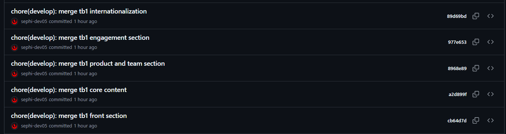
</p>

<p align="center"><i>Figura: Evidencia de colaboración e integración de ramas durante el Sprint 1.</i></p>

### **4.2.2. Sprint 2**

<p
  style="text-align: justify;
         text-indent: 0.5in;
         line-height: 1.5;
         margin: 0 0 12px 0;
         orphans: 2;
         widows: 2;">
  El Sprint 2 incorporó la integración de SafeLab Android y SafeLab Web con Spring Boot y PostgreSQL, junto
  con la publicación de los componentes del ecosistema. El trabajo amplió el monitoreo ambiental hacia
  alertas e incidentes, operaciones sobre activos y sensores, autenticación, usuarios autorizados, y
  consulta de datos vinculados a cada organización. Las 18 historias y 36 tareas registradas en Jira
  permiten identificar el alcance planificado; las funcionalidades verificadas se distinguen de las tareas
  que aún requieren pruebas de extremo a extremo.
</p>

<p
  style="text-align: justify;
         text-indent: 0.5in;
         line-height: 1.5;
         margin: 0 0 12px 0;
         orphans: 2;
         widows: 2;">
  Dos cambios representan el avance más significativo respecto de TB1. Primero, la aplicación móvil dejó de
  depender exclusivamente de datos locales: las operaciones respaldadas por la API pueden persistirse y
  consultarse desde Android y la web. Segundo, los productos pasaron de demostraciones aisladas a enlaces
  públicos: Landing Page en GitHub Pages, frontend y backend en Render, datos en Neon y APK en GitHub
  Releases. El hotfix <code>av2-v2.5.3</code> mejoró los errores de red, la recuperación de sesiones y las
  solicitudes de sincronización en Android.
</p>

<p
  style="text-align: justify;
         text-indent: 0.5in;
         line-height: 1.5;
         margin: 0 0 12px 0;
         orphans: 2;
         widows: 2;">
  El Sprint se documenta a partir de la planificación, el tablero, las ramas y commits, las pruebas
  disponibles, la documentación OpenAPI y la evidencia gráfica existente. El estado «Hecho» del tablero no
  se equipara automáticamente a una prueba aprobada, ni la publicación de un endpoint demuestra que todos
  los flujos del Bounded Context estén implementados.
</p>

#### **4.2.2.1. Sprint Planning 2**

<p
  style="text-align: justify;
         text-indent: 0.5in;
         line-height: 1.5;
         margin: 0 0 12px 0;
         orphans: 2;
         widows: 2;">
  Se presentan los principales aspectos definidos para la planificación del Sprint 2 de SafeLab. A partir
  de los resultados del primer Sprint y de las User Stories priorizadas en el Product Backlog, se
  estableció un alcance enfocado en la gestión de alertas e incidentes, la configuración de límites
  ambientales, las notificaciones móviles y la consulta de información de monitoreo. El Sprint comprende 18
  User Stories, con una estimación total de 55 Story Points.
</p>

<table border="1" style="width: 100%; border-collapse: collapse;">
<tr>
<th style="text-align: left; vertical-align: middle; padding: 6px; width: 35%;">Número de Sprint</th>
<td style="text-align: left; vertical-align: middle; padding: 6px;">2</td>
</tr>

<tr>
<th colspan="2" style="text-align: center; vertical-align: middle; padding: 6px;">Información de la planificación del Sprint</th>
</tr>

<tr>
<td style="text-align: left; vertical-align: middle; padding: 6px;"><b>Fecha</b></td>
<td style="text-align: left; vertical-align: middle; padding: 6px;">16/10/2026</td>
</tr>

<tr>
<td style="text-align: left; vertical-align: middle; padding: 6px;"><b>Hora</b></td>
<td style="text-align: left; vertical-align: middle; padding: 6px;">10:00 a. m.</td>
</tr>

<tr>
<td style="text-align: left; vertical-align: middle; padding: 6px;"><b>Lugar</b></td>
<td style="text-align: left; vertical-align: middle; padding: 6px;">UPC San Isidro</td>
</tr>

<tr>
<td style="text-align: left; vertical-align: middle; padding: 6px;"><b>Preparado por</b></td>
<td style="text-align: left; vertical-align: middle; padding: 6px;">Valeria Rojas</td>
</tr>

<tr>
<td style="text-align: left; vertical-align: top; padding: 6px;"><b>Asistentes a la reunión de planificación</b></td>
<td style="text-align: left; vertical-align: top; padding: 6px;">Braden Garcia / Victor Espino / Giusephi Carlos / Oscar Vara / Valeria Rojas</td>
</tr>

<tr>
<td style="text-align: left; vertical-align: top; padding: 6px;"><b>Resumen de la revisión del Sprint 1</b></td>
<td style="text-align: justify; vertical-align: top; padding: 6px;">El primer Sprint se enfocó en la organización del proyecto SafeLab, la revisión de los requerimientos y del Product Backlog, así como en la preparación de la Landing Page y las funcionalidades iniciales de monitoreo necesarias para el primer incremento del producto.</td>
</tr>

<tr>
<td style="text-align: left; vertical-align: top; padding: 6px;"><b>Resumen de la retrospectiva del Sprint 1</b></td>
<td style="text-align: justify; vertical-align: top; padding: 6px;">El equipo identificó avances en la organización de los requerimientos y la documentación del proyecto, además de oportunidades de mejora en la coordinación de actividades, la distribución de responsabilidades y la consistencia entre el Product Backlog, la planificación de los Sprints y las actividades de implementación.</td>
</tr>

<tr>
<th colspan="2" style="text-align: center; vertical-align: middle; padding: 6px;">Objetivo del Sprint y User Stories</th>
</tr>

<tr>
<td style="text-align: left; vertical-align: top; padding: 6px;"><b>Objetivo del Sprint 2</b></td>
<td style="text-align: justify; vertical-align: top; padding: 6px;">Nuestro enfoque es habilitar la consulta y gestión de alertas e incidentes con información persistida en una API compartida por Android y la aplicación web.<br><br>
      Creemos que permitirá identificar desviaciones ambientales y dar seguimiento al equipo afectado a los trabajadores de laboratorios y organizaciones farmacéuticas, con acceso limitado por organización y permisos.<br><br>
      Lo comprobaremos cuando un usuario autenticado consulte los sensores, abra una alerta, ejecute una acción autorizada, observe el cambio persistido y pueda recuperarlo desde otro cliente sin borrar los datos de la aplicación.</td>
</tr>

<tr>
<td style="text-align: left; vertical-align: middle; padding: 6px;"><b>Capacidad estimada del Sprint 2</b></td>
<td style="text-align: left; vertical-align: middle; padding: 6px;">60 Story Points</td>
</tr>

<tr>
<td style="text-align: left; vertical-align: middle; padding: 6px;"><b>Suma de Story Points seleccionados</b></td>
<td style="text-align: left; vertical-align: middle; padding: 6px;">55 Story Points</td>
</tr>
</table>

#### **4.2.2.2. Aspect Leaders and Collaborators**

<p
  style="text-align: justify;
         text-indent: 0.5in;
         line-height: 1.5;
         margin: 0 0 12px 0;
         orphans: 2;
         widows: 2;">
  En el Sprint 2 se definieron tres aspectos de trabajo, que corresponden al alcance del Sprint Backlog 2
  (sección 4.2.2.3). El aspecto <b>Gestión de alertas</b> agrupa la configuración de límites de alerta por
  equipo, la generación de alertas de temperatura y humedad, su listado, detalle, confirmación de atención
  y orden por severidad, la visualización de alertas críticas y de equipos con alertas activas, las
  notificaciones en el dispositivo móvil y el envío de alertas al equipo de trabajo (US18, US19, US20,
  US21, US22, US23, US24, US25, US26, US44 y US46). El aspecto <b>Consulta de la organización del
  monitoreo</b> agrupa la visualización de sitios de monitoreo, áreas de almacenamiento, lista y detalle de
  equipos, la búsqueda de equipos por nombre y su filtro por área (US02, US04, US06, US08, US12 y US14). El
  aspecto <b>Servicios de alertas e incidentes</b> agrupa los servicios RESTful que soportan las
  funcionalidades anteriores (US62).
</p>

<p
  style="text-align: justify;
         text-indent: 0.5in;
         line-height: 1.5;
         margin: 0 0 12px 0;
         orphans: 2;
         widows: 2;">
  Al igual que en el Sprint 1, para cada aspecto se designó como líder (L) al integrante con mayor carga de
  horas asignadas en el Sprint Backlog 2; en caso de empate, lidera el integrante a cargo del Bounded
  Context correspondiente en la implementación. Los demás integrantes con tareas en el aspecto participan
  como colaboradores (C). La siguiente tabla muestra las horas de cada integrante por aspecto y la
  Leadership-and-Collaboration Matrix (LACX) resultante.
</p>

<table border="1" style="width: 100%; border-collapse: collapse;">
<thead>
<tr>
<th style="text-align: center; vertical-align: middle; padding: 6px;">Team Member (Last Name, First Name)</th>
<th style="text-align: center; vertical-align: middle; padding: 6px;">Gestión de alertas</th>
<th style="text-align: center; vertical-align: middle; padding: 6px;">Consulta de la organización del monitoreo</th>
<th style="text-align: center; vertical-align: middle; padding: 6px;">Servicios de alertas e incidentes</th>
<th style="text-align: center; vertical-align: middle; padding: 6px;">Total</th>
</tr>
</thead>
<tbody>
<tr>
<td style="text-align: left; vertical-align: top; padding: 6px;">Carlos Lavado, Ever Giusephi</td>
<td style="text-align: center; vertical-align: middle; padding: 6px;">—</td>
<td style="text-align: center; vertical-align: middle; padding: 6px;">10 h</td>
<td style="text-align: center; vertical-align: middle; padding: 6px;">10 h</td>
<td style="text-align: center; vertical-align: middle; padding: 6px;">20 h</td>
</tr>

<tr>
<td style="text-align: left; vertical-align: top; padding: 6px;">Espino Rossi, Victor Manuel</td>
<td style="text-align: center; vertical-align: middle; padding: 6px;">20 h</td>
<td style="text-align: center; vertical-align: middle; padding: 6px;">4 h</td>
<td style="text-align: center; vertical-align: middle; padding: 6px;">—</td>
<td style="text-align: center; vertical-align: middle; padding: 6px;">24 h</td>
</tr>

<tr>
<td style="text-align: left; vertical-align: top; padding: 6px;">Garcia Cerpa, Braden Raid</td>
<td style="text-align: center; vertical-align: middle; padding: 6px;">20 h</td>
<td style="text-align: center; vertical-align: middle; padding: 6px;">4 h</td>
<td style="text-align: center; vertical-align: middle; padding: 6px;">—</td>
<td style="text-align: center; vertical-align: middle; padding: 6px;">24 h</td>
</tr>

<tr>
<td style="text-align: left; vertical-align: top; padding: 6px;">Rojas Gomez, Valeria Alexandra</td>
<td style="text-align: center; vertical-align: middle; padding: 6px;">18 h</td>
<td style="text-align: center; vertical-align: middle; padding: 6px;">4 h</td>
<td style="text-align: center; vertical-align: middle; padding: 6px;">—</td>
<td style="text-align: center; vertical-align: middle; padding: 6px;">22 h</td>
</tr>

<tr>
<td style="text-align: left; vertical-align: top; padding: 6px;">Vara Velásquez, Oscar Fernando</td>
<td style="text-align: center; vertical-align: middle; padding: 6px;">16 h</td>
<td style="text-align: center; vertical-align: middle; padding: 6px;">4 h</td>
<td style="text-align: center; vertical-align: middle; padding: 6px;">—</td>
<td style="text-align: center; vertical-align: middle; padding: 6px;">20 h</td>
</tr>
</tbody>
</table>

<p
  style="text-align: justify;
         text-indent: 0.5in;
         line-height: 1.5;
         margin: 0 0 12px 0;
         orphans: 2;
         widows: 2;">
  A partir de esta distribución, la Leadership-and-Collaboration Matrix (LACX) del Sprint 2 es la
  siguiente:
</p>

<table border="1" style="width: 100%; border-collapse: collapse;">
<thead>
<tr>
<th style="text-align: center; vertical-align: middle; padding: 6px;">Team Member (Last Name, First Name)</th>
<th style="text-align: center; vertical-align: middle; padding: 6px;">GitHub Username</th>
<th style="text-align: center; vertical-align: middle; padding: 6px;">Gestión de alertas</th>
<th style="text-align: center; vertical-align: middle; padding: 6px;">Consulta de la organización del monitoreo</th>
<th style="text-align: center; vertical-align: middle; padding: 6px;">Servicios de alertas e incidentes</th>
</tr>
</thead>
<tbody>
<tr>
<td style="text-align: left; vertical-align: top; padding: 6px;">Carlos Lavado, Ever Giusephi</td>
<td style="text-align: center; vertical-align: middle; padding: 6px;">sephi-dev05</td>
<td style="text-align: center; vertical-align: middle; padding: 6px;">—</td>
<td style="text-align: center; vertical-align: middle; padding: 6px;">L</td>
<td style="text-align: center; vertical-align: middle; padding: 6px;">L</td>
</tr>

<tr>
<td style="text-align: left; vertical-align: top; padding: 6px;">Espino Rossi, Victor Manuel</td>
<td style="text-align: center; vertical-align: middle; padding: 6px;">Vmer140</td>
<td style="text-align: center; vertical-align: middle; padding: 6px;">C</td>
<td style="text-align: center; vertical-align: middle; padding: 6px;">C</td>
<td style="text-align: center; vertical-align: middle; padding: 6px;">—</td>
</tr>

<tr>
<td style="text-align: left; vertical-align: top; padding: 6px;">Garcia Cerpa, Braden Raid</td>
<td style="text-align: center; vertical-align: middle; padding: 6px;">BradenGarcia</td>
<td style="text-align: center; vertical-align: middle; padding: 6px;">L</td>
<td style="text-align: center; vertical-align: middle; padding: 6px;">C</td>
<td style="text-align: center; vertical-align: middle; padding: 6px;">—</td>
</tr>

<tr>
<td style="text-align: left; vertical-align: top; padding: 6px;">Rojas Gomez, Valeria Alexandra</td>
<td style="text-align: center; vertical-align: middle; padding: 6px;">ValeriaAler</td>
<td style="text-align: center; vertical-align: middle; padding: 6px;">C</td>
<td style="text-align: center; vertical-align: middle; padding: 6px;">C</td>
<td style="text-align: center; vertical-align: middle; padding: 6px;">—</td>
</tr>

<tr>
<td style="text-align: left; vertical-align: top; padding: 6px;">Vara Velásquez, Oscar Fernando</td>
<td style="text-align: center; vertical-align: middle; padding: 6px;">varometro159</td>
<td style="text-align: center; vertical-align: middle; padding: 6px;">C</td>
<td style="text-align: center; vertical-align: middle; padding: 6px;">C</td>
<td style="text-align: center; vertical-align: middle; padding: 6px;">—</td>
</tr>
</tbody>
</table>

<p
  style="text-align: justify;
         text-indent: 0.5in;
         line-height: 1.5;
         margin: 0 0 12px 0;
         orphans: 2;
         widows: 2;">
  En el aspecto Gestión de alertas, Victor Espino y Braden Garcia tienen la misma carga (20 horas); por el
  criterio de desempate, lidera Braden Garcia, responsable del Bounded Context Alert &amp; Incident
  Management. Carlos Lavado lidera los aspectos Consulta de la organización del monitoreo y Servicios de
  alertas e incidentes, al concentrar la mayor carga de horas en ambos.
</p>

#### **4.2.2.3. Sprint Backlog 2**

<p
  style="text-align: justify;
         text-indent: 0.5in;
         line-height: 1.5;
         margin: 0 0 12px 0;
         orphans: 2;
         widows: 2;">
  El Sprint Backlog 2 reúne las 18 User Stories seleccionadas para ampliar las funcionalidades de SafeLab,
  con un total de 55 Story Points. Las historias abarcan la configuración y gestión de alertas ambientales,
  las notificaciones móviles, los servicios de alertas e incidentes y la consulta de sitios, áreas y
  equipos. Cada historia se desglosa en dos Work-items de implementación y validación, manteniendo la
  estructura utilizada en el Sprint Backlog 1.
</p>

<table border="1" style="width: 100%; border-collapse: collapse; table-layout: fixed; overflow-wrap: anywhere;">
<colgroup>
<col style="width: 7%;">
    <col style="width: 16%;">
    <col style="width: 8%;">
    <col style="width: 16%;">
    <col style="width: 28%;">
    <col style="width: 8%;">
    <col style="width: 10%;">
    <col style="width: 7%;">
</colgroup>
<thead>
<tr>
<th colspan="8" style="text-align: left; vertical-align: middle; padding: 6px;">Sprint # &nbsp;&nbsp; Sprint 2</th>
</tr>

<tr>
<th style="text-align: center; vertical-align: middle; padding: 6px;">User Story Id</th>
<th style="text-align: center; vertical-align: middle; padding: 6px;">Title</th>
<th style="text-align: center; vertical-align: middle; padding: 6px;">Work-Item / Task Id</th>
<th style="text-align: center; vertical-align: middle; padding: 6px;">Title</th>
<th style="text-align: center; vertical-align: middle; padding: 6px;">Description</th>
<th style="text-align: center; vertical-align: middle; padding: 6px;">Estimation (Hours)</th>
<th style="text-align: center; vertical-align: middle; padding: 6px;">Assigned To</th>
<th style="text-align: center; vertical-align: middle; padding: 6px;">Status</th>
</tr>
</thead>
<tbody>
<tr>
<td style="text-align:center; padding:6px;">US25</td>
<td style="padding:6px;">Configurar límites de alerta por equipo</td>
<td style="text-align:center; padding:6px;">UT31</td>
<td style="padding:6px;">Implementar configuración de límites</td>
<td style="padding:6px;">Permitir establecer los valores mínimos y máximos de alerta para cada equipo de monitoreo.</td>
<td style="text-align:center; padding:6px;">5</td>
<td style="padding:6px;">Victor Espino</td>
<td style="text-align:center; padding:6px;">Done</td>
</tr>

<tr>
<td style="text-align:center; padding:6px;">US25</td>
<td style="padding:6px;">Configurar límites de alerta por equipo</td>
<td style="text-align:center; padding:6px;">UT32</td>
<td style="padding:6px;">Validar límites configurados</td>
<td style="padding:6px;">Verificar que los límites ingresados sean válidos y queden asociados al equipo correspondiente.</td>
<td style="text-align:center; padding:6px;">5</td>
<td style="padding:6px;">Victor Espino</td>
<td style="text-align:center; padding:6px;">Done</td>
</tr>

<tr>
<td style="text-align:center; padding:6px;">US18</td>
<td style="padding:6px;">Recibir alertas de temperatura</td>
<td style="text-align:center; padding:6px;">UT33</td>
<td style="padding:6px;">Implementar alertas de temperatura</td>
<td style="padding:6px;">Generar alertas cuando las lecturas de temperatura superen los límites establecidos para el equipo.</td>
<td style="text-align:center; padding:6px;">5</td>
<td style="padding:6px;">Braden Garcia</td>
<td style="text-align:center; padding:6px;">Done</td>
</tr>

<tr>
<td style="text-align:center; padding:6px;">US18</td>
<td style="padding:6px;">Recibir alertas de temperatura</td>
<td style="text-align:center; padding:6px;">UT34</td>
<td style="padding:6px;">Validar generación de alertas de temperatura</td>
<td style="padding:6px;">Comprobar que las alertas se registren con la lectura, el equipo y la condición que provocó su generación.</td>
<td style="text-align:center; padding:6px;">5</td>
<td style="padding:6px;">Braden Garcia</td>
<td style="text-align:center; padding:6px;">Done</td>
</tr>

<tr>
<td style="text-align:center; padding:6px;">US19</td>
<td style="padding:6px;">Recibir alertas de humedad</td>
<td style="text-align:center; padding:6px;">UT35</td>
<td style="padding:6px;">Implementar alertas de humedad</td>
<td style="padding:6px;">Generar alertas cuando las lecturas de humedad se encuentren fuera del rango configurado.</td>
<td style="text-align:center; padding:6px;">5</td>
<td style="padding:6px;">Oscar Vara</td>
<td style="text-align:center; padding:6px;">Done</td>
</tr>

<tr>
<td style="text-align:center; padding:6px;">US19</td>
<td style="padding:6px;">Recibir alertas de humedad</td>
<td style="text-align:center; padding:6px;">UT36</td>
<td style="padding:6px;">Validar alertas por humedad</td>
<td style="padding:6px;">Verificar que las alertas correspondan a lecturas fuera del rango permitido y se relacionen con su equipo.</td>
<td style="text-align:center; padding:6px;">5</td>
<td style="padding:6px;">Oscar Vara</td>
<td style="text-align:center; padding:6px;">Done</td>
</tr>

<tr>
<td style="text-align:center; padding:6px;">US62</td>
<td style="padding:6px;">Proporcionar servicios de alertas e incidentes</td>
<td style="text-align:center; padding:6px;">UT37</td>
<td style="padding:6px;">Implementar servicios de alertas e incidentes</td>
<td style="padding:6px;">Implementar las operaciones RESTful necesarias para consultar y gestionar la información de alertas e incidentes.</td>
<td style="text-align:center; padding:6px;">5</td>
<td style="padding:6px;">Giusephi Carlos</td>
<td style="text-align:center; padding:6px;">Done</td>
</tr>

<tr>
<td style="text-align:center; padding:6px;">US62</td>
<td style="padding:6px;">Proporcionar servicios de alertas e incidentes</td>
<td style="text-align:center; padding:6px;">UT38</td>
<td style="padding:6px;">Validar respuestas de los servicios</td>
<td style="padding:6px;">Verificar las respuestas de la API y el manejo de alertas o incidentes que no se encuentren registrados.</td>
<td style="text-align:center; padding:6px;">5</td>
<td style="padding:6px;">Giusephi Carlos</td>
<td style="text-align:center; padding:6px;">Done</td>
</tr>

<tr>
<td style="text-align:center; padding:6px;">US20</td>
<td style="padding:6px;">Visualizar lista de alertas</td>
<td style="text-align:center; padding:6px;">UT39</td>
<td style="padding:6px;">Implementar listado de alertas</td>
<td style="padding:6px;">Mostrar las alertas registradas con la información necesaria para identificarlas y consultar su estado.</td>
<td style="text-align:center; padding:6px;">3</td>
<td style="padding:6px;">Victor Espino</td>
<td style="text-align:center; padding:6px;">Done</td>
</tr>

<tr>
<td style="text-align:center; padding:6px;">US20</td>
<td style="padding:6px;">Visualizar lista de alertas</td>
<td style="text-align:center; padding:6px;">UT40</td>
<td style="padding:6px;">Validar visualización de alertas</td>
<td style="padding:6px;">Comprobar que el listado represente correctamente las alertas disponibles y los casos sin registros.</td>
<td style="text-align:center; padding:6px;">3</td>
<td style="padding:6px;">Victor Espino</td>
<td style="text-align:center; padding:6px;">Done</td>
</tr>

<tr>
<td style="text-align:center; padding:6px;">US21</td>
<td style="padding:6px;">Visualizar detalles de una alerta</td>
<td style="text-align:center; padding:6px;">UT41</td>
<td style="padding:6px;">Implementar detalle de alerta</td>
<td style="padding:6px;">Mostrar la información de una alerta seleccionada, incluyendo su tipo, severidad, estado y equipo relacionado.</td>
<td style="text-align:center; padding:6px;">2</td>
<td style="padding:6px;">Valeria Rojas</td>
<td style="text-align:center; padding:6px;">Done</td>
</tr>

<tr>
<td style="text-align:center; padding:6px;">US21</td>
<td style="padding:6px;">Visualizar detalles de una alerta</td>
<td style="text-align:center; padding:6px;">UT42</td>
<td style="padding:6px;">Validar información del detalle</td>
<td style="padding:6px;">Verificar que los datos mostrados correspondan a la alerta seleccionada desde el listado.</td>
<td style="text-align:center; padding:6px;">2</td>
<td style="padding:6px;">Valeria Rojas</td>
<td style="text-align:center; padding:6px;">Done</td>
</tr>

<tr>
<td style="text-align:center; padding:6px;">US22</td>
<td style="padding:6px;">Confirmar atención de una alerta</td>
<td style="text-align:center; padding:6px;">UT43</td>
<td style="padding:6px;">Implementar confirmación de atención</td>
<td style="padding:6px;">Permitir que el usuario confirme la atención de una alerta registrada en el sistema.</td>
<td style="text-align:center; padding:6px;">2</td>
<td style="padding:6px;">Valeria Rojas</td>
<td style="text-align:center; padding:6px;">Done</td>
</tr>

<tr>
<td style="text-align:center; padding:6px;">US22</td>
<td style="padding:6px;">Confirmar atención de una alerta</td>
<td style="text-align:center; padding:6px;">UT44</td>
<td style="padding:6px;">Validar actualización de la alerta</td>
<td style="padding:6px;">Comprobar que la confirmación de atención actualice correctamente el estado de la alerta.</td>
<td style="text-align:center; padding:6px;">2</td>
<td style="padding:6px;">Valeria Rojas</td>
<td style="text-align:center; padding:6px;">Done</td>
</tr>

<tr>
<td style="text-align:center; padding:6px;">US44</td>
<td style="padding:6px;">Visualizar alertas críticas</td>
<td style="text-align:center; padding:6px;">UT45</td>
<td style="padding:6px;">Implementar consulta de alertas críticas</td>
<td style="padding:6px;">Mostrar las alertas identificadas con severidad crítica dentro del monitoreo ambiental.</td>
<td style="text-align:center; padding:6px;">3</td>
<td style="padding:6px;">Braden Garcia</td>
<td style="text-align:center; padding:6px;">Done</td>
</tr>

<tr>
<td style="text-align:center; padding:6px;">US44</td>
<td style="padding:6px;">Visualizar alertas críticas</td>
<td style="text-align:center; padding:6px;">UT46</td>
<td style="padding:6px;">Validar clasificación de alertas críticas</td>
<td style="padding:6px;">Comprobar que se muestren únicamente las alertas clasificadas con la severidad correspondiente.</td>
<td style="text-align:center; padding:6px;">3</td>
<td style="padding:6px;">Braden Garcia</td>
<td style="text-align:center; padding:6px;">Done</td>
</tr>

<tr>
<td style="text-align:center; padding:6px;">US46</td>
<td style="padding:6px;">Visualizar equipos con alertas activas</td>
<td style="text-align:center; padding:6px;">UT47</td>
<td style="padding:6px;">Implementar consulta de equipos con alertas</td>
<td style="padding:6px;">Mostrar los equipos de monitoreo que tienen alertas activas asociadas.</td>
<td style="text-align:center; padding:6px;">2</td>
<td style="padding:6px;">Victor Espino</td>
<td style="text-align:center; padding:6px;">Done</td>
</tr>

<tr>
<td style="text-align:center; padding:6px;">US46</td>
<td style="padding:6px;">Visualizar equipos con alertas activas</td>
<td style="text-align:center; padding:6px;">UT48</td>
<td style="padding:6px;">Validar relación entre equipos y alertas</td>
<td style="padding:6px;">Verificar que se identifiquen los equipos con alertas activas sin incluir equipos que no cumplan esta condición.</td>
<td style="text-align:center; padding:6px;">2</td>
<td style="padding:6px;">Victor Espino</td>
<td style="text-align:center; padding:6px;">Done</td>
</tr>

<tr>
<td style="text-align:center; padding:6px;">US23</td>
<td style="padding:6px;">Visualizar alertas ordenadas por severidad</td>
<td style="text-align:center; padding:6px;">UT49</td>
<td style="padding:6px;">Implementar ordenamiento por severidad</td>
<td style="padding:6px;">Organizar las alertas del listado según su nivel de severidad.</td>
<td style="text-align:center; padding:6px;">2</td>
<td style="padding:6px;">Braden Garcia</td>
<td style="text-align:center; padding:6px;">Done</td>
</tr>

<tr>
<td style="text-align:center; padding:6px;">US23</td>
<td style="padding:6px;">Visualizar alertas ordenadas por severidad</td>
<td style="text-align:center; padding:6px;">UT50</td>
<td style="padding:6px;">Validar orden de las alertas</td>
<td style="padding:6px;">Comprobar que el listado presente las alertas respetando la prioridad de severidad establecida.</td>
<td style="text-align:center; padding:6px;">2</td>
<td style="padding:6px;">Braden Garcia</td>
<td style="text-align:center; padding:6px;">Done</td>
</tr>

<tr>
<td style="text-align:center; padding:6px;">US24</td>
<td style="padding:6px;">Recibir alertas en un dispositivo móvil</td>
<td style="text-align:center; padding:6px;">UT51</td>
<td style="padding:6px;">Implementar notificaciones móviles</td>
<td style="padding:6px;">Incorporar el mecanismo de notificación que informe al usuario sobre las alertas ambientales generadas.</td>
<td style="text-align:center; padding:6px;">5</td>
<td style="padding:6px;">Valeria Rojas</td>
<td style="text-align:center; padding:6px;">Done</td>
</tr>

<tr>
<td style="text-align:center; padding:6px;">US24</td>
<td style="padding:6px;">Recibir alertas en un dispositivo móvil</td>
<td style="text-align:center; padding:6px;">UT52</td>
<td style="padding:6px;">Validar recepción de notificaciones</td>
<td style="padding:6px;">Verificar que el dispositivo muestre la notificación correspondiente cuando se genere una alerta.</td>
<td style="text-align:center; padding:6px;">5</td>
<td style="padding:6px;">Valeria Rojas</td>
<td style="text-align:center; padding:6px;">Done</td>
</tr>

<tr>
<td style="text-align:center; padding:6px;">US26</td>
<td style="padding:6px;">Compartir alertas con el equipo de trabajo</td>
<td style="text-align:center; padding:6px;">UT53</td>
<td style="padding:6px;">Implementar opción para compartir alertas</td>
<td style="padding:6px;">Permitir que el usuario comparta información de una alerta con otros integrantes de su equipo de trabajo.</td>
<td style="text-align:center; padding:6px;">3</td>
<td style="padding:6px;">Oscar Vara</td>
<td style="text-align:center; padding:6px;">Done</td>
</tr>

<tr>
<td style="text-align:center; padding:6px;">US26</td>
<td style="padding:6px;">Compartir alertas con el equipo de trabajo</td>
<td style="text-align:center; padding:6px;">UT54</td>
<td style="padding:6px;">Validar información compartida</td>
<td style="padding:6px;">Verificar que la información compartida permita identificar correctamente la alerta correspondiente.</td>
<td style="text-align:center; padding:6px;">3</td>
<td style="padding:6px;">Oscar Vara</td>
<td style="text-align:center; padding:6px;">Done</td>
</tr>

<tr>
<td style="text-align:center; padding:6px;">US02</td>
<td style="padding:6px;">Visualizar sitios de monitoreo</td>
<td style="text-align:center; padding:6px;">UT55</td>
<td style="padding:6px;">Implementar listado de sitios</td>
<td style="padding:6px;">Mostrar los sitios de monitoreo registrados con su información principal.</td>
<td style="text-align:center; padding:6px;">2</td>
<td style="padding:6px;">Oscar Vara</td>
<td style="text-align:center; padding:6px;">Done</td>
</tr>

<tr>
<td style="text-align:center; padding:6px;">US02</td>
<td style="padding:6px;">Visualizar sitios de monitoreo</td>
<td style="text-align:center; padding:6px;">UT56</td>
<td style="padding:6px;">Validar consulta de sitios</td>
<td style="padding:6px;">Verificar que el listado muestre los sitios registrados y gestione correctamente la ausencia de información.</td>
<td style="text-align:center; padding:6px;">2</td>
<td style="padding:6px;">Oscar Vara</td>
<td style="text-align:center; padding:6px;">Done</td>
</tr>

<tr>
<td style="text-align:center; padding:6px;">US04</td>
<td style="padding:6px;">Visualizar áreas de almacenamiento</td>
<td style="text-align:center; padding:6px;">UT57</td>
<td style="padding:6px;">Implementar listado de áreas</td>
<td style="padding:6px;">Mostrar las áreas de almacenamiento registradas y su información principal.</td>
<td style="text-align:center; padding:6px;">2</td>
<td style="padding:6px;">Giusephi Carlos</td>
<td style="text-align:center; padding:6px;">Done</td>
</tr>

<tr>
<td style="text-align:center; padding:6px;">US04</td>
<td style="padding:6px;">Visualizar áreas de almacenamiento</td>
<td style="text-align:center; padding:6px;">UT58</td>
<td style="padding:6px;">Validar relación entre áreas y sitios</td>
<td style="padding:6px;">Comprobar que las áreas consultadas se encuentren relacionadas con los sitios de monitoreo correspondientes.</td>
<td style="text-align:center; padding:6px;">2</td>
<td style="padding:6px;">Giusephi Carlos</td>
<td style="text-align:center; padding:6px;">Done</td>
</tr>

<tr>
<td style="text-align:center; padding:6px;">US06</td>
<td style="padding:6px;">Visualizar lista de equipos</td>
<td style="text-align:center; padding:6px;">UT59</td>
<td style="padding:6px;">Implementar listado de equipos</td>
<td style="padding:6px;">Mostrar los equipos registrados con sus datos principales de identificación y organización.</td>
<td style="text-align:center; padding:6px;">3</td>
<td style="padding:6px;">Giusephi Carlos</td>
<td style="text-align:center; padding:6px;">Done</td>
</tr>

<tr>
<td style="text-align:center; padding:6px;">US06</td>
<td style="padding:6px;">Visualizar lista de equipos</td>
<td style="text-align:center; padding:6px;">UT60</td>
<td style="padding:6px;">Validar información del listado de equipos</td>
<td style="padding:6px;">Comprobar que la lista muestre los equipos disponibles y permita identificar cuando no existen registros.</td>
<td style="text-align:center; padding:6px;">3</td>
<td style="padding:6px;">Giusephi Carlos</td>
<td style="text-align:center; padding:6px;">Done</td>
</tr>

<tr>
<td style="text-align:center; padding:6px;">US12</td>
<td style="padding:6px;">Visualizar detalles del equipo</td>
<td style="text-align:center; padding:6px;">UT61</td>
<td style="padding:6px;">Implementar detalle de equipo</td>
<td style="padding:6px;">Mostrar la información del equipo seleccionado y sus datos de ubicación y monitoreo.</td>
<td style="text-align:center; padding:6px;">2</td>
<td style="padding:6px;">Valeria Rojas</td>
<td style="text-align:center; padding:6px;">Done</td>
</tr>

<tr>
<td style="text-align:center; padding:6px;">US12</td>
<td style="padding:6px;">Visualizar detalles del equipo</td>
<td style="text-align:center; padding:6px;">UT62</td>
<td style="padding:6px;">Validar consulta del detalle de equipo</td>
<td style="padding:6px;">Verificar que se muestre la información del equipo solicitado y se gestione la consulta de equipos inexistentes.</td>
<td style="text-align:center; padding:6px;">2</td>
<td style="padding:6px;">Valeria Rojas</td>
<td style="text-align:center; padding:6px;">Done</td>
</tr>

<tr>
<td style="text-align:center; padding:6px;">US08</td>
<td style="padding:6px;">Buscar equipo por nombre</td>
<td style="text-align:center; padding:6px;">UT63</td>
<td style="padding:6px;">Implementar búsqueda de equipos</td>
<td style="padding:6px;">Permitir localizar equipos registrados mediante la búsqueda por nombre.</td>
<td style="text-align:center; padding:6px;">2</td>
<td style="padding:6px;">Victor Espino</td>
<td style="text-align:center; padding:6px;">Done</td>
</tr>

<tr>
<td style="text-align:center; padding:6px;">US08</td>
<td style="padding:6px;">Buscar equipo por nombre</td>
<td style="text-align:center; padding:6px;">UT64</td>
<td style="padding:6px;">Validar resultados de búsqueda</td>
<td style="padding:6px;">Verificar que los resultados correspondan al nombre ingresado y se informe cuando no existan coincidencias.</td>
<td style="text-align:center; padding:6px;">2</td>
<td style="padding:6px;">Victor Espino</td>
<td style="text-align:center; padding:6px;">Done</td>
</tr>

<tr>
<td style="text-align:center; padding:6px;">US14</td>
<td style="padding:6px;">Filtrar equipos por área de almacenamiento</td>
<td style="text-align:center; padding:6px;">UT65</td>
<td style="padding:6px;">Implementar filtro de equipos por área</td>
<td style="padding:6px;">Permitir consultar únicamente los equipos asociados al área de almacenamiento seleccionada.</td>
<td style="text-align:center; padding:6px;">2</td>
<td style="padding:6px;">Braden Garcia</td>
<td style="text-align:center; padding:6px;">Done</td>
</tr>

<tr>
<td style="text-align:center; padding:6px;">US14</td>
<td style="padding:6px;">Filtrar equipos por área de almacenamiento</td>
<td style="text-align:center; padding:6px;">UT66</td>
<td style="padding:6px;">Validar filtro por área</td>
<td style="padding:6px;">Verificar que el filtro presente los equipos correspondientes y gestione correctamente las áreas sin equipos registrados.</td>
<td style="text-align:center; padding:6px;">2</td>
<td style="padding:6px;">Braden Garcia</td>
<td style="text-align:center; padding:6px;">Done</td>
</tr>
</tbody>
</table>

<p
  style="text-align: justify;
         text-indent: 0.5in;
         line-height: 1.5;
         margin: 0 0 12px 0;
         orphans: 2;
         widows: 2;">
  El Sprint Backlog 2 se gestiona en Jira: contiene 18 User Stories y 36 Work-items con responsable,
  estimación y estado. El valor «Done» reproduce el estado documentado en el tablero, pero cada operación
  debe contrastarse con la evidencia técnica y la prueba correspondiente.
</p>

<p align="center">
  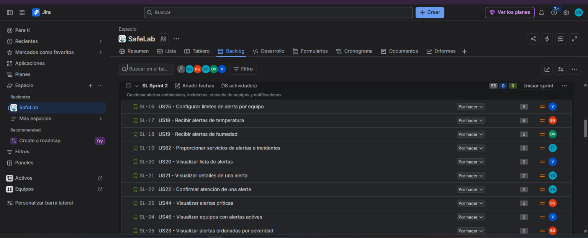
</p>

<p align="center"><i>Figura: Sprint Backlog 2 de SafeLab en Jira.</i></p>

**Board URL:** [SafeLab - Sprint 2](https://ipoundzy.atlassian.net/jira/software/projects/SL/boards/2/backlog)

#### **4.2.2.4. Development Evidence for Sprint Review**

<p
  style="text-align: justify;
         text-indent: 0.5in;
         line-height: 1.5;
         margin: 0 0 12px 0;
         orphans: 2;
         widows: 2;">
  Durante el Sprint 2 trabajamos sobre el código de la aplicación Android y de SafeLab Platform API para
  relacionar las historias seleccionadas con componentes y servicios concretos. En Android mantuvimos la
  separación <code>data</code>, <code>domain</code> y <code>presentation</code> dentro de cada Bounded
  Context. En el backend conservamos las clases de dominio, los controladores HTTP y los contratos de
  autorización. Con esta organización podemos seguir una operación desde la interacción de la pantalla
  hasta el recurso RESTful y comprobar si requiere persistencia o si corresponde únicamente a una consulta.
</p>

<table border="1" style="width: 100%; border-collapse: collapse; table-layout: fixed; overflow-wrap: anywhere;">
<thead>
<tr>
<th style="text-align: center; vertical-align: middle; padding: 6px;">Aspecto y User Stories</th>
<th style="text-align: center; vertical-align: middle; padding: 6px;">Implementación Android</th>
<th style="text-align: center; vertical-align: middle; padding: 6px;">Servicio y contrato relacionados</th>
<th style="text-align: center; vertical-align: middle; padding: 6px;">Resultado que revisamos</th>
</tr>
</thead>
<tbody>
<tr>
<td style="text-align: left; vertical-align: top; padding: 6px;"><b>Alertas e incidentes</b><br>US18–US26, US44 y US46</td>
<td style="text-align: left; vertical-align: top; padding: 6px;"><code>AlertsScreen.kt</code>, <code>AlertDetailScreen.kt</code>, <code>AlertRulesScreen.kt</code> y <code>AlertsIncidentsRepository.kt</code></td>
<td style="text-align: left; vertical-align: top; padding: 6px;"><code>AlertsIncidentsController</code>; consulta, reconocimiento, escalamiento y reglas de alerta sujetos a permisos</td>
<td style="text-align: justify; vertical-align: top; padding: 6px;">Distinguimos el listado por severidad, el detalle, los equipos con alertas activas y las acciones permitidas por la sesión.</td>
</tr>

<tr>
<td style="text-align: left; vertical-align: top; padding: 6px;"><b>Organización del monitoreo</b><br>US02, US04, US06, US08, US12 y US14</td>
<td style="text-align: left; vertical-align: top; padding: 6px;"><code>MonitoringSitesScreen.kt</code>, <code>StorageAreasScreen.kt</code>, <code>EquipmentRegistryScreen.kt</code> y <code>MonitoringOrganizationRepository.kt</code></td>
<td style="text-align: left; vertical-align: top; padding: 6px;"><code>FacilityAssetsController</code>; consulta de sitios, áreas y equipos con filtrado de acceso</td>
<td style="text-align: justify; vertical-align: top; padding: 6px;">Relacionamos la búsqueda y la selección de equipos con los registros de la organización y con el alcance autorizado del usuario.</td>
</tr>

<tr>
<td style="text-align: left; vertical-align: top; padding: 6px;"><b>Integración y servicios RESTful</b><br>US62</td>
<td style="text-align: left; vertical-align: top; padding: 6px;">Repositorios Android que consumen los contratos HTTP; actualización de datos sin reiniciar la sesión</td>
<td style="text-align: left; vertical-align: top; padding: 6px;"><code>IntegrationBootstrapController</code> y endpoints <code>/api/v1/alertsincidents/**</code>, con autenticación y RBAC</td>
<td style="text-align: justify; vertical-align: top; padding: 6px;">Contrastamos los datos devueltos por la API con el contenido mostrado en el móvil y diferenciamos las respuestas exitosas de los errores de autorización.</td>
</tr>
</tbody>
</table>

<p
  style="text-align: justify;
         text-indent: 0.5in;
         line-height: 1.5;
         margin: 0 0 12px 0;
         orphans: 2;
         widows: 2;">
  El cambio principal respecto del primer incremento consiste en la fuente de información de las pantallas.
  Los repositorios locales permanecen como soporte del desarrollo. La integración iniciada en RC3
  incorpora el endpoint autenticado <code>GET /api/v1/integration/bootstrap</code> para obtener un conjunto
  de datos filtrado en el servidor. Al ingresar a otro módulo, recuperar el primer plano o utilizar la
  acción de actualización, el cliente vuelve a consultar la información. No interpretamos este mecanismo
  como una sincronización instantánea: no implementamos WebSockets ni notificaciones push de actualización
  entre clientes.
</p>

<p
  style="text-align: justify;
         text-indent: 0.5in;
         line-height: 1.5;
         margin: 0 0 12px 0;
         orphans: 2;
         widows: 2;">
  También revisamos la correspondencia entre las operaciones visibles y las operaciones que realmente
  acepta el backend. Las acciones de reconocer, resolver o escalar alertas, así como las de consultar y
  modificar recursos, están condicionadas por los permisos efectivos de cada sesión. Cuando una pantalla no
  cuenta con un endpoint equivalente, la mantenemos como consulta o demostración; no presentamos un
  guardado simulado como si hubiese modificado PostgreSQL. En la API, la eliminación de activos o sensores
  vinculados a registros clínicos devuelve un conflicto HTTP 409, con lo cual conservamos la integridad
  referencial y evitamos ocultar errores de negocio.
</p>

<p
  style="text-align: justify;
         text-indent: 0.5in;
         line-height: 1.5;
         margin: 0 0 12px 0;
         orphans: 2;
         widows: 2;">
  Mantuvimos la documentación de las interfaces en OpenAPI y Swagger UI con descripciones en español e
  inglés. La sección 4.2.2.7 contiene los contratos y las respuestas HTTP; la sección 4.2.2.5 reúne los
  Unit Tests, Integration Tests y Acceptance Tests asociados a US62. Para verificar la correspondencia con
  el código de desarrollo, conservamos los siguientes repositorios y recursos técnicos utilizados durante
  este Sprint.
</p>

<table border="1" style="width: 100%; border-collapse: collapse; table-layout: fixed;">
<thead>
<tr>
<th style="text-align: center; vertical-align: middle; padding: 6px;">Recurso técnico</th>
<th style="text-align: center; vertical-align: middle; padding: 6px;">Ubicación verificable</th>
<th style="text-align: center; vertical-align: middle; padding: 6px;">Relación con el Sprint</th>
</tr>
</thead>
<tbody>
<tr>
<td style="text-align: left; vertical-align: top; padding: 6px;">Implementación móvil</td>
<td style="text-align: left; vertical-align: top; padding: 6px;"><a href="https://github.com/meditrack-mobile-app-1acc0238-2620-4949/safelab-mobile-app/tree/develop/app/src/main/java/pe/edu/upc/safelab/boundedcontext/alertsincidents">Alerts &amp; Incidents en Android</a></td>
<td style="text-align: justify; vertical-align: top; padding: 6px;">Pantallas, modelos y repositorio del Bounded Context de alertas e incidentes.</td>
</tr>

<tr>
<td style="text-align: left; vertical-align: top; padding: 6px;">Organización de equipos</td>
<td style="text-align: left; vertical-align: top; padding: 6px;"><a href="https://github.com/meditrack-mobile-app-1acc0238-2620-4949/safelab-mobile-app/tree/develop/app/src/main/java/pe/edu/upc/safelab/boundedcontext/facilityassets">Facility &amp; Assets en Android</a></td>
<td style="text-align: justify; vertical-align: top; padding: 6px;">Vistas de sitios, áreas de almacenamiento y registro de equipos.</td>
</tr>

<tr>
<td style="text-align: left; vertical-align: top; padding: 6px;">Servicios de la plataforma</td>
<td style="text-align: left; vertical-align: top; padding: 6px;"><a href="https://github.com/meditrack-mobile-app-1acc0238-2620-4949/safelab-platform-api/tree/main/src/main/java/com/safelab/platform/alertsincidents">Módulo Alerts &amp; Incidents de la API</a></td>
<td style="text-align: justify; vertical-align: top; padding: 6px;">Controlador, objetos del dominio y contratos RESTful vinculados a US62.</td>
</tr>

<tr>
<td style="text-align: left; vertical-align: top; padding: 6px;">Plan de integración y matriz de compatibilidad</td>
<td style="text-align: left; vertical-align: top; padding: 6px;"><a href="https://github.com/meditrack-mobile-app-1acc0238-2620-4949/safelab-platform-api/blob/main/docs/INTEGRATION_TEST_PLAN.md">Integration Test Plan</a> y <a href="https://github.com/meditrack-mobile-app-1acc0238-2620-4949/safelab-platform-api/blob/main/docs/COMPATIBILITY_MATRIX_RC3.md">Compatibility Matrix RC3</a></td>
<td style="text-align: justify; vertical-align: top; padding: 6px;">Comprobaciones requeridas antes de considerar aprobada la integración de desarrollo.</td>
</tr>
</tbody>
</table>

<p align="center">
  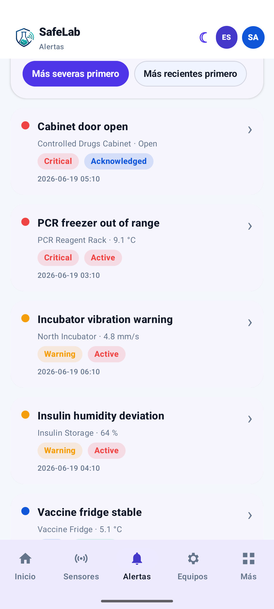
</p>

<p align="center"><i>Figura: Listado de alertas ambientales desarrollado en el Sprint 2.</i></p>

<p align="center">
  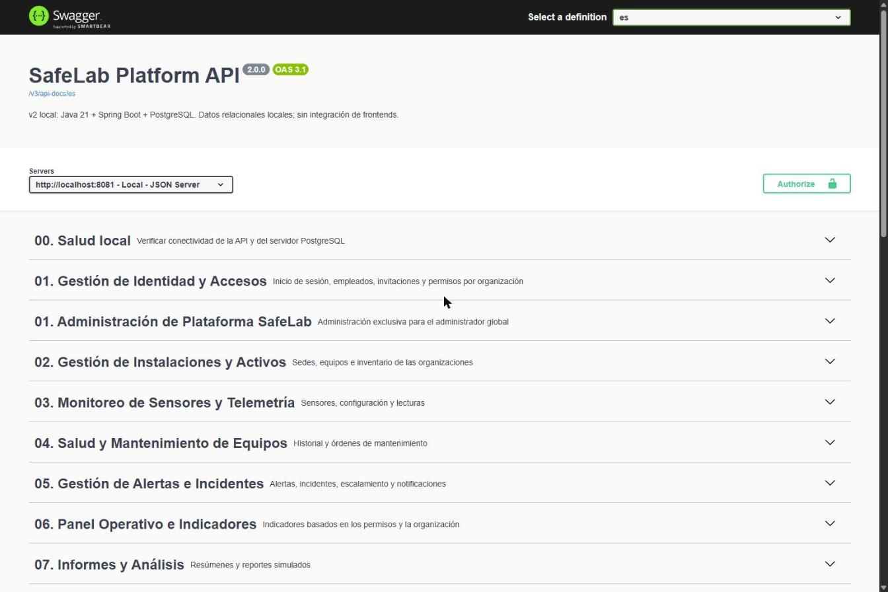
</p>

<p align="center"><i>Figura: Contratos RESTful de SafeLab organizados por Bounded Context.</i></p>

##### **Verified AV2 Integration Commits**

<p
  style="text-align: justify;
         text-indent: 0.5in;
         line-height: 1.5;
         margin: 0 0 12px 0;
         orphans: 2;
         widows: 2;">
  Los siguientes identificadores corresponden a commits publicados en las ramas <code>main</code> de los
  repositorios de implementación. Se presentan aparte de las tablas del trabajo específico de Sprint para
  distinguir integración verificada de actividades descritas en el backlog.
</p>

<table border="1" style="width: 100%; border-collapse: collapse; page-break-inside: auto;">
<thead>
<tr>
<th style="text-align: center; vertical-align: middle; padding: 6px;">Repository</th>
<th style="text-align: center; vertical-align: middle; padding: 6px;">Branch</th>
<th style="text-align: center; vertical-align: middle; padding: 6px;">Commit Id</th>
<th style="text-align: center; vertical-align: middle; padding: 6px;">Commit Message</th>
<th style="text-align: center; vertical-align: middle; padding: 6px;">Commit Message Body</th>
<th style="text-align: center; vertical-align: middle; padding: 6px;">Commited on (Date)</th>
</tr>
</thead>
<tbody>
<tr style="page-break-inside: avoid;">
<td style="text-align: left; vertical-align: top; padding: 6px;">meditrack-mobile-app-1acc0238-2620-4949/safelab-platform-api</td>
<td style="text-align: left; vertical-align: top; padding: 6px;">main</td>
<td style="text-align: left; vertical-align: top; padding: 6px;"><a href="https://github.com/meditrack-mobile-app-1acc0238-2620-4949/safelab-platform-api/commit/e5ac37b1">e5ac37b1</a></td>
<td style="text-align: left; vertical-align: top; padding: 6px;">merge(hotfix): integrate AV2 backend deployment configuration into main</td>
<td style="text-align: left; vertical-align: top; padding: 6px;">Integración de la configuración pública Render/Neon</td>
<td style="text-align: left; vertical-align: top; padding: 6px;">12/11/2026</td>
</tr>

<tr style="page-break-inside: avoid;">
<td style="text-align: left; vertical-align: top; padding: 6px;">meditrack-mobile-app-1acc0238-2620-4949/safelab-platform-api</td>
<td style="text-align: left; vertical-align: top; padding: 6px;">main</td>
<td style="text-align: left; vertical-align: top; padding: 6px;"><a href="https://github.com/meditrack-mobile-app-1acc0238-2620-4949/safelab-platform-api/commit/6e6e35f6">6e6e35f6</a></td>
<td style="text-align: left; vertical-align: top; padding: 6px;">chore(deploy): configure SafeLab backend for Render and Neon PostgreSQL</td>
<td style="text-align: left; vertical-align: top; padding: 6px;">Configuración del servicio backend y persistencia remota</td>
<td style="text-align: left; vertical-align: top; padding: 6px;">12/11/2026</td>
</tr>

<tr style="page-break-inside: avoid;">
<td style="text-align: left; vertical-align: top; padding: 6px;">meditrack-mobile-app-1acc0238-2620-4949/safelab-frontend</td>
<td style="text-align: left; vertical-align: top; padding: 6px;">main</td>
<td style="text-align: left; vertical-align: top; padding: 6px;"><a href="https://github.com/meditrack-mobile-app-1acc0238-2620-4949/safelab-frontend/commit/6920333e">6920333e</a></td>
<td style="text-align: left; vertical-align: top; padding: 6px;">feat(web): integrate Spring Boot API, PostgreSQL synchronization and role-based operations</td>
<td style="text-align: left; vertical-align: top; padding: 6px;">Consumo HTTP de API, sincronización y permisos en la web</td>
<td style="text-align: left; vertical-align: top; padding: 6px;">07/11/2026</td>
</tr>

<tr style="page-break-inside: avoid;">
<td style="text-align: left; vertical-align: top; padding: 6px;">meditrack-mobile-app-1acc0238-2620-4949/safelab-frontend</td>
<td style="text-align: left; vertical-align: top; padding: 6px;">main</td>
<td style="text-align: left; vertical-align: top; padding: 6px;"><a href="https://github.com/meditrack-mobile-app-1acc0238-2620-4949/safelab-frontend/commit/4630c9e6">4630c9e6</a></td>
<td style="text-align: left; vertical-align: top; padding: 6px;">merge(hotfix): integrate AV2 platform navigation fixes into main</td>
<td style="text-align: left; vertical-align: top; padding: 6px;">Corrección de navegación y detalles</td>
<td style="text-align: left; vertical-align: top; padding: 6px;">12/11/2026</td>
</tr>

<tr style="page-break-inside: avoid;">
<td style="text-align: left; vertical-align: top; padding: 6px;">meditrack-mobile-app-1acc0238-2620-4949/safelab-mobile-app</td>
<td style="text-align: left; vertical-align: top; padding: 6px;">main</td>
<td style="text-align: left; vertical-align: top; padding: 6px;"><a href="https://github.com/meditrack-mobile-app-1acc0238-2620-4949/safelab-mobile-app/commit/83d0ac58">83d0ac58</a></td>
<td style="text-align: left; vertical-align: top; padding: 6px;">fix(mobile): improve API connectivity, session recovery and synchronization</td>
<td style="text-align: left; vertical-align: top; padding: 6px;">Correcciones de conectividad, sesión y recuperación</td>
<td style="text-align: left; vertical-align: top; padding: 6px;">13/11/2026</td>
</tr>

<tr style="page-break-inside: avoid;">
<td style="text-align: left; vertical-align: top; padding: 6px;">meditrack-mobile-app-1acc0238-2620-4949/safelab-mobile-app</td>
<td style="text-align: left; vertical-align: top; padding: 6px;">main</td>
<td style="text-align: left; vertical-align: top; padding: 6px;"><a href="https://github.com/meditrack-mobile-app-1acc0238-2620-4949/safelab-mobile-app/commit/3bb81f91">3bb81f91</a></td>
<td style="text-align: left; vertical-align: top; padding: 6px;">chore(merge): integrate AV2 network and session recovery hotfix into main</td>
<td style="text-align: left; vertical-align: top; padding: 6px;">Integración del hotfix de Android</td>
<td style="text-align: left; vertical-align: top; padding: 6px;">13/11/2026</td>
</tr>

<tr style="page-break-inside: avoid;">
<td style="text-align: left; vertical-align: top; padding: 6px;">meditrack-mobile-app-1acc0238-2620-4949/safelab-business-website</td>
<td style="text-align: left; vertical-align: top; padding: 6px;">main</td>
<td style="text-align: left; vertical-align: top; padding: 6px;"><a href="https://github.com/meditrack-mobile-app-1acc0238-2620-4949/safelab-business-website/commit/b8620650">b8620650</a></td>
<td style="text-align: left; vertical-align: top; padding: 6px;">feat(landing): integrate videos, Render authentication and Android APK downloads</td>
<td style="text-align: left; vertical-align: top; padding: 6px;">Contenido audiovisual y enlaces a servicios públicos</td>
<td style="text-align: left; vertical-align: top; padding: 6px;">13/11/2026</td>
</tr>

<tr style="page-break-inside: avoid;">
<td style="text-align: left; vertical-align: top; padding: 6px;">meditrack-mobile-app-1acc0238-2620-4949/safelab-business-website</td>
<td style="text-align: left; vertical-align: top; padding: 6px;">main</td>
<td style="text-align: left; vertical-align: top; padding: 6px;"><a href="https://github.com/meditrack-mobile-app-1acc0238-2620-4949/safelab-business-website/commit/0bbc92d5">0bbc92d5</a></td>
<td style="text-align: left; vertical-align: top; padding: 6px;">fix(landing): clarify hero KPI labels and translations</td>
<td style="text-align: left; vertical-align: top; padding: 6px;">Corrección de etiquetas KPI en ambos idiomas</td>
<td style="text-align: left; vertical-align: top; padding: 6px;">13/11/2026</td>
</tr>
</tbody>
</table>

#### **4.2.2.5. Testing Suite Evidence for Sprint Review**

<p
  style="text-align: justify;
         text-indent: 0.5in;
         line-height: 1.5;
         margin: 0 0 12px 0;
         orphans: 2;
         widows: 2;">
  Se presenta el conjunto de pruebas automatizadas elaborado para los Web Services de la <i>SafeLab
  Platform API</i> relacionados con la User Story del Sprint 2 orientada a servicios: <b>US62 -
  Proporcionar servicios de alertas e incidentes</b>. El conjunto incluye Unit Tests, Integration Tests y
  Acceptance Tests bajo el enfoque BDD, desarrollados con JUnit 5, Mockito, AssertJ, Spring Boot Test
  (MockMvc) y Cucumber 7.20.1. Las pruebas de integración y aceptación levantan el contexto completo de
  Spring Boot e inician sesión con las cuentas de prueba de la API, y cada caso parte de los datos semilla
  (<code>data/db.seed.json</code>) cargados en memoria, lo que garantiza resultados reproducibles.
</p>

<p
  style="text-align: justify;
         text-indent: 0.5in;
         line-height: 1.5;
         margin: 0 0 12px 0;
         orphans: 2;
         widows: 2;">
  Las pruebas se organizan dentro del proyecto del backend <b>safelab-platform-api</b>, en las rutas
  <code>src/test/java/com/safelab/platform</code> (clases de prueba y Steps) y
  <code>src/test/resources/features</code> (archivo <code>.feature</code>).
</p>

<p align="center">
  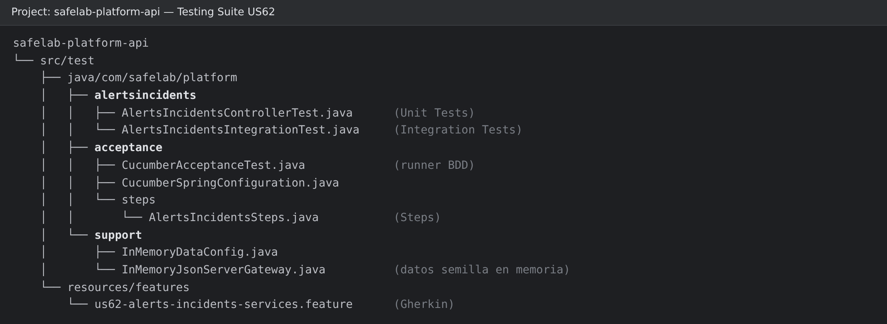
</p>

<p align="center"><i>Figura: Estructura del proyecto de testing de US62 en la SafeLab Platform API.</i></p>

##### **Unit Tests**

<p
  style="text-align: justify;
         text-indent: 0.5in;
         line-height: 1.5;
         margin: 0 0 12px 0;
         orphans: 2;
         widows: 2;">
  Los Unit Tests verifican de forma aislada el comportamiento del controlador del bounded context <i>Alert
  &amp; Incident Management</i>. Sus dependencias (<code>RecordsService</code> y <code>DataGateway</code>)
  se reemplazan con <i>mocks</i> de Mockito, por lo que estas pruebas no levantan el servidor ni acceden a
  la base de datos.
</p>

<table border="1" style="width: 100%; border-collapse: collapse;">
<thead>
<tr>
<th style="text-align: center; vertical-align: middle; padding: 6px;">Test Class</th>
<th style="text-align: center; vertical-align: middle; padding: 6px;">Clase evaluada</th>
<th style="text-align: center; vertical-align: middle; padding: 6px;">Tests y comportamientos verificados</th>
<th style="text-align: center; vertical-align: middle; padding: 6px;">User Story</th>
</tr>
</thead>
<tbody>
<tr>
<td style="text-align:center; vertical-align: top; padding:6px;">AlertsIncidentsControllerTest</td>
<td style="text-align: justify; vertical-align: top; padding:6px;"><code>AlertsIncidentsController</code></td>
<td style="text-align: justify; vertical-align: top; padding:6px;"><code>alertsReturnsTheAlertsAuthorizedToView</code>: retorna las alertas autorizadas.<br><code>acknowledgeChangesTheAlertStatusToAcknowledged</code>: cambia la alerta a <i>acknowledged</i> con sus notas y fecha de actualización.<br><code>acknowledgePropagatesNotFoundWhenTheAlertDoesNotExist</code>: responde 404 y no modifica datos si la alerta no existe.<br><code>resolveAlertChangesTheAlertStatusToResolved</code>: cambia la alerta a <i>resolved</i>.<br><code>escalateOpensALinkedIncidentAndMarksTheAlertAsEscalated</code>: abre un incidente vinculado a la alerta y al sensor, y marca la alerta como <i>escalated</i>.<br><code>createRegistersAnOpenIncident</code>: registra un incidente con estado <i>open</i> (201).<br><code>investigateChangesTheIncidentStatusToInvestigating</code>: inicia la investigación del incidente.<br><code>closeRejectsAnIncidentThatIsNotResolved</code>: impide cerrar un incidente no resuelto.<br><code>closeClosesAResolvedIncident</code>: cierra un incidente resuelto.</td>
<td style="text-align:center; vertical-align: top; padding:6px;">US62</td>
</tr>
</tbody>
</table>

<p align="center">
  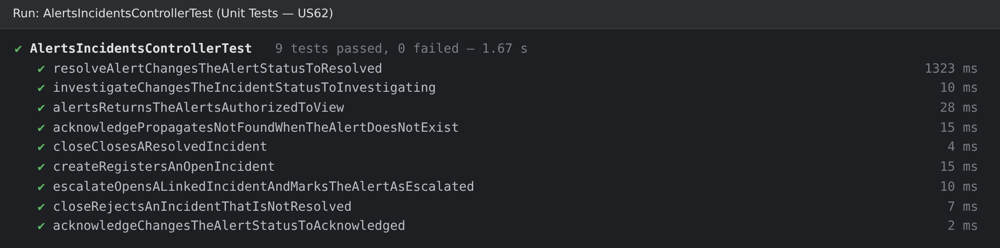
</p>

<p align="center"><i>Figura: Ejecución de los Unit Tests de US62 (9 tests aprobados).</i></p>

##### **Integration Tests**

<p
  style="text-align: justify;
         text-indent: 0.5in;
         line-height: 1.5;
         margin: 0 0 12px 0;
         orphans: 2;
         widows: 2;">
  Los Integration Tests levantan el contexto completo de Spring Boot y consumen los endpoints de la RESTful
  API mediante MockMvc con un token de sesión real, verificando la interacción entre el filtro de sesión,
  las reglas de acceso por rol y empresa, el controlador, los servicios y los datos.
</p>

<table border="1" style="width: 100%; border-collapse: collapse;">
<thead>
<tr>
<th style="text-align: center; vertical-align: middle; padding: 6px;">Test Class</th>
<th style="text-align: center; vertical-align: middle; padding: 6px;">Endpoints evaluados</th>
<th style="text-align: center; vertical-align: middle; padding: 6px;">Comportamientos verificados</th>
<th style="text-align: center; vertical-align: middle; padding: 6px;">User Story</th>
</tr>
</thead>
<tbody>
<tr>
<td style="text-align:center; vertical-align: top; padding:6px;">AlertsIncidentsIntegrationTest</td>
<td style="text-align: justify; vertical-align: top; padding:6px;"><code>POST /api/v1/auth/login</code><br><code>GET /api/v1/alertsincidents/alerts</code><br><code>POST /api/v1/alertsincidents/alerts/{id}/acknowledge</code><br><code>POST /api/v1/alertsincidents/alerts/{id}/escalate</code><br><code>POST /api/v1/alertsincidents/incidents/{id}/investigate</code><br><code>POST /api/v1/alertsincidents/incidents/{id}/resolve</code><br><code>POST /api/v1/alertsincidents/incidents/{id}/close</code><br><code>GET /api/v1/alertsincidents/incidents/{id}</code></td>
<td style="text-align: justify; vertical-align: top; padding:6px;">Lista solo las alertas de la empresa del usuario; actualiza el estado de una alerta; responde 404 si la alerta no existe; responde 403 ante una alerta de otra empresa; escala una alerta y crea el incidente vinculado; completa el flujo investigar, resolver y cerrar un incidente; responde 409 al cerrar un incidente no resuelto; responde 400 ante notas inválidas; responde 401 sin token de sesión.</td>
<td style="text-align:center; vertical-align: top; padding:6px;">US62</td>
</tr>
</tbody>
</table>

<p align="center">
  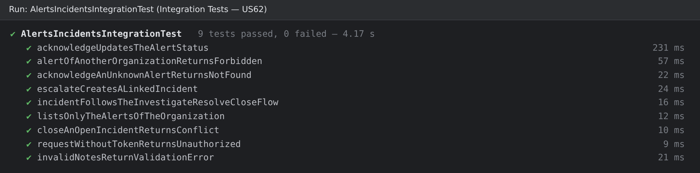
</p>

<p align="center"><i>Figura: Ejecución de los Integration Tests de US62 (9 tests aprobados).</i></p>

##### **Acceptance Tests (BDD)**

<p
  style="text-align: justify;
         text-indent: 0.5in;
         line-height: 1.5;
         margin: 0 0 12px 0;
         orphans: 2;
         widows: 2;">
  Los Acceptance Tests se elaboraron bajo el enfoque BDD con Cucumber. El archivo <code>.feature</code>
  está escrito en lenguaje Gherkin a partir de los criterios de aceptación de US62, y sus pasos se
  implementan en la clase de Steps <code>AlertsIncidentsSteps</code>, que inicia sesión y ejecuta las
  solicitudes contra la RESTful API. La clase <code>CucumberAcceptanceTest</code> ejecuta los escenarios y
  <code>CucumberSpringConfiguration</code> inicia el contexto de Spring Boot para las pruebas.
</p>

<p
  style="text-align: justify;
         text-indent: 0.5in;
         line-height: 1.5;
         margin: 0 0 12px 0;
         orphans: 2;
         widows: 2;">
  <b>US62 - Proporcionar servicios de alertas e incidentes.</b> Verifica que la API proporcione la
  información de una alerta, que devuelva la alerta junto con su estado registrado, que responda que la
  alerta no fue encontrada cuando no está disponible y que permita escalar una alerta a un incidente.
  Archivo: <code>us62-alerts-incidents-services.feature</code>.
</p>

```gherkin
@US62
Feature: US62 - Provide alert and incident services
  As a Developer
  I want the RESTful API to provide alert and incident information
  So that the SafeLab applications can use the generated alerts and their status

  Scenario: Provide alert information
    Given the user "gerente.andes@safelab.test" is signed in
    And the alert "alert-001" exists
    When the client requests the alerts
    Then the service responds with status 200
    And the alert "alert-001" has the field "title" with value "PCR freezer out of range"
    And the alert "alert-001" has the field "severity" with value "critical"

  Scenario Outline: Provide the status of an alert
    Given the user "<user>" is signed in
    And the alert "<alert>" exists
    When the client requests the alerts
    Then the service responds with status 200
    And the alert "<alert>" has the field "status" with value "<status>"

    Examples:
      | user                         | alert     | status       |
      | gerente.andes@safelab.test   | alert-001 | active       |
      | gerente.gabriel@safelab.test | alert-003 | acknowledged |
      | gerente.gabriel@safelab.test | alert-005 | resolved     |

  Scenario: Non-existent alert
    Given the user "gerente.andes@safelab.test" is signed in
    And the alert "alert-999" does not exist
    When the client acknowledges the alert "alert-999"
    Then the service responds with status 404
    And the error code is "NOT_FOUND"

  Scenario: Escalate an alert into an incident
    Given the user "gerente.andes@safelab.test" is signed in
    And the alert "alert-001" exists
    When the client escalates the alert "alert-001"
    Then the service responds with status 200
    And the response field "relatedAlertId" is "alert-001"
    And the response field "status" is "open"
```

<p align="center">
  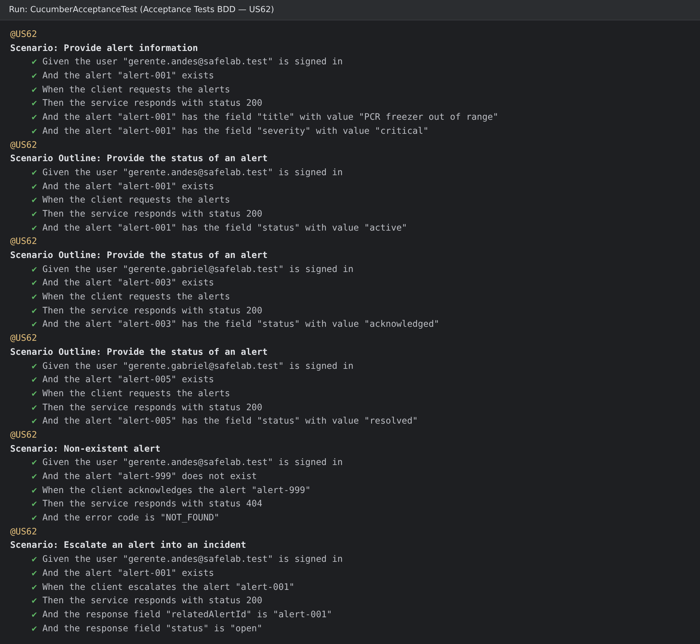
</p>

<p align="center"><i>Figura: Ejecución de los Acceptance Tests BDD de US62 (6 escenarios aprobados).</i></p>

<p align="center">
  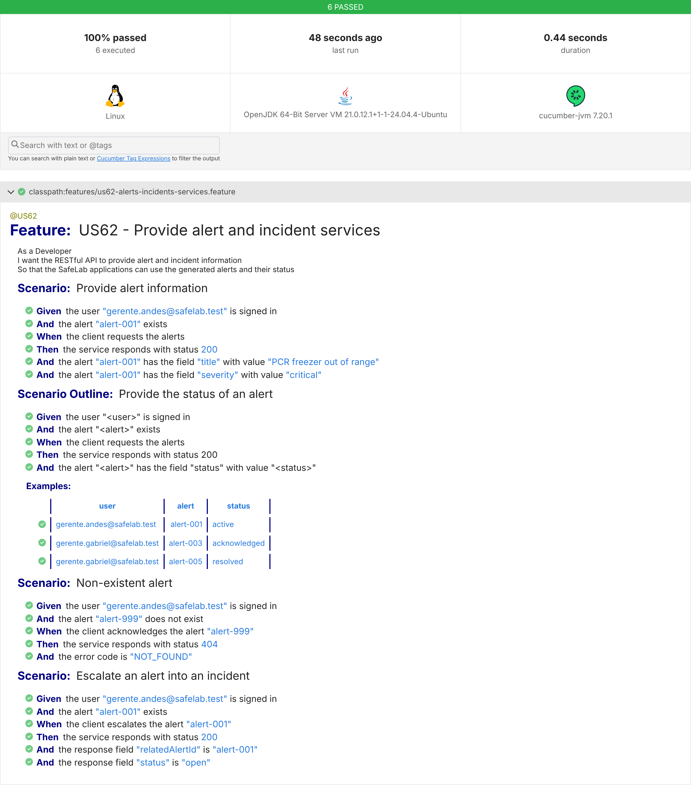
</p>

<p align="center"><i>Figura: Reporte de Cucumber con los escenarios de US62.</i></p>

##### **Test Results**

<p
  style="text-align: justify;
         text-indent: 0.5in;
         line-height: 1.5;
         margin: 0 0 12px 0;
         orphans: 2;
         widows: 2;">
  La ejecución de la suite mediante Maven finalizó con éxito: los 9 Unit Tests y los 9 Integration Tests se
  aprobaron sin fallos ni errores, y los 6 escenarios BDD de Cucumber se ejecutaron satisfactoriamente,
  según se muestra en el reporte de Cucumber. Con ello se valida el comportamiento de los Web Services de
  alertas e incidentes asociados a la User Story US62 del Sprint 2.
</p>

<p align="center">
  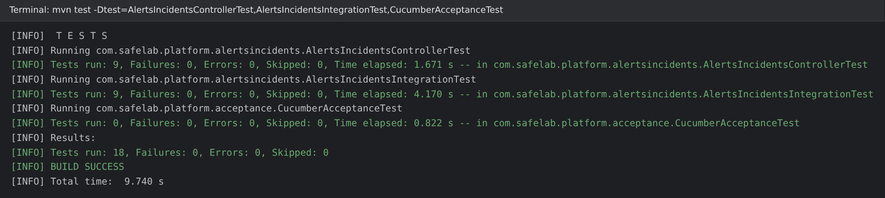
</p>

<p align="center"><i>Figura: Resumen de la ejecución de la suite con Maven.</i></p>

#### **4.2.2.6. Execution Evidence for Sprint Review**

<p
  style="text-align: justify;
         text-indent: 0.5in;
         line-height: 1.5;
         margin: 0 0 12px 0;
         orphans: 2;
         widows: 2;">
  Al finalizar el Sprint 2, la aplicación móvil de SafeLab incorpora la gestión de alertas ambientales, la
  configuración de límites por equipo y la consulta de los equipos con alertas activas, integradas con el
  RESTful API de la plataforma. La navegación se realiza mediante una barra inferior con las secciones
  Inicio, Sensores, Alertas, Equipos y Más. Las vistas aplican Material Design 3 y la paleta de SafeLab. A
  continuación se presentan las principales vistas implementadas, relacionadas con las User Stories del
  Sprint Backlog 2.
</p>

<p align="center">
  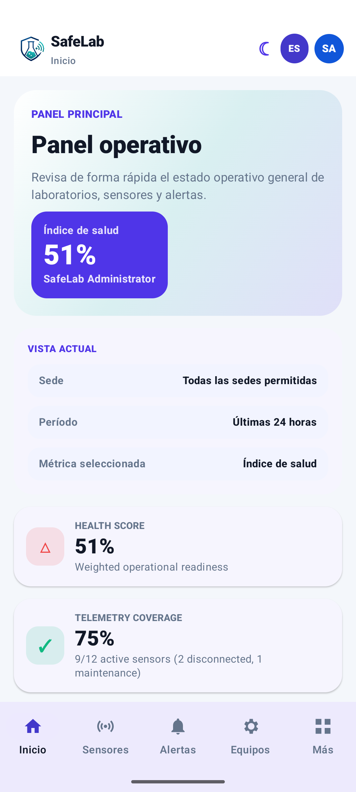
</p>

<p align="center"><i>Figura: Navegación principal de la aplicación móvil en el Sprint 2.</i></p>

##### Alerts & Incidents

<p
  style="text-align: justify;
         text-indent: 0.5in;
         line-height: 1.5;
         margin: 0 0 12px 0;
         orphans: 2;
         widows: 2;">
  La sección Alertas muestra las alertas de temperatura y humedad registradas por los sensores, con su
  severidad y estado (US18, US19, US20). El usuario puede ordenarlas por severidad (US23) y consultar
  únicamente las alertas críticas (US44).
</p>

<p align="center">
  
</p>

<p align="center"><i>Figura: Lista de alertas.</i></p>

<p align="center">
  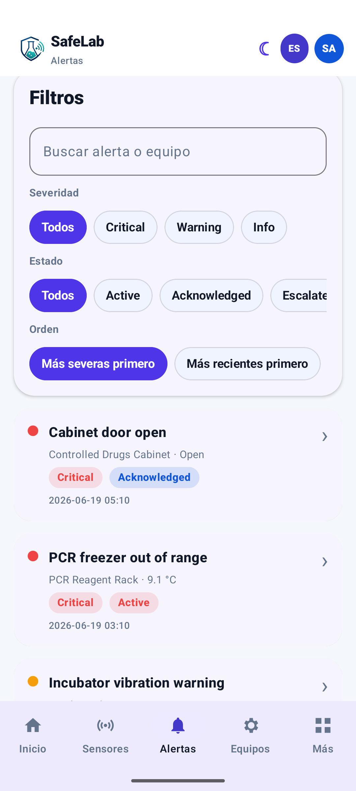
</p>

<p align="center"><i>Figura: Alertas ordenadas por severidad.</i></p>

<p align="center">
  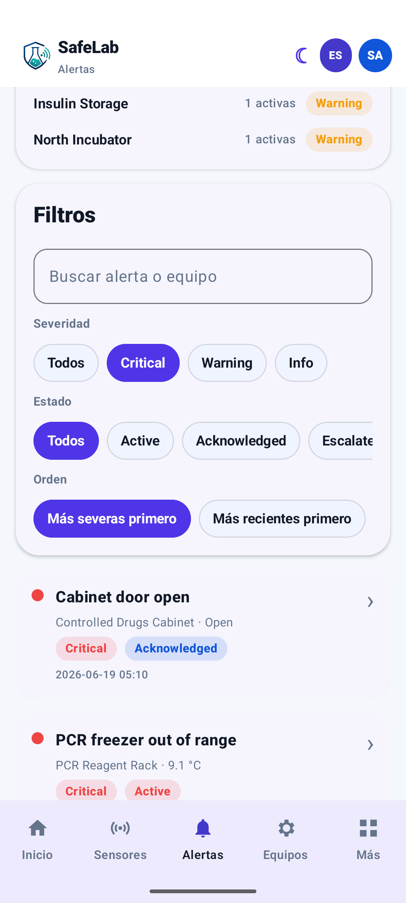
</p>

<p align="center"><i>Figura: Alertas críticas.</i></p>

<p
  style="text-align: justify;
         text-indent: 0.5in;
         line-height: 1.5;
         margin: 0 0 12px 0;
         orphans: 2;
         widows: 2;">
  Desde cada alerta, el usuario accede al detalle con la información de la lectura y del equipo afectado
  (US21), y puede confirmar su atención (US22).
</p>

<p align="center">
  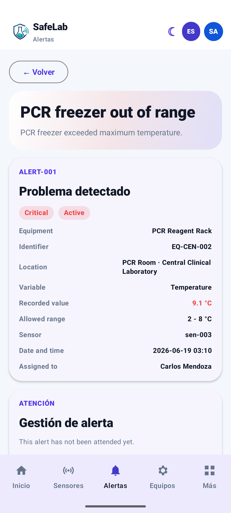
</p>

<p align="center"><i>Figura: Detalle de una alerta.</i></p>

<p align="center">
  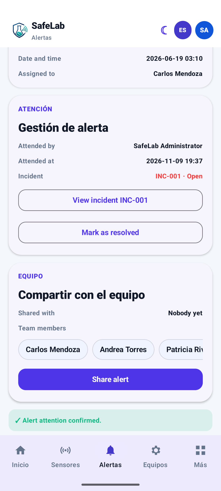
</p>

<p align="center"><i>Figura: Confirmación de atención de una alerta.</i></p>

<p
  style="text-align: justify;
         text-indent: 0.5in;
         line-height: 1.5;
         margin: 0 0 12px 0;
         orphans: 2;
         widows: 2;">
  La vista de reglas permite configurar los límites de alerta por equipo (US25). Además, se pueden
  consultar los equipos que tienen alertas activas (US46).
</p>

<p align="center">
  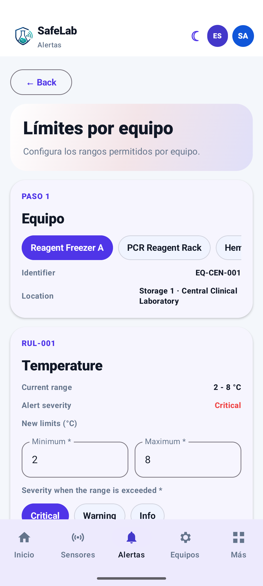
</p>

<p align="center"><i>Figura: Límites de alerta por equipo.</i></p>

<p align="center">
  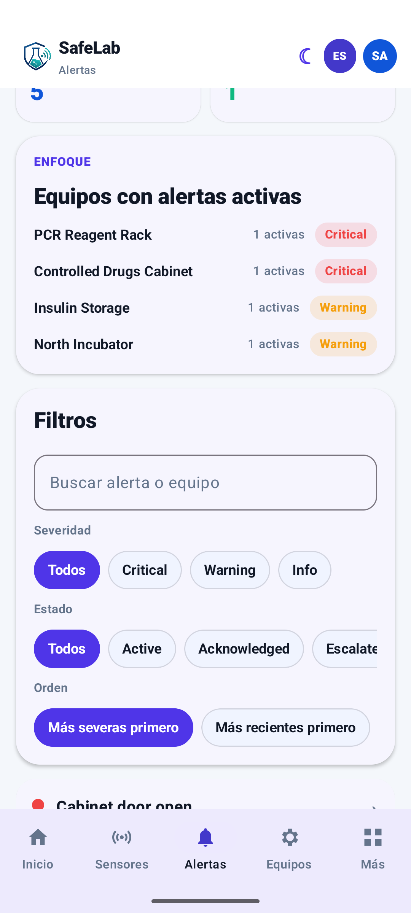
</p>

<p align="center"><i>Figura: Equipos con alertas activas.</i></p>

#### **4.2.2.7. Services Documentation Evidence for Sprint Review**

<p
  style="text-align: justify;
         text-indent: 0.5in;
         line-height: 1.5;
         margin: 0 0 12px 0;
         orphans: 2;
         widows: 2;">
  En el Sprint 2 se documentaron los servicios web que soportan la gestión de alertas e incidentes y la
  consulta de la organización del monitoreo (US62). En este Sprint, SafeLab Platform API evolucionó a la
  versión 2.5.0: el backend, desarrollado con Java 21 y Spring Boot 3.4.5, persiste la información en
  PostgreSQL con migraciones de Flyway y protege todos los endpoints con autenticación por token y control
  de acceso por roles y permisos (RBAC), de modo que cada usuario solo consulta y modifica los registros de
  su empresa y de los recursos que tiene asignados. La documentación se genera con la especificación
  OpenAPI mediante springdoc y se publica en Swagger UI en dos versiones, español e inglés, que traducen la
  descripción de los endpoints sin cambiar sus rutas.
</p>

<p
  style="text-align: justify;
         text-indent: 0.5in;
         line-height: 1.5;
         margin: 0 0 12px 0;
         orphans: 2;
         widows: 2;">
  La siguiente tabla resume los endpoints relacionados con el alcance del Sprint, con su verbo HTTP, su
  sintaxis de llamada, sus parámetros y permisos requeridos, y un ejemplo de respuesta basado en los datos
  de demostración del proyecto.
</p>

<table border="1" style="width: 100%; border-collapse: collapse; table-layout: fixed; overflow-wrap: anywhere;">
<colgroup>
<col style="width: 13%;">
    <col style="width: 21%;">
    <col style="width: 8%;">
    <col style="width: 14%;">
    <col style="width: 17%;">
    <col style="width: 27%;">
</colgroup>
<thead>
<tr>
<th style="text-align: center; vertical-align: middle; padding: 6px;">Bounded Context</th>
<th style="text-align: center; vertical-align: middle; padding: 6px;">Endpoint</th>
<th style="text-align: center; vertical-align: middle; padding: 6px;">Verbo HTTP</th>
<th style="text-align: center; vertical-align: middle; padding: 6px;">Acción</th>
<th style="text-align: center; vertical-align: middle; padding: 6px;">Parámetros y permiso</th>
<th style="text-align: center; vertical-align: middle; padding: 6px;">Ejemplo y explicación del response</th>
</tr>
</thead>
<tbody>
<tr>
<td style="text-align: left; vertical-align: top; padding: 6px;">Identity &amp; Access</td>
<td style="text-align: left; vertical-align: top; padding: 6px;"><code>/api/v1/auth/login</code></td>
<td style="text-align: center; vertical-align: middle; padding: 6px;">POST</td>
<td style="text-align: left; vertical-align: top; padding: 6px;">Iniciar sesión y obtener el token</td>
<td style="text-align: left; vertical-align: top; padding: 6px;">Body: <code>identifier</code>, <code>password</code></td>
<td style="text-align: left; vertical-align: top; padding: 6px;"><code>200 OK</code>: <code>accessToken</code>, <code>tokenType: Bearer</code> y <code>expiresAt</code>. El token se envía en <code>Authorization: Bearer</code> en las demás solicitudes (botón <i>Authorize</i> de Swagger). Credenciales inválidas: <code>401</code>.</td>
</tr>

<tr>
<td style="text-align: left; vertical-align: top; padding: 6px;">Alert &amp; Incident Management</td>
<td style="text-align: left; vertical-align: top; padding: 6px;"><code>/api/v1/alertsincidents/alerts</code></td>
<td style="text-align: center; vertical-align: middle; padding: 6px;">GET</td>
<td style="text-align: left; vertical-align: top; padding: 6px;">Listar alertas (US20, US23, US44, US46)</td>
<td style="text-align: left; vertical-align: top; padding: 6px;">Permiso: <code>incidents.view</code></td>
<td style="text-align: left; vertical-align: top; padding: 6px;"><code>200 OK</code>: <code>[{&quot;id&quot;: &quot;alert-001&quot;, &quot;type&quot;: &quot;Temperature&quot;, &quot;title&quot;: &quot;PCR freezer out of range&quot;, &quot;sensorId&quot;: &quot;sen-003&quot;, &quot;assetId&quot;: &quot;asset-002&quot;, &quot;facilityId&quot;: &quot;fac-central&quot;, &quot;severity&quot;: &quot;critical&quot;, &quot;status&quot;: &quot;active&quot;}, …]</code>. Solo devuelve las alertas de la empresa y de los recursos asignados al usuario; la aplicación las ordena por severidad y filtra las críticas y los equipos con alertas activas.</td>
</tr>

<tr>
<td style="text-align: left; vertical-align: top; padding: 6px;">Alert &amp; Incident Management</td>
<td style="text-align: left; vertical-align: top; padding: 6px;"><code>/api/v1/alertsincidents/alerts/{id}/acknowledge</code></td>
<td style="text-align: center; vertical-align: middle; padding: 6px;">POST</td>
<td style="text-align: left; vertical-align: top; padding: 6px;">Confirmar atención de una alerta (US22)</td>
<td style="text-align: left; vertical-align: top; padding: 6px;">Path: <code>id</code>. Body: <code>notes</code> (5 a 500 caracteres). Permiso: <code>alerts.acknowledge</code></td>
<td style="text-align: left; vertical-align: top; padding: 6px;"><code>200 OK</code>: la alerta con <code>status: acknowledged</code>, <code>notes</code> y <code>updatedAt</code>. <code>400 VALIDATION_ERROR</code> si falta la nota y <code>404 NOT_FOUND</code> si la alerta no existe.</td>
</tr>

<tr>
<td style="text-align: left; vertical-align: top; padding: 6px;">Alert &amp; Incident Management</td>
<td style="text-align: left; vertical-align: top; padding: 6px;"><code>/api/v1/alertsincidents/alerts/{id}/resolve</code></td>
<td style="text-align: center; vertical-align: middle; padding: 6px;">POST</td>
<td style="text-align: left; vertical-align: top; padding: 6px;">Resolver una alerta</td>
<td style="text-align: left; vertical-align: top; padding: 6px;">Path: <code>id</code>. Body: <code>notes</code>. Permiso: <code>incidents.resolve</code></td>
<td style="text-align: left; vertical-align: top; padding: 6px;"><code>200 OK</code>: la alerta con <code>status: resolved</code>.</td>
</tr>

<tr>
<td style="text-align: left; vertical-align: top; padding: 6px;">Alert &amp; Incident Management</td>
<td style="text-align: left; vertical-align: top; padding: 6px;"><code>/api/v1/alertsincidents/alerts/{id}/escalate</code></td>
<td style="text-align: center; vertical-align: middle; padding: 6px;">POST</td>
<td style="text-align: left; vertical-align: top; padding: 6px;">Escalar una alerta y abrir un incidente</td>
<td style="text-align: left; vertical-align: top; padding: 6px;">Path: <code>id</code>. Body: <code>notes</code>. Permiso: <code>incidents.create</code></td>
<td style="text-align: left; vertical-align: top; padding: 6px;"><code>200 OK</code>: el incidente creado (<code>title: Escalation: …</code>, <code>relatedAlertId</code>, <code>relatedSensorId</code>, severidad heredada y <code>status: open</code>). La alerta queda con <code>status: escalated</code> en la misma transacción.</td>
</tr>

<tr>
<td style="text-align: left; vertical-align: top; padding: 6px;">Alert &amp; Incident Management</td>
<td style="text-align: left; vertical-align: top; padding: 6px;"><code>/api/v1/alertsincidents/notifications</code></td>
<td style="text-align: center; vertical-align: middle; padding: 6px;">GET</td>
<td style="text-align: left; vertical-align: top; padding: 6px;">Listar notificaciones (US24)</td>
<td style="text-align: left; vertical-align: top; padding: 6px;">Permiso: <code>incidents.view</code></td>
<td style="text-align: left; vertical-align: top; padding: 6px;"><code>200 OK</code>: <code>[{&quot;id&quot;: &quot;not-001&quot;, &quot;title&quot;: &quot;Critical freezer alert&quot;, &quot;context&quot;: &quot;alerts&quot;, &quot;severity&quot;: &quot;critical&quot;, &quot;unread&quot;: true}, …]</code></td>
</tr>

<tr>
<td style="text-align: left; vertical-align: top; padding: 6px;">Alert &amp; Incident Management</td>
<td style="text-align: left; vertical-align: top; padding: 6px;"><code>/api/v1/alertsincidents/notifications/{id}/mark-read</code></td>
<td style="text-align: center; vertical-align: middle; padding: 6px;">POST</td>
<td style="text-align: left; vertical-align: top; padding: 6px;">Marcar notificación como leída</td>
<td style="text-align: left; vertical-align: top; padding: 6px;">Path: <code>id</code>. Permiso: <code>incidents.view</code></td>
<td style="text-align: left; vertical-align: top; padding: 6px;"><code>200 OK</code>: la notificación con <code>unread: false</code>.</td>
</tr>

<tr>
<td style="text-align: left; vertical-align: top; padding: 6px;">Alert &amp; Incident Management</td>
<td style="text-align: left; vertical-align: top; padding: 6px;"><code>/api/v1/alertsincidents/incidents</code></td>
<td style="text-align: center; vertical-align: middle; padding: 6px;">GET</td>
<td style="text-align: left; vertical-align: top; padding: 6px;">Listar incidentes</td>
<td style="text-align: left; vertical-align: top; padding: 6px;">Permiso: <code>incidents.view</code></td>
<td style="text-align: left; vertical-align: top; padding: 6px;"><code>200 OK</code>: <code>[{&quot;id&quot;: &quot;inc-001&quot;, &quot;code&quot;: &quot;INC-001&quot;, &quot;title&quot;: &quot;PCR freezer deviation&quot;, &quot;relatedAlertId&quot;: &quot;alert-001&quot;, &quot;severity&quot;: &quot;critical&quot;, &quot;status&quot;: &quot;open&quot;}, …]</code>. <code>GET /incidents/{id}</code> devuelve el detalle de un incidente.</td>
</tr>

<tr>
<td style="text-align: left; vertical-align: top; padding: 6px;">Alert &amp; Incident Management</td>
<td style="text-align: left; vertical-align: top; padding: 6px;"><code>/api/v1/alertsincidents/incidents</code></td>
<td style="text-align: center; vertical-align: middle; padding: 6px;">POST</td>
<td style="text-align: left; vertical-align: top; padding: 6px;">Registrar incidente</td>
<td style="text-align: left; vertical-align: top; padding: 6px;">Body: <code>title</code>, <code>description</code>, <code>facilityId</code>, <code>severity</code>, <code>relatedSensorId</code> (opcional). Permiso: <code>incidents.create</code></td>
<td style="text-align: left; vertical-align: top; padding: 6px;"><code>201 Created</code>: el incidente registrado con <code>status: open</code>.</td>
</tr>

<tr>
<td style="text-align: left; vertical-align: top; padding: 6px;">Alert &amp; Incident Management</td>
<td style="text-align: left; vertical-align: top; padding: 6px;"><code>/api/v1/alertsincidents/incidents/{id}/investigate</code></td>
<td style="text-align: center; vertical-align: middle; padding: 6px;">POST</td>
<td style="text-align: left; vertical-align: top; padding: 6px;">Avanzar el ciclo del incidente</td>
<td style="text-align: left; vertical-align: top; padding: 6px;">Path: <code>id</code>. Body: <code>notes</code>. Permiso: <code>incidents.resolve</code></td>
<td style="text-align: left; vertical-align: top; padding: 6px;"><code>200 OK</code>: el incidente con <code>status: investigating</code>. <code>/resolve</code> y <code>/close</code> siguen el mismo formato; cerrar un incidente que no está resuelto responde <code>409 INCIDENT_NOT_RESOLVED</code>.</td>
</tr>

<tr>
<td style="text-align: left; vertical-align: top; padding: 6px;">Sensor Monitoring</td>
<td style="text-align: left; vertical-align: top; padding: 6px;"><code>/api/v1/sensormonitoring/sensors/{id}</code></td>
<td style="text-align: center; vertical-align: middle; padding: 6px;">PATCH</td>
<td style="text-align: left; vertical-align: top; padding: 6px;">Configurar límites de alerta del sensor (US25)</td>
<td style="text-align: left; vertical-align: top; padding: 6px;">Path: <code>id</code>. Body: <code>min</code>, <code>max</code>. Permiso: <code>sensors.configure</code>, que el gerente puede otorgar al coordinador del laboratorio</td>
<td style="text-align: left; vertical-align: top; padding: 6px;"><code>200 OK</code>: el sensor con sus nuevos límites, que se aplican a las siguientes lecturas.</td>
</tr>

<tr>
<td style="text-align: left; vertical-align: top; padding: 6px;">Sensor Monitoring</td>
<td style="text-align: left; vertical-align: top; padding: 6px;"><code>/api/v1/sensormonitoring/sensors/{id}/reading</code></td>
<td style="text-align: center; vertical-align: middle; padding: 6px;">PATCH</td>
<td style="text-align: left; vertical-align: top; padding: 6px;">Registrar lectura y generar alerta (US18, US19)</td>
<td style="text-align: left; vertical-align: top; padding: 6px;">Path: <code>id</code>. Body: <code>value</code>. Permiso: <code>sensors.configure</code></td>
<td style="text-align: left; vertical-align: top; padding: 6px;"><code>200 OK</code>: el sensor con <code>value</code>, <code>lastReading</code> y <code>status</code> recalculado. Si el valor sale del rango <code>min</code>–<code>max</code>, el estado pasa a <code>out-of-range</code> y el servicio registra automáticamente una alerta <code>active</code> con severidad <code>warning</code>.</td>
</tr>

<tr>
<td style="text-align: left; vertical-align: top; padding: 6px;">Facility &amp; Asset Management</td>
<td style="text-align: left; vertical-align: top; padding: 6px;"><code>/api/v1/facilityassets/facilities</code></td>
<td style="text-align: center; vertical-align: middle; padding: 6px;">GET</td>
<td style="text-align: left; vertical-align: top; padding: 6px;">Listar sedes de monitoreo (US02)</td>
<td style="text-align: left; vertical-align: top; padding: 6px;">Permiso: <code>assets.view</code></td>
<td style="text-align: left; vertical-align: top; padding: 6px;"><code>200 OK</code>: <code>[{&quot;id&quot;: &quot;fac-central&quot;, &quot;name&quot;: &quot;Andinos Central Laboratory&quot;, &quot;city&quot;: &quot;Huancayo&quot;, &quot;healthScore&quot;: 72, &quot;organizationId&quot;: &quot;org-andes&quot;}, …]</code></td>
</tr>

<tr>
<td style="text-align: left; vertical-align: top; padding: 6px;">Facility &amp; Asset Management</td>
<td style="text-align: left; vertical-align: top; padding: 6px;"><code>/api/v1/facilityassets/assets</code></td>
<td style="text-align: center; vertical-align: middle; padding: 6px;">GET</td>
<td style="text-align: left; vertical-align: top; padding: 6px;">Listar equipos (US04, US06, US08, US14)</td>
<td style="text-align: left; vertical-align: top; padding: 6px;">Permiso: <code>assets.view</code></td>
<td style="text-align: left; vertical-align: top; padding: 6px;"><code>200 OK</code>: equipos con <code>name</code>, <code>facilityId</code>, <code>storageUnit</code>, <code>location</code> y <code>status</code>. La búsqueda por nombre y el filtro por área se aplican en la aplicación sobre esta respuesta; las áreas de almacenamiento corresponden al campo <code>storageUnit</code>.</td>
</tr>

<tr>
<td style="text-align: left; vertical-align: top; padding: 6px;">Facility &amp; Asset Management</td>
<td style="text-align: left; vertical-align: top; padding: 6px;"><code>/api/v1/facilityassets/assets/{id}</code></td>
<td style="text-align: center; vertical-align: middle; padding: 6px;">GET</td>
<td style="text-align: left; vertical-align: top; padding: 6px;">Consultar detalle de un equipo (US12)</td>
<td style="text-align: left; vertical-align: top; padding: 6px;">Path: <code>id</code>. Permiso: <code>assets.view</code></td>
<td style="text-align: left; vertical-align: top; padding: 6px;"><code>200 OK</code>: <code>{&quot;id&quot;: &quot;asset-001&quot;, &quot;name&quot;: &quot;Reagent Freezer A&quot;, &quot;category&quot;: &quot;Cold Storage&quot;, &quot;storageUnit&quot;: &quot;Freezer A&quot;, &quot;responsible&quot;: &quot;Andrea Torres&quot;, &quot;status&quot;: &quot;compliant&quot;}</code>. <code>403 ACCESS_DENIED</code> si el equipo no está asignado al usuario y <code>404 NOT_FOUND</code> si no existe.</td>
</tr>
</tbody>
</table>

<p
  style="text-align: justify;
         text-indent: 0.5in;
         line-height: 1.5;
         margin: 0 0 12px 0;
         orphans: 2;
         widows: 2;">
  Los servicios responden con un formato de error común (<code>ApiError</code>) que incluye un código y un
  mensaje en el idioma indicado en la cabecera <code>Accept-Language</code>: <code>400
  VALIDATION_ERROR</code> cuando el cuerpo no cumple las validaciones, <code>401 AUTH_REQUIRED</code>
  cuando no se envía un token válido, <code>403 ACCESS_DENIED</code> cuando el rol del usuario no tiene el
  permiso requerido y <code>404 NOT_FOUND</code> cuando el registro no existe. Además, los servicios se
  relacionan mediante eventos de negocio: una lectura fuera de rango genera una alerta, y escalar una
  alerta crea un incidente vinculado a ella mediante <code>relatedAlertId</code>, de modo que el personal
  puede seguir una desviación desde la lectura que la originó hasta el cierre del incidente.
</p>

##### **Documentation Access**

<table border="1" style="width: 100%; border-collapse: collapse;">
<thead>
<tr>
<th style="text-align: center; vertical-align: middle; padding: 6px;">Recurso</th>
<th style="text-align: center; vertical-align: middle; padding: 6px;">URL</th>
</tr>
</thead>
<tbody>
<tr>
<td style="text-align: left; vertical-align: top; padding: 6px;">Swagger UI</td>
<td style="text-align: left; vertical-align: top; padding: 6px;"><code>http://localhost:8080/swagger-ui.html</code> (perfil <i>postgres</i>) y <code>http://localhost:8081/swagger-ui.html</code> (perfil <i>jsonserver</i>), con los documentos <i>es</i> y <i>en</i></td>
</tr>

<tr>
<td style="text-align: left; vertical-align: top; padding: 6px;">Especificación OpenAPI</td>
<td style="text-align: left; vertical-align: top; padding: 6px;"><code>/v3/api-docs/es</code> y <code>/v3/api-docs/en</code> en el mismo puerto</td>
</tr>

<tr>
<td style="text-align: left; vertical-align: top; padding: 6px;">Health check</td>
<td style="text-align: left; vertical-align: top; padding: 6px;"><code>/api/v1/health</code> en el mismo puerto</td>
</tr>

<tr>
<td style="text-align: left; vertical-align: top; padding: 6px;">Repositorio</td>
<td style="text-align: left; vertical-align: top; padding: 6px;"><a href="https://github.com/meditrack-mobile-app-1acc0238-2620-4949/safelab-platform-api">safelab-platform-api</a> (tag <i>backend-v2.5.0</i>)</td>
</tr>
</tbody>
</table>
<p
  style="text-align: justify;
         text-indent: 0.5in;
         line-height: 1.5;
         margin: 0 0 12px 0;
         orphans: 2;
         widows: 2;">
  En este Sprint, SafeLab Platform API se ejecuta en el entorno local de desarrollo con dos perfiles:
  <code>postgres</code>, que persiste los datos en PostgreSQL y que la aplicación móvil consume desde el
  emulador de Android mediante <code>http://10.0.2.2:8080/api/v1</code>, y <code>jsonserver</code>, que
  expone la misma API sobre los datos de demostración en el puerto 8081. Las capturas de esta sección se
  tomaron con el perfil <code>jsonserver</code>. El despliegue del servicio en un entorno público se
  describe en la sección de despliegue correspondiente.
</p>

<p
  style="text-align: justify;
         text-indent: 0.5in;
         line-height: 1.5;
         margin: 0 0 12px 0;
         orphans: 2;
         widows: 2;">
  Las direcciones anteriores corresponden a los perfiles locales utilizados para documentar los
  contratos del Sprint 2 y no son direcciones accesibles desde un celular físico. La configuración
  pública de Render y Neon se integró después en <code>main</code> mediante los commits
  <code>6e6e35f6</code> y <code>e5ac37b1</code>. La evidencia de configuración se distingue de las
  pruebas funcionales, descritas en la sección 4.2.2.8.
</p>

##### **Documentation Interaction**

<p
  style="text-align: justify;
         text-indent: 0.5in;
         line-height: 1.5;
         margin: 0 0 12px 0;
         orphans: 2;
         widows: 2;">
  A continuación se presentan las capturas de la interacción con Swagger UI utilizando la cuenta de
  demostración del gerente de Laboratorios Andinos: el inicio de sesión y la autorización con el token, la
  consulta de alertas, la confirmación de atención de una alerta, su escalamiento a incidente, la consulta
  de incidentes —donde aparece el incidente creado y vinculado a la alerta mediante
  <code>relatedAlertId</code>— y la consulta de los equipos.
</p>

<p align="center">
  
</p>

<p align="center"><i>Figura: Swagger UI de SafeLab Platform API con los endpoints agrupados por Bounded Context.</i></p>

<p align="center">
  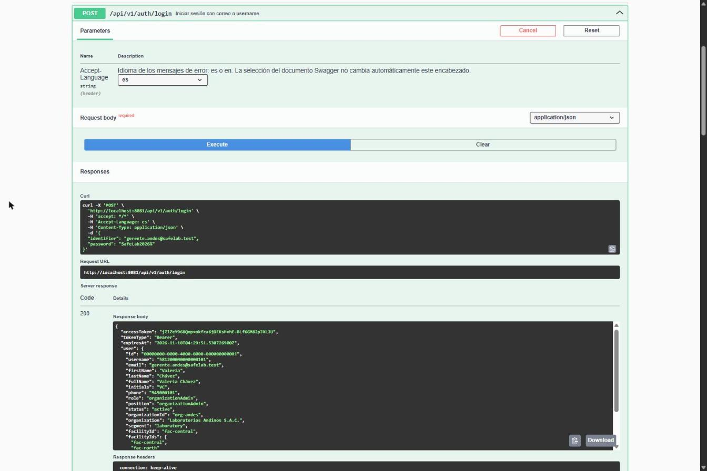
</p>

<p align="center"><i>Figura: Inicio de sesión y autorización con el token.</i></p>

<p align="center">
  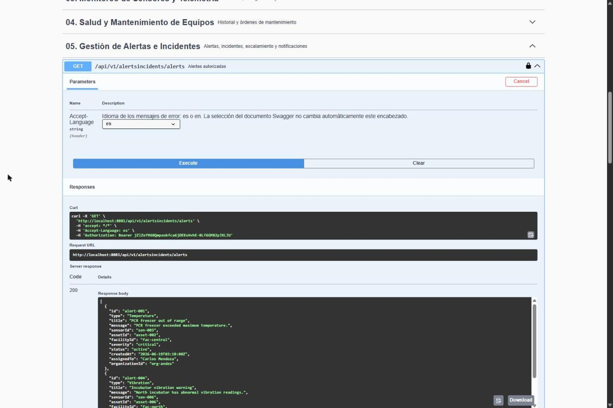
</p>

<p align="center"><i>Figura: Consulta de alertas autorizadas.</i></p>

<p align="center">
  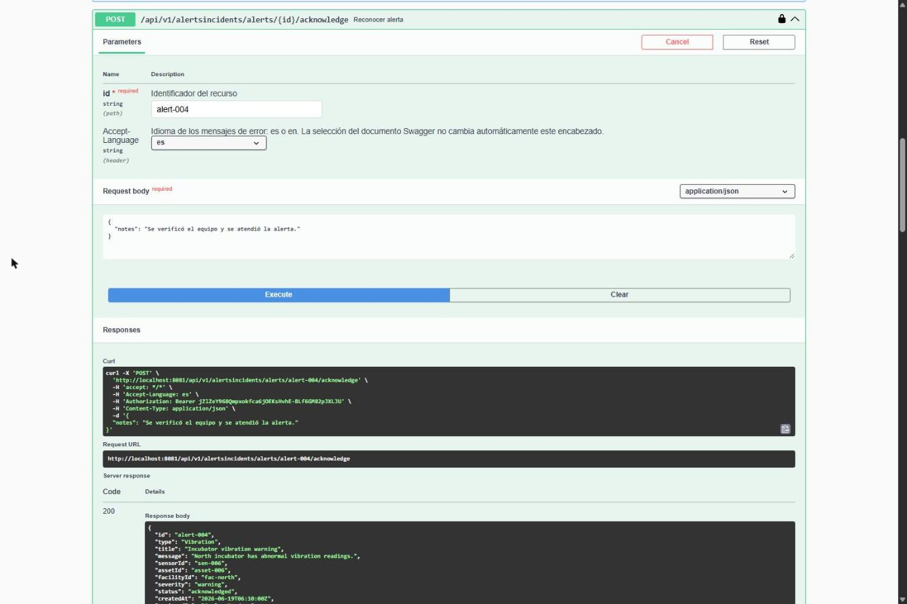
</p>

<p align="center"><i>Figura: Confirmación de atención de una alerta.</i></p>

<p align="center">
  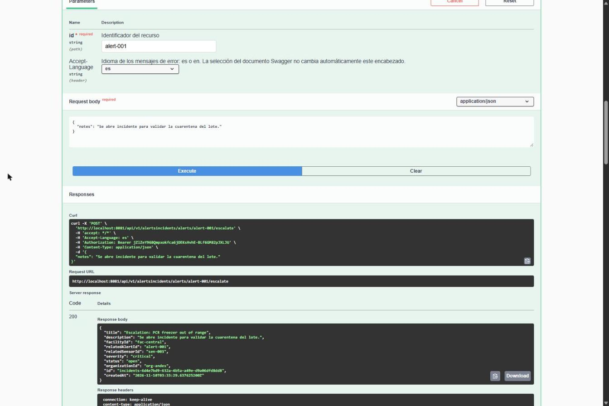
</p>

<p align="center"><i>Figura: Escalamiento de una alerta a incidente.</i></p>

<p align="center">
  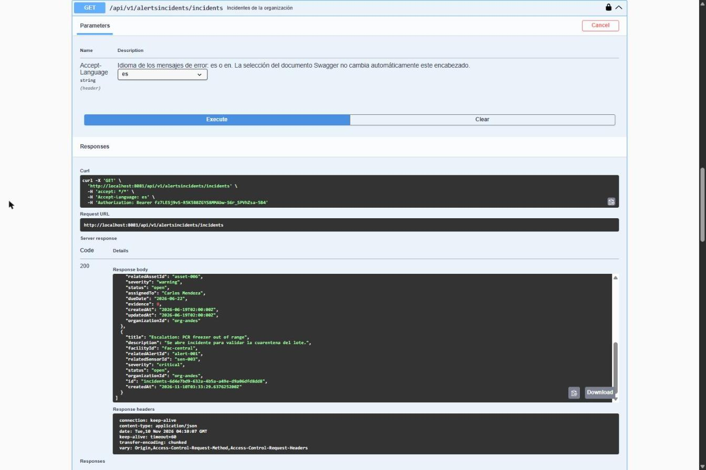
</p>

<p align="center"><i>Figura: Consulta de incidentes con el incidente vinculado a la alerta escalada.</i></p>

<p align="center">
  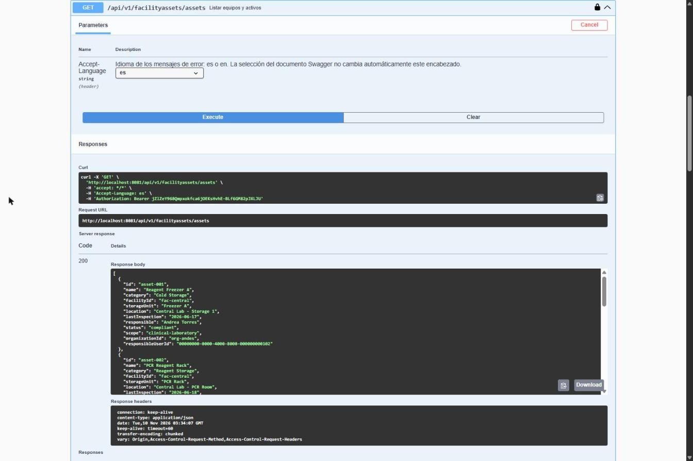
</p>

<p align="center"><i>Figura: Consulta de equipos de la empresa.</i></p>

#### **4.2.2.8. Software Deployment Evidence for Sprint Review**

<p
  style="text-align: justify;
         text-indent: 0.5in;
         line-height: 1.5;
         margin: 0 0 12px 0;
         orphans: 2;
         widows: 2;">
  El Sprint 2 culminó con los componentes web y los servicios accesibles a través de Render, la Landing
  Page en GitHub Pages y la distribución académica de la aplicación Android mediante GitHub Releases. El
  backend incorpora configuración para PostgreSQL en Neon; la aplicación móvil utiliza la URL HTTPS de la
  API, en lugar del host local <code>10.0.2.2</code>. La configuración de estas publicaciones se versionó
  en repositorios separados y las credenciales permanecen fuera del código fuente.
</p>

<table border="1" style="width: 100%; border-collapse: collapse; page-break-inside: auto;">
<thead>
<tr>
<th style="text-align: center; vertical-align: middle; padding: 6px;">Componente</th>
<th style="text-align: center; vertical-align: middle; padding: 6px;">Publicación / Acceso</th>
<th style="text-align: center; vertical-align: middle; padding: 6px;">Evidencia del incremento</th>
<th style="text-align: center; vertical-align: middle; padding: 6px;">Alcance y límites</th>
</tr>
</thead>
<tbody>
<tr style="page-break-inside: avoid;">
<td style="text-align: left; vertical-align: top; padding: 6px;">Landing Page</td>
<td style="text-align: left; vertical-align: top; padding: 6px;"><a href="https://meditrack-mobile-app-1acc0238-2620-4949.github.io/safelab-business-website/">GitHub Pages</a></td>
<td style="text-align: left; vertical-align: top; padding: 6px;"><code>f76c133d</code> integra cambios de AV2 y <code>1c20326b</code> integra el hotfix de KPI</td>
<td style="text-align: left; vertical-align: top; padding: 6px;">Presentación pública, videos y enlaces; sin acceso directo a PostgreSQL</td>
</tr>

<tr style="page-break-inside: avoid;">
<td style="text-align: left; vertical-align: top; padding: 6px;">Aplicación web</td>
<td style="text-align: left; vertical-align: top; padding: 6px;"><a href="https://safelab-frontend.onrender.com/">Render Static Site</a></td>
<td style="text-align: left; vertical-align: top; padding: 6px;">Integración con API/roles <code>6920333e</code>; corrección de navegación <code>4630c9e6</code></td>
<td style="text-align: left; vertical-align: top; padding: 6px;">Consulta y escritura según endpoints implementados y permisos; actualización al consultar o reenfocar la ventana</td>
</tr>

<tr style="page-break-inside: avoid;">
<td style="text-align: left; vertical-align: top; padding: 6px;">Backend RESTful</td>
<td style="text-align: left; vertical-align: top; padding: 6px;"><a href="https://safelab-platform-api.onrender.com/">Render Web Service</a></td>
<td style="text-align: left; vertical-align: top; padding: 6px;">Configuración Render/Neon en <code>6e6e35f6</code>, integrada en <code>e5ac37b1</code></td>
<td style="text-align: left; vertical-align: top; padding: 6px;">Documentación Swagger/OpenAPI, seguridad por organización, Flyway y respuestas HTTP; algunas operaciones especiales siguen pendientes</td>
</tr>

<tr style="page-break-inside: avoid;">
<td style="text-align: left; vertical-align: top; padding: 6px;">Base de datos</td>
<td style="text-align: left; vertical-align: top; padding: 6px;">Neon PostgreSQL</td>
<td style="text-align: left; vertical-align: top; padding: 6px;">Migraciones versionadas V1–V4; credenciales de aplicación y de migración separadas</td>
<td style="text-align: left; vertical-align: top; padding: 6px;">Persistencia multiempresa sin exponer credenciales al cliente</td>
</tr>

<tr style="page-break-inside: avoid;">
<td style="text-align: left; vertical-align: top; padding: 6px;">Android</td>
<td style="text-align: left; vertical-align: top; padding: 6px;"><a href="https://github.com/meditrack-mobile-app-1acc0238-2620-4949/safelab-mobile-app/releases/tag/av2-v2.5.3">GitHub Release av2-v2.5.3</a></td>
<td style="text-align: left; vertical-align: top; padding: 6px;">APK <code>SafeLab.apk</code>; hotfix <code>83d0ac58</code>, integrado con <code>3bb81f91</code></td>
<td style="text-align: left; vertical-align: top; padding: 6px;">Distribución de pruebas con firma Debug; no equivale a publicación en Play Store ni a release comercial</td>
</tr>
</tbody>
</table>

<p
  style="text-align: justify;
         text-indent: 0.5in;
         line-height: 1.5;
         margin: 0 0 12px 0;
         orphans: 2;
         widows: 2;">
  La reproducción técnica del despliegue comprende: (1) integrar y etiquetar la revisión aprobada; (2)
  desplegar el backend Docker en Render con variables de entorno para Neon, CORS, Java y migraciones; (3)
  comprobar salud, Swagger y permisos; (4) construir el frontend Vite y habilitar el acceso a rutas
  internas con la reescritura <code>/*</code> hacia <code>/index.html</code>; (5) publicar la Landing Page;
  y (6) generar, firmar, comprobar e incorporar <code>SafeLab.apk</code> a la Release. Los valores privados
  de configuración no forman parte de este documento.
</p>

<p
  style="text-align: justify;
         text-indent: 0.5in;
         line-height: 1.5;
         margin: 0 0 12px 0;
         orphans: 2;
         widows: 2;">
  El flujo de integración es Android / Vue → HTTPS → Spring Boot → PostgreSQL Neon. La API valida el token,
  los permisos efectivos y la pertenencia a la organización. Para comprobar cambios entre clientes no se
  requiere reinstalar Android: el cliente puede actualizar su información desde el backend y la web puede
  recargar o recuperar el foco. La sincronización instantánea sin interacción permanece como mejora del
  Trabajo Final.
</p>

<p
  style="text-align: justify;
         text-indent: 0.5in;
         line-height: 1.5;
         margin: 0 0 12px 0;
         orphans: 2;
         widows: 2;">
  La publicación de la Release <code>av2-v2.5.3</code> identifica el incremento corregido, pero el APK está
  firmado con un certificado Android Debug y se utiliza en dispositivos de prueba. Antes de una
  distribución comercial deben configurarse firma Release, versionado Android y procedimientos de
  actualización. Para la presentación de AV2 se debe demostrar un CRUD permitido por la API sobre un
  recurso de prueba, comprobando respuesta HTTP y persistencia sin divulgar credenciales.
</p>

#### **4.2.2.9. Team Collaboration Insights during Sprint**

<p
  style="text-align: justify;
         text-indent: 0.5in;
         line-height: 1.5;
         margin: 0 0 12px 0;
         orphans: 2;
         widows: 2;">
  Durante el Sprint 2, el equipo Meditrack mantuvo la estrategia de ramas por entrega: cada repositorio
  trabajó con ramas <code>feature/av2-*</code> que se integraron en <code>develop</code> y, una vez
  revisadas, en <code>main</code> con su respectivo tag de versión. A diferencia del Sprint 1, el trabajo
  se dividió en dos frentes: la implementación técnica de la aplicación móvil, la aplicación web y la
  SafeLab Platform API, y la documentación de las evidencias del Sprint en el reporte, donde cada
  integrante se encargó de las secciones de su aspecto en la rama <code>feature/av2-chapter-4</code>.
</p>

<table border="1" style="width: 100%; border-collapse: collapse; table-layout: fixed;">
<thead>
<tr>
<th style="text-align: center; vertical-align: middle; padding: 6px;">Integrante</th>
<th style="text-align: center; vertical-align: middle; padding: 6px;">Contribución principal en el Sprint 2</th>
<th style="text-align: center; vertical-align: middle; padding: 6px;">Resultado colaborativo</th>
</tr>
</thead>
<tbody>
<tr>
<td style="text-align: left; vertical-align: top; padding: 6px;">Carlos Lavado, Ever Giusephi</td>
<td style="text-align: justify; vertical-align: top; padding: 6px;">Refactorización nativa, multitenencia con RBAC e integración con la API en Mobile; refactorización e integración de la aplicación web; JSON Server, persistencia en PostgreSQL con Flyway e integración Web/Mobile en la SafeLab Platform API; Development Evidence y Software Deployment Evidence en el reporte.</td>
<td style="text-align: justify; vertical-align: top; padding: 6px;">Integración de los tres productos técnicos en las versiones <code>av2-v2.5.0</code> (Mobile y Web) y <code>backend-v2.5.0</code> (API), que sirvieron de base para las evidencias del Sprint.</td>
</tr>

<tr>
<td style="text-align: left; vertical-align: top; padding: 6px;">Espino Rossi, Victor Manuel</td>
<td style="text-align: justify; vertical-align: top; padding: 6px;">Aspect Leaders and Collaborators del Sprint 2; Services Documentation Evidence con capturas de Swagger; corrección de contraste y arquitectura de información en el capítulo 3.</td>
<td style="text-align: justify; vertical-align: top; padding: 6px;">Correspondencia entre los contratos documentados en Swagger, los responsables de cada aspecto y las guías de diseño de la aplicación.</td>
</tr>

<tr>
<td style="text-align: left; vertical-align: top; padding: 6px;">Garcia Cerpa, Braden Raid</td>
<td style="text-align: justify; vertical-align: top; padding: 6px;">Testing Suite Evidence del Sprint 2: Unit Tests, Integration Tests y Acceptance Tests BDD de US62 sobre la SafeLab Platform API.</td>
<td style="text-align: justify; vertical-align: top; padding: 6px;">Validación de los servicios de alertas e incidentes que consumen las aplicaciones móvil y web.</td>
</tr>

<tr>
<td style="text-align: left; vertical-align: top; padding: 6px;">Rojas Gomez, Valeria Alexandra</td>
<td style="text-align: justify; vertical-align: top; padding: 6px;">Sprint Planning 2 y Sprint Backlog 2; estructura de los Sprints 2 y 3; Product Backlog con evidencia y URL de Jira; diseño de las entrevistas de validación; Student Outcome y conclusiones.</td>
<td style="text-align: justify; vertical-align: top; padding: 6px;">Alineación entre el Product Backlog, la planificación del Sprint y las User Stories implementadas y documentadas por el equipo.</td>
</tr>

<tr>
<td style="text-align: left; vertical-align: top; padding: 6px;">Vara Velásquez, Oscar Fernando</td>
<td style="text-align: justify; vertical-align: top; padding: 6px;">Execution Evidence del Sprint 2 con las pantallas de la aplicación móvil.</td>
<td style="text-align: justify; vertical-align: top; padding: 6px;">Evidencia visual de las funcionalidades del Sprint 2 ejecutadas en la aplicación.</td>
</tr>
</tbody>
</table>

<p
  style="text-align: justify;
         text-indent: 0.5in;
         line-height: 1.5;
         margin: 0 0 12px 0;
         orphans: 2;
         widows: 2;">
  En el repositorio del reporte, la rama <code>feature/av2-chapter-4</code> reunió 18 commits de los cinco
  integrantes entre el 6 y el 11 de noviembre de 2026, a los que se suman dos commits de la rama
  <code>feature/av2-chapter-3</code>. Cada integrante trabajó sobre una sección distinta del capítulo 4,
  por lo que los commits se integraron de forma secuencial y sin conflictos. Los mensajes con el prefijo
  <code>docs(chapter-4)</code> permiten identificar qué sección agregó cada integrante.
</p>

<p align="center">
  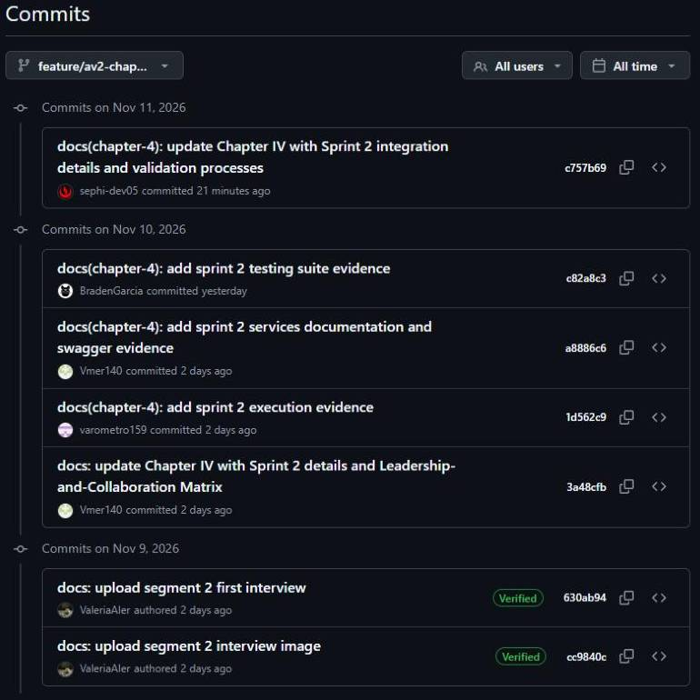
</p>

<p align="center"><i>Figura: Commits de los integrantes en la rama feature/av2-chapter-4 del reporte durante el Sprint 2.</i></p>

<p
  style="text-align: justify;
         text-indent: 0.5in;
         line-height: 1.5;
         margin: 0 0 12px 0;
         orphans: 2;
         widows: 2;">
  En los repositorios de código, GitHub Insights muestra que el incremento del Sprint 2 se concentró en la
  semana del 2 de noviembre. En <code>safelab-mobile-app</code> se registraron 9 commits de desarrollo y 11
  merge commits, y en <code>safelab-platform-api</code> y <code>safelab-frontend</code> se registraron 3
  commits de desarrollo y 6 merge commits en cada uno, todos realizados por Carlos Lavado, Ever Giusephi.
  En cambio, el gráfico de contribuidores de Mobile muestra que los aportes de Victor, Oscar, Valeria y
  Braden corresponden a la semana del 5 de octubre, cuando cada integrante implementó sus Bounded Contexts
  en el Sprint 1.
</p>

<p align="center">
  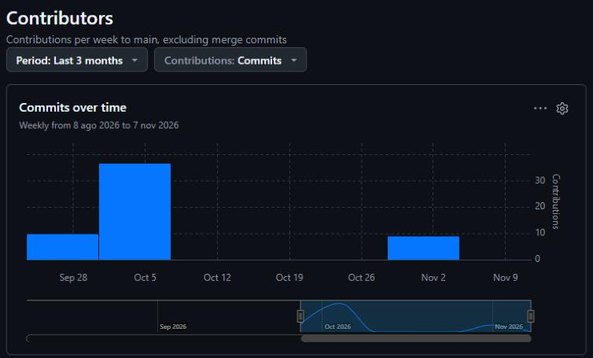
</p>

<p align="center"><i>Figura: Commits over time del repositorio safelab-mobile-app.</i></p>

<p align="center">
  
</p>

<p align="center"><i>Figura: Contribuidores del repositorio safelab-mobile-app.</i></p>

<p align="center">
  
</p>

<p align="center"><i>Figura: Contribuidores y commits over time del repositorio safelab-platform-api.</i></p>

<p align="center">
  
</p>

<p align="center"><i>Figura: Contribuidores y commits over time del repositorio safelab-frontend.</i></p>

<p
  style="text-align: justify;
         text-indent: 0.5in;
         line-height: 1.5;
         margin: 0 0 12px 0;
         orphans: 2;
         widows: 2;">
  Concentrar la integración técnica en un solo integrante permitió cambiar de forma coherente la
  arquitectura de los tres productos (multitenencia, RBAC, PostgreSQL y consumo de la API) sin que varias
  ramas modificaran a la vez los mismos archivos. Sin embargo, también generó una dependencia: las
  secciones de testing, ejecución, documentación de servicios y despliegue solo pudieron completarse cuando
  las versiones <code>v2.5.0</code> estuvieron integradas en <code>main</code>. Como aprendizaje del
  Sprint, el equipo identificó la necesidad de repartir nuevamente la implementación por Bounded Context,
  como en el Sprint 1, y de publicar antes las versiones integradas para que la documentación avance en
  paralelo.
</p>

<table border="1" style="width: 100%; border-collapse: collapse; table-layout: fixed;">
<thead>
<tr>
<th style="text-align: center; vertical-align: middle; padding: 6px;">Insight</th>
<th style="text-align: center; vertical-align: middle; padding: 6px;">Evidencia observada</th>
<th style="text-align: center; vertical-align: middle; padding: 6px;">Acción para el siguiente Sprint</th>
</tr>
</thead>
<tbody>
<tr>
<td style="text-align: left; vertical-align: top; padding: 6px;">Separar el reporte por secciones evita conflictos.</td>
<td style="text-align: justify; vertical-align: top; padding: 6px;">Los cinco integrantes registraron commits en <code>feature/av2-chapter-4</code> sin conflictos al modificar secciones distintas.</td>
<td style="text-align: justify; vertical-align: top; padding: 6px;">Mantener una sección por responsable y el prefijo <code>docs(chapter-4)</code> en los commits.</td>
</tr>

<tr>
<td style="text-align: left; vertical-align: top; padding: 6px;">La implementación técnica se concentró en un integrante.</td>
<td style="text-align: justify; vertical-align: top; padding: 6px;">GitHub Insights muestra que todos los commits de Mobile, Web y API del Sprint 2 pertenecen a Carlos Lavado, Ever Giusephi.</td>
<td style="text-align: justify; vertical-align: top; padding: 6px;">Asignar los Bounded Contexts del Sprint 3 entre los cinco integrantes, con una rama por BC en cada repositorio.</td>
</tr>

<tr>
<td style="text-align: left; vertical-align: top; padding: 6px;">La documentación depende de las versiones integradas.</td>
<td style="text-align: justify; vertical-align: top; padding: 6px;">Las secciones 4.2.2.4 a 4.2.2.8 se registraron después de integrar las versiones <code>v2.5.0</code> en <code>main</code>.</td>
<td style="text-align: justify; vertical-align: top; padding: 6px;">Integrar y etiquetar las versiones al inicio del cierre del Sprint para que la documentación se realice en paralelo.</td>
</tr>

<tr>
<td style="text-align: left; vertical-align: top; padding: 6px;">Los tags de versión mejoran la trazabilidad.</td>
<td style="text-align: justify; vertical-align: top; padding: 6px;">Cada repositorio registró tags por versión (<code>av2-v1.0.0</code>, <code>av2-v1.1.0</code>, <code>av2-v2.5.0</code> y <code>backend-v1.0.0</code> a <code>backend-v2.5.0</code>).</td>
<td style="text-align: justify; vertical-align: top; padding: 6px;">Mantener Conventional Commits, merges hacia <code>develop</code> y <code>main</code>, y tags por entrega.</td>
</tr>
</tbody>
</table>

### **4.2.3. Sprint 3**

<p
  style="text-align: justify;
         text-indent: 0.5in;
         line-height: 1.5;
         margin: 0 0 12px 0;
         orphans: 2;
         widows: 2;">
  El Sprint 3 se conserva como planificación preliminar del Trabajo Final. Sus historias abarcan datos
  históricos, comparación de periodos, generación y descarga de reportes, indicadores operativos y
  tendencias. El backlog establece trabajo previsto; los títulos de las tareas y los artefactos de
  referencia no acreditan, por sí mismos, un Sprint Review realizado ni una release de TF publicada.
</p>

<p
  style="text-align: justify;
         text-indent: 0.5in;
         line-height: 1.5;
         margin: 0 0 12px 0;
         orphans: 2;
         widows: 2;">
  Las estimaciones, responsables y diagramas existentes permiten visualizar qué falta completar tras AV2.
  Los resultados de pruebas y despliegue deberán actualizarse con ejecuciones fechadas, capturas reales y
  commits del Sprint 3. Hasta disponer de esas evidencias, las actividades de esta planificación se
  clasifican como previstas, no como realizadas.
</p>

#### **4.2.3.1. Sprint Planning 3**

<p
  style="text-align: justify;
         text-indent: 0.5in;
         line-height: 1.5;
         margin: 0 0 12px 0;
         orphans: 2;
         widows: 2;">
  Se presenta la planificación del Sprint 3 de SafeLab, tomando como referencia las User Stories
  priorizadas en el Product Backlog y los avances documentados en los Sprints anteriores. El alcance se
  enfoca en la consulta y comparación de datos históricos, la generación y exportación de reportes, la
  visualización del dashboard operativo y el análisis de tendencias ambientales. Para este Sprint se
  seleccionaron 16 User Stories, con una estimación total de 57 Story Points.
</p>

<table border="1" style="width: 100%; border-collapse: collapse;">
<tr>
<th style="text-align: left; vertical-align: middle; padding: 6px; width: 35%;">Número de Sprint</th>
<td style="text-align: left; vertical-align: middle; padding: 6px;">3</td>
</tr>

<tr>
<th colspan="2" style="text-align: center; vertical-align: middle; padding: 6px;">Información de la planificación del Sprint</th>
</tr>

<tr>
<td style="text-align: left; vertical-align: middle; padding: 6px;"><b>Fecha</b></td>
<td style="text-align: left; vertical-align: middle; padding: 6px;">30/10/2026</td>
</tr>

<tr>
<td style="text-align: left; vertical-align: middle; padding: 6px;"><b>Hora</b></td>
<td style="text-align: left; vertical-align: middle; padding: 6px;">10:00 a. m.</td>
</tr>

<tr>
<td style="text-align: left; vertical-align: middle; padding: 6px;"><b>Lugar</b></td>
<td style="text-align: left; vertical-align: middle; padding: 6px;">UPC San Isidro</td>
</tr>

<tr>
<td style="text-align: left; vertical-align: middle; padding: 6px;"><b>Preparado por</b></td>
<td style="text-align: left; vertical-align: middle; padding: 6px;">Valeria Rojas</td>
</tr>

<tr>
<td style="text-align: left; vertical-align: top; padding: 6px;"><b>Asistentes a la reunión de planificación</b></td>
<td style="text-align: left; vertical-align: top; padding: 6px;">Braden Garcia / Victor Espino / Giusephi Carlos / Oscar Vara / Valeria Rojas</td>
</tr>

<tr>
<td style="text-align: left; vertical-align: top; padding: 6px;"><b>Resumen de la revisión del Sprint 2</b></td>
<td style="text-align: justify; vertical-align: top; padding: 6px;">La planificación del segundo Sprint estuvo orientada a ampliar las funcionalidades de SafeLab mediante la gestión de alertas ambientales, la configuración de límites de temperatura y humedad, las notificaciones móviles y la consulta de sitios, áreas y equipos. Este alcance constituye la base funcional sobre la que se plantea incorporar las herramientas de consulta histórica, análisis y generación de reportes del Sprint 3.</td>
</tr>

<tr>
<td style="text-align: left; vertical-align: top; padding: 6px;"><b>Resumen de la retrospectiva del Sprint 2</b></td>
<td style="text-align: justify; vertical-align: top; padding: 6px;">Como parte de la planificación del siguiente incremento, se retoman las oportunidades de mejora documentadas previamente, especialmente la coordinación entre los integrantes, la trazabilidad de las actividades y la consistencia entre los requerimientos y sus implementaciones. Para el Sprint 3 se considera importante mantener la organización por Bounded Contexts y verificar la correspondencia de los datos utilizados en los módulos de monitoreo, dashboard y reportes.</td>
</tr>

<tr>
<th colspan="2" style="text-align: center; vertical-align: middle; padding: 6px;">Objetivo del Sprint y User Stories</th>
</tr>

<tr>
<td style="text-align: left; vertical-align: top; padding: 6px;"><b>Objetivo del Sprint 3</b></td>
<td style="text-align: justify; vertical-align: top; padding: 6px;">Nuestro objetivo es ampliar las capacidades de consulta y análisis de SafeLab mediante la visualización de datos históricos, la comparación de información entre periodos, la generación y descarga de reportes y la incorporación de indicadores y tendencias en el dashboard.<br><br>
      Consideramos que estas funcionalidades permitirán al personal de laboratorios hospitalarios y empresas farmacéuticas consultar el comportamiento de sus condiciones ambientales a lo largo del tiempo, identificar variaciones relevantes y disponer de información organizada para el seguimiento de sus equipos y procesos de monitoreo.<br><br>
      Esto se comprobará cuando los usuarios puedan visualizar datos desde un dispositivo móvil, consultar registros históricos, seleccionar rangos de fechas, comparar periodos, generar y descargar reportes, revisar el historial de incidentes, exportar información y visualizar indicadores generales, distribución de equipos y tendencias de alertas, temperatura y humedad.</td>
</tr>

<tr>
<td style="text-align: left; vertical-align: middle; padding: 6px;"><b>Capacidad estimada del Sprint 3</b></td>
<td style="text-align: left; vertical-align: middle; padding: 6px;">60 Story Points</td>
</tr>

<tr>
<td style="text-align: left; vertical-align: middle; padding: 6px;"><b>Suma de Story Points seleccionados</b></td>
<td style="text-align: left; vertical-align: middle; padding: 6px;">57 Story Points</td>
</tr>
</table>

#### **4.2.3.2. Aspect Leaders and Collaborators**

<p
  style="text-align: justify;
         text-indent: 0.5in;
         line-height: 1.5;
         margin: 0 0 12px 0;
         orphans: 2;
         widows: 2;">
  Para el Sprint 3, la distribución de responsabilidades se organizó a partir de las 16 User Stories y los
  32 Work-items registrados en el Sprint Backlog. El alcance se concentra en la consulta histórica, los
  reportes, el dashboard y el análisis de tendencias, por lo que se relacionó cada aspecto con los
  integrantes responsables de sus historias. Esta tabla refleja la asignación del backlog, no una medición
  de commits individuales.
</p>

<table border="1" style="width: 100%; border-collapse: collapse; table-layout: fixed;">
<thead>
<tr>
<th style="padding: 6px;">Aspecto</th>
<th style="padding: 6px;">Responsable principal según el backlog</th>
<th style="padding: 6px;">Colaboradores y User Stories relacionadas</th>
</tr>
</thead>
<tbody>
<tr>
<td style="padding: 6px;">Consulta de datos históricos y comparación temporal</td>
<td style="padding: 6px;">Giusephi Carlos</td>
<td style="padding: 6px;">Oscar Vara (US17, US28), Giusephi Carlos (US27, US29) y Victor Espino (US34).</td>
</tr>

<tr>
<td style="padding: 6px;">Reporting &amp; Analytics y servicios RESTful</td>
<td style="padding: 6px;">Victor Espino (US63)</td>
<td style="padding: 6px;">Braden Garcia (US30), Oscar Vara (US31) y Valeria Rojas (US33). Se relacionan generación, consulta, descarga y exportación de reportes.</td>
</tr>

<tr>
<td style="padding: 6px;">Dashboard &amp; Insights</td>
<td style="padding: 6px;">Valeria Rojas (US43)</td>
<td style="padding: 6px;">Giusephi Carlos (US45), Victor Espino (US47), Braden Garcia (US48), Valeria Rojas (US49) y Oscar Vara (US50).</td>
</tr>

<tr>
<td style="padding: 6px;">Historial de incidentes</td>
<td style="padding: 6px;">Braden Garcia</td>
<td style="padding: 6px;">US32, relacionada con los registros del módulo Alerts &amp; Incidents desarrollado en el incremento anterior.</td>
</tr>

<tr>
<td style="padding: 6px;">Planificación, seguimiento y reporte del Sprint</td>
<td style="padding: 6px;">Valeria Rojas</td>
<td style="padding: 6px;">Coordinación con los cinco integrantes para mantener la correspondencia entre las historias, el backlog de Jira y las evidencias de implementación.</td>
</tr>
</tbody>
</table>

<p
  style="text-align: justify;
         text-indent: 0.5in;
         line-height: 1.5;
         margin: 0 0 12px 0;
         orphans: 2;
         widows: 2;">
  La asignación busca mantener la separación por Bounded Contexts utilizada en SafeLab y facilitar que las
  secciones de desarrollo, pruebas y ejecución puedan relacionarse con sus User Stories. Los resultados de
  testing y los datos de contribución en GitHub se registran por separado, únicamente cuando cuentan con
  evidencia verificable.
</p>

#### **4.2.3.3. Sprint Backlog 3**

<p
  style="text-align: justify;
         text-indent: 0.5in;
         line-height: 1.5;
         margin: 0 0 12px 0;
         orphans: 2;
         widows: 2;">
  El Sprint Backlog 3 de SafeLab reúne 16 User Stories, con una estimación total de 57 Story Points. El
  trabajo se enfoca en la consulta de datos históricos, la comparación de registros ambientales, la
  generación y exportación de reportes y la visualización de indicadores y tendencias en el dashboard. Para
  organizar el desarrollo se propone un desglose de 32 Work-items, con una estimación conjunta de 114
  horas. Las actividades se distribuyen entre los cinco integrantes del equipo Meditrack y se agrupan por
  User Story para facilitar su seguimiento.
</p>

<table border="1" style="width: 100%; border-collapse: collapse; table-layout: fixed; page-break-inside: auto;">
  <colgroup>
    <col style="width: 7%;">
    <col style="width: 14%;">
    <col style="width: 8%;">
    <col style="width: 15%;">
    <col style="width: 29%;">
    <col style="width: 9%;">
    <col style="width: 11%;">
    <col style="width: 7%;">
  </colgroup>
  <thead>
    <tr>
      <th colspan="8" style="text-align: left; padding: 6px;">Sprint # &nbsp;&nbsp; Sprint 3</th>
    </tr>
    <tr>
      <th style="text-align: center; vertical-align: middle; padding: 5px;">User Story Id</th>
      <th style="text-align: center; vertical-align: middle; padding: 5px;">Title</th>
      <th style="text-align: center; vertical-align: middle; padding: 5px;">Work-Item / Task Id</th>
      <th style="text-align: center; vertical-align: middle; padding: 5px;">Title</th>
      <th style="text-align: center; vertical-align: middle; padding: 5px;">Description</th>
      <th style="text-align: center; vertical-align: middle; padding: 5px;">Estimation (Hours)</th>
      <th style="text-align: center; vertical-align: middle; padding: 5px;">Assigned To</th>
      <th style="text-align: center; vertical-align: middle; padding: 5px;">Status</th>
    </tr>
  </thead>
  <tbody>
    <tr style="page-break-inside: avoid;">
      <td style="text-align: center; vertical-align: top; padding: 5px;">US17</td>
      <td style="text-align: left; vertical-align: top; padding: 5px;">Visualizar datos en dispositivo móvil</td>
      <td style="text-align: center; vertical-align: top; padding: 5px;">UT67</td>
      <td style="text-align: left; vertical-align: top; padding: 5px;">Implementar consulta móvil</td>
      <td style="text-align: left; vertical-align: top; padding: 5px;">Permitir consultar los datos de monitoreo desde la aplicación móvil.</td>
      <td style="text-align: center; vertical-align: top; padding: 5px;">5</td>
      <td style="text-align: left; vertical-align: top; padding: 5px;">Oscar Vara</td>
      <td style="text-align: center; vertical-align: top; padding: 5px;">To-do</td>
    </tr>
    <tr style="page-break-inside: avoid;">
      <td style="text-align: center; vertical-align: top; padding: 5px;">US17</td>
      <td style="text-align: left; vertical-align: top; padding: 5px;">Visualizar datos en dispositivo móvil</td>
      <td style="text-align: center; vertical-align: top; padding: 5px;">UT68</td>
      <td style="text-align: left; vertical-align: top; padding: 5px;">Validar visualización móvil</td>
      <td style="text-align: left; vertical-align: top; padding: 5px;">Verificar la presentación de los datos en las pantallas del dispositivo.</td>
      <td style="text-align: center; vertical-align: top; padding: 5px;">5</td>
      <td style="text-align: left; vertical-align: top; padding: 5px;">Oscar Vara</td>
      <td style="text-align: center; vertical-align: top; padding: 5px;">To-do</td>
    </tr>
    <tr style="page-break-inside: avoid;">
      <td style="text-align: center; vertical-align: top; padding: 5px;">US27</td>
      <td style="text-align: left; vertical-align: top; padding: 5px;">Visualizar datos históricos</td>
      <td style="text-align: center; vertical-align: top; padding: 5px;">UT69</td>
      <td style="text-align: left; vertical-align: top; padding: 5px;">Implementar historial de datos</td>
      <td style="text-align: left; vertical-align: top; padding: 5px;">Mostrar las lecturas históricas registradas para los equipos.</td>
      <td style="text-align: center; vertical-align: top; padding: 5px;">5</td>
      <td style="text-align: left; vertical-align: top; padding: 5px;">Giusephi Carlos</td>
      <td style="text-align: center; vertical-align: top; padding: 5px;">To-do</td>
    </tr>
    <tr style="page-break-inside: avoid;">
      <td style="text-align: center; vertical-align: top; padding: 5px;">US27</td>
      <td style="text-align: left; vertical-align: top; padding: 5px;">Visualizar datos históricos</td>
      <td style="text-align: center; vertical-align: top; padding: 5px;">UT70</td>
      <td style="text-align: left; vertical-align: top; padding: 5px;">Validar registros históricos</td>
      <td style="text-align: left; vertical-align: top; padding: 5px;">Comprobar que los registros correspondan al equipo y conserven su información temporal.</td>
      <td style="text-align: center; vertical-align: top; padding: 5px;">5</td>
      <td style="text-align: left; vertical-align: top; padding: 5px;">Giusephi Carlos</td>
      <td style="text-align: center; vertical-align: top; padding: 5px;">To-do</td>
    </tr>
    <tr style="page-break-inside: avoid;">
      <td style="text-align: center; vertical-align: top; padding: 5px;">US28</td>
      <td style="text-align: left; vertical-align: top; padding: 5px;">Seleccionar un rango de fechas para los datos</td>
      <td style="text-align: center; vertical-align: top; padding: 5px;">UT71</td>
      <td style="text-align: left; vertical-align: top; padding: 5px;">Implementar selección de fechas</td>
      <td style="text-align: left; vertical-align: top; padding: 5px;">Permitir seleccionar fechas de inicio y fin para consultar datos.</td>
      <td style="text-align: center; vertical-align: top; padding: 5px;">2</td>
      <td style="text-align: left; vertical-align: top; padding: 5px;">Oscar Vara</td>
      <td style="text-align: center; vertical-align: top; padding: 5px;">To-do</td>
    </tr>
    <tr style="page-break-inside: avoid;">
      <td style="text-align: center; vertical-align: top; padding: 5px;">US28</td>
      <td style="text-align: left; vertical-align: top; padding: 5px;">Seleccionar un rango de fechas para los datos</td>
      <td style="text-align: center; vertical-align: top; padding: 5px;">UT72</td>
      <td style="text-align: left; vertical-align: top; padding: 5px;">Validar rango de fechas</td>
      <td style="text-align: left; vertical-align: top; padding: 5px;">Verificar que los resultados correspondan al periodo seleccionado.</td>
      <td style="text-align: center; vertical-align: top; padding: 5px;">2</td>
      <td style="text-align: left; vertical-align: top; padding: 5px;">Oscar Vara</td>
      <td style="text-align: center; vertical-align: top; padding: 5px;">To-do</td>
    </tr>
    <tr style="page-break-inside: avoid;">
      <td style="text-align: center; vertical-align: top; padding: 5px;">US63</td>
      <td style="text-align: left; vertical-align: top; padding: 5px;">Proporcionar servicios de datos históricos y reportes</td>
      <td style="text-align: center; vertical-align: top; padding: 5px;">UT73</td>
      <td style="text-align: left; vertical-align: top; padding: 5px;">Implementar servicios históricos</td>
      <td style="text-align: left; vertical-align: top; padding: 5px;">Proporcionar servicios RESTful para consultar datos históricos y generar reportes.</td>
      <td style="text-align: center; vertical-align: top; padding: 5px;">5</td>
      <td style="text-align: left; vertical-align: top; padding: 5px;">Victor Espino</td>
      <td style="text-align: center; vertical-align: top; padding: 5px;">To-do</td>
    </tr>
    <tr style="page-break-inside: avoid;">
      <td style="text-align: center; vertical-align: top; padding: 5px;">US63</td>
      <td style="text-align: left; vertical-align: top; padding: 5px;">Proporcionar servicios de datos históricos y reportes</td>
      <td style="text-align: center; vertical-align: top; padding: 5px;">UT74</td>
      <td style="text-align: left; vertical-align: top; padding: 5px;">Validar respuestas de la API</td>
      <td style="text-align: left; vertical-align: top; padding: 5px;">Verificar las respuestas y el manejo de solicitudes sin información disponible.</td>
      <td style="text-align: center; vertical-align: top; padding: 5px;">5</td>
      <td style="text-align: left; vertical-align: top; padding: 5px;">Victor Espino</td>
      <td style="text-align: center; vertical-align: top; padding: 5px;">To-do</td>
    </tr>
    <tr style="page-break-inside: avoid;">
      <td style="text-align: center; vertical-align: top; padding: 5px;">US30</td>
      <td style="text-align: left; vertical-align: top; padding: 5px;">Generar reporte por equipo y fecha</td>
      <td style="text-align: center; vertical-align: top; padding: 5px;">UT75</td>
      <td style="text-align: left; vertical-align: top; padding: 5px;">Implementar generación de reportes</td>
      <td style="text-align: left; vertical-align: top; padding: 5px;">Generar reportes según el equipo y el periodo seleccionado.</td>
      <td style="text-align: center; vertical-align: top; padding: 5px;">5</td>
      <td style="text-align: left; vertical-align: top; padding: 5px;">Braden Garcia</td>
      <td style="text-align: center; vertical-align: top; padding: 5px;">To-do</td>
    </tr>
    <tr style="page-break-inside: avoid;">
      <td style="text-align: center; vertical-align: top; padding: 5px;">US30</td>
      <td style="text-align: left; vertical-align: top; padding: 5px;">Generar reporte por equipo y fecha</td>
      <td style="text-align: center; vertical-align: top; padding: 5px;">UT76</td>
      <td style="text-align: left; vertical-align: top; padding: 5px;">Validar contenido del reporte</td>
      <td style="text-align: left; vertical-align: top; padding: 5px;">Comprobar que incluya los datos del equipo y las fechas solicitadas.</td>
      <td style="text-align: center; vertical-align: top; padding: 5px;">5</td>
      <td style="text-align: left; vertical-align: top; padding: 5px;">Braden Garcia</td>
      <td style="text-align: center; vertical-align: top; padding: 5px;">To-do</td>
    </tr>
    <tr style="page-break-inside: avoid;">
      <td style="text-align: center; vertical-align: top; padding: 5px;">US31</td>
      <td style="text-align: left; vertical-align: top; padding: 5px;">Descargar archivo de reporte</td>
      <td style="text-align: center; vertical-align: top; padding: 5px;">UT77</td>
      <td style="text-align: left; vertical-align: top; padding: 5px;">Implementar descarga de reportes</td>
      <td style="text-align: left; vertical-align: top; padding: 5px;">Permitir descargar el archivo del reporte generado.</td>
      <td style="text-align: center; vertical-align: top; padding: 5px;">3</td>
      <td style="text-align: left; vertical-align: top; padding: 5px;">Oscar Vara</td>
      <td style="text-align: center; vertical-align: top; padding: 5px;">To-do</td>
    </tr>
    <tr style="page-break-inside: avoid;">
      <td style="text-align: center; vertical-align: top; padding: 5px;">US31</td>
      <td style="text-align: left; vertical-align: top; padding: 5px;">Descargar archivo de reporte</td>
      <td style="text-align: center; vertical-align: top; padding: 5px;">UT78</td>
      <td style="text-align: left; vertical-align: top; padding: 5px;">Validar archivo descargado</td>
      <td style="text-align: left; vertical-align: top; padding: 5px;">Verificar que el archivo contenga el reporte solicitado.</td>
      <td style="text-align: center; vertical-align: top; padding: 5px;">3</td>
      <td style="text-align: left; vertical-align: top; padding: 5px;">Oscar Vara</td>
      <td style="text-align: center; vertical-align: top; padding: 5px;">To-do</td>
    </tr>
    <tr style="page-break-inside: avoid;">
      <td style="text-align: center; vertical-align: top; padding: 5px;">US29</td>
      <td style="text-align: left; vertical-align: top; padding: 5px;">Comparar datos entre periodos</td>
      <td style="text-align: center; vertical-align: top; padding: 5px;">UT79</td>
      <td style="text-align: left; vertical-align: top; padding: 5px;">Implementar comparación de periodos</td>
      <td style="text-align: left; vertical-align: top; padding: 5px;">Permitir comparar registros ambientales de dos periodos seleccionados.</td>
      <td style="text-align: center; vertical-align: top; padding: 5px;">3</td>
      <td style="text-align: left; vertical-align: top; padding: 5px;">Giusephi Carlos</td>
      <td style="text-align: center; vertical-align: top; padding: 5px;">To-do</td>
    </tr>
    <tr style="page-break-inside: avoid;">
      <td style="text-align: center; vertical-align: top; padding: 5px;">US29</td>
      <td style="text-align: left; vertical-align: top; padding: 5px;">Comparar datos entre periodos</td>
      <td style="text-align: center; vertical-align: top; padding: 5px;">UT80</td>
      <td style="text-align: left; vertical-align: top; padding: 5px;">Validar resultados comparativos</td>
      <td style="text-align: left; vertical-align: top; padding: 5px;">Comprobar que los resultados utilicen los registros de cada periodo.</td>
      <td style="text-align: center; vertical-align: top; padding: 5px;">3</td>
      <td style="text-align: left; vertical-align: top; padding: 5px;">Giusephi Carlos</td>
      <td style="text-align: center; vertical-align: top; padding: 5px;">To-do</td>
    </tr>
    <tr style="page-break-inside: avoid;">
      <td style="text-align: center; vertical-align: top; padding: 5px;">US34</td>
      <td style="text-align: left; vertical-align: top; padding: 5px;">Comparar datos semanales y mensuales</td>
      <td style="text-align: center; vertical-align: top; padding: 5px;">UT81</td>
      <td style="text-align: left; vertical-align: top; padding: 5px;">Implementar comparación temporal</td>
      <td style="text-align: left; vertical-align: top; padding: 5px;">Mostrar comparaciones entre periodos semanales y mensuales.</td>
      <td style="text-align: center; vertical-align: top; padding: 5px;">3</td>
      <td style="text-align: left; vertical-align: top; padding: 5px;">Victor Espino</td>
      <td style="text-align: center; vertical-align: top; padding: 5px;">To-do</td>
    </tr>
    <tr style="page-break-inside: avoid;">
      <td style="text-align: center; vertical-align: top; padding: 5px;">US34</td>
      <td style="text-align: left; vertical-align: top; padding: 5px;">Comparar datos semanales y mensuales</td>
      <td style="text-align: center; vertical-align: top; padding: 5px;">UT82</td>
      <td style="text-align: left; vertical-align: top; padding: 5px;">Validar comparación semanal y mensual</td>
      <td style="text-align: left; vertical-align: top; padding: 5px;">Verificar que los valores correspondan al intervalo seleccionado.</td>
      <td style="text-align: center; vertical-align: top; padding: 5px;">3</td>
      <td style="text-align: left; vertical-align: top; padding: 5px;">Victor Espino</td>
      <td style="text-align: center; vertical-align: top; padding: 5px;">To-do</td>
    </tr>
    <tr style="page-break-inside: avoid;">
      <td style="text-align: center; vertical-align: top; padding: 5px;">US32</td>
      <td style="text-align: left; vertical-align: top; padding: 5px;">Visualizar historial de incidentes</td>
      <td style="text-align: center; vertical-align: top; padding: 5px;">UT83</td>
      <td style="text-align: left; vertical-align: top; padding: 5px;">Implementar historial de incidentes</td>
      <td style="text-align: left; vertical-align: top; padding: 5px;">Mostrar los incidentes registrados con su información y estado.</td>
      <td style="text-align: center; vertical-align: top; padding: 5px;">3</td>
      <td style="text-align: left; vertical-align: top; padding: 5px;">Braden Garcia</td>
      <td style="text-align: center; vertical-align: top; padding: 5px;">To-do</td>
    </tr>
    <tr style="page-break-inside: avoid;">
      <td style="text-align: center; vertical-align: top; padding: 5px;">US32</td>
      <td style="text-align: left; vertical-align: top; padding: 5px;">Visualizar historial de incidentes</td>
      <td style="text-align: center; vertical-align: top; padding: 5px;">UT84</td>
      <td style="text-align: left; vertical-align: top; padding: 5px;">Validar registros de incidentes</td>
      <td style="text-align: left; vertical-align: top; padding: 5px;">Comprobar que el historial muestre correctamente los incidentes disponibles.</td>
      <td style="text-align: center; vertical-align: top; padding: 5px;">3</td>
      <td style="text-align: left; vertical-align: top; padding: 5px;">Braden Garcia</td>
      <td style="text-align: center; vertical-align: top; padding: 5px;">To-do</td>
    </tr>
    <tr style="page-break-inside: avoid;">
      <td style="text-align: center; vertical-align: top; padding: 5px;">US33</td>
      <td style="text-align: left; vertical-align: top; padding: 5px;">Exportar archivo de datos</td>
      <td style="text-align: center; vertical-align: top; padding: 5px;">UT85</td>
      <td style="text-align: left; vertical-align: top; padding: 5px;">Implementar exportación de datos</td>
      <td style="text-align: left; vertical-align: top; padding: 5px;">Permitir exportar los registros de monitoreo a un archivo.</td>
      <td style="text-align: center; vertical-align: top; padding: 5px;">3</td>
      <td style="text-align: left; vertical-align: top; padding: 5px;">Valeria Rojas</td>
      <td style="text-align: center; vertical-align: top; padding: 5px;">To-do</td>
    </tr>
    <tr style="page-break-inside: avoid;">
      <td style="text-align: center; vertical-align: top; padding: 5px;">US33</td>
      <td style="text-align: left; vertical-align: top; padding: 5px;">Exportar archivo de datos</td>
      <td style="text-align: center; vertical-align: top; padding: 5px;">UT86</td>
      <td style="text-align: left; vertical-align: top; padding: 5px;">Validar archivo exportado</td>
      <td style="text-align: left; vertical-align: top; padding: 5px;">Comprobar que el archivo contenga los datos seleccionados.</td>
      <td style="text-align: center; vertical-align: top; padding: 5px;">3</td>
      <td style="text-align: left; vertical-align: top; padding: 5px;">Valeria Rojas</td>
      <td style="text-align: center; vertical-align: top; padding: 5px;">To-do</td>
    </tr>
    <tr style="page-break-inside: avoid;">
      <td style="text-align: center; vertical-align: top; padding: 5px;">US43</td>
      <td style="text-align: left; vertical-align: top; padding: 5px;">Visualizar dashboard</td>
      <td style="text-align: center; vertical-align: top; padding: 5px;">UT87</td>
      <td style="text-align: left; vertical-align: top; padding: 5px;">Implementar dashboard operativo</td>
      <td style="text-align: left; vertical-align: top; padding: 5px;">Mostrar un panel general con los principales indicadores de SafeLab.</td>
      <td style="text-align: center; vertical-align: top; padding: 5px;">5</td>
      <td style="text-align: left; vertical-align: top; padding: 5px;">Valeria Rojas</td>
      <td style="text-align: center; vertical-align: top; padding: 5px;">To-do</td>
    </tr>
    <tr style="page-break-inside: avoid;">
      <td style="text-align: center; vertical-align: top; padding: 5px;">US43</td>
      <td style="text-align: left; vertical-align: top; padding: 5px;">Visualizar dashboard</td>
      <td style="text-align: center; vertical-align: top; padding: 5px;">UT88</td>
      <td style="text-align: left; vertical-align: top; padding: 5px;">Validar indicadores del dashboard</td>
      <td style="text-align: left; vertical-align: top; padding: 5px;">Verificar que los valores correspondan a la información disponible.</td>
      <td style="text-align: center; vertical-align: top; padding: 5px;">5</td>
      <td style="text-align: left; vertical-align: top; padding: 5px;">Valeria Rojas</td>
      <td style="text-align: center; vertical-align: top; padding: 5px;">To-do</td>
    </tr>
    <tr style="page-break-inside: avoid;">
      <td style="text-align: center; vertical-align: top; padding: 5px;">US45</td>
      <td style="text-align: left; vertical-align: top; padding: 5px;">Visualizar resumen con totales</td>
      <td style="text-align: center; vertical-align: top; padding: 5px;">UT89</td>
      <td style="text-align: left; vertical-align: top; padding: 5px;">Implementar resumen de indicadores</td>
      <td style="text-align: left; vertical-align: top; padding: 5px;">Mostrar los valores totales de equipos y condiciones de monitoreo.</td>
      <td style="text-align: center; vertical-align: top; padding: 5px;">3</td>
      <td style="text-align: left; vertical-align: top; padding: 5px;">Giusephi Carlos</td>
      <td style="text-align: center; vertical-align: top; padding: 5px;">To-do</td>
    </tr>
    <tr style="page-break-inside: avoid;">
      <td style="text-align: center; vertical-align: top; padding: 5px;">US45</td>
      <td style="text-align: left; vertical-align: top; padding: 5px;">Visualizar resumen con totales</td>
      <td style="text-align: center; vertical-align: top; padding: 5px;">UT90</td>
      <td style="text-align: left; vertical-align: top; padding: 5px;">Validar totales presentados</td>
      <td style="text-align: left; vertical-align: top; padding: 5px;">Comprobar que los valores coincidan con los registros disponibles.</td>
      <td style="text-align: center; vertical-align: top; padding: 5px;">3</td>
      <td style="text-align: left; vertical-align: top; padding: 5px;">Giusephi Carlos</td>
      <td style="text-align: center; vertical-align: top; padding: 5px;">To-do</td>
    </tr>
    <tr style="page-break-inside: avoid;">
      <td style="text-align: center; vertical-align: top; padding: 5px;">US47</td>
      <td style="text-align: left; vertical-align: top; padding: 5px;">Visualizar distribución de equipos por estado</td>
      <td style="text-align: center; vertical-align: top; padding: 5px;">UT91</td>
      <td style="text-align: left; vertical-align: top; padding: 5px;">Implementar distribución de equipos</td>
      <td style="text-align: left; vertical-align: top; padding: 5px;">Mostrar los equipos agrupados según su estado operativo.</td>
      <td style="text-align: center; vertical-align: top; padding: 5px;">3</td>
      <td style="text-align: left; vertical-align: top; padding: 5px;">Victor Espino</td>
      <td style="text-align: center; vertical-align: top; padding: 5px;">To-do</td>
    </tr>
    <tr style="page-break-inside: avoid;">
      <td style="text-align: center; vertical-align: top; padding: 5px;">US47</td>
      <td style="text-align: left; vertical-align: top; padding: 5px;">Visualizar distribución de equipos por estado</td>
      <td style="text-align: center; vertical-align: top; padding: 5px;">UT92</td>
      <td style="text-align: left; vertical-align: top; padding: 5px;">Validar clasificación de equipos</td>
      <td style="text-align: left; vertical-align: top; padding: 5px;">Verificar que la distribución refleje los estados registrados.</td>
      <td style="text-align: center; vertical-align: top; padding: 5px;">3</td>
      <td style="text-align: left; vertical-align: top; padding: 5px;">Victor Espino</td>
      <td style="text-align: center; vertical-align: top; padding: 5px;">To-do</td>
    </tr>
    <tr style="page-break-inside: avoid;">
      <td style="text-align: center; vertical-align: top; padding: 5px;">US48</td>
      <td style="text-align: left; vertical-align: top; padding: 5px;">Visualizar tendencias de alertas</td>
      <td style="text-align: center; vertical-align: top; padding: 5px;">UT93</td>
      <td style="text-align: left; vertical-align: top; padding: 5px;">Implementar tendencias de alertas</td>
      <td style="text-align: left; vertical-align: top; padding: 5px;">Mostrar la evolución de las alertas registradas durante un periodo.</td>
      <td style="text-align: center; vertical-align: top; padding: 5px;">3</td>
      <td style="text-align: left; vertical-align: top; padding: 5px;">Braden Garcia</td>
      <td style="text-align: center; vertical-align: top; padding: 5px;">To-do</td>
    </tr>
    <tr style="page-break-inside: avoid;">
      <td style="text-align: center; vertical-align: top; padding: 5px;">US48</td>
      <td style="text-align: left; vertical-align: top; padding: 5px;">Visualizar tendencias de alertas</td>
      <td style="text-align: center; vertical-align: top; padding: 5px;">UT94</td>
      <td style="text-align: left; vertical-align: top; padding: 5px;">Validar tendencias de alertas</td>
      <td style="text-align: left; vertical-align: top; padding: 5px;">Comprobar que los datos correspondan a las alertas registradas.</td>
      <td style="text-align: center; vertical-align: top; padding: 5px;">3</td>
      <td style="text-align: left; vertical-align: top; padding: 5px;">Braden Garcia</td>
      <td style="text-align: center; vertical-align: top; padding: 5px;">To-do</td>
    </tr>
    <tr style="page-break-inside: avoid;">
      <td style="text-align: center; vertical-align: top; padding: 5px;">US49</td>
      <td style="text-align: left; vertical-align: top; padding: 5px;">Visualizar tendencias de temperatura</td>
      <td style="text-align: center; vertical-align: top; padding: 5px;">UT95</td>
      <td style="text-align: left; vertical-align: top; padding: 5px;">Implementar tendencias de temperatura</td>
      <td style="text-align: left; vertical-align: top; padding: 5px;">Mostrar gráficamente la evolución de las lecturas de temperatura.</td>
      <td style="text-align: center; vertical-align: top; padding: 5px;">3</td>
      <td style="text-align: left; vertical-align: top; padding: 5px;">Valeria Rojas</td>
      <td style="text-align: center; vertical-align: top; padding: 5px;">To-do</td>
    </tr>
    <tr style="page-break-inside: avoid;">
      <td style="text-align: center; vertical-align: top; padding: 5px;">US49</td>
      <td style="text-align: left; vertical-align: top; padding: 5px;">Visualizar tendencias de temperatura</td>
      <td style="text-align: center; vertical-align: top; padding: 5px;">UT96</td>
      <td style="text-align: left; vertical-align: top; padding: 5px;">Validar datos de temperatura</td>
      <td style="text-align: left; vertical-align: top; padding: 5px;">Verificar que los gráficos representen las lecturas del periodo consultado.</td>
      <td style="text-align: center; vertical-align: top; padding: 5px;">3</td>
      <td style="text-align: left; vertical-align: top; padding: 5px;">Valeria Rojas</td>
      <td style="text-align: center; vertical-align: top; padding: 5px;">To-do</td>
    </tr>
    <tr style="page-break-inside: avoid;">
      <td style="text-align: center; vertical-align: top; padding: 5px;">US50</td>
      <td style="text-align: left; vertical-align: top; padding: 5px;">Visualizar tendencias de humedad</td>
      <td style="text-align: center; vertical-align: top; padding: 5px;">UT97</td>
      <td style="text-align: left; vertical-align: top; padding: 5px;">Implementar tendencias de humedad</td>
      <td style="text-align: left; vertical-align: top; padding: 5px;">Mostrar gráficamente la evolución de las lecturas de humedad.</td>
      <td style="text-align: center; vertical-align: top; padding: 5px;">3</td>
      <td style="text-align: left; vertical-align: top; padding: 5px;">Oscar Vara</td>
      <td style="text-align: center; vertical-align: top; padding: 5px;">To-do</td>
    </tr>
    <tr style="page-break-inside: avoid;">
      <td style="text-align: center; vertical-align: top; padding: 5px;">US50</td>
      <td style="text-align: left; vertical-align: top; padding: 5px;">Visualizar tendencias de humedad</td>
      <td style="text-align: center; vertical-align: top; padding: 5px;">UT98</td>
      <td style="text-align: left; vertical-align: top; padding: 5px;">Validar datos de humedad</td>
      <td style="text-align: left; vertical-align: top; padding: 5px;">Verificar que los gráficos representen las lecturas del periodo seleccionado.</td>
      <td style="text-align: center; vertical-align: top; padding: 5px;">3</td>
      <td style="text-align: left; vertical-align: top; padding: 5px;">Oscar Vara</td>
      <td style="text-align: center; vertical-align: top; padding: 5px;">To-do</td>
    </tr>
  </tbody>
</table>

<p
  style="text-align: justify;
         text-indent: 0.5in;
         line-height: 1.5;
         margin: 0 0 12px 0;
         orphans: 2;
         widows: 2;">
  El Sprint Backlog 3 se encuentra organizado en Jira mediante las User Stories asignadas al Sprint, sus
  responsables y sus estimaciones en Story Points. El desglose propuesto de Work-items relaciona las
  funcionalidades con las actividades de implementación y validación, facilitando el seguimiento del
  trabajo del equipo.
</p>

<p align="center">
  
</p>

<p align="center"><i>Figura: Sprint Backlog 3 de SafeLab en Jira.</i></p>

**Board URL:** [SafeLab - Sprint 3](https://ipoundzy.atlassian.net/jira/software/projects/SL/boards/2/backlog)

#### **4.2.3.4. Development Evidence for Sprint Review**

<p
  style="text-align: justify;
         text-indent: 0.5in;
         line-height: 1.5;
         margin: 0 0 12px 0;
         orphans: 2;
         widows: 2;">
  Durante la revisión del alcance del Sprint 3 se relacionaron las User Stories de datos históricos,
  reportes y dashboard con los módulos existentes de la aplicación Android y de SafeLab Platform API. Se
  mantuvo la organización por Bounded Contexts y la separación entre las capas de presentación, dominio y
  datos de la aplicación móvil. Asimismo, se distinguieron las funcionalidades implementadas como vistas de
  demostración de los recursos que cuentan con un contrato RESTful en el backend.
</p>

<table border="1" style="width: 100%; border-collapse: collapse; table-layout: fixed;">
<thead>
<tr>
<th style="padding: 6px;">Aspecto y User Stories</th>
<th style="padding: 6px;">Implementación Android</th>
<th style="padding: 6px;">Servicio o fuente de información relacionada</th>
<th style="padding: 6px;">Alcance revisado</th>
</tr>
</thead>
<tbody>
<tr>
<td style="padding: 6px;"><b>Datos históricos</b><br>US17, US27, US28, US29 y US34</td>
<td style="padding: 6px;"><code>HistoricalReadingsScreen.kt</code>, <code>HistoricalDataScreen.kt</code> y <code>SensorMonitoringRepository.kt</code></td>
<td style="padding: 6px;">Repositorio de lecturas del módulo Sensor Monitoring; datos de demostración en Reporting &amp; Analytics</td>
<td style="padding: 6px;">Consulta de registros, presentación temporal y opciones de filtrado. La comparación completa entre períodos y el filtrado histórico desde la API deben validarse por separado.</td>
</tr>

<tr>
<td style="padding: 6px;"><b>Reportes y exportación</b><br>US30, US31, US33 y US63</td>
<td style="padding: 6px;"><code>ReportsScreen.kt</code>, <code>GenerateReportScreen.kt</code>, <code>ExportDataScreen.kt</code> y <code>ReportingComplianceEntryScreen.kt</code></td>
<td style="padding: 6px;"><code>ReportingAnalyticsController</code>; recursos <code>/reports</code> y <code>/summary</code></td>
<td style="padding: 6px;">Pantallas para consulta, búsqueda, configuración de reportes y opciones de exportación. El backend puede registrar un reporte simulado, pero no genera un PDF descargable.</td>
</tr>

<tr>
<td style="padding: 6px;"><b>Dashboard operativo e indicadores</b><br>US43, US45 y US47</td>
<td style="padding: 6px;"><code>DashboardScreen.kt</code>, <code>DashboardComponents.kt</code> y <code>DashboardOverviewEntryScreen.kt</code></td>
<td style="padding: 6px;"><code>DashboardInsightsController</code>; <code>GET /api/v1/dashboardinsights/overview</code></td>
<td style="padding: 6px;">Presentación de métricas, alertas priorizadas y estado de los recursos. El servicio ofrece totales según los permisos y la empresa; algunas tarjetas de Android todavía usan <code>DashboardMockData</code>.</td>
</tr>

<tr>
<td style="padding: 6px;"><b>Tendencias ambientales</b><br>US48, US49 y US50</td>
<td style="padding: 6px;"><code>MonitoringTrendsScreen.kt</code> y componentes gráficos del módulo Dashboard &amp; Insights</td>
<td style="padding: 6px;"><code>DashboardMockData</code> para los gráficos de demostración; servicios de sensores y alertas disponibles para consultas</td>
<td style="padding: 6px;">Visualización de tendencias y resúmenes. No se considera acreditado un cálculo histórico de temperatura, humedad o alertas desde la API sin una prueba específica.</td>
</tr>

<tr>
<td style="padding: 6px;"><b>Historial de incidentes</b><br>US32</td>
<td style="padding: 6px;">Pantallas y repositorio del módulo Alerts &amp; Incidents</td>
<td style="padding: 6px;"><code>AlertsIncidentsController</code>; <code>GET /api/v1/alertsincidents/incidents</code></td>
<td style="padding: 6px;">Consulta de incidentes registrados y sus estados, respetando el alcance autorizado de la sesión.</td>
</tr>
</tbody>
</table>

<p
  style="text-align: justify;
         text-indent: 0.5in;
         line-height: 1.5;
         margin: 0 0 12px 0;
         orphans: 2;
         widows: 2;">
  La continuidad respecto del Sprint 2 se encuentra en el consumo de información mediante la arquitectura
  Android → API RESTful → PostgreSQL y en las restricciones de acceso por organización. La API dispone de
  recursos para consultar reportes, obtener un resumen de actividad y calcular totales del dashboard. En
  cambio, las vistas de generación y exportación de archivos y parte de los gráficos conservan datos o
  interacciones de demostración. Por ello, la presencia de una pantalla no se considera prueba suficiente
  de persistencia ni de generación física de archivos.
</p>

<p
  style="text-align: justify;
         text-indent: 0.5in;
         line-height: 1.5;
         margin: 0 0 12px 0;
         orphans: 2;
         widows: 2;">
  Para revisar la implementación se conservan como referencia los repositorios oficiales del proyecto. Las
  rutas siguientes corresponden al código disponible y permiten identificar los componentes relacionados
  con el alcance del Sprint.
</p>

<table border="1" style="width: 100%; border-collapse: collapse;">
<thead>
<tr>
<th style="padding: 6px;">Recurso técnico</th>
<th style="padding: 6px;">Ubicación</th>
<th style="padding: 6px;">Relación con el Sprint 3</th>
</tr>
</thead>
<tbody>
<tr>
<td style="padding: 6px;">Reporting &amp; Analytics en Android</td>
<td style="padding: 6px;"><a href="https://github.com/meditrack-mobile-app-1acc0238-2620-4949/safelab-mobile-app/tree/develop/app/src/main/java/pe/edu/upc/safelab/boundedcontext/reportinganalytics">Módulo reportinganalytics</a></td>
<td style="padding: 6px;">Pantallas de consulta histórica, reportes y exportación.</td>
</tr>

<tr>
<td style="padding: 6px;">Dashboard &amp; Insights en Android</td>
<td style="padding: 6px;"><a href="https://github.com/meditrack-mobile-app-1acc0238-2620-4949/safelab-mobile-app/tree/develop/app/src/main/java/pe/edu/upc/safelab/boundedcontext/dashboardinsights">Módulo dashboardinsights</a></td>
<td style="padding: 6px;">Indicadores y visualización de tendencias.</td>
</tr>

<tr>
<td style="padding: 6px;">Reporting &amp; Analytics en la API</td>
<td style="padding: 6px;"><a href="https://github.com/meditrack-mobile-app-1acc0238-2620-4949/safelab-platform-api/tree/main/src/main/java/com/safelab/platform/reportinganalytics">Módulo reportinganalytics</a></td>
<td style="padding: 6px;">Consulta, resumen y registro de reportes.</td>
</tr>

<tr>
<td style="padding: 6px;">Dashboard &amp; Insights en la API</td>
<td style="padding: 6px;"><a href="https://github.com/meditrack-mobile-app-1acc0238-2620-4949/safelab-platform-api/tree/main/src/main/java/com/safelab/platform/dashboardinsights">Módulo dashboardinsights</a></td>
<td style="padding: 6px;">Resumen de indicadores según autorización.</td>
</tr>
</tbody>
</table>

<p align="center">
  
</p>

<p align="center"><i>Figura: Navegación principal de SafeLab utilizada como punto de acceso a los módulos de consulta.</i></p>

<p align="center">
  
</p>

<p align="center"><i>Figura: Organización de los contratos RESTful en Swagger UI.</i></p>

#### **4.2.3.5. Testing Suite Evidence for Sprint Review**

<p
  style="text-align: justify;
         text-indent: 0.5in;
         line-height: 1.5;
         margin: 0 0 12px 0;
         orphans: 2;
         widows: 2;">
  Para el Sprint 3 se definieron las verificaciones correspondientes a <b>US63 - Proporcionar servicios de
  datos históricos y reportes</b>, manteniendo la clasificación del Sprint 2 en Unit Tests, Integration
  Tests y Acceptance Tests (BDD). El backend dispone de infraestructura de pruebas con JUnit y Spring Boot
  Test, pero en la revisión del código aportado no se identificó una suite específica de US63 ni un reporte
  de ejecución comparable al de US62. Por ello, los casos siguientes constituyen una matriz de validación
  del Sprint 3 y no se presentan como resultados aprobados.
</p>

<p align="center">
  
</p>

<p align="center"><i>Figura: Organización de la estructura de pruebas del backend, utilizada como referencia para la suite de US63.</i></p>

##### **Unit Tests**

<p
  style="text-align: justify;
         text-indent: 0.5in;
         line-height: 1.5;
         margin: 0 0 12px 0;
         orphans: 2;
         widows: 2;">
  Las pruebas unitarias deben aislar la lógica de consulta y registro de reportes del controlador
  <code>ReportingAnalyticsController</code>. Al igual que en el Sprint 2, es posible reemplazar los
  servicios y el acceso a datos por mocks, comprobando tanto el contenido de las respuestas como los
  permisos requeridos.
</p>

<table border="1" style="width: 100%; border-collapse: collapse;">
<thead>
<tr>
<th style="padding: 6px;">Componente</th>
<th style="padding: 6px;">Comportamiento por verificar</th>
<th style="padding: 6px;">User Story</th>
<th style="padding: 6px;">Evidencia</th>
</tr>
</thead>
<tbody>
<tr>
<td style="padding: 6px;"><code>ReportingAnalyticsController</code></td>
<td style="padding: 6px;">Devolver los reportes visibles para la sesión autenticada.</td>
<td style="padding: 6px;">US63</td>
<td style="padding: 6px;">Pendiente de ejecución específica</td>
</tr>

<tr>
<td style="padding: 6px;"><code>ReportingAnalyticsController</code></td>
<td style="padding: 6px;">Calcular el resumen de reportes, sensores y alertas respetando los permisos.</td>
<td style="padding: 6px;">US63</td>
<td style="padding: 6px;">Pendiente de ejecución específica</td>
</tr>

<tr>
<td style="padding: 6px;"><code>ReportingAnalyticsController</code></td>
<td style="padding: 6px;">Registrar los metadatos de un reporte válido e identificar solicitudes inválidas.</td>
<td style="padding: 6px;">US63</td>
<td style="padding: 6px;">Pendiente de ejecución específica</td>
</tr>
</tbody>
</table>

<p align="center">
  
</p>

<p align="center"><i>Figura: Formato de visualización de los resultados unitarios utilizado en la suite del Sprint 2.</i></p>

##### **Integration Tests**

<p
  style="text-align: justify;
         text-indent: 0.5in;
         line-height: 1.5;
         margin: 0 0 12px 0;
         orphans: 2;
         widows: 2;">
  Las pruebas de integración deben consumir los endpoints del módulo con una sesión autenticada, incluyendo
  el filtro de seguridad, el control de acceso por empresa y la capa de persistencia. También se debe
  comprobar que las respuestas de la API coincidan con la información que presenta el cliente móvil en los
  escenarios efectivamente integrados.
</p>

<table border="1" style="width: 100%; border-collapse: collapse;">
<thead>
<tr>
<th style="padding: 6px;">Endpoint</th>
<th style="padding: 6px;">Caso por verificar</th>
<th style="padding: 6px;">Resultado esperado</th>
</tr>
</thead>
<tbody>
<tr>
<td style="padding: 6px;"><code>GET /api/v1/reportinganalytics/reports</code></td>
<td style="padding: 6px;">Consultar reportes con usuario autorizado.</td>
<td style="padding: 6px;">200 OK y únicamente los reportes visibles para su organización.</td>
</tr>

<tr>
<td style="padding: 6px;"><code>GET /api/v1/reportinganalytics/summary</code></td>
<td style="padding: 6px;">Consultar el resumen de actividad.</td>
<td style="padding: 6px;">200 OK con totales de reportes, sensores y alertas autorizados.</td>
</tr>

<tr>
<td style="padding: 6px;"><code>POST /api/v1/reportinganalytics/reports</code></td>
<td style="padding: 6px;">Enviar un reporte válido con permisos de exportación.</td>
<td style="padding: 6px;">201 Created con registro de metadatos; no implica descarga de archivo físico.</td>
</tr>

<tr>
<td style="padding: 6px;">Endpoints de Reporting &amp; Analytics</td>
<td style="padding: 6px;">Solicitudes sin token o con permisos insuficientes.</td>
<td style="padding: 6px;">Respuesta 401 o 403, según corresponda.</td>
</tr>
</tbody>
</table>

<p align="center">
  
</p>

<p align="center"><i>Figura: Formato de ejecución de las pruebas de integración utilizado como referencia.</i></p>

##### **Acceptance Tests (BDD)**

<p
  style="text-align: justify;
         text-indent: 0.5in;
         line-height: 1.5;
         margin: 0 0 12px 0;
         orphans: 2;
         widows: 2;">
  Los escenarios BDD propuestos para US63 siguen la estructura Given–When–Then utilizada en los Acceptance
  Tests del Sprint 2. Se enfocan en la consulta de reportes, la respuesta ante falta de autorización y la
  creación de un registro de reporte. Los escenarios deberán incorporarse a un archivo
  <code>.feature</code> y ejecutarse antes de registrar resultados aprobados.
</p>

```gherkin
@US63
Feature: US63 - Provide historical data and report services
  As an authorized SafeLab user
  I want to access reporting information
  So that I can review the monitoring activity of my organization

  Scenario: Consult authorized reports
    Given the user is signed in with permission to view reports
    When the client requests the report list
    Then the service responds with status 200
    And the response contains only authorized reports

  Scenario: Request reports without authentication
    Given the client has no valid session token
    When the client requests the report list
    Then the service responds with status 401

  Scenario: Register a report
    Given the user is signed in with permission to export reports
    When the client submits a valid report request
    Then the service responds with status 201
    And the response contains the report metadata
```

<p align="center">
  
</p>

<p align="center"><i>Figura: Estructura del reporte Cucumber empleado para documentar escenarios BDD.</i></p>

##### **Test Results**

<p
  style="text-align: justify;
         text-indent: 0.5in;
         line-height: 1.5;
         margin: 0 0 12px 0;
         orphans: 2;
         widows: 2;">
  La revisión del código permite identificar los controladores y contratos que deben evaluarse, pero
  todavía no permite registrar una cantidad de pruebas aprobadas de US63. Para completar esta evidencia se
  requiere ejecutar la suite correspondiente, conservar la salida de Maven y adjuntar capturas del resumen
  de Unit Tests, Integration Tests y Cucumber. Los resultados de US62 del Sprint 2 no se reutilizan como si
  correspondieran al Sprint 3.
</p>

<p align="center">
  
</p>

<p align="center"><i>Figura: Ejemplo del resumen de Maven empleado como formato de control de las pruebas.</i></p>

#### **4.2.3.6. Execution Evidence for Sprint Review**

<p
  style="text-align: justify;
         text-indent: 0.5in;
         line-height: 1.5;
         margin: 0 0 12px 0;
         orphans: 2;
         widows: 2;">
  La revisión de ejecución del Sprint 3 se organiza alrededor de la consulta de datos históricos, los
  reportes y el dashboard de SafeLab. Las pantallas mantienen los componentes de navegación y los
  lineamientos visuales de la aplicación Android. Para cada vista se relaciona la funcionalidad observada
  con su User Story y se diferencia la información de demostración de los datos obtenidos mediante
  servicios RESTful.
</p>

<p align="center">
  
</p>

<p align="center"><i>Figura: Menú de navegación de SafeLab y acceso a los módulos principales.</i></p>

##### **Historical Data**

<p
  style="text-align: justify;
         text-indent: 0.5in;
         line-height: 1.5;
         margin: 0 0 12px 0;
         orphans: 2;
         widows: 2;">
  La pantalla de lecturas históricas permite consultar registros asociados a un sensor y aplicar filtros
  por estado. Por su parte, el módulo Reporting &amp; Analytics presenta una vista de datos históricos con
  registros de demostración y búsqueda. Estas pantallas sirven como referencia visual para US17 y US27. La
  selección de rangos y la comparación efectiva entre períodos de US28, US29 y US34 requieren una
  comprobación adicional con registros fechados.
</p>

<p align="center">
  
</p>

<p align="center"><i>Figura: Vista de equipos con alertas activas, utilizada como referencia del origen de datos de los reportes.</i></p>

##### **Reporting &amp; Analytics**

<p
  style="text-align: justify;
         text-indent: 0.5in;
         line-height: 1.5;
         margin: 0 0 12px 0;
         orphans: 2;
         widows: 2;">
  La sección de reportes dispone de un listado con búsqueda y filtros por tipo, así como de pantallas para
  configurar la generación de un reporte y seleccionar opciones de exportación (US30, US31 y US33). Las
  interfaces permiten mostrar el flujo esperado al usuario, aunque en la versión revisada las acciones de
  generación y descarga no constituyen evidencia de creación o descarga de un archivo real. La API permite
  crear un registro de reporte simulado y consultar los reportes autorizados (US63).
</p>

<p align="center">
  
</p>

<p align="center"><i>Figura: Listado de alertas que alimenta los indicadores y reportes operativos.</i></p>

##### **Dashboard &amp; Insights**

<p
  style="text-align: justify;
         text-indent: 0.5in;
         line-height: 1.5;
         margin: 0 0 12px 0;
         orphans: 2;
         widows: 2;">
  El dashboard presenta tarjetas de indicadores, alertas priorizadas y secciones de seguimiento operacional
  (US43 y US45). También se encuentra disponible una pantalla de tendencias con gráficos y resúmenes
  visuales (US48–US50). La API proporciona totales de sensores, equipos, alertas, incidentes y reportes
  para la organización autorizada, mientras que las vistas Android revisadas conservan parte de su
  contenido en <code>DashboardMockData</code>. La correspondencia entre ambas fuentes debe validarse antes
  de afirmar que todas las gráficas representan mediciones persistidas.
</p>

<p align="center">
  
</p>

<p align="center"><i>Figura: Clasificación visual de alertas por severidad para el seguimiento operativo.</i></p>

##### **Incident History**

<p
  style="text-align: justify;
         text-indent: 0.5in;
         line-height: 1.5;
         margin: 0 0 12px 0;
         orphans: 2;
         widows: 2;">
  La consulta de incidentes del incremento anterior sirve de base para US32. Los registros incluyen
  información relacionada con el estado del incidente y pueden consultarse mediante los servicios
  protegidos del Bounded Context Alerts &amp; Incidents.
</p>

<p
  style="text-align: justify;
         text-indent: 0.5in;
         line-height: 1.5;
         margin: 0 0 12px 0;
         orphans: 2;
         widows: 2;">
  Las imágenes incorporadas muestran los componentes de navegación, consulta de equipos y gestión de
  alertas que sirven de referencia para los flujos de reportes, historial y dashboard. La descripción de
  las pantallas de históricos, generación y exportación se sustenta en los componentes del proyecto
  Android; las capturas reutilizadas representan sus módulos relacionados, sin atribuirles acciones que no
  muestran.
</p>

<p align="center">
  
</p>

<p align="center"><i>Figura: Detalle de una alerta y sus datos asociados, relacionados con el seguimiento histórico.</i></p>

<p align="center">
  
</p>

<p align="center"><i>Figura: Priorización de alertas críticas para el análisis del estado del monitoreo.</i></p>

#### **4.2.3.7. Services Documentation Evidence for Sprint Review**

<p
  style="text-align: justify;
         text-indent: 0.5in;
         line-height: 1.5;
         margin: 0 0 12px 0;
         orphans: 2;
         widows: 2;">
  El Sprint 3 se relaciona principalmente con los servicios del Bounded Context Reporting &amp; Analytics y
  con los indicadores del módulo Dashboard &amp; Insights. SafeLab Platform API mantiene los contratos
  RESTful documentados mediante OpenAPI y Swagger UI, la autenticación mediante token y las restricciones
  de acceso por rol y organización. En esta revisión se documentan los endpoints presentes en el backend,
  sin incorporar rutas de comparación histórica o descarga de archivos que todavía no han sido verificadas
  en el código.
</p>

<table border="1" style="width: 100%; border-collapse: collapse; table-layout: fixed; overflow-wrap: anywhere;">
<thead>
<tr>
<th style="padding: 6px;">Bounded Context</th>
<th style="padding: 6px;">Endpoint</th>
<th style="padding: 6px;">Verbo HTTP</th>
<th style="padding: 6px;">Acción</th>
<th style="padding: 6px;">Permiso y respuesta</th>
</tr>
</thead>
<tbody>
<tr>
<td style="padding: 6px;">Identity &amp; Access</td>
<td style="padding: 6px;"><code>/api/v1/auth/login</code></td>
<td style="padding: 6px;">POST</td>
<td style="padding: 6px;">Iniciar sesión para acceder a los recursos protegidos.</td>
<td style="padding: 6px;">Recibe identificador y contraseña; entrega un token de acceso cuando las credenciales son válidas.</td>
</tr>

<tr>
<td style="padding: 6px;">Reporting &amp; Analytics</td>
<td style="padding: 6px;"><code>/api/v1/reportinganalytics/reports</code></td>
<td style="padding: 6px;">GET</td>
<td style="padding: 6px;">Consultar los reportes disponibles (US63).</td>
<td style="padding: 6px;">Permiso <code>reports.view</code>. Respuesta 200 OK con una lista de reportes permitidos.</td>
</tr>

<tr>
<td style="padding: 6px;">Reporting &amp; Analytics</td>
<td style="padding: 6px;"><code>/api/v1/reportinganalytics/summary</code></td>
<td style="padding: 6px;">GET</td>
<td style="padding: 6px;">Obtener el resumen de actividad y cobertura (US63).</td>
<td style="padding: 6px;">Devuelve los campos <code>reports</code>, <code>sensors</code> y <code>alerts</code>, calculados a partir de las listas autorizadas.</td>
</tr>

<tr>
<td style="padding: 6px;">Reporting &amp; Analytics</td>
<td style="padding: 6px;"><code>/api/v1/reportinganalytics/reports</code></td>
<td style="padding: 6px;">POST</td>
<td style="padding: 6px;">Crear un registro de reporte (US30, US63).</td>
<td style="padding: 6px;">Permiso <code>reports.export</code>. Body con <code>title</code> y <code>type</code>. Respuesta 201 Created con <code>format: CSV</code>, <code>status: ready</code> y fecha de generación. No produce un archivo PDF o CSV descargable.</td>
</tr>

<tr>
<td style="padding: 6px;">Dashboard &amp; Insights</td>
<td style="padding: 6px;"><code>/api/v1/dashboardinsights/overview</code></td>
<td style="padding: 6px;">GET</td>
<td style="padding: 6px;">Consultar los indicadores generales (US43, US45 y US47).</td>
<td style="padding: 6px;">Permiso <code>dashboard.view</code>. Devuelve totales de organizaciones, sensores, equipos, alertas, incidentes y reportes, según el alcance del usuario.</td>
</tr>

<tr>
<td style="padding: 6px;">Sensor Monitoring</td>
<td style="padding: 6px;"><code>/api/v1/sensormonitoring/sensors</code></td>
<td style="padding: 6px;">GET</td>
<td style="padding: 6px;">Consultar sensores y datos disponibles (US17 y US27).</td>
<td style="padding: 6px;">Permiso <code>sensors.view</code>. Devuelve los sensores de los recursos asignados. No constituye por sí solo un servicio de series históricas por intervalo.</td>
</tr>

<tr>
<td style="padding: 6px;">Alerts &amp; Incidents</td>
<td style="padding: 6px;"><code>/api/v1/alertsincidents/incidents</code></td>
<td style="padding: 6px;">GET</td>
<td style="padding: 6px;">Consultar incidentes de la organización (US32).</td>
<td style="padding: 6px;">Permiso <code>incidents.view</code>. Respuesta 200 OK con incidentes autorizados y sus estados.</td>
</tr>
</tbody>
</table>

<p
  style="text-align: justify;
         text-indent: 0.5in;
         line-height: 1.5;
         margin: 0 0 12px 0;
         orphans: 2;
         widows: 2;">
  Las respuestas de la API utilizan los códigos HTTP definidos en la plataforma: <code>200 OK</code> para
  consultas válidas, <code>201 Created</code> para recursos creados y errores como <code>400</code>,
  <code>401</code>, <code>403</code> o <code>404</code> cuando corresponda. El control de acceso impide que
  un usuario consulte registros de otra organización o ejecute operaciones para las que no tenga permisos.
  La generación efectiva de archivos, las comparaciones históricas por período y las tendencias calculadas
  sobre series temporales se mantienen como puntos por validar respecto del alcance de las User Stories.
</p>

##### **Documentation Access**

<table border="1" style="width: 100%; border-collapse: collapse;">
<thead>
<tr>
<th style="padding: 6px;">Recurso</th>
<th style="padding: 6px;">URL o ubicación</th>
</tr>
</thead>
<tbody>
<tr>
<td style="padding: 6px;">Swagger UI local</td>
<td style="padding: 6px;"><code>http://localhost:8080/swagger-ui.html</code></td>
</tr>

<tr>
<td style="padding: 6px;">OpenAPI en español</td>
<td style="padding: 6px;"><code>http://localhost:8080/v3/api-docs/es</code></td>
</tr>

<tr>
<td style="padding: 6px;">OpenAPI en inglés</td>
<td style="padding: 6px;"><code>http://localhost:8080/v3/api-docs/en</code></td>
</tr>

<tr>
<td style="padding: 6px;">Health check</td>
<td style="padding: 6px;"><code>http://localhost:8080/api/v1/health</code></td>
</tr>

<tr>
<td style="padding: 6px;">Código fuente de los servicios</td>
<td style="padding: 6px;"><a href="https://github.com/meditrack-mobile-app-1acc0238-2620-4949/safelab-platform-api">Repositorio safelab-platform-api</a></td>
</tr>
</tbody>
</table>

<p
  style="text-align: justify;
         text-indent: 0.5in;
         line-height: 1.5;
         margin: 0 0 12px 0;
         orphans: 2;
         widows: 2;">
  Para ilustrar el uso de Swagger se incluyen las capturas de navegación, autenticación y consumo de
  servicios registradas en el incremento anterior. Los contratos de Reporting &amp; Analytics y Dashboard
  &amp; Insights se detallan en la tabla anterior, mientras que las capturas permiten reconocer la
  estructura común de autenticación, parámetros y respuestas de la API.
</p>

##### **Documentation Interaction**

<p align="center">
  
</p>

<p align="center"><i>Figura: Vista general de Swagger UI y agrupación de recursos RESTful.</i></p>

<p align="center">
  
</p>

<p align="center"><i>Figura: Inicio de sesión y autorización Bearer en la documentación interactiva.</i></p>

<p align="center">
  
</p>

<p align="center"><i>Figura: Ejemplo de respuesta autorizada en la documentación de servicios.</i></p>

<p align="center">
  
</p>

<p align="center"><i>Figura: Consulta de equipos que aportan información al monitoreo operativo.</i></p>

#### **4.2.3.8. Software Deployment Evidence for Sprint Review**

<p
  style="text-align: justify;
         text-indent: 0.5in;
         line-height: 1.5;
         margin: 0 0 12px 0;
         orphans: 2;
         widows: 2;">
  Para el Sprint 3 se mantiene la distinción entre la publicación de la Landing Page, el servicio
  desplegado previamente y la integración local utilizada para revisar el incremento Android/API. La
  existencia de endpoints de reportes y dashboard en el código no demuestra, por sí misma, que esos cambios
  hayan sido publicados en Render. Por este motivo, la documentación del despliegue conserva como
  antecedente los entornos del Sprint 2 y especifica qué comprobaciones son necesarias para acreditar una
  nueva versión.
</p>

<table border="1" style="width: 100%; border-collapse: collapse; table-layout: fixed;">
<thead>
<tr>
<th style="padding: 6px;">Componente</th>
<th style="padding: 6px;">Entorno</th>
<th style="padding: 6px;">Evidencia disponible</th>
<th style="padding: 6px;">Estado en el Sprint 3</th>
</tr>
</thead>
<tbody>
<tr>
<td style="padding: 6px;">Landing Page</td>
<td style="padding: 6px;">GitHub Pages</td>
<td style="padding: 6px;">Publicación previamente documentada en los primeros incrementos.</td>
<td style="padding: 6px;">Se mantiene como presentación independiente del producto.</td>
</tr>

<tr>
<td style="padding: 6px;">SafeLab Platform API pública</td>
<td style="padding: 6px;">Render y PostgreSQL</td>
<td style="padding: 6px;">Configuración histórica descrita en los Sprints anteriores.</td>
<td style="padding: 6px;">No se atribuye una nueva versión pública al Sprint 3 sin evidencia de despliegue y commit.</td>
</tr>

<tr>
<td style="padding: 6px;">SafeLab Platform API local</td>
<td style="padding: 6px;"><code>localhost:8080</code> con PostgreSQL</td>
<td style="padding: 6px;">Código de Reporting &amp; Analytics, Dashboard &amp; Insights, Swagger UI y migraciones de Flyway.</td>
<td style="padding: 6px;">Entorno de revisión de servicios y pruebas del Sprint.</td>
</tr>

<tr>
<td style="padding: 6px;">Aplicación Android</td>
<td style="padding: 6px;">Android Emulator</td>
<td style="padding: 6px;">Pantallas de datos históricos, reportes, dashboard y tendencias disponibles en el proyecto.</td>
<td style="padding: 6px;">Ejecución local; no equivale a distribución en una tienda de aplicaciones.</td>
</tr>
</tbody>
</table>

<p
  style="text-align: justify;
         text-indent: 0.5in;
         line-height: 1.5;
         margin: 0 0 12px 0;
         orphans: 2;
         widows: 2;">
  La secuencia de integración mantiene el flujo Android → SafeLab Platform API → PostgreSQL. En el emulador
  Android, el host de desarrollo se accede mediante <code>http://10.0.2.2:8080/api/v1</code>. Las
  credenciales de base de datos se configuran exclusivamente en el backend y no deben incorporarse al
  cliente móvil ni a los repositorios públicos. El uso de datos de demostración y las restricciones de
  seguridad de la plataforma se revisan como parte del entorno de desarrollo.
</p>

<p
  style="text-align: justify;
         text-indent: 0.5in;
         line-height: 1.5;
         margin: 0 0 12px 0;
         orphans: 2;
         widows: 2;">
  Antes de acreditar el cierre de despliegue del Sprint 3, corresponde asociar una revisión concreta del
  código con el resultado de las pruebas, la compilación de Android, la verificación de endpoints y, si se
  actualiza el servicio público, el registro de despliegue de Render. Mientras no se disponga de estas
  evidencias, no se declara una nueva release pública de SafeLab.
</p>

<p align="center">
  
</p>

<p align="center"><i>Figura: Swagger UI en el entorno local de la plataforma.</i></p>

#### **4.2.3.9. Team Collaboration Insights during Sprint**

<p
  style="text-align: justify;
         text-indent: 0.5in;
         line-height: 1.5;
         margin: 0 0 12px 0;
         orphans: 2;
         widows: 2;">
  La planificación del Sprint 3 retoma la organización del equipo MediTrack por Bounded Contexts y la
  distribución de tareas de implementación y validación. A diferencia de un registro basado en actividad
  inferida, esta sección describe las responsabilidades reflejadas en el Sprint Backlog 3 y las
  oportunidades de mejora heredadas del Sprint 2. Los indicadores de commits, merges y contribuciones se
  incorporarán únicamente después de consultar los registros reales de GitHub correspondientes a este
  incremento.
</p>

<table border="1" style="width: 100%; border-collapse: collapse; table-layout: fixed;">
<thead>
<tr>
<th style="padding: 6px;">Integrante</th>
<th style="padding: 6px;">Responsabilidades asignadas en el Sprint 3</th>
<th style="padding: 6px;">Resultado esperado de la colaboración</th>
</tr>
</thead>
<tbody>
<tr>
<td style="padding: 6px;">Carlos Lavado, Ever Giusephi</td>
<td style="padding: 6px;">Datos históricos (US27), comparación de periodos (US29) y totales del dashboard (US45).</td>
<td style="padding: 6px;">Relacionar registros históricos e indicadores con las fuentes de información de SafeLab.</td>
</tr>

<tr>
<td style="padding: 6px;">Espino Rossi, Victor Manuel</td>
<td style="padding: 6px;">Servicios de datos históricos y reportes (US63), comparaciones semanales y mensuales (US34) y distribución de equipos por estado (US47).</td>
<td style="padding: 6px;">Mantener la correspondencia entre contratos RESTful y consultas del dashboard.</td>
</tr>

<tr>
<td style="padding: 6px;">Garcia Cerpa, Braden Raid</td>
<td style="padding: 6px;">Generación de reportes (US30), historial de incidentes (US32) y tendencias de alertas (US48).</td>
<td style="padding: 6px;">Conectar la información de reportes e incidentes con los componentes de análisis.</td>
</tr>

<tr>
<td style="padding: 6px;">Rojas Gomez, Valeria Alexandra</td>
<td style="padding: 6px;">Exportación de datos (US33), dashboard operativo (US43) y tendencias de temperatura (US49). Planificación y documentación del Sprint 3.</td>
<td style="padding: 6px;">Mantener la trazabilidad del Sprint Backlog y la organización de las evidencias documentales.</td>
</tr>

<tr>
<td style="padding: 6px;">Vara Velásquez, Oscar Fernando</td>
<td style="padding: 6px;">Visualización móvil (US17), selección de rango de fechas (US28), descarga de reportes (US31) y tendencias de humedad (US50).</td>
<td style="padding: 6px;">Apoyar la consulta de información y la navegación de las pantallas Android relacionadas con el Sprint.</td>
</tr>
</tbody>
</table>

<p
  style="text-align: justify;
         text-indent: 0.5in;
         line-height: 1.5;
         margin: 0 0 12px 0;
         orphans: 2;
         widows: 2;">
  La distribución del Sprint contempla 16 User Stories y 32 Work-items entre cinco integrantes. La
  organización por historias permite identificar responsables y vincular cada aspecto con los apartados de
  desarrollo, ejecución y documentación de servicios. Para evaluar la colaboración de manera objetiva se
  debe complementar esta asignación con el historial real de ramas, commits y revisiones; no corresponde
  inferir cantidades ni atribuciones a partir de las tareas del backlog.
</p>

<table border="1" style="width: 100%; border-collapse: collapse; table-layout: fixed;">
<thead>
<tr>
<th style="padding: 6px;">Insight</th>
<th style="padding: 6px;">Antecedente o evidencia</th>
<th style="padding: 6px;">Acción de mejora en el Sprint 3</th>
</tr>
</thead>
<tbody>
<tr>
<td style="padding: 6px;">La distribución por Bounded Context favorece la trazabilidad.</td>
<td style="padding: 6px;">Las 16 historias del Sprint 3 se relacionan con datos históricos, reportes, dashboard y tendencias.</td>
<td style="padding: 6px;">Mantener la correspondencia entre cada User Story, sus Work-items y los componentes implementados.</td>
</tr>

<tr>
<td style="padding: 6px;">La documentación no debe adelantarse a la integración.</td>
<td style="padding: 6px;">En el Sprint 2, las evidencias finales dependieron de las versiones integradas y de los contratos RESTful disponibles.</td>
<td style="padding: 6px;">Verificar las funciones reales antes de redactar afirmaciones sobre persistencia, exportación o tendencias.</td>
</tr>

<tr>
<td style="padding: 6px;">Las pruebas deben corresponder a las User Stories del incremento.</td>
<td style="padding: 6px;">El Sprint 2 documentó pruebas de US62; el Sprint 3 incorpora US63.</td>
<td style="padding: 6px;">Preparar y ejecutar casos específicos de servicios de reportes y conservar su salida verificable.</td>
</tr>

<tr>
<td style="padding: 6px;">Los registros de GitHub respaldan el análisis de colaboración.</td>
<td style="padding: 6px;">El Sprint 2 incluyó capturas de commits y contribuciones por repositorio.</td>
<td style="padding: 6px;">Adjuntar capturas nuevas de GitHub Insights y vincular cada cambio con su commit real, sin reutilizar cifras anteriores.</td>
</tr>
</tbody>
</table>

<p
  style="text-align: justify;
         text-indent: 0.5in;
         line-height: 1.5;
         margin: 0 0 12px 0;
         orphans: 2;
         widows: 2;">
  Como cierre de colaboración, el equipo mantiene el objetivo de integrar las funcionalidades por
  incremento, documentar los cambios con mensajes claros y reunir las evidencias después de comprobar que
  correspondan a la misma revisión del código. La evaluación de resultados del Sprint 3 quedará sustentada
  en la combinación de backlog, pruebas, capturas de ejecución y actividad verificable de los repositorios.
</p>

<p align="center">
  
</p>

<p align="center"><i>Figura: Referencia de historial documental para el seguimiento de la colaboración.</i></p>

<p align="center">
  
</p>

<p align="center"><i>Figura: Vista de actividad histórica del repositorio móvil.</i></p>

<p align="center">
  
</p>

<p align="center"><i>Figura: Contribuidores del repositorio móvil registrados en el incremento anterior.</i></p>

<p align="center">
  
</p>

<p align="center"><i>Figura: Vista histórica de actividad del repositorio de la API.</i></p>

<p align="center">
  
</p>

<p align="center"><i>Figura: Vista histórica de actividad del repositorio frontend.</i></p>

## **4.3. Validation Interviews**

<p
  style="text-align: justify;
         text-indent: 0.5in;
         line-height: 1.5;
         margin: 0 0 12px 0;
         orphans: 2;
         widows: 2;">
  En esta sección se registran y explican las entrevistas de validación, en las que usuarios de los dos
  segmentos objetivo interactúan con el Landing Page y la aplicación móvil de SafeLab para verificar si el
  producto les permite cumplir sus objetivos. La sección incluye el diseño de las sesiones, el registro de
  cada entrevista y la evaluación de los hallazgos según heurísticas de usabilidad, arquitectura de
  información y diseño inclusivo, siguiendo el formato de evaluación indicado para el proyecto.
</p>

### **4.3.1. Interview Design**

<p
  style="text-align: justify;
         text-indent: 0.5in;
         line-height: 1.5;
         margin: 0 0 12px 0;
         orphans: 2;
         widows: 2;">
  Para validar la experiencia de usuario de SafeLab, se diseñaron entrevistas dirigidas a los dos segmentos
  objetivo del proyecto: Laboratorios Hospitalarios y Empresas Farmacéuticas. Estas sesiones tienen como
  propósito evaluar la facilidad de uso, comprensión y utilidad de la Landing Page y la aplicación móvil,
  identificando dificultades de navegación, problemas de interpretación y oportunidades de mejora. Las
  entrevistas se desarrollarán mediante tareas prácticas y preguntas abiertas, permitiendo observar el
  comportamiento de los participantes y recoger sus opiniones sobre las funcionalidades de la solución.
</p>

<p
  style="text-align: justify;
         text-indent: 0.5in;
         line-height: 1.5;
         margin: 0 0 12px 0;
         orphans: 2;
         widows: 2;">
  Durante cada sesión se solicitará al participante que explore ambas interfaces y explique lo que
  comprende mientras realiza las tareas asignadas. El entrevistador observará las acciones, dudas y
  dificultades sin intervenir directamente en la navegación, salvo cuando sea necesario continuar con la
  actividad. Los resultados permitirán identificar hallazgos que posteriormente serán analizados mediante
  las evaluaciones heurísticas correspondientes.
</p>

#### **Segment 1: Hospital Laboratories**

<p
  style="text-align: justify;
         text-indent: 0.5in;
         line-height: 1.5;
         margin: 0 0 12px 0;
         orphans: 2;
         widows: 2;">
  La entrevista está dirigida a profesionales y personal de laboratorios hospitalarios responsables del
  almacenamiento, supervisión y control de muestras, reactivos e insumos sensibles. Se busca evaluar si
  SafeLab permite comprender y consultar fácilmente las condiciones ambientales, identificar anomalías y
  acceder a información relevante para sus actividades diarias.
</p>

**Tareas asignadas (User Flows evaluados):**

1. Explorar la Landing Page e identificar el propósito de SafeLab, sus principales beneficios y las funcionalidades que ofrece.
2. Revisar las secciones de servicios y plan comercial de la Landing Page para identificar qué opciones podrían ser útiles para un laboratorio hospitalario.
3. Ingresar a la aplicación móvil y explorar el dashboard para interpretar el estado general del monitoreo.
4. Acceder al módulo de sensores y revisar las lecturas de temperatura, humedad y estado de conexión.
5. Seleccionar un sensor para consultar sus detalles, límites ambientales e historial de lecturas.
6. Utilizar las opciones de búsqueda y filtrado para localizar un sensor o identificar aquellos que presentan condiciones fuera de rango.
7. Revisar el listado de alertas e identificar cuáles requieren mayor atención según su severidad y estado.
8. Consultar los sitios, áreas de almacenamiento y equipos registrados para comprender cómo se organiza la información de monitoreo.
9. Explorar los reportes disponibles e identificar qué información podría utilizarse para revisar las condiciones ambientales de periodos anteriores.

**Preguntas:**

**Contexto del participante**

1. ¿Cuántos años tienes y cuál es tu función dentro del laboratorio?
2. ¿Cuánto tiempo llevas trabajando en actividades relacionadas con el laboratorio?
3. ¿Cómo supervisan actualmente la temperatura y la humedad de los espacios donde almacenan muestras o reactivos?
4. ¿Qué procedimiento siguen cuando detectan una temperatura o humedad fuera del rango permitido?

**Durante las tareas**

1. Al explorar la Landing Page, ¿comprendiste para qué sirve SafeLab y cómo podría utilizarse en tu laboratorio?
2. ¿La información sobre los servicios y el plan te pareció clara? ¿Qué información adicional necesitarías?
3. Al ingresar al dashboard, ¿qué información identificaste primero? ¿Hubo algún indicador que no entendieras?
4. Al revisar los sensores, ¿te resultó sencillo distinguir cuáles estaban funcionando correctamente y cuáles presentaban problemas?
5. Al consultar el detalle de un sensor, ¿encontraste la información que esperabas? ¿Qué datos adicionales necesitarías?
6. ¿Fue fácil utilizar la búsqueda y los filtros para encontrar la información que necesitabas?
7. Al revisar las alertas, ¿pudiste identificar cuál requería atención más urgente? ¿Qué harías al recibir una alerta similar en tu trabajo?
8. ¿Te pareció clara la organización de los sitios, áreas de almacenamiento y equipos?
9. ¿Consideras útil consultar el historial de mediciones y los reportes? ¿En qué situaciones los utilizarías?

**Cierre**

1. ¿Qué parte de la aplicación te resultó más sencilla y cuál fue la más complicada?
2. ¿Encontraste algún botón, símbolo, color o mensaje que te generara confusión?
3. ¿Qué funcionalidad consideras más útil para tus actividades diarias?
4. ¿Qué cambiarías o agregarías para facilitar el uso de SafeLab?
5. ¿Confiarías en utilizar SafeLab como herramienta de apoyo para el monitoreo de tu laboratorio? ¿Por qué?

#### **Segment 2: Pharmaceutical Companies**

<p
  style="text-align: justify;
         text-indent: 0.5in;
         line-height: 1.5;
         margin: 0 0 12px 0;
         orphans: 2;
         widows: 2;">
  La entrevista está dirigida a personal de empresas farmacéuticas que participa en actividades de
  almacenamiento, logística, supervisión o control de productos sensibles. Se busca evaluar si SafeLab
  facilita la consulta de condiciones ambientales, la identificación de desviaciones, el seguimiento de
  incidentes y el acceso a registros históricos, reportes e información de trazabilidad.
</p>

**Tareas asignadas (User Flows evaluados):**

1. Explorar la Landing Page e identificar qué ofrece SafeLab a una empresa farmacéutica y cuáles son sus beneficios principales.
2. Revisar las funcionalidades, servicios y plan comercial presentados para determinar cuáles podrían adaptarse a las necesidades de su organización.
3. Ingresar a la aplicación móvil y consultar el dashboard para identificar el estado general de los equipos y las condiciones de monitoreo.
4. Explorar los sitios de monitoreo, áreas de almacenamiento y equipos registrados para comprender cómo se organiza la información.
5. Acceder al monitoreo de sensores y revisar las lecturas de temperatura y humedad, identificando posibles desviaciones de los rangos establecidos.
6. Revisar las alertas e incidentes registrados, identificar su severidad y consultar los detalles de una situación crítica.
7. Consultar el historial de lecturas de un sensor para interpretar la evolución de sus condiciones ambientales.
8. Explorar las pantallas de reportes e identificar la información disponible para actividades de control y seguimiento.
9. Revisar el módulo de auditoría y trazabilidad para identificar los registros y actividades que pueden consultarse dentro del sistema.

**Preguntas:**

**Contexto del participante**

1. ¿Cuántos años tienes y cuál es tu cargo o función dentro de la empresa?
2. ¿Cuánto tiempo llevas trabajando en actividades de almacenamiento, logística o supervisión?
3. ¿Qué herramientas utilizan actualmente para monitorear las condiciones ambientales de los productos almacenados?
4. ¿Cómo registran y consultan la información cuando necesitan revisar una desviación o preparar una auditoría?

**Durante las tareas**

1. Al explorar la Landing Page, ¿comprendiste qué ofrece SafeLab y cómo podría beneficiar a una empresa farmacéutica?
2. ¿La información de los servicios y el plan te pareció suficiente para evaluar su utilidad? ¿Qué información adicional necesitarías?
3. Al ingresar al dashboard, ¿pudiste identificar fácilmente el estado general de los equipos? ¿Qué información te gustaría visualizar primero?
4. ¿Te pareció clara la organización de los sitios, áreas de almacenamiento y equipos registrados?
5. Al revisar las lecturas de temperatura y humedad, ¿pudiste reconocer cuándo existía una condición fuera del rango permitido?
6. ¿La información presentada en las alertas e incidentes te pareció suficiente para comprender la gravedad de una situación?
7. Al consultar el historial de lecturas, ¿te resultó sencillo interpretar cómo cambiaron las condiciones ambientales?
8. Al explorar los reportes, ¿encontraste información que normalmente necesitarías para actividades de control o auditoría?
9. Al revisar la trazabilidad, ¿comprendiste qué información registra el sistema? ¿Qué datos adicionales considerarías importantes?

**Cierre**

1. ¿Qué parte de SafeLab consideras más útil para las actividades de tu empresa?
2. ¿Qué fue lo más difícil o confuso durante la navegación?
3. ¿Qué información consideras indispensable para confiar en los reportes y registros de monitoreo?
4. ¿Qué funcionalidades cambiarías o agregarías para facilitar el trabajo del personal?
5. ¿Consideras que SafeLab podría ayudar a mejorar la supervisión de las condiciones de almacenamiento? ¿Por qué?

<p
  style="text-align: justify;
         text-indent: 0.5in;
         line-height: 1.5;
         margin: 0 0 12px 0;
         orphans: 2;
         widows: 2;">
  Antes de iniciar cada entrevista se solicitará el consentimiento del participante para registrar la
  sesión. Durante las actividades se observará si logra completar las tareas, las dificultades que
  encuentra, los elementos que le generan confusión y las sugerencias que proporciona. Las observaciones y
  respuestas serán documentadas en Interview Recording y posteriormente utilizadas para identificar
  problemas de usabilidad en Evaluations Based on Heuristics, aplicando el formato de evaluación
  establecido para el proyecto.
</p>

### **4.3.2. Interview Recording**


<p
  style="text-align: justify;
         text-indent: 0.5in;
         line-height: 1.5;
         margin: 0 0 12px 0;
         orphans: 2;
         widows: 2;">
  Las entrevistas de validación realizadas a ambos segmentos objetivo fueron consolidadas en el video
  mostrado a continuación.
</p>

<p
  style="text-align: justify;
         text-indent: 0.5in;
         line-height: 1.5;
         margin: 0 0 12px 0;
         orphans: 2;
         widows: 2;">
  <b>Enlace:</b> <a href="https://youtu.be/mDeXDb51usI">https://youtu.be/mDeXDb51usI</a>
</p>

#### **Segment 1: Hospital Laboratories**

##### **Interview 1: Muriel Cárdenas**

<p
  style="text-align: justify;
         text-indent: 0.5in;
         line-height: 1.5;
         margin: 0 0 12px 0;
         orphans: 2;
         widows: 2;">
  <b>Fecha:</b> 12 de noviembre de 2026<br>
  <b>Inicia en:</b> <a href="https://www.youtube.com/watch?v=Cqfwp6EW_PE">00:00 (video individual)</a><br>
  <b>Duración:</b> 05:31
</p>

<p align="center">
  
</p>

<p
  style="text-align: justify;
         text-indent: 0.5in;
         line-height: 1.5;
         margin: 0 0 12px 0;
         orphans: 2;
         widows: 2;">
  Muriel Cárdenas tiene 25 años, y es técnica de laboratorio, con un año de experiencia laboral y dos años
  previos de prácticas. Actualmente, la supervisión de la temperatura y la humedad en su laboratorio es
  manual: el personal se turna para revisar los equipos y, cuando una condición sale del rango permitido,
  avisa al supervisor y registra lo ocurrido. Tras explorar la landing, comprendió que SafeLab sirve para
  monitorear las condiciones de almacenamiento de muestras, reactivos y otros materiales sensibles, aunque
  indicó que los planes deberían explicar con más claridad qué incluye cada uno y qué dispositivos se
  requieren. En la aplicación, señaló que lo más fácil fue identificar rápidamente qué equipos necesitaban
  atención y lo más difícil, encontrar la información detallada; además, recomendó que los estados de los
  sensores y de las alertas se acompañen de etiquetas claras, como «Normal» o «Fuera de rango», ya que el
  color por sí solo puede generar confusión. Considera que la función más útil son las alertas, porque
  permiten enterarse y actuar a tiempo cuando un equipo sale de rango, y le gustaría contar con un
  historial de lecturas fácil de consultar y una opción para registrar las acciones tomadas al atender una
  alerta. Finalmente, afirmó que usaría SafeLab como apoyo para monitorear su laboratorio, siempre que las
  lecturas sean confiables y las alertas lleguen a tiempo.
</p>

#### **Segment 2: Pharmaceutical Companies**

##### **Interview 1: Pablo Cáceres**

<p
  style="text-align: justify;
         text-indent: 0.5in;
         line-height: 1.5;
         margin: 0 0 12px 0;
         orphans: 2;
         widows: 2;">
  <b>Fecha:</b> 8 de noviembre de 2026<br>
  <b>Inicia en:</b> <a href="https://www.youtube.com/watch?v=8nF0AHzJdWY">00:10 (video individual)</a><br>
  <b>Duración:</b> 14:14
</p>

<p align="center">
  
</p>

<p
  style="text-align: justify;
         text-indent: 0.5in;
         line-height: 1.5;
         margin: 0 0 12px 0;
         orphans: 2;
         widows: 2;">
  Pablo Cáceres tiene 50 años, reside en San Isidro y trabaja como administrador en una empresa
  farmacéutica. Sus principales funciones son supervisar el estado de los medicamentos y gestionar su
  almacenamiento. Considera que la Landing Page presenta un diseño limpio e intuitivo. Además en cuanto al
  dashboard y las lecturas de los sensores, la información presentada puede resultar útil para preparar
  revisiones y auditorías, siempre que los registros sean verificables. Además, destacó la utilidad de la
  exportación de reportes asociados a sensores. Finalmente, valoró la consulta de notificaciones como apoyo
  para identificar con rapidez los eventos relevantes de su establecimiento.
</p>

### **4.3.3. Evaluations Based on Heuristics**

<p
  style="text-align: justify;
         text-indent: 0.5in;
         line-height: 1.5;
         margin: 0 0 12px 0;
         orphans: 2;
         widows: 2;">
  La evaluación preliminar de la experiencia de SafeLab utiliza las observaciones descriptivas registradas
  en las entrevistas de Muriel Cárdenas y Pablo Cáceres. Su alcance comprende la Landing Page, la consulta
  de sensores y equipos, la localización del detalle y la interpretación de alertas. La escala de severidad
  sigue el Anexo E: 1 = superficial, 2 = menor, 3 = mayor y 4 = muy grave. Los niveles propuestos
  representan una priorización heurística del equipo; no son puntuaciones asignadas por los entrevistados.
</p>

<table border="1" style="width: 100%; border-collapse: collapse; page-break-inside: auto;">
<thead>
<tr>
<th style="text-align: center; vertical-align: middle; padding: 6px;">Campo</th>
<th style="text-align: center; vertical-align: middle; padding: 6px;">Información de la evaluación</th>
</tr>
</thead>
<tbody>
<tr style="page-break-inside: avoid;">
<td style="text-align: left; vertical-align: top; padding: 6px;">Carrera</td>
<td style="text-align: left; vertical-align: top; padding: 6px;">Ingeniería de Software</td>
</tr>

<tr style="page-break-inside: avoid;">
<td style="text-align: left; vertical-align: top; padding: 6px;">Curso</td>
<td style="text-align: left; vertical-align: top; padding: 6px;">Aplicaciones para Dispositivos Móviles (1ACC0238)</td>
</tr>

<tr style="page-break-inside: avoid;">
<td style="text-align: left; vertical-align: top; padding: 6px;">Auditor</td>
<td style="text-align: left; vertical-align: top; padding: 6px;">Equipo MediTrack</td>
</tr>

<tr style="page-break-inside: avoid;">
<td style="text-align: left; vertical-align: top; padding: 6px;">Clientes participantes</td>
<td style="text-align: left; vertical-align: top; padding: 6px;">Muriel Cárdenas y Pablo Cáceres</td>
</tr>

<tr style="page-break-inside: avoid;">
<td style="text-align: left; vertical-align: top; padding: 6px;">Sitio o aplicación evaluada</td>
<td style="text-align: left; vertical-align: top; padding: 6px;">SafeLab Business Website y SafeLab Mobile</td>
</tr>

<tr style="page-break-inside: avoid;">
<td style="text-align: left; vertical-align: top; padding: 6px;">Tareas evaluadas</td>
<td style="text-align: left; vertical-align: top; padding: 6px;">Explorar planes; localizar el detalle de un equipo; distinguir estados; revisar alertas y notificaciones</td>
</tr>

<tr style="page-break-inside: avoid;">
<td style="text-align: left; vertical-align: top; padding: 6px;">Fuera del alcance de las sesiones registradas</td>
<td style="text-align: left; vertical-align: top; padding: 6px;">Distribución mediante Firebase App Distribution, evaluación longitudinal y medición de tiempos con una muestra ampliada</td>
</tr>
</tbody>
</table>

##### **Severity Scale**

<table border="1" style="width: 100%; border-collapse: collapse; page-break-inside: auto;">
<thead>
<tr>
<th style="text-align: center; vertical-align: middle; padding: 6px;">Nivel</th>
<th style="text-align: center; vertical-align: middle; padding: 6px;">Descripción</th>
</tr>
</thead>
<tbody>
<tr style="page-break-inside: avoid;">
<td style="text-align: left; vertical-align: top; padding: 6px;">1</td>
<td style="text-align: left; vertical-align: top; padding: 6px;">Problema superficial, de baja frecuencia y fácilmente superable.</td>
</tr>

<tr style="page-break-inside: avoid;">
<td style="text-align: left; vertical-align: top; padding: 6px;">2</td>
<td style="text-align: left; vertical-align: top; padding: 6px;">Problema menor, recuperable con esfuerzo adicional del usuario.</td>
</tr>

<tr style="page-break-inside: avoid;">
<td style="text-align: left; vertical-align: top; padding: 6px;">3</td>
<td style="text-align: left; vertical-align: top; padding: 6px;">Problema mayor, frecuente o difícil de resolver sin ayuda.</td>
</tr>

<tr style="page-break-inside: avoid;">
<td style="text-align: left; vertical-align: top; padding: 6px;">4</td>
<td style="text-align: left; vertical-align: top; padding: 6px;">Problema muy grave que impide completar una tarea crítica.</td>
</tr>
</tbody>
</table>

##### **Summary Table**

<table border="1" style="width: 100%; border-collapse: collapse; page-break-inside: auto;">
<thead>
<tr>
<th style="text-align: center; vertical-align: middle; padding: 6px;">#</th>
<th style="text-align: center; vertical-align: middle; padding: 6px;">Problema</th>
<th style="text-align: center; vertical-align: middle; padding: 6px;">Escala de severidad</th>
<th style="text-align: center; vertical-align: middle; padding: 6px;">Heurística/Principio violada(o)</th>
</tr>
</thead>
<tbody>
<tr style="page-break-inside: avoid;">
<td style="text-align: left; vertical-align: top; padding: 6px;">1</td>
<td style="text-align: left; vertical-align: top; padding: 6px;">El detalle de algunos equipos o sensores no se localiza con suficiente facilidad durante el recorrido.</td>
<td style="text-align: left; vertical-align: top; padding: 6px;">2</td>
<td style="text-align: left; vertical-align: top; padding: 6px;">Arquitectura de información: encontrabilidad y orientación en la navegación</td>
</tr>

<tr style="page-break-inside: avoid;">
<td style="text-align: left; vertical-align: top; padding: 6px;">2</td>
<td style="text-align: left; vertical-align: top; padding: 6px;">El uso de colores para diferenciar estados puede generar ambigüedad si el usuario no identifica una etiqueta textual explícita.</td>
<td style="text-align: left; vertical-align: top; padding: 6px;">3</td>
<td style="text-align: left; vertical-align: top; padding: 6px;">Usabilidad: reconocimiento antes que recuerdo; diseño inclusivo: información no dependiente del color</td>
</tr>

<tr style="page-break-inside: avoid;">
<td style="text-align: left; vertical-align: top; padding: 6px;">3</td>
<td style="text-align: left; vertical-align: top; padding: 6px;">La información comercial no explica con suficiente claridad la cobertura y los dispositivos requeridos para adoptar la solución.</td>
<td style="text-align: left; vertical-align: top; padding: 6px;">2</td>
<td style="text-align: left; vertical-align: top; padding: 6px;">Arquitectura de información: claridad y completitud del contenido</td>
</tr>
</tbody>
</table>

##### **Problem Descriptions and Recommendations**

<p
  style="text-align: justify;
         text-indent: 0.5in;
         line-height: 1.5;
         margin: 0 0 12px 0;
         orphans: 2;
         widows: 2;">
  <b>Problema #1 — Dificultad para localizar información detallada.</b> Severidad: 2. Muriel identificó con
  rapidez los equipos que requerían atención, pero señaló que encontrar su información detallada le resultó
  más difícil. La navegación debe ofrecer un enlace de detalle inequívoco desde cada tarjeta y conservar el
  contexto del listado al regresar. La comprobación se realizará sobre el flujo de consulta del sensor y su
  historial.
</p>

<p
  style="text-align: justify;
         text-indent: 0.5in;
         line-height: 1.5;
         margin: 0 0 12px 0;
         orphans: 2;
         widows: 2;">
  <b>Problema #2 — Interpretación de estados basada en color.</b> Severidad: 3. Muriel recomendó utilizar
  etiquetas como «Normal» y «Fuera de rango» además de los colores. Cada indicador crítico debe incluir
  texto, unidad, rango permitido y un mensaje de acción, tanto en modo claro como oscuro. La recomendación
  es verificable al comparar los chips y mensajes de las pantallas de sensores y alertas.
</p>

<p
  style="text-align: justify;
         text-indent: 0.5in;
         line-height: 1.5;
         margin: 0 0 12px 0;
         orphans: 2;
         widows: 2;">
  <b>Problema #3 — Claridad del alcance comercial.</b> Severidad: 2. Muriel solicitó explicar qué cubre el
  plan y qué equipamiento se necesita. La versión actual de la Landing Page presenta un único plan SafeLab
  Business de S/118 mensuales, con diez empleados y una cuenta de gerente general no computada dentro de
  ese cupo; cada empleado adicional cuesta S/17 al mes. Aún corresponde explicar expresamente los
  requisitos de sensores y conectividad sin presentar dispositivos físicos como incluidos si no existe tal
  acuerdo comercial.
</p>

<p
  style="text-align: justify;
         text-indent: 0.5in;
         line-height: 1.5;
         margin: 0 0 12px 0;
         orphans: 2;
         widows: 2;">
  El registro contiene dos entrevistas de validación documentadas, una por segmento. El statement solicita
  de tres a cinco entrevistas por segmento y capturas que ilustren cada problema heurístico; estas
  evidencias complementarias no aparecen en los archivos suministrados. Las recomendaciones anteriores son
  una evaluación preliminar sustentada en las observaciones existentes y no sustituyen la ampliación de la
  muestra ni las capturas específicas del Anexo E.
</p>

## **4.4. Video About-the-Product**

<p
  style="text-align: justify;
         text-indent: 0.5in;
         line-height: 1.5;
         margin: 0 0 12px 0;
         orphans: 2;
         widows: 2;">
  Se presenta el video About-the-Product de SafeLab, cuyo objetivo es explicar en menos de dos minutos qué
  problema resuelve el producto, a quién está dirigido y cuáles son sus funcionalidades principales.
  Siguiendo el formato de los videos de presentación de producto, cada funcionalidad se presenta con un
  título, una frase breve y la pantalla correspondiente de la aplicación móvil dentro de un dispositivo,
  con animaciones que señalan los elementos más importantes. Las capturas corresponden al diseño y a los
  datos de demostración de la versión 2.5.0; no representan por sí mismas un ensayo de la APK
  <code>av2-v2.5.3</code> publicada posteriormente.
</p>

<table border="1" style="width: 100%; border-collapse: collapse;">
<thead>
<tr>
<th style="text-align: center; vertical-align: middle; padding: 6px;">Campo</th>
<th style="text-align: center; vertical-align: middle; padding: 6px;">Detalle</th>
</tr>
</thead>
<tbody>
<tr>
<td style="text-align: left; vertical-align: top; padding: 6px;">Versión</td>
<td style="text-align: left; vertical-align: top; padding: 6px;">Primera versión (AV2)</td>
</tr>

<tr>
<td style="text-align: left; vertical-align: top; padding: 6px;">Duración</td>
<td style="text-align: left; vertical-align: top; padding: 6px;">1:37</td>
</tr>

<tr>
<td style="text-align: left; vertical-align: top; padding: 6px;">Formato</td>
<td style="text-align: left; vertical-align: top; padding: 6px;">MP4, 1920 × 1080 (1080p)</td>
</tr>

<tr>
<td style="text-align: left; vertical-align: top; padding: 6px;">Idioma</td>
<td style="text-align: left; vertical-align: top; padding: 6px;">Español, con textos en pantalla y música de fondo</td>
</tr>

<tr>
<td style="text-align: left; vertical-align: top; padding: 6px;">Enlace</td>
<td style="text-align: left; vertical-align: top; padding: 6px;"><a href="https://youtu.be/quI9qKaDnN4">https://youtu.be/quI9qKaDnN4</a></td>
</tr>

<tr>
<td style="text-align: left; vertical-align: top; padding: 6px;">Nombre del archivo</td>
<td style="text-align: left; vertical-align: top; padding: 6px;">upc-pre-202620-1acc0238-4949-safelab-about-the-product-av2.mp4</td>
</tr>
</tbody>
</table>

<p
  style="text-align: justify;
         text-indent: 0.5in;
         line-height: 1.5;
         margin: 0 0 12px 0;
         orphans: 2;
         widows: 2;">
  El contenido del video se organiza en las siguientes partes:
</p>

<table border="1" style="width: 100%; border-collapse: collapse;">
<thead>
<tr>
<th style="text-align: center; vertical-align: middle; padding: 6px;">Parte</th>
<th style="text-align: center; vertical-align: middle; padding: 6px;">Contenido</th>
</tr>
</thead>
<tbody>
<tr>
<td style="text-align: left; vertical-align: top; padding: 6px;">1. Introducción</td>
<td style="text-align: left; vertical-align: top; padding: 6px;">Logotipo de SafeLab y el mensaje «Monitoreo de la cadena de frío clínica».</td>
</tr>

<tr>
<td style="text-align: left; vertical-align: top; padding: 6px;">2. Propuesta de valor</td>
<td style="text-align: left; vertical-align: top; padding: 6px;">El lema «Protege cada muestra, reactivo y vacuna» junto a la pantalla de inicio de sesión.</td>
</tr>

<tr>
<td style="text-align: left; vertical-align: top; padding: 6px;">3. Panel principal</td>
<td style="text-align: left; vertical-align: top; padding: 6px;">Los indicadores de sensores, equipos, alertas e incidentes, destacando las alertas activas.</td>
</tr>

<tr>
<td style="text-align: left; vertical-align: top; padding: 6px;">4. Sensores</td>
<td style="text-align: left; vertical-align: top; padding: 6px;">La lectura del congelador PCR a 9.1 °C, fuera de su rango de 2 a 8 °C.</td>
</tr>

<tr>
<td style="text-align: left; vertical-align: top; padding: 6px;">5. Alertas</td>
<td style="text-align: left; vertical-align: top; padding: 6px;">El usuario abre las acciones de una alerta, la reconoce y su estado cambia a «Reconocido», con el aviso «Alerta reconocida».</td>
</tr>

<tr>
<td style="text-align: left; vertical-align: top; padding: 6px;">6. Incidentes</td>
<td style="text-align: left; vertical-align: top; padding: 6px;">El detalle del incidente «PCR freezer deviation», generado a partir de la alerta, con su gravedad, responsable y fecha de vencimiento.</td>
</tr>

<tr>
<td style="text-align: left; vertical-align: top; padding: 6px;">7. Equipos y mantenimiento</td>
<td style="text-align: left; vertical-align: top; padding: 6px;">La lista de equipos y su historial de mantenimiento.</td>
</tr>

<tr>
<td style="text-align: left; vertical-align: top; padding: 6px;">8. Otros módulos</td>
<td style="text-align: left; vertical-align: top; padding: 6px;">Sedes y activos, cumplimiento ambiental, control remoto, reportes y auditoría.</td>
</tr>

<tr>
<td style="text-align: left; vertical-align: top; padding: 6px;">9. Idiomas y temas</td>
<td style="text-align: left; vertical-align: top; padding: 6px;">La aplicación en español e inglés, y en modo claro y oscuro.</td>
</tr>

<tr>
<td style="text-align: left; vertical-align: top; padding: 6px;">10. Cierre</td>
<td style="text-align: left; vertical-align: top; padding: 6px;">El lema de SafeLab y los nombres de los integrantes del equipo MediTrack.</td>
</tr>
</tbody>
</table>

<p
  style="text-align: justify;
         text-indent: 0.5in;
         line-height: 1.5;
         margin: 0 0 12px 0;
         orphans: 2;
         widows: 2;">
  Las siguientes capturas corresponden a dos momentos del video:
</p>

<p align="center">
  
</p>

<p align="center"><i>Figura: Propuesta de valor en el video About-the-Product.</i></p>

<p align="center">
  
</p>

<p align="center"><i>Figura: Reconocimiento de una alerta en el video About-the-Product.</i></p>

## **4.5. Video App Validation**

<p
  style="text-align: justify;
         text-indent: 0.5in;
         line-height: 1.5;
         margin: 0 0 12px 0;
         orphans: 2;
         widows: 2;">
  La primera versión audiovisual de validación reúne entrevistas con participantes de los segmentos
  objetivo y comentarios sobre la Landing Page y la aplicación móvil. Se dispone del video de entrevistas
  <a href="https://youtu.be/mDeXDb51usI">SafeLab — Validation Interviews</a> y de registros individuales
  referenciados en la sección 4.3.2. El análisis cubre comprensión de la propuesta, consulta de sensores,
  interpretación de alertas y percepción de reportes.
</p>

<p
  style="text-align: justify;
         text-indent: 0.5in;
         line-height: 1.5;
         margin: 0 0 12px 0;
         orphans: 2;
         widows: 2;">
  Durante AV2 la distribución de Android se realiza mediante el archivo <code>SafeLab.apk</code> de <a
  href="https://github.com/meditrack-mobile-app-1acc0238-2620-4949/safelab-mobile-app/releases/tag/av2-v2.5.3">GitHub
  Releases</a>, dirigido a dispositivos de prueba. La distribución controlada y la evaluación de uso
  mediante Firebase App Distribution, cuando se realice, se documentará para el Trabajo Final. El video
  existente no acredita una campaña de pruebas mediante Firebase ni la totalidad de los criterios de
  evaluación heurística.
</p>

<table border="1" style="width: 100%; border-collapse: collapse; page-break-inside: auto;">
<thead>
<tr>
<th style="text-align: center; vertical-align: middle; padding: 6px;">Evidencia</th>
<th style="text-align: center; vertical-align: middle; padding: 6px;">Referencia</th>
<th style="text-align: center; vertical-align: middle; padding: 6px;">Alcance</th>
</tr>
</thead>
<tbody>
<tr style="page-break-inside: avoid;">
<td style="text-align: left; vertical-align: top; padding: 6px;">Video de entrevistas</td>
<td style="text-align: left; vertical-align: top; padding: 6px;"><a href="https://youtu.be/mDeXDb51usI">Video de validación</a></td>
<td style="text-align: left; vertical-align: top; padding: 6px;">Sesiones registradas y comentarios de usuarios</td>
</tr>

<tr style="page-break-inside: avoid;">
<td style="text-align: left; vertical-align: top; padding: 6px;">Entrevista a laboratorio</td>
<td style="text-align: left; vertical-align: top; padding: 6px;"><a href="https://www.youtube.com/watch?v=Cqfwp6EW_PE">Muriel Cárdenas</a></td>
<td style="text-align: left; vertical-align: top; padding: 6px;">Inicio 00:00; duración 05:31</td>
</tr>

<tr style="page-break-inside: avoid;">
<td style="text-align: left; vertical-align: top; padding: 6px;">Entrevista a empresa farmacéutica</td>
<td style="text-align: left; vertical-align: top; padding: 6px;"><a href="https://www.youtube.com/watch?v=8nF0AHzJdWY">Pablo Cáceres</a></td>
<td style="text-align: left; vertical-align: top; padding: 6px;">Inicio 00:10; duración 14:14</td>
</tr>

<tr style="page-break-inside: avoid;">
<td style="text-align: left; vertical-align: top; padding: 6px;">Distribución Android AV2</td>
<td style="text-align: left; vertical-align: top; padding: 6px;"><a href="https://github.com/meditrack-mobile-app-1acc0238-2620-4949/safelab-mobile-app/releases/tag/av2-v2.5.3">Release av2-v2.5.3</a></td>
<td style="text-align: left; vertical-align: top; padding: 6px;">APK de depuración para pruebas</td>
</tr>
</tbody>
</table>

## **4.6. Video About-the-Team**

<p
  style="text-align: justify;
         text-indent: 0.5in;
         line-height: 1.5;
         margin: 0 0 12px 0;
         orphans: 2;
         widows: 2;">
  El video About-the-Team presenta el trabajo colaborativo de MediTrack: planificación, construcción de las
  interfaces, desarrollo de servicios y evolución del producto hasta AV2. Su versión audiovisual se
  encuentra en <a href="https://youtu.be/hP9a5WlMhLk">SafeLab — About the Team</a>, con una duración
  aproximada de 4 minutos y 57 segundos. La Landing Page incorpora el enlace a este material junto con la
  información de los integrantes.
</p>

<p
  style="text-align: justify;
         text-indent: 0.5in;
         line-height: 1.5;
         margin: 0 0 12px 0;
         orphans: 2;
         widows: 2;">
  El video muestra la participación de los miembros del equipo y permite explicar cómo se distribuyeron las
  tareas entre repositorios. Para cerrar la evidencia conforme al statement se requiere vincular la copia
  alojada en el repositorio audiovisual facilitado por el docente y transcribir el tiempo de inicio real de
  cada segmento, sin inventar marcas temporales a partir de la duración global.
</p>
